# TRANG BÌA

**[TÊN TRƯỜNG / CƠ SỞ ĐÀO TẠO]**

**[TÊN KHOA / BỘ MÔN]**

**[TÊN ĐƠN VỊ THỰC TẬP]**

---

**BÁO CÁO TỔNG KẾT ĐỒ ÁN THỰC TẬP**

**ĐỀ TÀI: XÂY DỰNG HỆ THỐNG QUẢN LÝ PHÒNG GYM DƯƠNG DOUBLE**

| Thông tin | Nội dung |
| --- | --- |
| Sinh viên thực hiện | Đoàn Thế Tín |
| Mã số sinh viên | [Điền mã số sinh viên] |
| Lớp / ngành | [Điền lớp và ngành học] |
| Giảng viên hướng dẫn | [Điền họ tên] |
| Người hướng dẫn tại đơn vị | [Điền họ tên] |
| Đơn vị thực tập | [Điền tên đơn vị] |
| Thời gian thực hiện | [Điền thời gian thực tế] |
| Địa điểm, năm | [Điền địa điểm và năm] |

> Thông tin trong ngoặc vuông cần được điền theo hồ sơ thực tế trước khi nộp. Tài liệu mô tả mã nguồn và database PostgreSQL local đã đối chiếu đến ngày 19/10/2026; khi mã nguồn hoặc schema thay đổi, cần đối chiếu lại các phần tương ứng.

```{=openxml}
<w:p><w:r><w:br w:type="page"/></w:r></w:p>
```

# LỜI CẢM ƠN

Trong quá trình thực hiện đồ án thực tập, em đã có cơ hội vận dụng kiến thức lập trình Java, phát triển ứng dụng web và cơ sở dữ liệu vào một bài toán quản lý có tính thực tế. Để hoàn thành báo cáo và sản phẩm, em đã nhận được sự hướng dẫn, góp ý và hỗ trợ từ nhiều phía.

Em xin chân thành cảm ơn quý thầy cô của **[tên trường / khoa]** đã trang bị những kiến thức nền tảng và tạo điều kiện để em thực hiện đề tài. Em xin cảm ơn **[giảng viên hướng dẫn]** và **[người hướng dẫn tại đơn vị]** đã dành thời gian theo dõi, góp ý về phương pháp làm việc, nghiệp vụ và cách trình bày kết quả. Em cũng xin cảm ơn đại diện phòng gym đã chia sẻ quy trình vận hành để em hiểu hơn về nhu cầu quản lý hội viên, gói tập và huấn luyện cá nhân.

Do giới hạn về thời gian và kinh nghiệm, báo cáo khó tránh khỏi thiếu sót. Em mong nhận được ý kiến nhận xét để tiếp tục hoàn thiện kiến thức và kỹ năng trong quá trình học tập, làm việc.

**Sinh viên thực hiện**

**Đoàn Thế Tín**

```{=openxml}
<w:p><w:r><w:br w:type="page"/></w:r></w:p>
```

# LỜI MỞ ĐẦU

Tại các phòng gym quy mô nhỏ, chủ phòng thường phải đồng thời quản lý thông tin khách hàng, thời hạn gói tập, công nợ, lịch của huấn luyện viên và quá trình tập luyện. Nếu thông tin được ghi rời rạc trong sổ, tin nhắn hoặc nhiều bảng tính, việc tra cứu lịch sử và đối chiếu có thể mất thời gian; các khoản đã thu, chưa thu hoặc sắp đến hạn cũng dễ bị bỏ sót.

Đề tài xây dựng một hệ thống web hỗ trợ những hoạt động này trong phạm vi phù hợp với mô hình phòng gym nhỏ. Backend được phát triển bằng Java và Spring Boot, lưu trữ dữ liệu quan hệ trên PostgreSQL; frontend sử dụng React và TypeScript. Hệ thống phân biệt tài khoản chủ phòng, huấn luyện viên và tài khoản hội viên, đồng thời cung cấp trang thông tin công khai cho người chưa đăng nhập.

Điểm mở rộng của đồ án là chức năng **AI Cố vấn Giữ chân và Doanh thu**. Thay vì gửi hồ sơ cá nhân cho mô hình ngôn ngữ, backend tổng hợp các chỉ số và nhóm rủi ro theo quy tắc trước khi gọi Groq để gợi ý hành động. Sau phân tích tổng quan, chủ phòng có thể nhập ba tỷ lệ giả định để mô phỏng giá trị có thể tác động từ thu công nợ, khôi phục nhóm PT rủi ro và gia hạn/quay lại. Các giá trị tiền được backend tính trước; Groq chỉ diễn giải thứ tự ưu tiên và lưu ý. Kết quả AI chỉ mang tính hỗ trợ ra quyết định; hệ thống không khẳng định dự đoán chắc chắn khách rời bỏ hay số tiền sẽ mất.

Báo cáo trình bày bài toán, cơ sở công nghệ, phân tích và thiết kế, tổ chức mã nguồn, giao diện, phương án kiểm thử và giới hạn hiện tại. Các dữ liệu tiền và hội viên dùng trong ví dụ chỉ mang tính minh họa; báo cáo không công bố mật khẩu, khóa API hoặc dữ liệu khách hàng thật.

# MỤC LỤC

1. Chương 1. Tổng quan đề tài.
2. Chương 2. Cơ sở lý thuyết và công nghệ sử dụng.
3. Chương 3. Phân tích và thiết kế hệ thống.
4. Chương 4. Triển khai và giao diện chương trình.
5. Chương 5. Kiểm thử và đánh giá.
6. Kết luận.
7. Tài liệu tham khảo.
8. Phụ lục.

Danh sách chương ở đây là định hướng đọc, không phải số trang đã được tính sẵn. Sau khi xuất DOCX, có thể thay phần này bằng mục lục tự động trong trình soạn thảo và cập nhật số trang.

# DANH MỤC HÌNH

| Ký hiệu | Nội dung |
| --- | --- |
| Hình 3.1 | Tổng quan tác nhân và nhóm chức năng |
| Hình 3.2 | Kiến trúc tổng thể hệ thống |
| Hình 3.3 | Trình tự đăng nhập |
| Hình 3.4 | Trình tự đăng ký gói và thu tiền ban đầu |
| Hình 3.5 | Trình tự ghi nhận buổi PT |
| Hình 3.6 | Trình tự phân tích giữ chân và doanh thu |
| Hình 3.7 | Quan hệ dữ liệu hội viên, gói và tài chính |
| Hình 3.8 | Quan hệ dữ liệu huấn luyện và thư viện |
| Hình 3.9 | Kiểm tra JWT và quyền của request |
| Hình 3.10 | Giới hạn số lần đăng nhập |
| Hình 3.11 | Đổi mật khẩu và thu hồi token cũ |
| Hình 3.12 | Thu công nợ nhiều đợt |
| Hình 3.13 | Phân công và điều phối lịch PT |
| Hình 3.14 | Hội viên truy cập portal cá nhân |
| Hình 3.15 | Vòng đời gói và lựa chọn gói hiển thị |
| Hình 4.1–4.8 | Ảnh chụp các màn hình khi thực hiện demo |

Các hình 3.1–3.15 được mô tả bằng mã Mermaid tại phần tương ứng. Ảnh màn hình thực tế cần được chụp bằng dữ liệu demo và chèn sau; không đưa thông tin nhạy cảm hoặc khóa truy cập vào ảnh.

# DANH MỤC TỪ VIẾT TẮT

| Từ viết tắt | Ý nghĩa |
| --- | --- |
| API | Giao diện lập trình ứng dụng |
| BCrypt | Thuật toán băm mật khẩu có sử dụng salt |
| DTO | Đối tượng truyền dữ liệu giữa các tầng hoặc qua API |
| ERD | Sơ đồ quan hệ thực thể |
| JWT | JSON Web Token, token mang thông tin xác thực |
| JPA | Đặc tả ánh xạ và truy cập dữ liệu quan hệ trong Java |
| MVP | Phiên bản sản phẩm tối thiểu phục vụ phạm vi cần thiết |
| OWNER | Vai trò chủ phòng, quản trị hệ thống |
| PT | Huấn luyện viên cá nhân |
| MEMBER | Vai trò tài khoản hội viên trên portal |
| REST | Phong cách thiết kế giao diện tài nguyên qua HTTP |
| UI / UX | Giao diện người dùng / trải nghiệm người dùng |
| XLSX | Định dạng bảng tính Microsoft Excel |

# CHƯƠNG 1. TỔNG QUAN ĐỀ TÀI

## 1.1. Giới thiệu tổng quát

Đề tài **Hệ thống quản lý phòng gym Dương Double** hướng tới tin học hóa các hoạt động cốt lõi của một phòng gym quy mô nhỏ: quản lý hội viên và bảng giá, đăng ký gói, ghi nhận tiền thu và công nợ, điều phối PT, theo dõi tiến trình tập luyện và tổng hợp báo cáo. Một hội viên được cấp tài khoản portal có thể xem thông tin của chính mình mà không phải truy cập giao diện quản trị.

Trong mô hình nghiên cứu, chủ phòng là người quyết định việc bán gói, phân công nhân sự và xử lý nghiệp vụ. Một tài khoản chủ phòng có thể đồng thời có vai trò PT khi trực tiếp huấn luyện. Hệ thống hỗ trợ quyết định và ghi nhận, không thay thế việc trao đổi, xác nhận thanh toán hay đánh giá của người quản lý.

## 1.2. Bài toán thực tế

Thông tin hội viên có vòng đời dài: một người có thể đăng ký nhiều lượt gói, được phân công PT ở các thời điểm khác nhau và thanh toán thành nhiều đợt. Nếu chỉ lưu “tên khách và ngày hết hạn” thì không đủ để giải thích tại sao còn nợ, ai thu tiền, buổi PT nào đã sử dụng hoặc dữ liệu nào thuộc gói tập trước.

Một số tình huống tiêu biểu:

1. Hội viên mua gói và trả trước một phần; các đợt thanh toán sau có thể khác ngày và khác phương thức.
2. Gói đã bán có thời hạn và định mức buổi; việc hẹn lịch không đồng nghĩa với việc đã sử dụng một buổi.
3. Chủ phòng nhập lịch sử các gói và khoản thu đã phát sinh trước đây; doanh thu cần được ghi theo ngày thu thực tế, không mặc định tính vào tháng nhập liệu.
4. Chủ phòng cần xem nhóm khách sắp hết hạn hoặc có nguy cơ gián đoạn để chủ động chăm sóc.
5. Hội viên muốn tự xem lịch hẹn, chỉ số và công nợ của bản thân nhưng không được xem dữ liệu của hội viên khác.

## 1.3. Mục đích và mục tiêu

### 1.3.1. Mục tiêu chung

Xây dựng ứng dụng web hỗ trợ quản lý vận hành và doanh thu gói tập của phòng gym; tổ chức backend theo các nhóm nghiệp vụ, có kiểm tra dữ liệu và phân quyền phù hợp để phục vụ học tập cũng như thử nghiệm vận hành local.

### 1.3.2. Mục tiêu cụ thể

- Quản lý hồ sơ hội viên, danh mục gói và lịch sử đăng ký.
- Ghi nhận các lần thu tiền riêng biệt và theo dõi số dư công nợ.
- Hỗ trợ phân công PT, đặt lịch, ghi buổi tập, tự ôn tập, số đo và mục tiêu huấn luyện.
- Cung cấp portal chỉ đọc cho hội viên được cấp tài khoản.
- Tổng hợp dashboard, báo cáo, nhắc việc và xuất dữ liệu.
- Tích hợp Groq cho phân tích tổng hợp về giữ chân và doanh thu, có phương án dự phòng khi không gọi được AI.
- Áp dụng xác thực JWT, phân quyền, xác thực dữ liệu, giới hạn một số thao tác nhạy cảm và security headers cho API.

## 1.4. Đối tượng và phạm vi

**Đối tượng nghiên cứu:** quy trình quản lý hội viên và hoạt động huấn luyện tại phòng gym nhỏ; cách thiết kế backend Java/Spring Boot, cơ sở dữ liệu quan hệ và ứng dụng React kết nối API.

**Đối tượng sử dụng:** chủ phòng, PT, hội viên được cấp tài khoản và khách truy cập trang công khai.

**Phạm vi chức năng:** quản lý gói, hội viên, tiền thu, công nợ, PT, portal, video bài tập, báo cáo và AI cố vấn trên dữ liệu tổng hợp. Phương thức ghi nhận tiền là tiền mặt hoặc chuyển khoản; người vận hành tự xác nhận tiền đã nhận.

**Ngoài phạm vi hiện tại:** kế toán chi phí và tính lợi nhuận thực tế, bảng lương PT, thanh toán tự động qua cổng hoặc webhook ngân hàng, nhắn Zalo tự động, nhập dữ liệu hàng loạt, phục hồi database từ XLSX, huấn luyện mô hình dự đoán churn riêng và triển khai production.

## 1.5. Phương pháp thực hiện

1. Khảo sát các tình huống vận hành: đăng ký, thu nợ, phân công PT và theo dõi học viên.
2. Phân tích tác nhân, quyền, đối tượng dữ liệu và các quy tắc kiểm tra.
3. Thiết kế kiến trúc client–server, API REST và các entity quan hệ.
4. Triển khai từng nhóm chức năng, đối chiếu giữa giao diện và nghiệp vụ backend.
5. Xây dựng test tự động cho một số chính sách, kết hợp kịch bản kiểm thử thủ công.
6. Rà soát phạm vi, tài liệu và giới hạn để mô tả đúng sản phẩm thực tế.

## 1.6. Môi trường ứng dụng

Ứng dụng được thiết kế để chạy local: backend Spring Boot kết nối PostgreSQL, frontend Vite phục vụ giao diện React, trình duyệt gọi REST API. Các tích hợp bên ngoài như Groq, TikTok và Google Apps Script phụ thuộc kết nối mạng, cấu hình và dịch vụ tương ứng. Việc chạy local thành công không đồng nghĩa hệ thống đã được triển khai hoặc đánh giá đầy đủ cho production.

## 1.7. Kết quả hướng tới và cách đánh giá

Sản phẩm bao gồm mã nguồn frontend, backend, thiết kế dữ liệu theo entity và tài liệu hỗ trợ học tập. Chất lượng được đánh giá thông qua việc đối chiếu yêu cầu với mã nguồn, kiểm tra luồng nghiệp vụ chính, kiểm tra các trường hợp biên và ghi lại giới hạn. Kết quả kiểm thử cụ thể chỉ nên ghi khi đã chạy, có môi trường và bằng chứng tương ứng; không mặc định mọi trường hợp đều đạt.

# CHƯƠNG 2. CƠ SỞ LÝ THUYẾT VÀ CÔNG NGHỆ

## 2.1. Kiến trúc client–server

Frontend chạy trong trình duyệt, xử lý tương tác và gọi API. Backend tiếp nhận yêu cầu, xác thực, áp dụng quy tắc nghiệp vụ, truy cập PostgreSQL và trả kết quả. Hai phía trao đổi dữ liệu JSON qua HTTP. Đây là **ứng dụng backend tổ chức theo module**, không phải kiến trúc microservice: các nhóm như hội viên, tài chính và PT cùng nằm trong một ứng dụng Spring Boot.

Thiết kế này giúp phân biệt trách nhiệm hiển thị và trách nhiệm bảo vệ dữ liệu. Kiểm tra ở giao diện cải thiện trải nghiệm, nhưng backend vẫn phải xác thực lại vì API có thể được gọi trực tiếp.

## 2.2. Java 21 và Spring Boot

Backend sử dụng Java 21 và Spring Boot 4.1.1 theo `backend/pom.xml`. Spring Boot hỗ trợ cấu hình ứng dụng, tạo REST controller, quản lý dependency injection và tích hợp các thành phần web, bảo mật, dữ liệu, validation và actuator. Maven quản lý thư viện, quá trình biên dịch và kiểm thử.

Mã nguồn được tổ chức theo nhóm nghiệp vụ, trong đó controller nhận request, service thực hiện quy tắc, repository truy cập dữ liệu và entity ánh xạ bảng. Cách tổ chức này giúp lần theo một luồng nghiệp vụ từ HTTP đến database mà không nhầm lẫn DTO với entity.

## 2.3. REST API và DTO

API sử dụng các phương thức HTTP như GET để đọc, POST để tạo hoặc thực hiện thao tác, PUT/PATCH để cập nhật và DELETE để xóa một số tài nguyên. Backend local mặc định có context path `/api`, còn API nghiệp vụ chủ yếu dưới `/v1`. Ví dụ: `POST /api/v1/auth/login`.

Request DTO mô tả dữ liệu đầu vào, kết hợp Jakarta Validation để kiểm tra các điều kiện khai báo. Response DTO giúp lựa chọn dữ liệu cần trả cho giao diện thay vì mặc định đưa toàn bộ entity ra ngoài. Lỗi được tập trung xử lý trong `GlobalExceptionHandler`; client cần phân biệt lỗi dữ liệu, chưa xác thực, không đủ quyền, xung đột và giới hạn tần suất.

## 2.4. PostgreSQL, JPA và Hibernate

PostgreSQL lưu dữ liệu quan hệ như hội viên, gói, phiếu thu và lịch PT. JPA mô tả entity, khóa và quan hệ; Hibernate là thành phần thực thi ánh xạ JPA. Spring Data JPA cung cấp repository và các phương thức truy vấn.

Các thao tác nghiệp vụ liên quan nhiều bản ghi, ví dụ tạo đăng ký gói kèm công nợ và phiếu thu ban đầu, được đặt trong transaction ở tầng service. Điều này nhằm giữ tính nhất quán khi thao tác thất bại. Các entity công nợ và gói buổi có trường `@Version` để phát hiện xung đột cập nhật đồng thời bằng optimistic locking.

Local dev hiện cấu hình `ddl-auto: update`, Flyway có dependency và vị trí migration nhưng đang tắt. Không đồng nhất cấu hình này với một chiến lược migration hoặc backup production hoàn chỉnh. Cột `deleted` là nền tảng dự phòng, chưa phải cơ chế soft delete hoàn chỉnh áp dụng đồng bộ cho toàn bộ truy vấn.

## 2.5. Spring Security, JWT và phân quyền

Sau khi xác thực thành công, backend cấp JWT để frontend gửi trong header `Authorization: Bearer ...` ở các request cần đăng nhập. Spring Security và service kiểm tra vai trò, trạng thái tài khoản và phạm vi dữ liệu. Mật khẩu được băm bằng BCrypt; khi đổi hoặc reset mật khẩu, cơ chế `authVersion` giúp từ chối JWT cũ theo logic xác thực hiện tại.

Role không thay thế quyền theo từng bản ghi. Ví dụ, một PT có thể có quyền gọi API PT nhưng vẫn cần thỏa điều kiện phân công và quyền truy cập đối với học viên cụ thể. Một OWNER có thể đồng thời có role PT; đây là một tài khoản có nhiều vai trò, không phải hai nhân sự bắt buộc tách rời.

## 2.6. React, TypeScript và Vite

Frontend dùng React 19, TypeScript, React Router, Axios, Tailwind CSS và Vite theo `frontend/package.json`. React chia giao diện thành component; TypeScript hỗ trợ kiểm tra kiểu; React Router tổ chức điều hướng; Axios là client gọi backend. Lucide React cung cấp biểu tượng.

Các route được nạp theo trang bằng `lazy` và `Suspense`. Guard ở frontend hỗ trợ điều hướng theo phiên và role; backend vẫn là nơi phải kiểm tra quyền thực sự. State và dữ liệu tải từ API được hiển thị theo từng chức năng như hội viên, thanh toán, PT và báo cáo.

## 2.7. AI tạo sinh và Groq

Groq là dịch vụ bên ngoài cung cấp khả năng gọi mô hình ngôn ngữ. Trong đồ án, backend tạo dữ liệu tổng hợp và nhóm theo quy tắc trước; mô hình được yêu cầu trả kết quả để diễn giải và gợi ý. Đây không phải mô hình machine learning do nhóm huấn luyện trên dữ liệu khách hàng, cũng không phải bộ máy dự đoán có tỷ lệ chính xác đã được đo.

Khóa API, model và endpoint được cấu hình qua biến môi trường. Client thử key theo thứ tự; với các lỗi được phân loại có thể thử key tiếp theo, không phải round-robin chia tải. Nếu lời gọi hoặc kết quả AI không đáp ứng yêu cầu xử lý, service có thể trả nội dung dự phòng theo quy tắc.

## 2.8. Các tích hợp khác

- **VietQR:** tạo thông tin mã để hỗ trợ chuyển khoản; không tự chứng minh ngân hàng đã báo giao dịch thành công.
- **TikTok:** nhúng hoặc liên kết video bài tập theo dữ liệu do chủ phòng quản lý; phụ thuộc nền tảng bên thứ ba.
- **Google Apps Script / Sheets:** giao diện có luồng gửi dữ liệu tới URL do người dùng cấu hình. Luồng này có thể chứa thông tin cá nhân và cần được cân nhắc bảo mật.
- **XLSX:** file được tạo từ dữ liệu và các sheet frontend chuẩn bị; không phải bản sao đầy đủ PostgreSQL.

# CHƯƠNG 3. PHÂN TÍCH VÀ THIẾT KẾ HỆ THỐNG

## 3.1. Phân tích yêu cầu

### 3.1.1. Tác nhân

| Tác nhân | Vai trò trong hệ thống |
| --- | --- |
| Khách truy cập | Xem website công khai, bảng giá và thư viện video được công bố. |
| Chủ phòng — OWNER | Quản lý dữ liệu và nhân sự trong phạm vi quyền; xem dashboard, báo cáo, AI, cấu hình VietQR và video. |
| Huấn luyện viên — PT | Xem và thao tác nghiệp vụ được cho phép đối với học viên, gói và lịch theo kiểm tra quyền thực tế. |
| Hội viên — MEMBER | Đăng nhập tài khoản portal để xem dữ liệu cá nhân được hệ thống cung cấp. |
| Dịch vụ Groq | Nhận dữ liệu tổng hợp do backend gửi và trả phản hồi AI khi được gọi. |
| TikTok / Apps Script | Các hệ thống ngoài phục vụ hiển thị video hoặc tiếp nhận dữ liệu đồng bộ, phụ thuộc cấu hình và dịch vụ bên thứ ba. |

OWNER kiêm PT cần có role và profile PT hợp lệ khi thực hiện các thao tác yêu cầu PT. `DataInitializer.seedOwner` hiện bổ sung cả role OWNER và PT cho tài khoản owner được cấu hình, đồng thời tạo profile PT nếu thiếu. Tương tự, `TeamUserService` thêm role PT và tạo profile nếu thiếu khi tạo nhân sự hoặc chuyển vai trò sang OWNER qua luồng service. Cần kiểm tra riêng tài khoản được nhập hay thay đổi bên ngoài các luồng này. Trong sơ đồ, OWNER và PT là các vai trò, không nhất thiết là hai con người khác nhau.

### 3.1.2. Yêu cầu chức năng

| Mã | Nhóm chức năng | Yêu cầu chính |
| --- | --- | --- |
| F01 | Tài khoản | Đăng nhập, xem thông tin phiên, đổi mật khẩu; OWNER quản lý tài khoản nhân sự và portal. |
| F02 | Hội viên | Tạo, tìm, xem và cập nhật hồ sơ; hỗ trợ tra cứu lịch sử liên quan. |
| F03 | Gói tập | Quản lý bảng giá, đăng ký hoặc gia hạn gói cho hội viên. |
| F04 | Thu và nợ | Thu ban đầu hoặc nhiều đợt, xem phiếu thu và số dư công nợ. |
| F05 | PT | Phân công, chuyển PT, đặt lịch, ghi buổi PT và tự ôn tập. |
| F06 | Tiến trình | Ghi số đo và mục tiêu; hội viên theo dõi dữ liệu của chính mình. |
| F07 | Báo cáo | Tổng hợp tình trạng hội viên, doanh thu và nhắc việc; xuất XLSX theo dữ liệu đã chọn. |
| F08 | AI cố vấn | Tính nhóm rủi ro/cơ hội, gọi Groq khi có cấu hình và hiển thị kết quả hoặc nội dung dự phòng; mô phỏng kịch bản từ ba tỷ lệ chủ phòng chọn mà không ghi dữ liệu. |
| F09 | Thư viện | OWNER quản lý nội dung video; khách truy cập xem video công bố. |
| F10 | Cài đặt | Quản lý tài khoản nhân sự và cấu hình VietQR theo quyền OWNER. |

### 3.1.3. Yêu cầu phi chức năng

| Nhóm | Yêu cầu và cách tiếp cận hiện tại |
| --- | --- |
| Bảo mật | Xác thực JWT, phân quyền, băm mật khẩu, validation, rate limit và header tại API. |
| Nhất quán | Kiểm tra quan hệ giữa hội viên, gói, nợ và phiếu thu; dùng transaction và optimistic locking ở các entity liên quan. |
| Dễ sử dụng | Giao diện chia theo tác vụ, có tìm kiếm, biểu mẫu, tóm tắt và các trạng thái. |
| Bảo trì | Mã nguồn chia theo nhóm nghiệp vụ; DTO, service và repository có vai trò tương đối rõ ràng. |
| Tính riêng tư | Payload Groq được thiết kế ở mức tổng hợp, không đưa trực tiếp tên, điện thoại, email hoặc từng giao dịch cá nhân. |
| Khả dụng local | Cấu hình và script cho môi trường phát triển; không mặc định có sẵn hệ thống triển khai production. |

Các yêu cầu này là định hướng thiết kế, không phải cam kết an toàn tuyệt đối hoặc số liệu hiệu năng đã đo.

### 3.1.4. Sơ đồ tác nhân và nhóm chức năng

**Hình 3.1. Tổng quan tác nhân và nhóm chức năng**

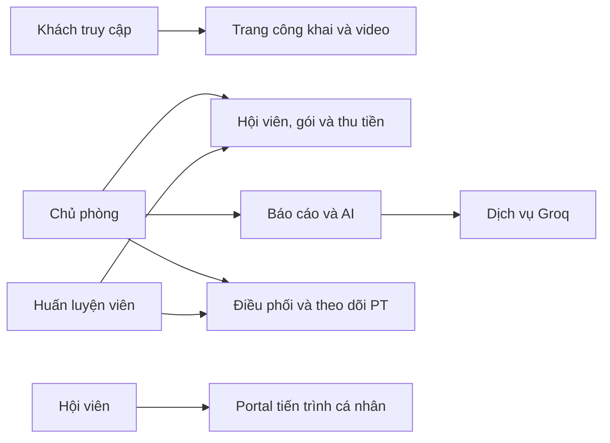

Sơ đồ thể hiện nhóm tương tác tổng quát, không thay thế ma trận quyền ở controller và kiểm tra phạm vi dữ liệu trong service.

### 3.1.5. Ma trận chức năng theo vai trò

| Chức năng | Khách | OWNER | PT | MEMBER |
| --- | --- | --- | --- | --- |
| Xem trang công khai, video công bố | Có | Có | Có | Có |
| Quản lý hồ sơ hội viên và bán gói | Không | Có | Có điều kiện theo service | Không |
| Thu tiền / xem công nợ | Không | Có | Có điều kiện theo hội viên | Xem dữ liệu của mình trên portal |
| Gán và theo dõi PT | Không | Quản lý toàn phòng | Phạm vi được phép, tự nhận theo policy | Xem dữ liệu cá nhân |
| Chuyển PT phụ trách | Không | Có | Không | Không |
| Dashboard, báo cáo và AI | Không | Có | Không theo route báo cáo | Không |
| Quản lý nhân sự, VietQR, video | Không | Có | Không | Không |
| Xem portal cá nhân | Không | Không theo route MEMBER | Không theo route MEMBER | Có |

Những ô “có điều kiện” không có nghĩa PT được xem hoặc thay đổi mọi hội viên. Cần đọc controller và `MemberAccessService`, `PtAssignmentPolicy`, `PtService` cho từng thao tác. Một số trang frontend và API có phạm vi khác nhau; ví dụ route Nhắc việc cho OWNER/PT, trong khi endpoint notifications của dashboard yêu cầu OWNER.

### 3.1.6. Đặc tả use case: đăng ký gói và thu ban đầu

**Mục tiêu:** tạo một lượt đăng ký cho hội viên và ghi nhận khoản đã thực sự thu, nếu có.

**Tác nhân:** OWNER hoặc PT được phép thao tác với hội viên.

**Tiền điều kiện:** hội viên tồn tại; gói đang được phép bán; người thao tác có quyền. Các dữ liệu giá, giảm giá, ngày và số tiền phải hợp lệ.

**Luồng chính:**

1. Người thao tác mở hồ sơ hội viên và chọn đăng ký/gia hạn.
2. Chọn gói, ngày bắt đầu, giá bán, giảm giá và số tiền thu ngay.
3. Nếu thu ngay lớn hơn 0, nhập phương thức và ngày thu thực tế.
4. Backend kiểm tra quyền, gói, số tiền, thời hạn và xác định ngày bắt đầu thực tế.
5. Backend lưu lượt đăng ký; nếu số phải thu sau giảm giá lớn hơn 0, tạo bản ghi nợ; nếu có thu ban đầu, tạo phiếu thu và cập nhật số dư. Bản ghi nợ có thể chuyển ngay sang PAID nếu thu đủ.
6. Nếu gói thuộc loại PT, hệ thống tạo gói buổi tương ứng. Giao diện tải lại dữ liệu từ kết quả xử lý.

**Luồng thay thế:** thu ngay bằng 0 không tạo phiếu thu ban đầu; khoản phải thu hợp lệ trở thành công nợ. Ngày thu trong tương lai bị từ chối. Gói lịch sử được giữ ngày yêu cầu nhưng kiểm tra chồng thời hạn; gói hiện tại/tương lai có thể được đẩy đến sau ngày kết thúc của gói liên quan theo thuật toán hiện hành.

**Hậu điều kiện:** các bản ghi hợp lệ được lưu trong transaction; doanh thu thực thu tương ứng phiếu thu, không tự bằng toàn bộ giá gói khi khách còn nợ.

### 3.1.7. Đặc tả use case: thu công nợ

**Mục tiêu:** ghi một lần thu cho khoản nợ đang hợp lệ.

**Luồng chính:** chọn hồ sơ nợ, nhập số tiền, ngày thu và phương thức; backend kiểm tra quyền, liên kết hội viên–nợ–gói, số tiền dương không vượt số còn nợ và ngày không ở tương lai; lưu một phiếu thu rồi đồng bộ khoản nợ và lượt đăng ký.

**Ngoại lệ:** nợ đã thanh toán/hủy, sai hội viên, sai liên kết gói hoặc số tiền vượt số dư bị từ chối. Hai lần thu khác nhau được lưu thành hai phiếu, mỗi phiếu có phương thức và ngày riêng.

### 3.1.8. Đặc tả use case: phân công và ghi buổi PT

**Mục tiêu:** xác định PT phụ trách và ghi nhận một buổi huấn luyện hoặc ôn tập vào đúng gói.

**Tiền điều kiện:** PT, hội viên và gói đáp ứng điều kiện nghiệp vụ; thao tác thuộc phạm vi người dùng. Khi gán, backend kiểm tra hạn phân công theo gói và trạng thái tương ứng.

**Luồng chính:** chủ phòng hoặc PT hợp lệ tạo phân công; PT và hội viên thống nhất lịch; người vận hành có thể tạo lịch hẹn; sau hoạt động thực tế, người có quyền ghi buổi vào gói tương ứng. Hệ thống kiểm tra ngày, gói, định mức và trùng lặp trước khi lưu.

**Điểm cần phân biệt:** lịch hẹn là kế hoạch, không tự trừ buổi. Số đo cơ thể và mục tiêu là các bản ghi riêng, không tự sinh khi lưu buổi tập. Theo `PtService` hiện tại, hai trạng thái buổi PT `COMPLETED` và `MISSED` thuộc nhóm tiêu buổi; `CANCELLED` và `RESCHEDULED` không thuộc nhóm đó. Chính sách xử lý khách vắng cần được chủ phòng xác nhận trước khi vận hành thực tế. Form ghi buổi gửi trạng thái `COMPLETED`; khi có lịch `SCHEDULED` phù hợp với ngày ghi và PT của gói, người vận hành phải chọn rõ lịch để liên kết hoặc chọn ghi độc lập. Nếu chọn lịch, request gửi `scheduleId` và service cập nhật trạng thái lịch. Hệ thống không tự ghép buổi vào lịch chỉ dựa trên ngày, nhằm tránh cập nhật nhầm khi một khách có nhiều lịch.

### 3.1.9. Đặc tả use case: AI cố vấn

OWNER chọn kỳ và yêu cầu phân tích tại trang báo cáo. Backend tổng hợp dữ liệu, tạo các phân đoạn theo quy tắc và gửi payload tổng hợp tới Groq nếu có cấu hình. Kết quả được chuẩn hóa để hiển thị; khi phát sinh lỗi xử lý AI, hệ thống có nội dung dự phòng.

Sau khi đã có kết quả tổng quan, OWNER có thể nhập ba tỷ lệ giả định cho thu công nợ, khôi phục nhóm PT rủi ro và gia hạn/quay lại. Backend validation tỷ lệ `0..100`, tính các giá trị kịch bản bằng calculator và chỉ sau đó mới yêu cầu Groq diễn giải ưu tiên/lưu ý. Kịch bản là request chỉ đọc: không lưu lịch sử, không tạo phiếu thu/công nợ, không đổi gói/trạng thái và không tự liên hệ khách.

Các nhóm có thể chồng lắp, vì vậy không cộng số khách ở mọi nhóm để suy ra tổng khách duy nhất. Doanh thu rủi ro là chỉ báo ước tính, không phải doanh thu chắc chắn sẽ mất; nội dung AI cần người quản lý xem xét. Chức năng không tự nhắn tin hoặc tự thay đổi gói của khách.

### 3.1.10. Đặc tả use case: đăng nhập

| Thành phần | Đặc tả |
| --- | --- |
| Mục tiêu | Xác minh thông tin đăng nhập, cấp token để người dùng truy cập các chức năng theo quyền. |
| Tác nhân | OWNER, PT hoặc MEMBER đã có tài khoản. |
| Điều kiện trước | Tài khoản tồn tại, có trạng thái cho phép đăng nhập và chưa bị giới hạn bởi bộ đếm login. |
| Đầu vào | Định danh email hoặc số điện thoại, mật khẩu, tùy chọn ghi nhớ phiên. |
| Kết quả thành công | Cấp JWT, trả thông tin người dùng và thời hạn; cập nhật lần đăng nhập gần nhất. |
| Trường hợp sai | Sai định danh/mật khẩu hoặc tài khoản không cho phép đăng nhập được xử lý bằng phản hồi lỗi; bộ đếm thất bại được cập nhật theo nhánh hiện hành. |
| Trường hợp bị giới hạn | Trả HTTP 429 với thời gian chờ, không tiếp tục xác thực ở lần thử đó. |

`AuthService.login` kiểm tra giới hạn trước, tra user và so khớp mật khẩu sau. Ở trường hợp đăng nhập thành công, bộ đếm của định danh và IP của request được xóa. Dùng chung IP có thể khiến thất bại của nhiều người ảnh hưởng cùng bộ đếm IP.

### 3.1.11. Đặc tả use case: tạo và tra cứu hội viên

**Tác nhân:** OWNER hoặc PT có quyền theo endpoint. **Mục tiêu:** lưu hồ sơ một người đến tập, phục vụ gán gói và tra cứu sau này.

1. Người thao tác nhập thông tin như họ tên, điện thoại, ngày sinh, nguồn khách và ghi chú theo form hỗ trợ.
2. Frontend gửi request tới `MemberController`. DTO, service và ràng buộc database xử lý các điều kiện tương ứng.
3. Số điện thoại Việt Nam được chuẩn hóa theo `VietnamPhoneNormalizer` trước khi các luồng liên quan lưu/tra cứu.
4. Sau khi lưu, hội viên có hồ sơ nhưng **chưa tự có gói, công nợ, tài khoản portal hay lịch PT**. Các bản ghi đó phát sinh từ các thao tác riêng.
5. Danh sách và chi tiết hiển thị theo quyền, trạng thái và lựa chọn gói áp dụng; người dùng cần kiểm tra lại thông tin nhập trước khi đăng ký gói.

**Trường hợp cần xử lý:** thiếu trường bắt buộc, số không thuộc định dạng được chấp nhận, số đã trùng hoặc người gọi không có quyền. Ghi chú của hội viên có thể chứa thông tin nhạy cảm; không nên đưa dữ liệu thật vào ảnh báo cáo.

### 3.1.12. Đặc tả use case: cấp portal cho hội viên

**Tác nhân:** OWNER. **Mục tiêu:** liên kết một tài khoản MEMBER với hồ sơ hội viên để khách tự theo dõi dữ liệu.

1. Chủ phòng mở hồ sơ hội viên và tạo tài khoản theo biểu mẫu. Nút cấp chỉ khả dụng khi hội viên đang hoạt động và có gói hiệu lực.
2. Backend kiểm tra quyền, trạng thái `ACTIVE`, ít nhất một membership hiệu lực hôm nay, dữ liệu tài khoản và chính sách mật khẩu; sau đó liên kết user với member theo logic trong `MemberService`.
3. Hội viên đăng nhập bằng thông tin tài khoản được cấp và truy cập `/my-progress`.
4. `MemberPortalController` lấy user đã xác thực; `MemberPortalService` tìm hội viên bằng user ID và chỉ tổng hợp dữ liệu của hội viên đó.
5. OWNER có thể thao tác trạng thái, reset mật khẩu hoặc gỡ liên kết qua các endpoint tương ứng; việc đổi/reset mật khẩu có cơ chế làm token cũ không còn hợp lệ.

Nếu tài khoản chưa liên kết hồ sơ hoặc hội viên đã ngừng hoạt động theo kiểm tra service, portal không trả dữ liệu bình thường. Việc người khác biết số điện thoại không đủ để xem portal; hệ thống hiện dùng tài khoản và mật khẩu.

`createPortalAccount` cần hội viên `ACTIVE`, số điện thoại, ít nhất một membership hiệu lực hôm nay và kiểm tra trùng/khả năng tái sử dụng tài khoản. Rule dùng `MembershipLifecyclePolicy`, vì vậy gói tương lai, chờ thanh toán, hết hạn hoặc hủy không đủ điều kiện cấp mới. Service không yêu cầu loại gói PT: khách tự tập có gói hiệu lực vẫn có thể được cấp để xem dữ liệu cá nhân. Khi xóa liên kết, service có thể xóa user portal thỏa điều kiện hoặc khóa user chỉ có role MEMBER theo nhánh xử lý; không đồng nhất thao tác này với xóa hồ sơ hội viên. Portal đã cấp không tự bị xóa chỉ vì gói sau đó hết hạn.

### 3.1.13. Đặc tả use case: quản lý danh mục gói

OWNER tạo gói với loại, giá, thời hạn và định mức buổi cần thiết; các thông tin được kiểm tra bởi request và service. Danh mục gói đang active được sử dụng trong luồng bán, còn danh mục quản trị cho OWNER có thể bao gồm gói inactive. Ngừng bán một gói không đồng nghĩa xóa lịch sử các lượt đăng ký đã có.

Khi bán, service lưu giá thực tế và giảm giá trên `MemberMembership`, nhờ vậy cần phân biệt giá được đề xuất trên danh mục với số đã ghi ở lượt đăng ký. `PlanType` và `PtLevel` được dùng để xác định nhóm doanh thu; chúng không đồng nghĩa có hệ thống đánh giá năng lực hay tính lương PT tự động.

### 3.1.14. Đặc tả use case: ghi số đo và mục tiêu

**Số đo:** người có quyền chọn học viên, ngày đo và ít nhất một chỉ số; backend kiểm tra quyền, ngày và validation rồi tạo `BodyMeasurement`. Một lần đo mới bổ sung lịch sử, không thay thế mục tiêu của học viên.

**Mục tiêu:** người có quyền nhập loại mục tiêu, mô tả, các mốc ngày và chỉ số mục tiêu được biểu mẫu hỗ trợ; backend tạo `PtGoal`. Service kiểm tra quan hệ ngày và PT trong phạm vi tương ứng. Giá trị mục tiêu không phải số đo thực tế, cũng không thể tự chứng minh kết quả sức khỏe.

UI có thể chỉ hiển thị một phần trường của entity/API. Chẳng hạn dữ liệu model có `targetBodyFat` nhưng không nên mặc định form hoặc biểu đồ MVP đều cho nhập và theo dõi trường đó.

### 3.1.15. Đặc tả use case: nhắc việc

Trang nhắc việc hỗ trợ người vận hành theo dõi các tình huống như gói sắp hết hạn, nợ hoặc sinh nhật từ dữ liệu mà giao diện sử dụng. Một số logic xây dựng danh sách nằm tại frontend; endpoint `/v1/notifications` của dashboard lại là endpoint riêng có quyền OWNER. Phải đối chiếu từng màn hình và nguồn dữ liệu khi giải thích số lượng, không coi mọi nhắc việc là một bảng notification được lưu sẵn.

Nhắc việc không đồng nghĩa hệ thống đã tự động gửi tin Zalo hay SMS. Các liên kết Zalo mở kênh liên lạc để người dùng thao tác, không chứng minh có API gửi tin tự động.

### 3.1.16. Đặc tả use case: quản lý nhân sự

OWNER xem danh sách nhân sự, tạo tài khoản, cập nhật role/trạng thái hoặc reset mật khẩu qua các endpoint `team-users`. Backend phải kiểm tra role hợp lệ, chính sách mật khẩu và các điều kiện đối với tài khoản đang thao tác. `lastLoginAt` cho biết thời điểm đăng nhập thành công gần nhất được lưu; trường này không phải nhật ký đầy đủ mọi thao tác.

Khi chủ phòng trực tiếp dạy, tài khoản cần role PT và profile phù hợp với những thao tác yêu cầu PT. Các luồng seed owner và tạo/chuyển nhân sự thành OWNER hiện chuẩn bị role PT cùng profile nếu thiếu như mục 3.1.1; tài khoản và profile vẫn phải đáp ứng trạng thái được service kiểm tra. `PtProfile` chỉ lưu thông tin vận hành, không có trường lương, tỷ lệ dạy hoặc hoa hồng và không có nghiệp vụ kết toán lương.

### 3.1.17. Đặc tả use case: video, xuất dữ liệu và đồng bộ

OWNER quản lý danh mục, thông tin bài tập, URL TikTok và trạng thái công bố. Khách xem được nội dung công khai theo điều kiện service. Hệ thống không tự sở hữu hoặc sao lưu video TikTok; khả năng hiển thị phụ thuộc bên thứ ba.

OWNER có thể xuất dữ liệu được giao diện chuẩn bị thành XLSX. Luồng đồng bộ Sheets dùng URL Apps Script và token do người dùng cấu hình trong trình duyệt; nó có thể gửi dữ liệu hồ sơ và giao dịch. Người vận hành cần kiểm tra đích nhận và quyền truy cập. Khác với dữ liệu tổng hợp gửi Groq, luồng Sheets không nên được quảng bá là đã ẩn danh.

## 3.2. Thiết kế kiến trúc

### 3.2.1. Sơ đồ tổng thể

**Hình 3.2. Kiến trúc tổng thể hệ thống**

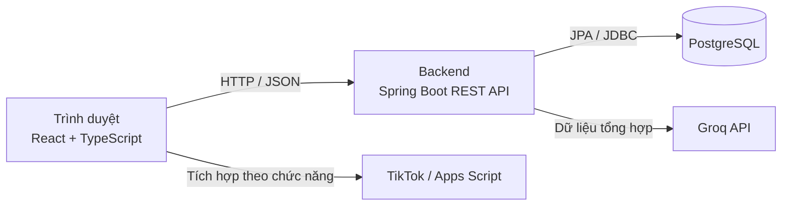

Trình duyệt gọi backend cho nghiệp vụ. Riêng tích hợp Groq được thực hiện từ backend; xuất XLSX và gọi Apps Script thuộc luồng frontend. Hình không hàm ý các dịch vụ ngoài là một phần của database hoặc được triển khai cùng ứng dụng.

### 3.2.2. Cấu trúc backend

| Nhóm mã | Trách nhiệm tiêu biểu |
| --- | --- |
| `auth`, `user` | Đăng nhập, đổi mật khẩu, quản lý tài khoản và role. |
| `member`, `membership` | Hồ sơ, portal, bảng giá và lượt đăng ký gói. |
| `finance` | Phiếu thu và công nợ. |
| `pt`, `training` | Profile, phân công, lịch, gói buổi, nhật ký, số đo và mục tiêu. |
| `dashboard`, `ai` | Tổng hợp vận hành và cố vấn giữ chân/doanh thu. |
| `exercise` | Danh mục và video bài tập. |
| `common` | Bảo mật, cấu hình, exception, enum, thời gian và tiện ích dùng chung. |

Một yêu cầu điển hình được xử lý theo chuỗi controller → DTO/validation → service/policy → repository → entity/database → response DTO. Tùy nghiệp vụ, một service có thể phối hợp nhiều repository trong transaction.

### 3.2.3. Cấu trúc frontend

`frontend/src/app` quản lý ứng dụng, route và guard; `features` chia theo màn hình/nghiệp vụ; `shared` chứa API client và thành phần dùng chung; `layouts` tổ chức khung giao diện. Cách chia theo feature giúp tìm nhanh API client, kiểu dữ liệu và trang tương ứng nhưng không thay thế quy tắc kiểm tra ở backend.

## 3.3. Thiết kế các luồng xử lý

### 3.3.1. Luồng đăng nhập

**Hình 3.3. Trình tự đăng nhập**

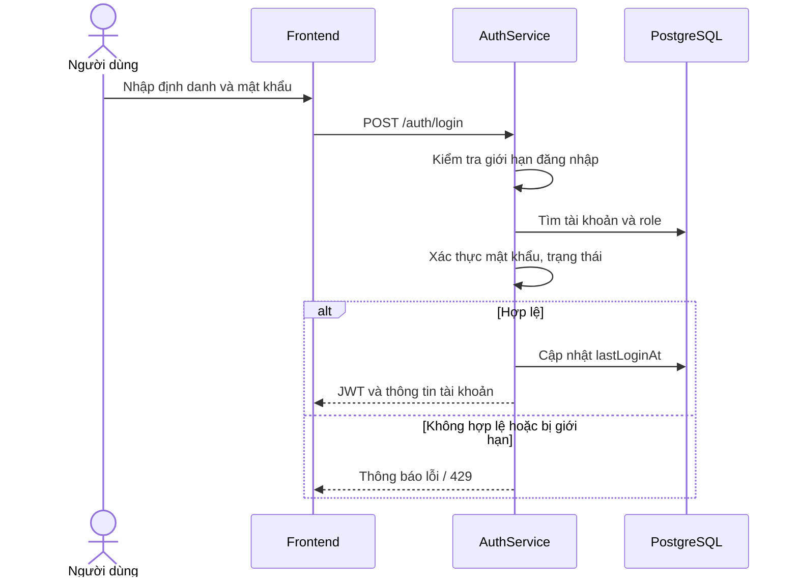

Bộ đếm thất bại login được giữ trong bộ nhớ tiến trình, theo định danh và IP server nhìn thấy. Năm lỗi phải nằm trong cửa sổ theo dõi 15 phút tính từ lần sai đầu; ngay tại lỗi thứ năm, code đặt `lockedUntil` bằng thời điểm đó cộng 15 phút và response trả `429` cùng `Retry-After` gần 900 giây. Nhập đúng trong lúc bị chặn cũng không vượt qua bước kiểm tra. Restart làm mất bộ đếm; hệ thống chưa dùng bộ đếm phân tán.

### 3.3.2. Luồng đăng ký và thu ban đầu

**Hình 3.4. Trình tự đăng ký gói và thu tiền ban đầu**

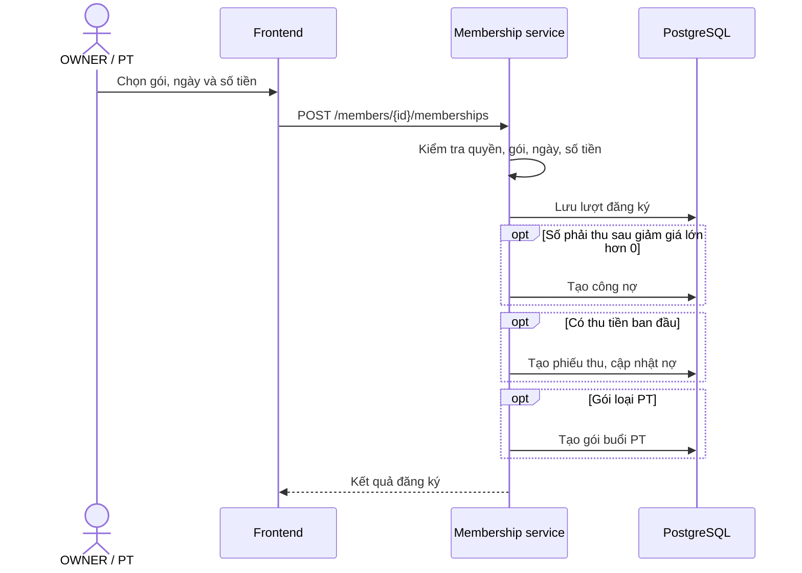

Các thao tác database nằm trong ranh giới transaction của service. Hình là sơ đồ nghiệp vụ rút gọn, không thể hiện từng lời gọi repository hoặc mọi nhánh exception.

### 3.3.3. Quy tắc giá và ngày

Ví dụ gói giá thực tế 11.200.000 đồng, giảm 0, thu trước 5.000.000 đồng bằng chuyển khoản:

| Đại lượng | Giá trị |
| --- | ---: |
| Giá bán thực tế | 11.200.000 đồng |
| Giảm giá | 0 đồng |
| Cần thu = giá thực tế − giảm giá | 11.200.000 đồng |
| Phiếu thu ban đầu | 5.000.000 đồng |
| Công nợ còn lại | 6.200.000 đồng |

Nếu sau đó thu thêm 6.200.000 đồng tiền mặt, hệ thống có hai phiếu thu riêng và công nợ về 0. Mỗi phiếu được tổng hợp theo `paymentDate`; hai phiếu ở hai tháng khác nhau không tự dồn vào tháng đầu hoặc tháng nhập liệu. Ngày thu có thể trước ngày bắt đầu gói, chẳng hạn khách đặt cọc trước; backend hiện chỉ từ chối ngày thu tương lai, không bắt buộc ngày thu phải từ ngày bắt đầu gói trở đi. Người nhập cần đối chiếu với ngày nhận tiền thực tế.

Thời hạn mặc định được tính cả ngày bắt đầu và kết thúc: `endDate = startDate + durationDays - 1`; API cũng cho phép chỉ định ngày kết thúc hợp lệ. Với ngày bắt đầu yêu cầu từ hôm nay trở đi, service tìm ngày kết thúc lớn nhất của các lượt chưa hủy có ngày kết thúc không trước ngày yêu cầu, rồi nếu tìm thấy thì đặt ngày bắt đầu thực tế vào ngày kế tiếp. Thuật toán này có thể đẩy lượt mới qua cả một gói tương lai đã tồn tại, không chỉ qua gói đang hiệu lực; giao diện cần được đối chiếu lại với kết quả trả về. Với ngày bắt đầu trong quá khứ, service giữ ngày yêu cầu và từ chối nếu khoảng ngày chồng với lượt chưa hủy.

Khi chọn gói đại diện để hiển thị, policy ưu tiên gói đang hiệu lực tại ngày xét, sau đó xét gói tương lai gần nhất hoặc gói đã hết hạn gần nhất. Trạng thái lưu và hiệu lực theo ngày không luôn là cùng một khái niệm; không có scheduler tự đồng bộ toàn bộ enum hết hạn.

### 3.3.4. Luồng ghi buổi PT

**Hình 3.5. Trình tự ghi nhận buổi PT**

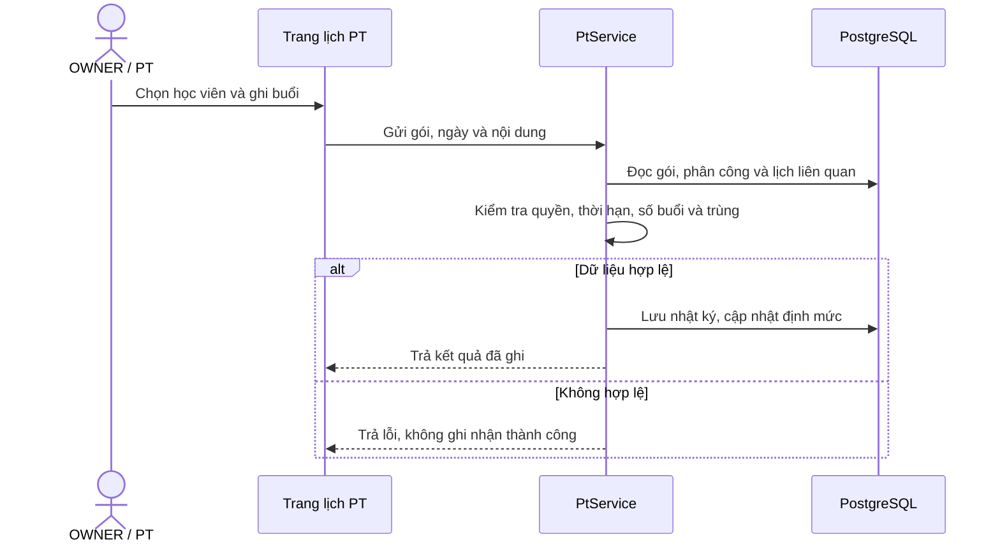

Nếu request có `scheduleId`, service kiểm tra lịch đang `SCHEDULED`, đúng hội viên, ngày và PT theo điều kiện áp dụng; khi lưu nhật ký hợp lệ, trạng thái lịch được chuyển tương ứng với trạng thái nhật ký. Request API vẫn cho phép ghi buổi không gắn lịch. Trên `PtSchedulePage.tsx`, khi có lịch phù hợp, người dùng phải chọn lịch cụ thể hoặc chọn “ghi buổi độc lập”; lựa chọn lịch sẽ gửi `scheduleId`. Cách này đồng bộ khi có chủ đích mà không tự ghép nhầm lịch chỉ trùng ngày.

Backend kiểm tra gói còn hiệu lực và còn buổi PT trước khi phân nhánh theo status, kể cả khi status là `CANCELLED` hoặc `RESCHEDULED`; hai trạng thái đó không tiêu định mức nhưng không có nghĩa được ghi khi gói đã hết buổi. Ôn tập sử dụng nhánh activity riêng với định mức và kiểm tra trùng tương ứng. Số đo được cập nhật khi thực sự đo, không cần giả định phải đo sau mọi buổi.

### 3.3.5. Luồng AI

**Hình 3.6. Trình tự phân tích giữ chân và doanh thu**

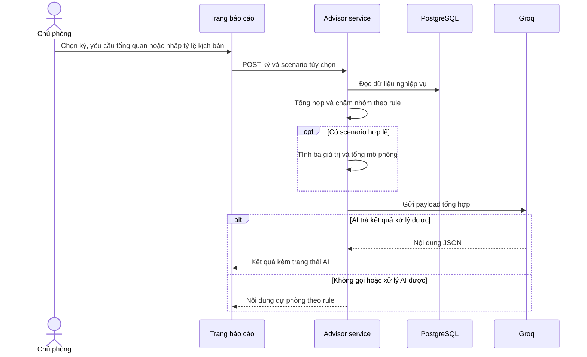

Ví dụ rule trong mã nguồn: gói còn tối đa 7 ngày được xét nhóm sắp hết hạn; gói PT còn tối đa 14 ngày và còn ít nhất 35% buổi PT có thể thuộc nhóm còn nhiều buổi gần hết hạn; gián đoạn hoạt động được xét theo mốc 21 ngày. Ngưỡng cụ thể phải được đối chiếu lại khi code thay đổi. Các phép đánh giá hiện trạng dùng ngày hiện tại, trong khi doanh thu có thể theo tháng được chọn; do đó chọn tháng quá khứ không tạo snapshot rủi ro hoàn chỉnh của tháng đó.

Với kịch bản, request chỉ hợp lệ khi có đủ ba tỷ lệ nguyên `0..100`: thu công nợ, khôi phục nhóm PT rủi ro và gia hạn/quay lại. `RetentionRevenueScenarioCalculator` tính tiền bằng backend trước khi gọi Groq. Nền gia hạn/quay lại loại bỏ các hội viên đã nằm trong nền PT rủi ro để không cộng lặp trong hai nhánh giữ chân. Kịch bản không tạo phiếu thu, công nợ, lượt đăng ký, lịch hay thay đổi trạng thái; nó chỉ trả response cho lần phân tích đang thực hiện.

### 3.3.6. Kiểm tra JWT và phân quyền theo request

**Hình 3.9. Kiểm tra JWT và quyền của request**

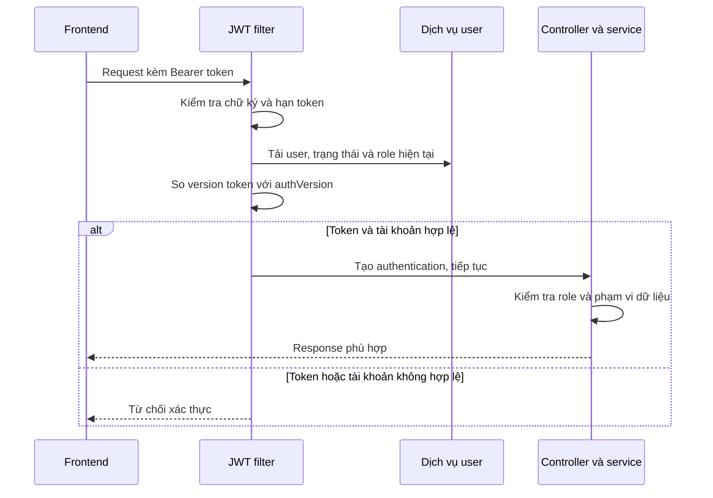

`JwtService` tạo token có header `alg=HS256`, ký HMAC-SHA256 từ secret cấu hình. Payload có `sub`, `uid`, `name`, `roles`, `ver`, `iat`, `exp`. Base64URL không phải mã hóa bảo mật: không đưa mật khẩu, key hoặc dữ liệu bí mật vào payload JWT.

Khi request có Bearer token, filter xác minh token, lấy định danh `sub`, tải lại user và quyền hiện tại, kiểm tra tài khoản còn hoạt động và so `ver` với `authVersion`. Sau đó authentication mới được đặt vào `SecurityContext`. Việc tải user từ database có nghĩa đây không phải cách kiểm tra chỉ dựa trên payload mà không chạm dữ liệu tài khoản.

Sau filter, `@PreAuthorize` và service tiếp tục quyết định request có được phép thao tác với dữ liệu cụ thể không. Nếu không có token hợp lệ, request vào vùng yêu cầu xác thực bị từ chối; có token hợp lệ nhưng thiếu quyền là tình huống khác.

### 3.3.7. Giới hạn đăng nhập

**Hình 3.10. Giới hạn số lần đăng nhập**

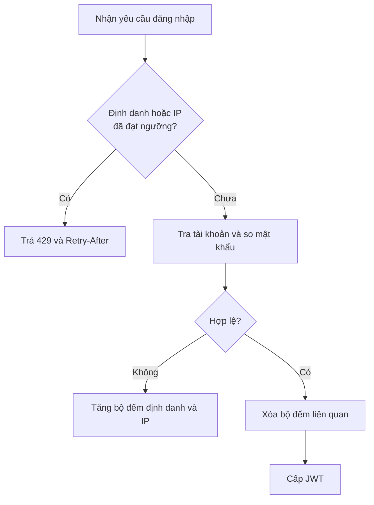

| Thời điểm giả định | Bộ đếm / phản ứng |
| --- | --- |
| 10:00 | Lần sai đầu, cửa sổ 15 phút bắt đầu. |
| 10:01–10:14 | Các lần sai tiếp theo làm tăng bộ đếm trong cửa sổ. |
| Sau lần sai thứ năm | Lần thử kế tiếp có thể bị 429 nếu định danh hoặc IP còn ở cửa sổ đang chặn. |
| Sau khi cửa sổ hết | Có thể thử lại theo bộ đếm mới. |

Không diễn đạt “mỗi lần sai thứ năm sẽ luôn khóa thêm đúng 15 phút”: thời gian còn lại phụ thuộc lần sai đầu của cửa sổ. Kiểm tra và tăng bộ đếm là các bước riêng; không tự hứa ngưỡng tuyệt đối trong mọi tình huống request đồng thời.

### 3.3.8. Đổi mật khẩu và thu hồi JWT

**Hình 3.11. Đổi mật khẩu và thu hồi token cũ**

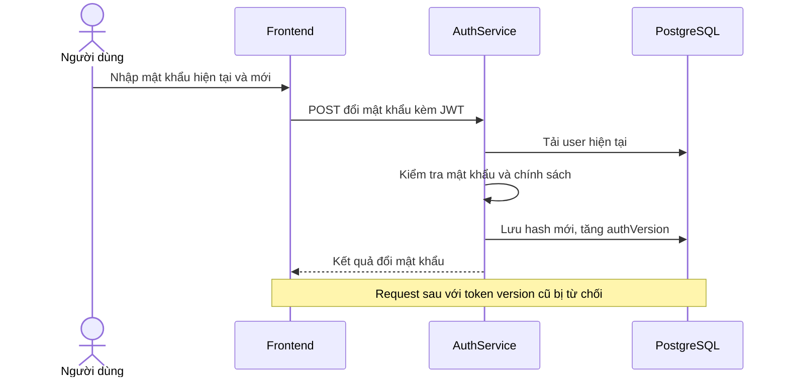

Version là một số được lưu trên user và được nhúng vào token khi cấp. Sau đổi/reset, token đã cấp không bị sửa nội dung, nhưng lần request tiếp theo sẽ thất bại khi filter đối chiếu version. Khi kiểm thử, nên dùng tài khoản demo và tạo phiên đăng nhập lại; không đưa token vào báo cáo.

`rememberMe` trong `AuthService` chọn thời hạn token 30 ngày khi bật; khi không bật dùng `JWT_ACCESS_TOKEN_MINUTES` theo cấu hình. `authStorage.ts` dùng localStorage cho phiên ghi nhớ và sessionStorage cho phiên không ghi nhớ. Cả hai là storage trình duyệt có thể bị JavaScript cùng origin truy cập; JWT ký không đồng nghĩa bảo vệ khỏi XSS.

### 3.3.9. Thu công nợ theo nhiều đợt

**Hình 3.12. Thu công nợ nhiều đợt**

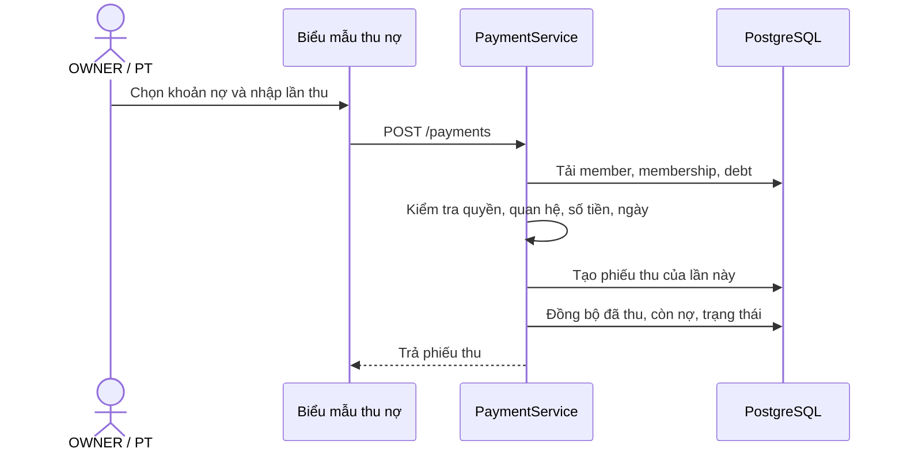

Một phiếu được ghi với chính phương thức và ngày của lần thu. Việc ghi nhận hai phiếu vào hai ngày không biến chúng thành một giao dịch duy nhất. Trong `PaymentService`, nếu không gửi debt ID nhưng có membership, code tìm khoản nợ chưa PAID/CANCELLED theo membership; nếu không tìm được khoản hợp lệ thì từ chối.

Trạng thái khoản nợ sau đồng bộ được quyết định từ số đã thu và còn lại: `OPEN`, `PARTIALLY_PAID` hoặc `PAID`. Bộ lọc `OPEN` trong danh sách nợ còn bao gồm `PARTIALLY_PAID`, nên khi thuyết trình phải nêu rõ ý nghĩa bộ lọc thay vì chỉ nhìn tên enum.

### 3.3.10. Phân công PT và đặt lịch

**Hình 3.13. Phân công và điều phối lịch PT**

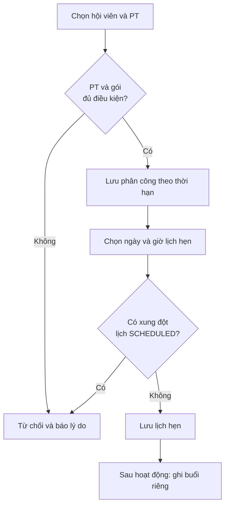

Khi gán, service kiểm tra PT hoạt động, hội viên active và gói PT phù hợp vào ngày bắt đầu; thời hạn phân công không được vượt giới hạn gói phù hợp. OWNER có thể điều chuyển PT theo endpoint riêng; service cập nhật phân công, các gói và lịch phù hợp theo logic hiện hành.

Khi tạo lịch, backend kiểm tra ngày/giờ, quyền thao tác, thông tin học viên và xung đột với lịch `SCHEDULED` của PT hoặc học viên. Hai khoảng 18:00–19:00 và 19:00–20:00 chạm biên nhưng không được coi là chồng theo phép so sánh trong code. Đây là kiểm tra phục vụ điều phối, không tự gửi thông báo bên ngoài.

### 3.3.11. Portal lấy dữ liệu theo tài khoản

**Hình 3.14. Hội viên truy cập portal cá nhân**

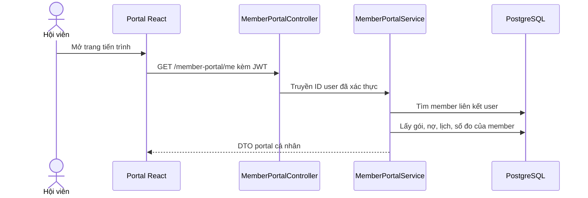

Endpoint lấy member theo user ID từ ngữ cảnh đăng nhập, không yêu cầu client đưa ID hội viên muốn xem. Nếu không có liên kết hoặc member không active, service không trả bộ dữ liệu portal bình thường. DTO có các nhóm dữ liệu nhưng từng field có hiển thị trên UI hay không còn phụ thuộc `MemberPortalPage`.

### 3.3.12. Vòng đời và lựa chọn gói

**Hình 3.15. Vòng đời gói và lựa chọn gói hiển thị**

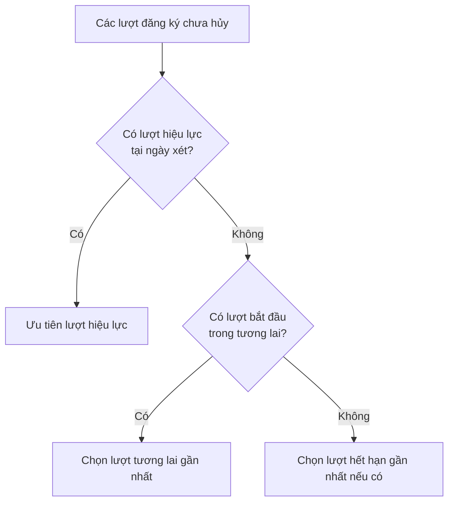

`effectiveStatus` giữ trạng thái hủy và xét ngày kết thúc để trả `EXPIRED`, nhưng `isEffective` còn kiểm tra ngày bắt đầu, ngày kết thúc và trạng thái `ACTIVE`. Vì vậy một lượt lưu `ACTIVE` với ngày bắt đầu trong tương lai có thể chưa hiệu lực hôm nay. Đó không phải bằng chứng có scheduler đã đổi trạng thái của toàn bộ bảng trong database.

## 3.4. Thiết kế cơ sở dữ liệu

### 3.4.1. Nguyên tắc thiết kế

Dữ liệu được tổ chức theo thực thể nghiệp vụ: hồ sơ người, danh mục gói, từng lượt mua, công nợ, từng phiếu thu, phân công và hoạt động tập. Một danh mục gói không đồng nhất với lượt đăng ký của một hội viên; một lượt đăng ký cũng không đồng nhất với phiếu thu.

Các tên bảng dưới đây được đối chiếu theo entity trong mã nguồn, bao gồm bảng liên kết `user_roles`. Đây là mô tả mapping của ứng dụng, **không phải kết quả kiểm kê trực tiếp database của từng máy**. Tuy nhiên, riêng PostgreSQL local dùng để kiểm thử đã được kiểm kê metadata ngày 19/10/2026: có đúng 19 bảng (18 entity và `user_roles`), không thiếu/thừa bảng hoặc cột so với mapping đã kiểm tra. Schema local cũ có thể có dữ liệu hoặc cột tồn dư vì Hibernate `update` không bảo đảm tự xóa toàn bộ cấu trúc cũ. Trong lượt dọn ngày 18/10/2026, database local đã loại năm cột nháp không còn mapping: ba cột payroll ở `pt_profiles`, `membership_plans.price_ratio` và `membership_plans.content_access_level`. Ngày 19/10/2026, sau khi kiểm tra không có số điện thoại hoặc liên kết người dùng trùng, database local được bổ sung UNIQUE cho `members.phone`, `members.user_id` và `pt_profiles.user_id`; lượt kiểm kê constraint cũng xác nhận khóa ngoại `body_measurements.member_id -> members.id` đã tồn tại đúng một lần. Đây là các thao tác bảo trì local có kiểm tra metadata, không phải Flyway migration versioned.

Nhiều entity kế thừa `BaseEntity` có định danh và cột `deleted`; một số kế thừa `AuditableEntity` bổ sung thời gian tạo/cập nhật. Không phải mọi bảng có cùng bộ trường audit; `system_settings` có cấu trúc riêng. Quan hệ tùy trường có thể bắt buộc hoặc cho phép null; cần đọc entity khi thiết kế truy vấn hoặc migration.

### 3.4.2. ERD nhóm hội viên, gói và tài chính

**Hình 3.7. Quan hệ dữ liệu hội viên, gói và tài chính**

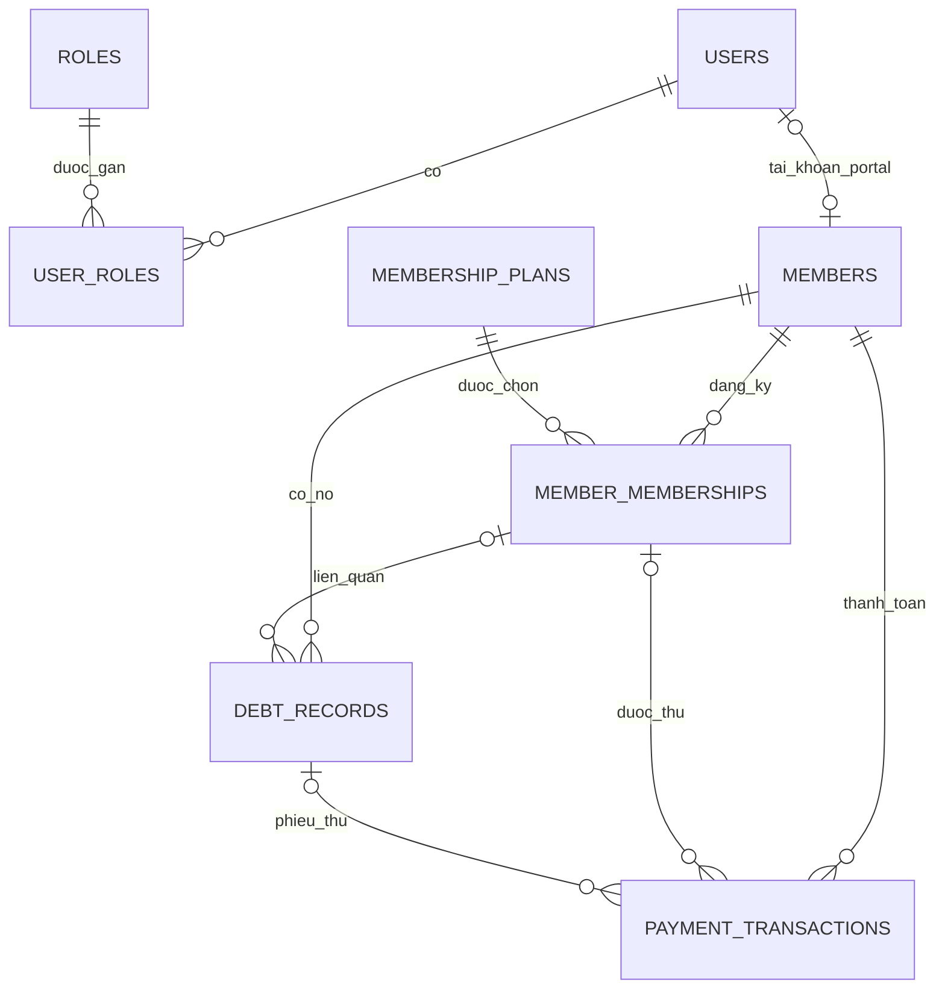

Sơ đồ giản lược các khóa người tạo và trường dữ liệu để khi xuất ảnh vẫn dễ đọc. Bội số cho quan hệ tùy chọn phản ánh mapping entity; các quy tắc service đối với luồng thu thực tế có thể chặt hơn việc cột cho phép null.

### 3.4.3. ERD nhóm huấn luyện và thư viện

**Hình 3.8. Quan hệ dữ liệu huấn luyện và thư viện**

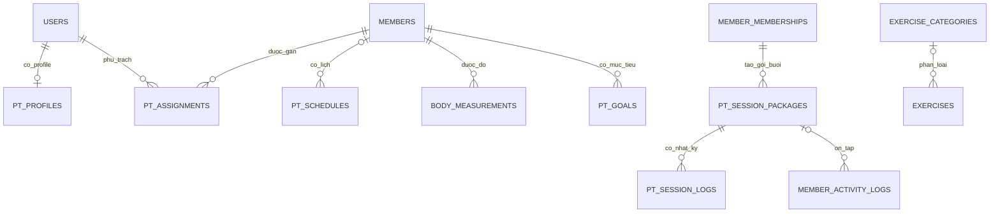

Sơ đồ chỉ trình bày các quan hệ chính. Thực thể lịch, nhật ký và số đo còn có thể tham chiếu user; nhật ký buổi có thể tham chiếu lịch. Không diễn giải một quan hệ tùy chọn trong ERD thành quy tắc bắt buộc cho mọi request.

### 3.4.4. Từ điển dữ liệu: tài khoản và hội viên

| Bảng | Mục đích | Trường / quan hệ cần chú ý |
| --- | --- | --- |
| `users` | Tài khoản đăng nhập | Email, phone, password hash, họ tên, trạng thái, `last_login_at`, `auth_version`. |
| `roles` | Danh mục vai trò | Các mã OWNER, PT, MEMBER. |
| `user_roles` | Liên kết tài khoản–vai trò | Một user có thể có nhiều role; OWNER có thể kiêm PT. |
| `members` | Hồ sơ hội viên | Họ tên, điện thoại, ngày sinh, giới tính, địa chỉ, nguồn, trạng thái, ghi chú; `phone` UNIQUE sau chuẩn hóa và `user_id` UNIQUE khi liên kết portal. |

Mật khẩu chỉ nên được lưu và xử lý dưới dạng hash trong hệ thống; tài liệu và ảnh demo không chứa mật khẩu thật. Dữ liệu số điện thoại hội viên được chuẩn hóa theo logic đang triển khai trước khi xử lý trùng.

### 3.4.5. Từ điển dữ liệu: gói, đăng ký và tài chính

| Bảng | Mục đích | Trường / quan hệ cần chú ý |
| --- | --- | --- |
| `membership_plans` | Danh mục gói | Loại gói, thời hạn ngày, giá mặc định, số buổi PT/ôn tập/hướng dẫn, trạng thái active. |
| `member_memberships` | Từng lượt mua hoặc gia hạn | Member, plan, ngày bắt đầu/kết thúc, giá thực tế, giảm giá, đã thu, còn nợ, status và người bán. |
| `debt_records` | Khoản cần thu | Member, membership có thể liên kết, số gốc, đã thu, còn lại, hạn, trạng thái và version. |
| `payment_transactions` | Từng lần thu thực tế được ghi nhận | Member, membership, debt, ngày thu, số tiền, phương thức, nhóm doanh thu, ghi chú và người tạo. |

Về nghiệp vụ, một lượt đăng ký có thể phát sinh nhiều phiếu thu. `payment_transactions` là nguồn để tổng hợp doanh thu đã ghi nhận; không có bảng chi phí làm căn cứ tính lợi nhuận thực tế trong phạm vi hiện tại.

### 3.4.6. Từ điển dữ liệu: PT và tiến trình

| Bảng | Mục đích | Trường / quan hệ cần chú ý |
| --- | --- | --- |
| `pt_profiles` | Hồ sơ PT | Liên kết user UNIQUE, cấp PT, chuyên môn, giới thiệu và trạng thái hoạt động; không lưu dữ liệu payroll. |
| `pt_assignments` | Phân công học viên | PT, member, khoảng ngày, trạng thái và ghi chú. |
| `pt_schedules` | Lịch hẹn | PT, member có thể liên kết, ngày, giờ, trạng thái, ghi chú, người tạo. |
| `pt_session_packages` | Định mức buổi của lượt đăng ký PT | Member, membership, PT có thể liên kết, tổng/đã dùng/còn lại, thời hạn, trạng thái và version. |
| `pt_session_logs` | Nhật ký buổi PT | Gói buổi, member, PT/lịch liên quan, ngày, số thứ tự buổi tùy chọn, trạng thái, nội dung, cân nặng và ghi chú. |
| `member_activity_logs` | Nhật ký ôn tập hoặc hướng dẫn | Member, membership/gói buổi liên quan, loại hoạt động, ngày, số thứ tự buổi tùy chọn và ghi chú. |
| `body_measurements` | Số đo thực tế | Member bắt buộc bằng khóa ngoại `member_id -> members.id`, ngày đo, người ghi, cân nặng, chiều cao và các vòng đo được hỗ trợ, ghi chú. |
| `pt_goals` | Mục tiêu huấn luyện | Member, PT, loại và mô tả mục tiêu, thời gian, chỉ số mục tiêu, trạng thái. |

`pt_profiles` không chứa lương, tỷ lệ dạy hay hoa hồng. Hệ thống lưu lịch và nhật ký PT để điều phối gói tập và theo dõi tiến trình hội viên, không tự quy đổi các buổi đó thành thu nhập.

### 3.4.7. Từ điển dữ liệu: thư viện và cấu hình

| Bảng | Mục đích | Trường / quan hệ cần chú ý |
| --- | --- | --- |
| `exercise_categories` | Danh mục bài tập | Tên, slug, mô tả, icon, thứ tự và active. |
| `exercises` | Thông tin video bài tập | Danh mục, tên, slug, mô tả, nhóm cơ, độ khó, thiết bị, URL và ID TikTok, trạng thái. |
| `system_settings` | Cấu hình dạng key–value | Các key VietQR, giá trị và thời gian cập nhật. |

Hệ thống hiện không triển khai bộ đếm lượt xem video. TikTok là bên cung cấp nội dung/phát video, không phải nơi lưu hồ sơ hội viên của ứng dụng.

### 3.4.8. Ràng buộc và tính nhất quán

- Kiểm tra dữ liệu đầu vào ở DTO và service, bao gồm ngày, số tiền, trạng thái và quyền.
- Trên PostgreSQL local đã đối chiếu ngày 19/10/2026, UNIQUE `members.phone` bảo vệ số điện thoại hội viên sau chuẩn hóa; UNIQUE trên `members.user_id` và `pt_profiles.user_id` bảo vệ hai quan hệ một-một; khóa ngoại `body_measurements.member_id` ngăn số đo tham chiếu hội viên không tồn tại.
- Đối chiếu `memberId`, `membershipId`, `debtRecordId` và `sessionPackageId` khi nghiệp vụ yêu cầu; các ID cùng tồn tại không tự chứng minh chúng thuộc cùng hội viên hoặc cùng gói.
- Khoản thu không được vượt số nợ còn lại; ngày thu không được ở tương lai.
- Không sử dụng định mức buổi khi gói hoặc ngày hoạt động không thỏa điều kiện service.
- `@Version` hỗ trợ phát hiện cập nhật đồng thời trên nợ và gói buổi; cần kiểm thử với database thật để đánh giá tình huống cạnh tranh.
- Các thao tác có nhiều thay đổi liên quan được đặt trong transaction; lỗi được trả về để người vận hành kiểm tra.

### 3.4.9. Chi tiết bảng lượt đăng ký gói

`MemberMembership` là bản ghi lịch sử của một lần mua/gia hạn; đọc entity và service theo bảng dưới đây.

| Cột / thuộc tính | Kiểu Java / mapping | Ý nghĩa và lưu ý |
| --- | --- | --- |
| `id` | Định danh kế thừa | Dùng phân biệt các lượt mua của cùng hội viên. |
| `member_id` | Quan hệ `ManyToOne`, bắt buộc | Hội viên của lượt đăng ký. |
| `plan_id` | Quan hệ `ManyToOne`, bắt buộc | Danh mục gói được chọn; không đồng nghĩa đã có phiếu thu. |
| `sold_by_user_id` | Quan hệ user, tùy chọn | Người được ghi nhận bán gói theo quy tắc phân quyền. |
| `start_date`, `end_date` | `LocalDate`, bắt buộc | Khoảng ngày của lượt đăng ký, hai đầu được xét trong hiệu lực. |
| `actual_price` | `BigDecimal`, precision 15, scale 2 | Giá bán thực tế của lượt đăng ký. |
| `discount_amount` | `BigDecimal`, precision 15, scale 2 | Số giảm giá áp dụng cho lượt đăng ký. |
| `paid_amount` | `BigDecimal`, precision 15, scale 2 | Tổng đã ghi nhận thu liên quan trong luồng service. |
| `debt_amount` | `BigDecimal`, precision 15, scale 2 | Số còn nợ được đồng bộ trong luồng hiện hành. |
| `status` | Enum lưu dạng chuỗi | Trạng thái lưu; phải kết hợp ngày để xác định hiệu lực thực tế. |
| `note`, `created_by` | Ghi chú và user tùy chọn | Cung cấp ngữ cảnh, không thay thế phiếu thu. |

Các tổng này hữu ích cho truy vấn và hiển thị, nhưng phiếu thu vẫn là nguồn để giải thích từng lần tiền được nhận. Nếu có dữ liệu cũ được sửa ngoài ứng dụng, việc đồng bộ giữa các bảng cần được kiểm tra riêng.

### 3.4.10. Chi tiết bảng công nợ và phiếu thu

| Bảng / trường | Mapping | Vai trò |
| --- | --- | --- |
| `debt_records.member_id` | Member bắt buộc | Xác định người còn phải thanh toán. |
| `debt_records.membership_id` | Membership tùy chọn ở entity | Luồng thu gói hiện hành yêu cầu khoản nợ gắn lượt đăng ký phù hợp. |
| `original_amount` | `BigDecimal(15,2)` | Số phải thu ban đầu của khoản nợ. |
| `paid_amount`, `remaining_amount` | `BigDecimal(15,2)` | Số đã thu và số còn lại; cập nhật trong transaction. |
| `due_date`, `status` | `LocalDate`, enum chuỗi | Hạn thu và trạng thái khoản nợ. |
| `version` | `Long` với `@Version` | Phát hiện xung đột cập nhật đồng thời. |
| `payment_transactions.payment_date` | `LocalDate`, bắt buộc | Ngày thu nghiệp vụ; cơ sở tổng hợp theo kỳ. |
| `payment_transactions.amount` | `BigDecimal(15,2)` | Số tiền của **một** phiếu thu. |
| `payment_method`, `revenue_category` | Enum lưu dạng chuỗi | Phương thức và nhóm doanh thu của phiếu. |
| `debt_record_id`, `membership_id` | Quan hệ tùy chọn ở entity | Được service đối chiếu với hội viên và nợ trong luồng thu. |
| `created_at`, `created_by` | Thời điểm/người tạo | Khác với ngày thu nghiệp vụ khi nhập dữ liệu cũ. |

Ví dụ: ngày thu là 05/06, người quản lý nhập dữ liệu ngày 18/10. `payment_date` cho biết tháng phát sinh tiền; `created_at` cho biết thời điểm bản ghi được tạo. Hai trường có mục đích khác nhau, không mặc định thay thế nhau.

### 3.4.11. Chi tiết gói buổi và nhật ký PT

| Nhóm trường | Ý nghĩa |
| --- | --- |
| `member_id`, `membership_id`, `pt_user_id` | Gắn gói buổi với hội viên và lượt mua; PT có thể chưa được điền tại thời điểm tạo. |
| `total_pt_sessions`, `used_pt_sessions`, `remaining_pt_sessions` | Tổng, đã dùng và còn lại của buổi kèm PT. |
| `total_practice_sessions`, `used_practice_sessions`, `remaining_practice_sessions` | Định mức cho hoạt động ôn tập của gói PT. |
| `start_date`, `end_date`, `status` | Thời hạn và trạng thái gói buổi; cần xét cùng membership. |
| `version` | Bảo vệ cập nhật đồng thời ở mức optimistic locking. |
| `pt_session_logs.session_package_id` | Nhật ký buổi PT gắn một gói buổi cụ thể. |
| `pt_session_logs.schedule_id` | Liên kết lịch là tùy chọn; có lịch thì áp dụng kiểm tra liên quan. |
| `member_activity_logs.session_package_id` | Dùng cho hoạt động ôn tập tương ứng; loại hướng dẫn có nhánh kiểm tra riêng. |

Khi giải thích công thức “còn lại = tổng − đã dùng”, cần coi đó là kỳ vọng nhất quán trong luồng ghi nhận, không chứng minh database cũ không thể đã bị sửa sai từ bên ngoài. `PtService` kiểm tra định mức và dùng transaction khi tiêu buổi.

### 3.4.12. Kiểu ngày, tiền và quan hệ

- `LocalDate` dùng cho ngày nghiệp vụ như bắt đầu gói, ngày thu hoặc ngày tập; không tự chứa múi giờ.
- `Instant` dùng cho một số dấu thời gian như tạo phiếu, lần đăng nhập và số đo. Mã `AppClock` cung cấp ngày theo múi giờ ứng dụng để giảm sai lệch khi xử lý ngày nghiệp vụ.
- `BigDecimal` phù hợp phép tính tiền hơn số thực dấu phẩy động. Precision/scale trên entity là định nghĩa mapping, cần kiểm tra schema thật khi vận hành hoặc migration.
- Quan hệ `ManyToOne(fetch = LAZY)` cho phép nạp liên quan theo cách ORM quản lý. Vì `open-in-view` tắt, việc lấy dữ liệu cho DTO cần được thực hiện trong phạm vi service/transaction phù hợp.
- Các trường quan hệ cho phép null tại entity không tự cho phép mọi nghiệp vụ bỏ qua chúng. Ví dụ phiếu thu trong luồng công nợ được service yêu cầu liên kết hợp lệ.

### 3.4.13. Tính nhất quán và cạnh tranh dữ liệu

Giả sử hai người đồng thời mở một khoản nợ còn 6,2 triệu và cùng cố ghi phiếu. Nếu chỉ dựa vào số tiền đã tải trên trình duyệt, cả hai có thể tưởng số dư vẫn đủ. Với `@Version`, khi các transaction cùng cập nhật một `DebtRecord`, Hibernate có thể phát hiện bản ghi đã đổi version và báo xung đột; `GlobalExceptionHandler` ánh xạ `ObjectOptimisticLockingFailureException` sang HTTP 409.

Khi xảy ra xung đột, người vận hành cần tải lại dữ liệu và kiểm tra số tiền đã thực sự ghi nhận trước khi thử lại. `@Transactional` nhằm đảm bảo phiếu thu và thay đổi số dư cùng commit/rollback trong ranh giới transaction. Mô tả này không thay thế một bài kiểm thử concurrency với database thật và không bảo đảm mọi biến thể race condition đã được kiểm chứng.

### 3.4.14. Nguyên tắc đọc schema thực tế

Mã entity mô tả schema ứng dụng mong đợi; PostgreSQL ở máy đã sử dụng lâu ngày có thể khác do lịch sử thay đổi. Khi kiểm tra thực tế, cần dùng truy vấn chỉ đọc để so bảng, cột, kiểu, khóa ngoại, index và constraint; không kết luận “database sạch 100%” chỉ từ việc compile thành công.

Nếu phát hiện chênh lệch, cần phân loại cột nào vẫn dùng, dữ liệu nào phải giữ và thay đổi nào có thể gây mất dữ liệu. Ngày 18/10/2026, database local chỉ loại năm cột đã xác minh không còn mapping hay tham chiếu. Ngày 19/10/2026, sau bước kiểm tra dữ liệu trùng, database local bổ sung ba UNIQUE (`members.phone`, `members.user_id`, `pt_profiles.user_id`) và xác nhận khóa ngoại `body_measurements.member_id` tồn tại đúng một lần. Hai lượt bảo trì đều không reset hoặc xóa bảng dữ liệu. Không coi đây là quy trình dọn schema chung: với thay đổi schema tiếp theo, không chạy `DROP DATABASE`, reset schema hoặc xóa dữ liệu để “làm sạch” khi chưa có backup, kế hoạch migration và xác nhận của người sở hữu dữ liệu.

## 3.5. Thiết kế API

### 3.5.1. Quy ước chung

Backend mặc định chạy tại `http://localhost:8080/api`; các đường dẫn trong bảng dưới đây đã bao gồm `/api`. Phần lớn API nghiệp vụ trả response theo `ApiResponse`; riêng `GET /v1/health` và Actuator dùng response kiểm tra sức khỏe riêng. Lỗi nghiệp vụ do `GlobalExceptionHandler` và lỗi ở security filter do các handler/nhánh response tương ứng xử lý. Không đưa JWT hay thông tin cá nhân thật vào báo cáo kiểm thử.

| Nhóm | Endpoint tiêu biểu | Quyền và chức năng |
| --- | --- | --- |
| Xác thực | `POST /api/v1/auth/login` | Public; xác thực và nhận JWT. |
| Phiên | `GET /api/v1/auth/me`, `POST /api/v1/auth/change-password` | Người dùng đã xác thực. |
| Hội viên | `GET, POST /api/v1/members`; `GET /api/v1/members/page`; `GET /api/v1/members/statistics`; `GET, PUT /api/v1/members/{id}` | OWNER/PT; có kiểm tra phạm vi, bảng quản trị dùng trang phân trang và KPI riêng. |
| Portal | `GET /api/v1/member-portal/me` | MEMBER xem dữ liệu gắn với tài khoản. |
| Tài khoản portal | `/api/v1/members/{id}/portal-account` và các thao tác status/reset | OWNER quản lý; chỉ cấp mới cho hội viên `ACTIVE` có membership hiệu lực, không bắt buộc gói PT. |
| Gói | `/api/v1/membership-plans`; `/api/v1/public/membership-plans`; `/api/v1/members/{id}/memberships` | Danh mục nội bộ, bảng giá công khai chỉ gồm gói đang bán và đăng ký theo quyền. |
| Thu/nợ | `GET, POST /api/v1/payments`; `GET /api/v1/payments/page`, `/summary`; `GET /api/v1/debts`, `/page` | OWNER/PT, kiểm tra hội viên liên quan; bảng quản trị phân trang, KPI tài chính tách response. |
| PT | `/api/v1/pt/assignments`, `/schedules`, `/members/{memberId}/...` | Phân công, lịch và ghi nhận PT theo method và quyền. |
| Dashboard | `/api/v1/dashboard/owner`, `/api/v1/reports/finance`, `/api/v1/reports/members` | OWNER. |
| AI | `POST /api/v1/ai/retention-revenue-advisor` | OWNER. |
| Cài đặt | `/api/v1/settings/team-users`, `/api/v1/settings/vietqr` | OWNER quản lý nhân sự và VietQR. |
| Public settings | `/api/v1/public/membership-plans`, `/api/v1/public/vietqr-setting` | Public; endpoint gói chỉ trả gói active. Endpoint VietQR trả cấu hình hiện có; frontend chỉ dựng QR khi cấu hình đang bật và đủ dữ liệu nhận tiền. |
| Thư viện | `/api/v1/public/exercises`, `/api/v1/owner/exercises` | Public xem nội dung công bố; OWNER quản lý. |

Bảng là danh mục rút gọn. Tên method, tham số và request/response chính xác cần đối chiếu controller, DTO và tài liệu `plans/active/04-api-design.md`. Không suy ra có endpoint sửa hoặc xóa cho một tài nguyên nếu controller không khai báo.

### 3.5.2. Ví dụ dữ liệu và lỗi

Một request thu nợ có thể chứa định danh hội viên/khoản nợ, số tiền, phương thức và ngày thu. Backend kiểm tra dữ liệu này, không chỉ tin vào việc giao diện đã chọn đúng khách. Nếu bỏ ngày trong request được hỗ trợ, service chọn ngày hiện tại theo đồng hồ ứng dụng; ngày tương lai bị từ chối.

Một phản hồi thất bại có thể do dữ liệu không hợp lệ, không có quyền, không tìm thấy bản ghi, xung đột cập nhật hoặc bị giới hạn. Với HTTP 429, frontend có thể đọc `Retry-After` để biết thời gian chờ. Mã trạng thái không thay thế việc xem nội dung lỗi và ngữ cảnh nghiệp vụ.

### 3.5.3. Ví dụ request và cấu trúc phản hồi

Ví dụ minh họa một lần thu công nợ qua `POST /api/v1/payments`. Các ID và ngày dưới đây là dữ liệu giả, phải thay bằng bản ghi hợp lệ trong database thử; giá trị ngày cũng phải không ở tương lai tại thời điểm thực hiện.

```json
{
  "memberId": 101,
  "debtRecordId": 205,
  "membershipId": 301,
  "paymentDate": "2026-10-01",
  "amount": 6200000,
  "paymentMethod": "CASH",
  "note": "Thu phần công nợ còn lại"
}
```

Request cần JWT của người có quyền. `memberId`, `debtRecordId` và `membershipId` trong ví dụ phải chỉ tới các bản ghi có liên hệ hợp lệ; nếu không, backend từ chối. Request DTO yêu cầu `amount` tối thiểu 1 và có `paymentMethod`. Hai ID nợ/gói có thể không cùng được gửi trong một request, nhưng service vẫn phải resolve và kiểm tra khoản nợ tương ứng.

Cấu trúc chung của `ApiResponse` trong code gồm `success`, `message`, `data`, `error` và `timestamp`. Ví dụ hình dạng sau chỉ minh họa envelope, không phải kết quả của giao dịch ở trên:

```json
{
  "success": true,
  "message": "OK",
  "data": {},
  "error": null,
  "timestamp": "2026-10-01T02:00:00Z"
}
```

Nội dung `data`, mã trạng thái và thông báo cụ thể phụ thuộc endpoint; để kiểm thử phải quan sát response thực tế và DTO tương ứng. Không đưa mật khẩu hoặc JWT vào mẫu báo cáo.

### 3.5.4. Danh mục API chi tiết: xác thực, nhân sự, hội viên

Các đường dẫn trong bảng đã bao gồm context `/api`. Quyền ghi ở đây là lớp controller; các điều kiện trên bản ghi vẫn được service kiểm tra.

| Method | Đường dẫn | Quyền / công dụng |
| --- | --- | --- |
| POST | `/api/v1/auth/login` | Public; xác thực, áp dụng bộ đếm thất bại. |
| GET | `/api/v1/auth/me` | Tài khoản đã xác thực; lấy thông tin hiện tại. |
| POST | `/api/v1/auth/change-password` | Tài khoản đã xác thực; đổi mật khẩu của mình. |
| GET, POST | `/api/v1/settings/team-users` | OWNER; danh sách hoặc tạo nhân sự. |
| PUT | `/api/v1/settings/team-users/{id}/role` | OWNER; cập nhật role. |
| PUT | `/api/v1/settings/team-users/{id}/status` | OWNER; cập nhật trạng thái. |
| POST | `/api/v1/settings/team-users/{id}/reset-password` | OWNER; reset mật khẩu nhân sự. |
| GET, POST | `/api/v1/members` | OWNER/PT; danh sách hoặc tạo hội viên. |
| GET, PUT | `/api/v1/members/{id}` | OWNER/PT; xem/sửa theo phạm vi service. |
| POST, DELETE | `/api/v1/members/{id}/portal-account` | OWNER; tạo Portal khi hội viên `ACTIVE` có gói hiệu lực, hoặc gỡ liên kết. |
| PUT | `/api/v1/members/{id}/portal-account/status` | OWNER; đổi trạng thái tài khoản portal. |
| POST | `/api/v1/members/{id}/portal-account/reset-password` | OWNER; reset mật khẩu portal. |
| GET | `/api/v1/member-portal/me` | MEMBER; dữ liệu của tài khoản đang đăng nhập. |

### 3.5.5. Danh mục API chi tiết: gói, tài chính, PT

| Method | Đường dẫn | Quyền / công dụng |
| --- | --- | --- |
| GET | `/api/v1/membership-plans` | OWNER/PT; danh mục dùng trong luồng nghiệp vụ. |
| GET | `/api/v1/membership-plans/all` | OWNER; danh mục quản trị. |
| POST | `/api/v1/membership-plans` | OWNER; tạo gói. |
| PUT | `/api/v1/membership-plans/{id}/active` | OWNER; đổi trạng thái bán gói. |
| GET, POST | `/api/v1/members/{memberId}/memberships` | OWNER/PT; lịch sử hoặc đăng ký theo phạm vi. |
| GET, POST | `/api/v1/payments` | OWNER/PT; tra cứu hoặc tạo phiếu thu. `/page` là contract phân trang; `/summary` trả KPI tài chính. |
| GET | `/api/v1/debts` | OWNER/PT; tra cứu công nợ theo phạm vi. `/page` là contract phân trang. |
| GET, POST | `/api/v1/pt/profiles` | OWNER/PT; xem/lưu profile theo điều kiện quyền. |
| GET | `/api/v1/pt/my-members` | OWNER/PT; danh sách học viên theo quyền. |
| POST | `/api/v1/pt/assignments` | OWNER/PT; phân công theo điều kiện service. |
| PUT | `/api/v1/pt/assignments/{assignmentId}/reassign` | OWNER; chuyển PT phụ trách. |
| GET, POST | `/api/v1/pt/schedules` | OWNER/PT; đọc hoặc tạo lịch. |
| DELETE | `/api/v1/pt/schedules/{scheduleId}` | OWNER/PT; xóa lịch nếu thỏa điều kiện. |
| GET | `/api/v1/pt/session-packages` | OWNER/PT; gói buổi theo phạm vi. |
| GET | `/api/v1/pt/members/{memberId}` | OWNER/PT; chi tiết PT của học viên. |
| POST | `/api/v1/pt/members/{memberId}/session-logs` | OWNER/PT; ghi nhật ký buổi PT. |
| POST | `/api/v1/pt/members/{memberId}/activity-logs` | OWNER/PT; ghi hoạt động ôn tập/hướng dẫn. |
| POST | `/api/v1/pt/members/{memberId}/body-measurements` | OWNER/PT; ghi số đo. |
| POST | `/api/v1/pt/members/{memberId}/goals` | OWNER/PT; tạo mục tiêu. |

### 3.5.6. Danh mục API chi tiết: báo cáo, cài đặt và thư viện

| Method | Đường dẫn | Quyền / công dụng |
| --- | --- | --- |
| GET | `/api/v1/dashboard/owner` | OWNER; tổng quan vận hành. |
| GET | `/api/v1/reports/finance`, `/api/v1/reports/members` | OWNER; tổng hợp báo cáo. |
| GET | `/api/v1/notifications` | OWNER; dữ liệu nhắc việc backend. |
| POST | `/api/v1/ai/retention-revenue-advisor` | OWNER; yêu cầu phân tích. |
| GET, PUT | `/api/v1/settings/vietqr` | OWNER; đọc/cập nhật cấu hình VietQR. |
| GET | `/api/v1/public/membership-plans` | Public; danh sách gói active với DTO công khai tối thiểu. |
| GET | `/api/v1/public/vietqr-setting` | Public; dữ liệu VietQR cho chức năng hiển thị. |
| GET | `/api/v1/public/exercise-categories`, `/api/v1/public/exercises` | Public; danh mục và bài tập được công bố. |
| GET | `/api/v1/public/exercises/{slugOrId}` | Public; chi tiết bài tập. |
| GET, POST | `/api/v1/owner/exercise-categories`, `/api/v1/owner/exercises` | OWNER; danh sách hoặc tạo. |
| PUT | `/api/v1/owner/exercise-categories/{id}`, `/api/v1/owner/exercises/{id}` | OWNER; cập nhật. |
| PATCH | `/api/v1/owner/exercises/{id}/published` | OWNER; thay đổi trạng thái công bố. |
| DELETE | `/api/v1/owner/exercises/{id}` | OWNER; xóa bài tập theo logic service. |
| GET | `/api/v1/health`, `/api/actuator/health` | Public theo security config; kiểm tra tình trạng backend. |

Xuất XLSX và gửi Google Apps Script không xuất hiện trong bảng API backend vì được frontend xử lý; TikTok và Groq có ranh giới khác nhau như mục 2.8.

### 3.5.7. Xử lý lỗi và mã trạng thái

| Tình huống | Status / mã tiêu biểu trong code | Cách hiểu |
| --- | --- | --- |
| DTO hoặc dữ liệu đầu vào không hợp lệ | 400; `VALIDATION_ERROR`, `BAD_REQUEST` hoặc mã liên quan | Kiểm tra field, định dạng và quy tắc service. |
| Sai mật khẩu hoặc thiếu/xấu token | 401; ví dụ `BAD_CREDENTIALS`, `INVALID_TOKEN` | Chưa được xác thực hợp lệ. |
| Không có quyền | 403; `ACCESS_DENIED` | Đã hoặc đang được đánh giá quyền nhưng không được thực hiện. |
| Không tìm thấy tài nguyên | 404; `RESOURCE_NOT_FOUND` | Bản ghi hoặc tài nguyên được yêu cầu không tồn tại theo logic xử lý. |
| Xung đột nghiệp vụ/cập nhật | 409; `CONFLICT` hoặc `CONCURRENT_UPDATE` | Cần kiểm tra trạng thái và tải lại trước khi thử lại. |
| Vượt giới hạn | 429; `RATE_LIMITED` và `Retry-After` | Chờ theo số giây được trả. |
| Lỗi chưa được xử lý riêng | 500; `INTERNAL_SERVER_ERROR` | Xem log backend an toàn để tìm nguyên nhân, không công bố dữ liệu nhạy cảm. |

Không phải mọi lỗi đều đi qua cùng một handler: lỗi bảo mật trong filter có nhánh response riêng, còn lỗi nghiệp vụ thường do `GlobalExceptionHandler` xử lý.

## 3.6. Bảo mật và phân quyền

### 3.6.1. Mật khẩu và phiên

Chính sách mật khẩu trong `PasswordPolicy` yêu cầu tối thiểu 8 ký tự, có chữ và số, không trùng định danh theo các kiểm tra được triển khai. Chính sách được gọi trong các luồng tạo, đổi và reset liên quan. Đổi/reset làm tăng `authVersion`; token có version không còn phù hợp sẽ bị từ chối khi kiểm tra. `lastLoginAt` được cập nhật sau đăng nhập thành công.

Policy bỏ khoảng trắng ở hai đầu trước khi kiểm tra mật khẩu mới. Với định danh có ít nhất tám chữ số, code còn so chuỗi chữ số rút ra từ mật khẩu với chuỗi chữ số của định danh; vì vậy mật khẩu có thêm chữ nhưng toàn bộ phần chữ số vẫn trùng số điện thoại cũng có thể bị từ chối. Đây là điều kiện thực tế của policy, không chỉ là phép so bằng văn bản nguyên vẹn.

Việc thu hồi token theo version không thay thế mọi biện pháp bảo mật: vẫn cần giữ bí mật JWT, quản lý thiết bị, cấu hình môi trường và đánh giá XSS khi triển khai thực tế.

### 3.6.2. Rate limit

Login dùng giới hạn theo định danh và IP như mục 3.3.1. Bộ lọc endpoint nhạy cảm hiện nhận diện một số request POST như đổi mật khẩu, tạo/reset tài khoản nhân sự hoặc portal, và AI advisor; ngưỡng trong code là 10 request/15 phút theo operation và actor hoặc IP. Không khẳng định backend đã rate-limit việc xuất XLSX hoặc đồng bộ Sheets vì các thao tác đó được thực hiện ở frontend và không nằm trong danh sách filter hiện tại.

Các bộ đếm nằm trong RAM, mất khi khởi động lại và không đồng bộ giữa nhiều instance. IP dùng chung có thể ảnh hưởng nhiều người; khi đặt sau proxy, cần thiết kế lại cách xác định IP tin cậy.

### 3.6.3. Security headers và CORS

Backend áp dụng các header như `X-Content-Type-Options: nosniff`, `X-Frame-Options: DENY`, `Referrer-Policy`, `Permissions-Policy`, CSP cho response API và `Cache-Control: no-store`. CORS được cấu hình cho các origin phát triển. Các header trên response API không tự chứng minh HTML frontend đã có cùng chính sách; CORS không thay thế xác thực hay phân quyền.

### 3.6.4. Bảo vệ dữ liệu trong tích hợp ngoài

Payload AI được thiết kế theo cấu trúc tổng hợp, không đưa các trường tên, điện thoại, email hoặc từng giao dịch cá nhân. Tuy nhiên nhóm rất nhỏ có thể làm tăng rủi ro suy luận; không gọi là ẩn danh tuyệt đối. Khi dùng Google Sheets, dữ liệu gửi từ frontend có thể bao gồm hồ sơ và giao dịch, khác payload AI. Cần kiểm tra nơi nhận, quyền truy cập, cơ sở xử lý dữ liệu và không đưa token vào Git hoặc báo cáo.

### 3.6.5. Các lớp bảo vệ và trách nhiệm

| Lớp | Thành phần | Câu hỏi được giải quyết | Giới hạn |
| --- | --- | --- | --- |
| Điều hướng UI | `ProtectedRoute`, `RoleGuard` | Người dùng có nên thấy trang theo phiên/role? | Không ngăn client gọi API trực tiếp. |
| Security chain | `SecurityConfig`, JWT filter | Request có xác thực hợp lệ và được phép đi vào vùng bảo vệ? | Không thay thế kiểm tra quan hệ của dữ liệu. |
| Method security | `@PreAuthorize` | Role có được gọi nhóm endpoint này? | Hai PT cùng role không mặc nhiên có quyền trên mọi học viên. |
| Chính sách dữ liệu | `MemberAccessService`, `PtAssignmentPolicy`, `PtService` | User có quyền trên học viên/gói/lịch ở thời điểm áp dụng? | Cần xem từng method; không suy rộng một điều kiện cho mọi endpoint. |
| DTO/service validation | Validation annotation và service | Dữ liệu, số tiền, ngày và ID có hợp lệ? | Validation ở một tầng không thay thế kiểm tra ở tầng khác. |
| Database/transaction | FK, unique theo schema, transaction, version | Giảm rủi ro dữ liệu liên kết sai và xung đột ghi. | Constraint thực tế cần đối chiếu database; concurrency cần test. |

Các API public được khai báo riêng. Security chain dùng `STATELESS`, tắt form login và HTTP Basic; CSRF được tắt trong cấu hình hiện tại. Đây là mô tả thiết kế API hiện hành, không phải khuyến nghị áp dụng nguyên xi cho bất kỳ hệ thống dùng cookie hay ứng dụng khác.

### 3.6.6. Giải thích cụ thể quyền PT

`MemberAccessService.canAccessMember` cho OWNER đi qua nhánh quyền tổng quát; với PT, code cần user hiện tại, hội viên ACTIVE và policy PT phù hợp. `PtAssignmentPolicy.canAccessMember` yêu cầu có gói PT truy cập được theo ngày và PT liên quan; sau đó cho phép khi **chưa có bản ghi assignment nào**, hoặc có assignment hiệu lực của chính PT đó.

“Không có bản ghi assignment nào” khác “có lịch sử assignment nhưng không có assignment nào đang hiệu lực”. Nhánh đăng ký gói PT cho khách chưa có phân công có quy tắc riêng trong `ensureCanCreateMembership`. Cần đọc đúng method tương ứng trước khi kết luận PT có quyền bán gói, xem hồ sơ, tạo lịch hay ghi buổi.

Khi PT bán gói, các nhánh `resolveSoldByUser` và `resolvePtUserId` ngăn PT ghi nhận ID người khác làm người bán/người phụ trách theo các điều kiện trong service. OWNER có nhánh xử lý khác. Một OWNER kiêm PT có thể đi qua các nhánh OWNER tại những method kiểm tra OWNER trước; đây không phải cơ chế hai tài khoản độc lập.

### 3.6.7. Mật khẩu, JWT và các giới hạn của token

Mật khẩu được so bằng `PasswordEncoder` BCrypt, không lưu plaintext trong bảng user qua luồng thông thường. Chính sách hiện hành yêu cầu tối thiểu 8 ký tự, có chữ và số và so sánh với các định danh được truyền cho policy. Thay/reset mật khẩu tăng version để token cũ bị từ chối ở request tiếp theo.

Token HS256 được ký với secret cấu hình tại server. Người giữ token có thể gửi request trong thời gian token còn hợp lệ và tài khoản/version được chấp nhận; việc ký không làm nội dung payload trở thành bí mật. Không chụp JWT, mật khẩu hoặc secret vào báo cáo; không dùng secret phát triển mặc định trong hệ thống công khai.

Lựa chọn ghi nhớ làm thời hạn phiên dài hơn và dùng localStorage. Điều này thuận tiện nhưng tăng thời gian phơi nhiễm nếu token bị lộ; cần đánh giá XSS, thiết bị dùng chung và thời hạn phiên trước khi vận hành thật. Đăng xuất ở client xóa token lưu tại trình duyệt; không nên mô tả đó là danh sách thu hồi từng token trên server nếu code không có.

### 3.6.8. Rate limit: cơ chế và giới hạn thực tế

| Loại | Key và cửa sổ | Điều kiện chặn |
| --- | --- | --- |
| Login | Định danh trim/lowercase và IP `getRemoteAddr()`; năm lỗi phải nằm trong cửa sổ theo dõi 15 phút từ lỗi đầu. | Lỗi thứ năm đặt `lockedUntil` mới bằng 15 phút và trả 429 ngay; trong thời gian đó, một trong hai key còn khóa sẽ chặn cả mật khẩu đúng. |
| Thao tác nhạy cảm | Operation và actor đã xác thực, hoặc IP; 15 phút. | Được tiêu thụ tối đa 10 request trong cửa sổ; các request sau bị chặn theo logic filter. |

Login chuẩn hóa key bằng trim/lowercase, trong khi tra cứu user còn có chuẩn hóa số điện thoại. Vì vậy các cách viết khác nhau của một số có thể tạo các key định danh khác nhau, dù bộ đếm IP vẫn được áp dụng. Bộ đếm bị xóa khi process restart, không chia sẻ giữa instance và có thể ảnh hưởng người dùng chung IP. Một proxy cần cấu hình IP tin cậy trước khi có thể sử dụng chiến lược theo IP đáng tin cậy.

Filter nhạy cảm chỉ khớp các path/method được liệt kê trong code; ví dụ reset nhân sự và tạo/reset portal, không có nghĩa toàn bộ API được bảo vệ bằng cùng ngưỡng. Frontend hiển thị thời gian thử lại dựa trên thông tin server; không nên ghi nhận “khóa vĩnh viễn” cho trường hợp này.

### 3.6.9. Header và CORS: giải thích từng thành phần

| Thành phần | Tác dụng dự kiến | Không nên hiểu nhầm |
| --- | --- | --- |
| `X-Content-Type-Options: nosniff` | Hạn chế trình duyệt tự suy đoán kiểu nội dung trái khai báo. | Không ngăn mọi dạng nội dung độc hại. |
| `X-Frame-Options: DENY` | Chỉ dẫn không nhúng response vào frame ở trình duyệt hỗ trợ. | Header trên API không tự chứng minh HTML frontend được bảo vệ. |
| `Referrer-Policy: no-referrer` | Hạn chế gửi referrer theo chính sách trình duyệt. | Không mã hóa request. |
| CSP `default-src 'none'` trên API | Chính sách hạn chế tài nguyên với response API. | Không thay CSP cho trang React được phục vụ riêng. |
| `Cache-Control: no-store` | Chỉ dẫn không lưu response qua cache theo chính sách. | Không thay xác thực, phân quyền hoặc bảo vệ token khỏi XSS. |
| CORS | Quy định origin và phương thức được trình duyệt cho phép. | Client không phải trình duyệt không bị CORS bảo vệ như vậy. |

Các filter security được thêm vào chain; `FilterRegistrationBean` tương ứng bị tắt đăng ký tự động để tránh chạy lặp ở servlet container. Log “registration disabled” không tự chứng minh filter đã bị loại khỏi security chain.

## 3.7. Các kỹ thuật và quyết định thiết kế đáng chú ý

1. **Phân chia theo nghiệp vụ:** tập trung entity, repository, service và controller gần nhau theo module.
2. **Policy tách khỏi hiển thị:** hiệu lực gói và quyền PT được tính theo quy tắc, không chỉ dựa vào nhãn giao diện.
3. **Transaction:** gom các thay đổi liên quan trong một đơn vị xử lý.
4. **Optimistic locking:** phát hiện xung đột cập nhật ở nợ và gói buổi thông qua version.
5. **DTO và validation:** kiểm tra đầu vào và lựa chọn dữ liệu trả về.
6. **Fallback AI:** giữ khả năng hiển thị nội dung theo rule khi nhà cung cấp ngoài không xử lý được.
7. **Phân quyền nhiều lớp:** guard frontend hỗ trợ điều hướng, backend kiểm tra role và phạm vi dữ liệu.

Các kỹ thuật trên làm giảm rủi ro ở những tình huống được thiết kế, nhưng không tự chứng minh toàn bộ trường hợp cạnh tranh, an toàn hay hiệu năng đã được kiểm thử đầy đủ.

## 3.8. Flyway và định hướng quản lý thay đổi cơ sở dữ liệu

### 3.8.1. Hiện trạng trong dự án

`backend/pom.xml` đã khai báo `spring-boot-starter-flyway` và module PostgreSQL của Flyway. `application.yml` khai báo vị trí `classpath:db/migration` nhưng đặt `spring.flyway.enabled: false`; thư mục migration hiện chỉ có `.gitkeep`, chưa có tập lệnh SQL versioned được cung cấp. Môi trường local hiện dùng Hibernate `ddl-auto: update`.

Như vậy, dự án **đã chuẩn bị dependency và vị trí để áp dụng Flyway trong tương lai**, chứ chưa có hệ thống migration đang chạy, chưa có baseline đáng tin cậy và chưa chứng minh lịch sử schema trên database hiện tại. Việc có thư viện Flyway trong project không tự bảo vệ dữ liệu.

### 3.8.2. Vai trò khi có yêu cầu mở rộng

Nếu sau này phòng gym cần thay đổi chức năng dẫn đến thay đổi schema, migration versioned có thể giúp quản lý thứ tự, nội dung và lịch sử áp dụng của từng thay đổi. Mục đích là nâng cấp có kiểm soát trên database đang có dữ liệu thay vì mặc định xóa database và khởi tạo lại.

Ví dụ về hướng làm: bổ sung một cột mới theo thiết kế, chuyển hoặc điền dữ liệu cũ theo bước cần thiết, kiểm tra kết quả rồi mới áp constraint phù hợp. Đây là **ví dụ định hướng**, không phải migration đã tồn tại. Một thay đổi cột, kiểu dữ liệu hoặc constraint vẫn có thể gây mất dữ liệu nếu viết hoặc triển khai sai.

### 3.8.3. Các bước chuẩn bị trước khi kích hoạt

1. Kiểm kê schema PostgreSQL hiện tại so với entity, ràng buộc và dữ liệu thực tế; xác định các môi trường đã có lịch sử khác nhau.
2. Sao lưu database và **thử khôi phục** trên môi trường thử. Backup chưa kiểm tra restore không phải bằng chứng đã khôi phục được.
3. Quyết định chiến lược baseline tương ứng schema thật, version và cách xử lý các database đã tồn tại; không bật baseline tùy tiện cho mọi môi trường.
4. Viết migration versioned phù hợp, review SQL, tác động dữ liệu, thời gian khóa và khả năng tương thích với phiên bản ứng dụng.
5. Chạy trên bản sao test có dữ liệu đại diện; kiểm tra cấu trúc, số lượng bản ghi, quan hệ và các luồng tài chính/PT sau migration.
6. Thiết kế kế hoạch triển khai và khôi phục khi có lỗi; chỉ áp dụng trên hệ thống thật sau khi được phê duyệt và có cửa sổ vận hành phù hợp.
7. Khi chuyển sang quản lý migration, xem xét cấu hình Hibernate `validate` hoặc chế độ phù hợp thay cho `update`; không để hai cơ chế cùng âm thầm thay đổi schema mà chưa có kế hoạch.

Flyway giúp quản lý lịch sử và thứ tự thay đổi, **không bảo đảm tuyệt đối không mất dữ liệu**; an toàn còn phụ thuộc nội dung migration, backup, kiểm thử và quy trình vận hành.

## 3.9. Phân tích thiết kế AI cố vấn

### 3.9.1. Vai trò của quy tắc và mô hình ngôn ngữ

Chức năng gồm ba phần: thu thập và phân nhóm dữ liệu nội bộ; đưa payload tổng hợp cho Groq để sinh diễn giải; trả kết quả AI hoặc nội dung fallback. Quy tắc được lập trình dựa trên dữ liệu hiện có, không phải mô hình học máy được huấn luyện từ nhãn churn.

Các thành phần chính:

| Thành phần | Trách nhiệm |
| --- | --- |
| `ReportsPage`, `aiAdvisorApi` | Cho OWNER yêu cầu phân tích và hiển thị phản hồi. |
| `AiAdvisorController` | Nhận yêu cầu phân tích, giới hạn vai trò OWNER. |
| `RetentionRevenueAdvisorService` | Chọn kỳ, đọc dữ liệu, tạo summary/segment và xử lý fallback. |
| `RetentionRevenueScenarioCalculator` | Nhân ba tỷ lệ hợp lệ với ba nền tiền do service đã tính; không đọc/ghi repository. |
| `GroqAiProperties` | Đọc danh sách key, model, endpoint, timeout từ cấu hình. |
| `GroqAiClient` | Tạo request HTTP, xử lý phản hồi JSON và thử key tiếp theo trong trường hợp được phân loại. |

### 3.9.2. Đầu vào và kết quả

Payload gửi provider bao gồm kỳ, summary, các phân đoạn rủi ro/cơ hội, phân bố nguồn khách và doanh thu theo loại gói. Khi OWNER chọn kịch bản, payload còn chứa ba tỷ lệ và các giá trị mô phỏng do backend tính. Mã dùng ID nội bộ trong bộ nhớ để nhóm và tránh trùng ở một số phép tính; cấu trúc payload được gửi không chứa trực tiếp tên, số điện thoại, email hay danh sách giao dịch cá nhân.

Response ứng dụng có `year`, `month`, `aiGenerated`, `model`, `generatedAt`, `summary`, các danh sách segment, `scenario` và `insight`. Khi request không có kịch bản, `scenario` là `null`. Khi có, object này trả ba nền tính, ba giá trị ước tính và `estimatedTotalImpact`; `insight.scenario` có nhận xét, thứ tự ưu tiên và lưu ý. Cần kiểm tra `aiGenerated` để biết phần diễn giải do AI hay fallback sinh; số tiền hiển thị luôn lấy từ object numeric do backend tính.

### 3.9.3. Quy tắc và diễn giải số liệu

| Đầu mục | Cách hiểu theo source hiện tại |
| --- | --- |
| Hội viên tổng hợp | `buildPayload` bắt đầu từ danh sách member có status ACTIVE. |
| Gói | Dữ liệu membership bỏ CANCELLED; hiệu lực và lựa chọn gói được policy đánh giá theo ngày. |
| Thanh toán | Doanh thu kỳ chọn và kỳ trước lấy payment theo `paymentDate` trong khoảng tháng. |
| Công nợ | Lấy khoản OPEN/PARTIALLY_PAID có số dư dương; tổng nợ và các segment hội viên có thể khác phạm vi. |
| Hoạt động PT gần nhất | Tổng hợp log PT COMPLETED và activity PRACTICE/GUIDANCE_CHECKIN theo code. |
| Rủi ro gần hết hạn | Một số ngưỡng cố định như 7 ngày hoặc 14 ngày; không phải xác suất churn được huấn luyện. |
| Giá trị liên quan | Nhiều segment dùng `actualPrice`; một hội viên có thể xuất hiện ở nhiều nhóm. |

`MembershipPeriodStatistics` là policy dùng chung cho Dashboard và AI. Policy bỏ lượt `CANCELLED`, nhóm theo hội viên, sắp theo `startDate` và ID rồi đếm theo **hội viên phân biệt**: lượt đầu trong toàn bộ lịch sử của hội viên mà bắt đầu trong kỳ tạo nhóm khách mới; lượt sau bắt đầu trong kỳ tạo nhóm gia hạn. Một hội viên mua lần đầu rồi gia hạn thêm ngay trong cùng tháng có thể xuất hiện ở cả hai nhóm; vì vậy không cộng hai nhãn này để suy ra tổng hội viên duy nhất. Cách dùng chung policy giúp hai màn hình không còn có quy tắc gia hạn khác nhau. Công nợ tổng hợp và phiếu thu vẫn được truy vấn theo điều kiện riêng, không cùng bộ lọc `member.status = ACTIVE` như vòng lặp phân nhóm hội viên; các chỉ số khác phạm vi không nhất thiết cộng khớp nhau.

Hàm `money` chuyển `BigDecimal` sang `long` bằng `longValue()` cho payload AI, nên phần lẻ thập phân bị bỏ khi tạo các tổng đó. Đây là đặc điểm phép tổng hợp AI hiện tại, không phải khẳng định toàn bộ số tiền gốc hoặc dữ liệu lưu trong database bị chuyển sang số nguyên.

`renewalOpportunityValue` được tổng hợp theo hội viên theo logic riêng; `openDebtAmount` là số dư nợ tổng hợp riêng. Không cộng tất cả giá trị ở từng segment rồi gọi đó là tiền chắc chắn mất. Nhóm dữ liệu nhỏ cũng có thể bị suy luận danh tính dù payload không có tên.

Kịch bản không dùng `renewalOpportunityValue` làm tổng chung. Service gom giá trị PT rủi ro theo ID hội viên vào `ptRecoveryOpportunityByMember`, sao chép nền cơ hội gia hạn/quay lại rồi loại các ID PT đã gom. Sau đó calculator áp dụng lần lượt ba tỷ lệ: công nợ trên `openDebtAmount`, PT trên `ptRecoveryPotential`, phần gia hạn/quay lại còn lại trên `renewalOpportunityPotential`. `estimatedTotalImpact` là tổng ba phép nhân đã làm tròn `HALF_UP` đến đồng. Nó là giá trị **có thể tác động theo giả định**, không phải doanh thu đã thu, dự báo thống kê hoặc cam kết kết quả.

### 3.9.4. Failover và fallback

Danh sách key được tách và loại trùng theo cấu hình. Với mỗi request, client thử theo thứ tự danh sách; khi Groq trả 401, 403 hoặc 429, code phân loại để thử key tiếp. Đây là **failover tuần tự**, không phải round-robin chia đều; lỗi khác, lỗi mạng hoặc JSON không hợp lệ không nhất thiết kích hoạt thử key tiếp theo.

Client yêu cầu JSON object, đọc `choices[0].message.content` và xử lý phần bao code fence nếu có. Nếu xảy ra `RuntimeException` trong lời gọi hoặc chuẩn hóa AI, service tạo kết quả dự phòng và trả `aiGenerated=false`. Với request có kịch bản, fallback vẫn tạo `insight.scenario` bằng cách sắp thứ tự ba giá trị backend đã tính và nêu rõ giới hạn mô phỏng. Không kết luận mọi kết quả hiển thị đều do Groq tạo, và không đưa nội dung key vào log, tài liệu hoặc ảnh.

### 3.9.5. Đánh giá trước khi sử dụng thực tế

Người quản lý cần đối chiếu đề xuất với dữ liệu và bối cảnh kinh doanh, không tự coi khuyến nghị là nguyên nhân thực tế hay quyết định bắt buộc. Cần đánh giá bảo mật, chi phí, độ ổn định provider, tính nhất quán số liệu và chất lượng gợi ý bằng dữ liệu test phù hợp. Các nhận định về churn chưa có đo lường độ chính xác bằng tập dữ liệu gán nhãn trong phạm vi hiện tại.

# CHƯƠNG 4. TRIỂN KHAI VÀ GIAO DIỆN CHƯƠNG TRÌNH

## 4.1. Tổ chức chương trình

Dự án gồm hai phần chính:

| Thành phần | Thư mục | Nội dung |
| --- | --- | --- |
| Backend | `backend/` | Java Spring Boot, API, bảo mật, nghiệp vụ, JPA và test. |
| Frontend | `frontend/` | React, TypeScript, trang giao diện, component và client API. |
| Kế hoạch và thiết kế | `plans/active/` | Tài liệu yêu cầu, kiến trúc, database, API, frontend và tiến độ. |
| Tài liệu học tập | `internship/workflow/` | Hướng dẫn đọc mã theo từng nhóm chức năng. |
| Báo cáo tổng kết | `internship/final_report/` | Báo cáo phục vụ trình bày và tổng kết đồ án. |

Chương trình backend có các thư mục `web`, `service`, `repository`, `domain` trong nhiều module. Một số chức năng dùng thêm policy, DTO, client hoặc config tùy độ phức tạp. Frontend chia thành các feature tương ứng với màn hình và nghiệp vụ; điều hướng chính được khai báo trong `frontend/src/app/App.tsx`.

## 4.2. Danh sách màn hình

| Màn hình | Route | Người dùng chính |
| --- | --- | --- |
| Trang giới thiệu, bảng giá | `/` | Công khai |
| Danh sách / chi tiết bài tập | `/exercises`, `/exercises/:slug` | Công khai |
| Đăng nhập | `/login` | Người chưa đăng nhập |
| Tổng quan | `/dashboard` | OWNER |
| Danh sách / chi tiết hội viên | `/members`, `/members/:memberId` | OWNER, PT theo phạm vi |
| Gói tập | `/membership-plans` | OWNER, PT theo chức năng |
| Nhắc việc | `/reminders`, `/reminders/:type` | OWNER, PT theo route |
| Thanh toán | `/payments` | OWNER, PT theo phạm vi |
| Báo cáo và AI | `/reports` | OWNER |
| Lịch PT | `/pt-schedule` | OWNER, PT theo phạm vi |
| Quản lý thư viện | `/owner/exercises` | OWNER |
| Cài đặt | `/settings` | OWNER |
| Hồ sơ tài khoản | `/profile` | Người đã đăng nhập |
| Tiến trình của tôi | `/my-progress` | MEMBER |

Route guard kiểm tra quyền để điều hướng giao diện; API và service vẫn kiểm tra quyền khi dữ liệu được yêu cầu.

## 4.3. Trang công khai và đăng nhập

Trang công khai giới thiệu phòng gym và bảng giá, hỗ trợ người truy cập tìm hiểu mà không cần tài khoản. Thư viện công khai trình bày nội dung video đã được cho phép hiển thị. Người dùng có tài khoản vào trang đăng nhập, cung cấp email hoặc số điện thoại và mật khẩu.

Bảng giá trên trang công khai gọi `GET /api/v1/public/membership-plans`. Endpoint chỉ trả các gói `active` và DTO chỉ gồm dữ liệu cần công khai như tên, loại, thời hạn, giá niêm yết, số buổi và mô tả; giao diện nhóm các gói theo loại. Khi OWNER tạo gói mới hoặc bật/tắt gói trong danh mục, lần tải trang công khai tiếp theo lấy đúng dữ liệu backend, không duy trì một bảng giá tĩnh thứ hai ở frontend. Phiên bản hiện tại chưa có API/giao diện chỉnh sửa toàn bộ thuộc tính của một gói đã tạo.

Component gọi cấu hình VietQR công khai nhưng không có số tài khoản hay người nhận dự phòng trong frontend. QR chỉ được dựng khi API trả cấu hình bật và đủ mã ngân hàng, số tài khoản, tên chủ tài khoản; nếu lỗi mạng, tắt cấu hình hoặc thiếu dữ liệu thì khối QR không hiển thị. Dù QR xuất hiện, đó chỉ là thông tin hỗ trợ chuyển khoản; người vận hành vẫn phải xác nhận tiền thực tế trước khi lập phiếu thu.

Khi đăng nhập thành công, giao diện lưu thông tin phiên theo cơ chế của frontend và điều hướng phù hợp role. Khi sai thông tin, người dùng nhận phản hồi lỗi; khi bộ đếm giới hạn có hiệu lực, cần chờ hết thời gian tương ứng. Không đưa tài khoản, mật khẩu hoặc token thật lên ảnh minh họa.

**Vị trí chèn Hình 4.1:** trang công khai và biểu mẫu đăng nhập với dữ liệu demo.

## 4.4. Màn hình tổng quan

Dashboard dành cho OWNER tổng hợp các chỉ số vận hành, tình trạng hội viên và các đầu việc cần chú ý từ dữ liệu hệ thống. Giá trị tài chính cần được hiểu theo nhãn và định nghĩa của từng chỉ số; dữ liệu thu được ghi theo phiếu thu không phải lợi nhuận sau chi phí.

Trong `DashboardService`, tổng hội viên dùng `memberRepository.count()`, còn số đang tập dựa trên gói đại diện của các hội viên có trạng thái ACTIVE và hiệu lực tại ngày hiện tại. Báo cáo hội viên theo kỳ gọi `MembershipPeriodStatistics`, cũng là policy mà AI Advisor dùng, để hiển thị số **khách mới / khách gia hạn** theo hội viên phân biệt. Hai nhóm có thể giao nhau khi một khách có lần mua đầu và lần mua tiếp trong cùng kỳ; giao diện ghi rõ hai số theo nhãn, không coi tổng của chúng là một tổng hội viên duy nhất.

**Vị trí chèn Hình 4.2:** dashboard khi dùng dữ liệu demo, che thông tin định danh nếu cần.

## 4.5. Quản lý hội viên và gói tập

Danh sách hội viên hỗ trợ tìm kiếm và xem tình trạng. Trang chi tiết trình bày hồ sơ, lịch sử lượt đăng ký, tiền thu, công nợ và thông tin liên quan. Người có quyền có thể mở biểu mẫu đăng ký/gia hạn hoặc thu tiền.

Danh mục gói lưu tên, loại, giá mặc định, thời hạn và số buổi tương ứng. Khi bán gói, lượt đăng ký ghi giá thực tế, giảm giá và các thông tin của lần mua. Giá trong danh mục và số tiền thực thu là những khái niệm khác nhau.

Trong biểu mẫu đăng ký, ngày bắt đầu và ngày thu là hai mục khác nhau. Ngày bắt đầu quyết định thời hạn gói; ngày thu được dùng khi có tiền thực sự thu và là cơ sở báo cáo theo kỳ. Nếu không thu ngay, không tạo phiếu thu ban đầu. Việc nhập gói lịch sử cần đối chiếu đúng ngày bắt đầu, thời hạn và ngày đã thu.

**Vị trí chèn Hình 4.3:** trang chi tiết hội viên và biểu mẫu đăng ký gói.

## 4.6. Thanh toán và công nợ

Trang thanh toán hỗ trợ xem các khoản nợ và phiếu thu theo chức năng hiện có. Khi thu nợ, người thao tác chọn khoản cần thu, nhập số tiền, phương thức và ngày thu; hệ thống kiểm tra số tiền không vượt số dư.

Nếu chuyển khoản, mã VietQR có thể giúp chuẩn bị thông tin thanh toán. Việc mã xuất hiện không đồng nghĩa ngân hàng đã xác nhận tiền vào tài khoản; người vận hành phải xác nhận thực tế trước khi ghi nhận. Các lần thu khác phương thức vẫn là các phiếu độc lập.

**Vị trí chèn Hình 4.4:** danh sách công nợ và biểu mẫu thu tiền.

## 4.7. Lịch PT và theo dõi huấn luyện

Màn hình PT tổ chức việc chọn học viên và các nhóm tác vụ:

1. **Khách PT:** xem thông tin học viên, gói buổi, lịch sắp tới, mục tiêu và lịch sử liên quan.
2. **Lịch dạy:** xem lịch và đặt lịch theo ngày, giờ. Service kiểm tra xung đột lịch theo PT và hội viên khi áp dụng.
3. **Ghi buổi tập:** ghi nhận buổi PT hoặc hoạt động ôn tập vào đúng gói.
4. **Chỉ số:** ghi số đo thực tế vào ngày đo; dữ liệu này khác với cân nặng ghi kèm nhật ký buổi.
5. **Mục tiêu:** ghi mục tiêu huấn luyện, chẳng hạn cân nặng hoặc vòng eo mục tiêu.

Ví dụ một gói có 40 buổi PT và 40 buổi ôn tập trong thời hạn của gói. Sau một buổi PT hợp lệ được ghi nhận ở trạng thái tiêu buổi, số PT còn lại giảm tương ứng; việc đặt một lịch mới không tự trừ buổi. Hạn sử dụng và định mức là hai điều kiện cần được kiểm tra riêng. Không mặc định 80 buổi bắt buộc diễn ra vào 80 ngày khác nhau.

Đặt lịch vẫn không tự trừ buổi. Khi ghi buổi, nếu tồn tại lịch `SCHEDULED` đúng ngày và đúng PT, giao diện hiển thị danh sách để người vận hành chọn lịch cần hoàn tất hoặc xác nhận ghi buổi độc lập. Với lịch được chọn, `scheduleId` được gửi đến API; service kiểm tra sở hữu, ngày, PT và chưa có log rồi đồng bộ trạng thái lịch. Không có hành vi tự ghép lịch chỉ vì ngày giống nhau.

**Vị trí chèn Hình 4.5:** phân công học viên, lịch dạy và form ghi buổi với dữ liệu giả lập.

## 4.8. Portal hội viên

OWNER chỉ cấp mới Portal khi hội viên `ACTIVE` có ít nhất một gói hiệu lực trong ngày; điều kiện không bắt buộc loại gói PT nên khách tự tập còn gói cũng có thể dùng Portal để xem dữ liệu cá nhân. Sau khi đăng nhập, trang `/my-progress` trình bày dữ liệu gắn với chính tài khoản đó, bao gồm gói tập, lịch sử và tình trạng thanh toán; các khối buổi còn lại, số đo, mục tiêu và lịch có dữ liệu khi nghiệp vụ PT đã tạo bản ghi tương ứng. Hội viên có thể đổi mật khẩu của mình.

Ở phiên bản giao diện hiện tại, form số đo của PT cho nhập cân nặng, vòng ngực, eo, bụng, mông, đùi và tay; request API còn hỗ trợ chiều cao. Portal hiển thị cân nặng, eo, ngực, mông, đùi và tay, nhưng không có thẻ vòng bụng hoặc chiều cao. Mục tiêu trên form/portal tập trung vào cân nặng và vòng eo; `targetBodyFat` có trong DTO/entity nhưng chưa có ô tương ứng trong form mục tiêu hiện tại. Cần phân biệt trường được API hỗ trợ với trường thực sự có trên màn hình.

Portal hiển thị toàn bộ lịch `SCHEDULED` thực sự còn ở tương lai, so sánh cả ngày và giờ bắt đầu theo múi giờ `Asia/Ho_Chi_Minh`; lịch đã qua giờ trong ngày không còn bị hiển thị là lịch sắp tới. Lịch sử phiếu thu không bị cắt sáu dòng. Biểu đồ tiếp tục giới hạn tám lần đo gần nhất để màn hình dễ đọc và chỉ vẽ cân nặng, vòng eo khi đủ dữ liệu; tiến độ mục tiêu lấy mốc từ lần đo đầu tiên của chuỗi thực tế, không tự suy đoán theo ngày tạo mục tiêu.

Gói PT trên portal chỉ được chọn khi gói buổi `ACTIVE`, ngày hiện tại nằm trong khoảng `startDate`–`endDate`, và `membershipId` trỏ tới lượt membership đang hiệu lực hôm nay. Do đó gói mua trước cho tương lai, gói hết hạn, hủy hoặc chờ thanh toán không bị hiển thị nhầm là gói đang theo dõi.

Portal không cấp quyền sửa hồ sơ của hội viên khác, tự kích hoạt gói hoặc tự xác nhận tiền đã thanh toán. Dữ liệu trên portal phụ thuộc bản ghi người vận hành đã nhập; nếu chưa đo, hệ thống không tự biết chỉ số thực tế.

**Vị trí chèn Hình 4.6:** portal hội viên sau khi đã có gói, lịch và số đo demo.

## 4.9. Báo cáo, nhắc việc và AI

Trang báo cáo dành cho OWNER tổng hợp dữ liệu tài chính và hội viên, hiển thị xu hướng, hỗ trợ xuất XLSX và phân tích AI. Trang nhắc việc giúp theo dõi các tình huống cần quan tâm; cần phân biệt dữ liệu UI tính tại frontend với endpoint notifications backend.

AI advisor trình bày tóm tắt, các nhóm rủi ro và cơ hội, cùng gợi ý hành động. Chủ phòng cần xem dữ liệu gốc và ngữ cảnh trước khi ra quyết định, đặc biệt khi các nhóm có thể giao nhau hoặc số lượng khách nhỏ.

File “Full Backup” trong giao diện là file XLSX gồm năm nhóm sheet được frontend chuẩn bị: hội viên, thanh toán, công nợ, gói tập và doanh thu. Tên nút không chứng minh đây là bản sao đầy đủ database; hệ thống chưa cung cấp quy trình restore toàn bộ từ file này.

**Vị trí chèn Hình 4.7:** trang báo cáo và kết quả AI với dữ liệu demo, không chụp key hay thông tin cá nhân.

## 4.10. Thư viện và cài đặt

OWNER quản lý danh mục và thông tin video TikTok, bao gồm trạng thái công bố. Trang công khai chỉ hiển thị các nội dung phù hợp điều kiện active. Việc xem video phụ thuộc khả năng truy cập TikTok; ứng dụng không quản lý số lượt xem TikTok.

Trong cài đặt, OWNER quản lý tài khoản nhân sự và thông tin cần thiết cho VietQR. Các quyền quản lý, đặt lại mật khẩu và trạng thái tài khoản cần được xác thực tại backend.

**Vị trí chèn Hình 4.8:** thư viện video và màn hình cài đặt với dữ liệu demo.

## 4.11. Hướng dẫn chạy local

### 4.11.1. Chuẩn bị

- Cài Java 21, PostgreSQL và Node.js/npm tương thích với dependency frontend.
- Tạo database phát triển phù hợp với `DB_URL`; kiểm tra PostgreSQL đang chạy.
- Tạo hoặc cập nhật file cấu hình môi trường local tại thư mục gốc theo script, tối thiểu có `DB_PASSWORD`, `JWT_SECRET`, `OWNER_PASSWORD` và các giá trị kết nối/owner cần thiết.
- Nếu thử AI, cấu hình `GROQ_API_KEYS` và `GROQ_MODEL` phù hợp. Không đưa key thật vào mã nguồn, ảnh hoặc báo cáo.
- Chỉ sử dụng dữ liệu demo và mật khẩu do người vận hành tự đặt; tránh dùng cấu hình mặc định trong môi trường thật.

Script `backend/run-backend.ps1` chỉ nạp biến từ `.env` tại thư mục gốc khi biến cùng tên chưa tồn tại trong môi trường process. Do đó, khi thay cấu hình mà kết quả chưa đổi, cần kiểm tra cả biến môi trường đã được đặt từ trước.

### 4.11.2. Khởi động

Tại thư mục gốc dự án trên Windows:

```powershell
.\run-backend.bat
```

Trong một terminal khác:

```powershell
cd frontend
npm install
npm run dev
```

Mở URL Vite được in trong terminal; cổng thường dùng là `5173` nhưng có thể khác nếu đã bị chiếm. Backend mặc định dùng cổng `8080` và context `/api`. Frontend mặc định trỏ đến `http://localhost:8080/api`, có thể cấu hình base URL theo môi trường.

Chỉ chạy `npm install` khi cần cài hoặc cập nhật dependency. Nếu cổng 8080 đã được sử dụng, kiểm tra process đang lắng nghe trước khi quyết định dừng hoặc đổi cổng; không tự xóa database để xử lý lỗi cổng hay lỗi bytecode.

### 4.11.3. Kiểm tra sau khởi động

1. Kiểm tra log Spring Boot có thông báo khởi động thành công và PostgreSQL kết nối được.
2. Truy cập health endpoint `http://localhost:8080/api/actuator/health`.
3. Mở frontend, đăng nhập bằng tài khoản demo được cấu hình cho môi trường.
4. Nếu frontend không gọi được API, kiểm tra base URL, CORS, cổng và trạng thái backend.
5. Nếu nhận 429 khi đăng nhập, kiểm tra thời gian chờ; không xem đó là lỗi kết nối database.

Không dùng `ddl-auto: update` hoặc thao tác khởi tạo dữ liệu như một thay thế cho backup. Tài liệu này không yêu cầu xóa hoặc tạo lại database hiện có.

## 4.12. Lần theo mã nguồn một nghiệp vụ hoàn chỉnh

Để review với tư cách backend intern, không nên chỉ đọc màn hình hoặc chỉ đọc một entity. Ví dụ với luồng đăng ký gói:

| Thứ tự | Vị trí mã | Nội dung cần quan sát |
| --- | --- | --- |
| 1 | `frontend/src/features/members/components/MembershipAssignmentModal.tsx` | Các trường người dùng nhập, điều kiện hiển thị thông tin thu ban đầu. |
| 2 | `frontend/src/features/members/pages/MemberDetailPage.tsx` và API client liên quan | Cách chuyển dữ liệu form thành request. |
| 3 | `membership/web/MemberMembershipController.java` | Method, path, annotation xác thực và request DTO. |
| 4 | `membership/web/dto/CreateMemberMembershipRequest.java` | Kiểu dữ liệu và validation của request. |
| 5 | `membership/service/MemberMembershipService.java` | Quyền, ngày, tính tiền, tạo membership/nợ/phiếu/gói PT và transaction. |
| 6 | Các repository membership, finance, PT | Truy vấn và lưu các bản ghi tương ứng. |
| 7 | Entity và response DTO | Cấu trúc dữ liệu lưu và dữ liệu trả về. |

Khi một bước có điều kiện, phải đọc method bên trong chứ không dựa vào tên hàm. Ví dụ `createInitialPaymentIfNeeded` không tạo payment nếu số thu bằng 0; `createPtPackageIfNeeded` chỉ xử lý khi plan type tương ứng. Việc UI gửi đúng không thay thế validation backend.

## 4.13. Các đoạn mã và phân tích kỹ thuật

### 4.13.1. Transaction tạo lượt đăng ký

Trích thứ tự các lời gọi trong `MemberMembershipService.create`:

```java
MemberMembership saved = memberMembershipRepository.save(membership);
DebtRecord debtRecord = createDebtIfNeeded(saved, debtAmount);
createInitialPaymentIfNeeded(saved, debtRecord, initialPaidAmount, request);
createPtPackageIfNeeded(saved, resolvePtUserId(request.ptUserId(), plan.getPlanType()));
```

Method được đánh dấu `@Transactional`. Đoạn mã trình bày bốn bước nhưng các method phía sau có điều kiện: không phải mọi lần đăng ký đều tạo debt, payment và gói PT. Trước khi chạy đoạn trên, service kiểm tra gói, quyền, ngày và số tiền. Khi có lỗi trong phạm vi transaction theo cấu hình Spring, các thay đổi liên quan cần được rollback thay vì chỉ báo lỗi ở giao diện.

### 4.13.2. Đồng bộ công nợ

Từ `PaymentService.syncDebtAndMembership`, về mặt ý nghĩa, service tính số đã thu mới bằng số đã thu cũ cộng lần thu, số còn lại bằng số còn lại cũ trừ lần thu và sau đó cập nhật trạng thái. Các phép tiền sử dụng `BigDecimal`; trước đó service kiểm tra khoản thu không vượt số nợ còn lại.

Ví dụ số học:

```text
Phải thu sau giảm giá = 11.200.000 - 0 = 11.200.000
Lần 1: còn nợ = 11.200.000 - 5.000.000 = 6.200.000
Lần 2: còn nợ = 6.200.000 - 6.200.000 = 0
```

Mỗi lần tạo một `Payment` mới, đồng thời cập nhật tổng trên debt và membership. Cách này hỗ trợ xem chi tiết phương thức/ngày của từng lần, nhưng vẫn cần kiểm thử xung đột và nhất quán trên database thực.

### 4.13.3. Điều kiện trừ buổi

Trích hằng số trong `PtService`:

```java
private static final List<PtSessionStatus> CONSUMING_PT_SESSION_STATUSES = List.of(
    PtSessionStatus.COMPLETED,
    PtSessionStatus.MISSED
);
```

Sau khi kiểm tra quyền, gói, ngày và trùng lặp, service chỉ gọi nhánh tiêu buổi nếu status nằm trong danh sách trên. Trạng thái `MISSED` đang được tính vào định mức theo code; đây là chính sách cần thảo luận với chủ phòng, không phải quy tắc bắt buộc áp dụng cho mọi gym. Ghi hoạt động `PRACTICE` là nhánh khác, cập nhật định mức ôn tập.

### 4.13.4. DTO, entity và response

Lấy ví dụ phiếu thu: `CreatePaymentRequest` định nghĩa trường đầu vào và validation; `Payment` là entity lưu từng giao dịch; `PaymentResponse` là dữ liệu trả ra. Không dùng trực tiếp entity làm hợp đồng API cho mọi trường hợp, vì entity có liên kết lazy, trường nội bộ và các quan hệ không nhất thiết nên lộ cho mọi client.

## 4.14. Cấu hình, khởi tạo dữ liệu và môi trường

`application.yml` chứa cấu hình chung cho datasource, JPA, server, CORS, JWT, seed và Groq. `DataInitializer` tham gia khởi tạo dữ liệu theo code và cấu hình; demo seed được bật mặc định ở profile phát triển trong cấu hình hiện tại. Cần đọc điều kiện seed và dùng database test khi thử; không mặc định mọi lần chạy đều an toàn cho dữ liệu nghiệp vụ.

Cụ thể, `DataInitializer.run` luôn gọi khởi tạo role, xử lý sửa dữ liệu lỗi mã hóa một lần theo marker, seed owner, settings và danh mục gói; việc này không nằm trong nhánh bật/tắt demo. `seedMembershipPlans` có thể cập nhật tên, giá, thời hạn và một số thuộc tính của các gói seed tìm thấy; cũng có nhánh xóa gói cũ bị nhận diện lỗi mã hóa nếu inactive và chưa có lượt đăng ký. Nhóm hội viên demo chỉ được tạo khi `demoSeedEnabled` bật và bảng hội viên đang trống. Do đó, tắt demo seed không đồng nghĩa backend hoàn toàn không thay đổi các dữ liệu khởi tạo khác khi khởi động.

Repository cũng có `application-prod.yml`, trong đó demo seed bị tắt và JWT secret được yêu cầu từ biến môi trường; file này không chứng minh đã có hệ thống production được triển khai hoặc cấu hình migration an toàn. Cả cấu hình hiện có và bí mật thật cần được rà soát trước khi vận hành trên môi trường bên ngoài.

Tại local, `run-backend.bat` ở thư mục gốc gọi `backend/run-backend.ps1`; script PowerShell nạp các biến từ `.env` ở thư mục gốc khi biến đó chưa tồn tại trong process. Không đưa file `.env`, API key hay mật khẩu thật vào tài liệu. Để kiểm tra thay đổi cấu hình, khởi động lại đúng process và đối chiếu môi trường mà process sử dụng.

# CHƯƠNG 5. KIỂM THỬ VÀ ĐÁNH GIÁ

## 5.1. Mục tiêu kiểm thử

Kiểm thử tập trung vào tính đúng đắn của luồng hội viên–gói–tiền, quyền truy cập, lịch và định mức PT, khả năng hiển thị portal, báo cáo, AI và các điều kiện biên. Cần kiểm tra cả thao tác bình thường lẫn request không hợp lệ vì frontend không phải lớp bảo vệ duy nhất.

Các bảng sau là **kịch bản và kết quả mong đợi**, không phải bảng kết quả đã thực thi. Trước khi nộp báo cáo kiểm thử, người thực hiện cần ghi ngày, môi trường, dữ liệu thử, kết quả thực tế và bằng chứng; không đánh dấu PASS nếu chưa chạy.

## 5.2. Phương pháp và môi trường kiểm thử

| Phương pháp | Mục đích | Ví dụ |
| --- | --- | --- |
| Kiểm thử đơn vị / chính sách | Kiểm tra các điều kiện trong lớp hoặc policy | Chuẩn hóa số điện thoại, rate limit, hiệu lực gói. |
| Kiểm thử API | Kiểm tra request, quyền và response | Gửi ngày thu tương lai hoặc ID gói của hội viên khác. |
| Kiểm thử tích hợp dữ liệu | Đối chiếu nhiều bản ghi sau một thao tác | Đăng ký gói, tạo nợ và thu trước. |
| Kiểm thử giao diện thủ công | Xác minh thao tác và thông tin hiển thị | Chọn học viên, ghi buổi, xem portal. |
| Kiểm thử tích hợp bên ngoài | Đánh giá lỗi và kết quả với dịch vụ ngoài | AI có key hợp lệ hoặc provider trả lỗi. |

Môi trường gợi ý: PostgreSQL và backend/frontend local, dữ liệu demo tách biệt với dữ liệu vận hành. Thời gian, múi giờ và trạng thái dữ liệu ảnh hưởng nhiều kịch bản; cần ghi rõ ngày đang thử.

## 5.3. Kịch bản hội viên, gói và tài chính

| Mã | Kịch bản | Kết quả mong đợi |
| --- | --- | --- |
| TC01 | Tạo hội viên bằng số điện thoại hợp lệ. | Lưu hồ sơ, trả dữ liệu hội viên mới. |
| TC02 | Nhập cùng một số với cách viết có và không có khoảng trắng. | Đối chiếu chuẩn hóa và kiểm tra trùng theo logic hiện hành. |
| TC03 | Đăng ký gói, thu ngay 0. | Tạo lượt đăng ký và công nợ nếu còn phải thu; không tạo phiếu thu ban đầu. |
| TC04 | Gói 11,2 triệu, thu trước 5 triệu. | Một phiếu thu 5 triệu; số nợ còn 6,2 triệu khi không giảm giá. |
| TC05 | Thu tiếp 6,2 triệu bằng phương thức khác. | Có hai phiếu riêng; số nợ về 0. |
| TC06 | Thu lớn hơn nợ còn lại hoặc dùng khoản nợ của hội viên khác. | API từ chối; số dư không bị cập nhật thành công. |
| TC07 | Gửi ngày thu trong tương lai. | API từ chối; không ghi nhận doanh thu tương lai. |
| TC08 | Nhập khoản thu cũ và xem báo cáo kỳ tương ứng. | Phiếu được xét theo ngày thu, không mặc định theo tháng nhập. |
| TC09 | Gia hạn khi còn gói đang hiệu lực. | Đối chiếu ngày bắt đầu thực tế và cách chọn gói hiện tại trong response. |
| TC10 | Nhập gói lịch sử trùng khoảng với gói chưa hủy. | Kiểm tra nhánh từ chối chồng thời hạn theo service. |

Để kiểm thử TC04–TC08, sau mỗi thao tác cần đối chiếu cả giao diện, response và các bản ghi liên quan trên database test. Không suy ra số dư chính xác chỉ vì giao diện báo thao tác thành công.

## 5.4. Kịch bản PT và portal

| Mã | Kịch bản | Kết quả mong đợi |
| --- | --- | --- |
| TC11 | OWNER kiêm PT hợp lệ nhận học viên có gói PT phù hợp. | Phân công được tạo theo điều kiện role, profile, gói và ngày. |
| TC12 | PT khác truy cập học viên không thuộc phạm vi. | API từ chối khi policy không cho phép. |
| TC13 | Tạo lịch trùng một phần theo cùng PT hoặc hội viên. | API từ chối lịch xung đột theo điều kiện service. |
| TC14 | Tạo lịch sát biên 18:00–19:00 và 19:00–20:00. | Không bị coi là chồng theo phép so sánh khoảng hiện tại, nếu các điều kiện khác hợp lệ. |
| TC15 | Tạo lịch rồi chưa ghi buổi. | Định mức buổi không tự giảm chỉ do tạo lịch. |
| TC16 | Ghi một buổi `COMPLETED` hợp lệ. | Có nhật ký và số PT còn lại giảm một. |
| TC17 | Ghi `MISSED` hoặc `CANCELLED` qua nhánh phù hợp. | Đối chiếu `MISSED` thuộc nhóm tiêu buổi, `CANCELLED` không thuộc nhóm đó. |
| TC18 | Gửi gói buổi của hội viên khác hoặc ngày tập tương lai. | API từ chối; không trừ buổi của gói. |
| TC19 | Ghi `PRACTICE` hợp lệ rồi gửi trùng cùng gói/ngày/loại. | Lần hợp lệ cập nhật định mức ôn tập; lần trùng bị từ chối theo quy tắc. |
| TC20 | Gửi lần đo chỉ có ngày, không có chỉ số. | Validation từ chối. |
| TC21 | Hội viên đăng nhập portal và xem dữ liệu. | Chỉ lấy dữ liệu gắn với tài khoản hội viên đó. |

Nếu dữ liệu demo có trạng thái đã tồn tại, cần lập hội viên/gói test mới hoặc ghi rõ dữ liệu ban đầu để tránh hiểu nhầm số buổi, lịch và trạng thái.

TC17 cần gọi API với dữ liệu hợp lệ nếu muốn thử các status khác `COMPLETED`; form ghi buổi hiện gửi `COMPLETED`. Với mọi status, service hiện vẫn yêu cầu gói PT còn hiệu lực và còn buổi. Khi ghi buổi vào một lịch `SCHEDULED` phù hợp, chọn lịch trong form để gửi `scheduleId` rồi đối chiếu trạng thái lịch sau khi lưu; chọn “ghi buổi độc lập” là nhánh khác và không thay đổi lịch nào.

## 5.5. Kịch bản bảo mật, báo cáo và AI

| Mã | Kịch bản | Kết quả mong đợi |
| --- | --- | --- |
| TC22 | Đăng nhập sai liên tiếp đến ngưỡng. | Lần thử tiếp theo trong cửa sổ bị 429; có thông tin thời gian thử lại. |
| TC23 | Dùng JWT cũ sau đổi/reset mật khẩu. | JWT cũ bị từ chối theo kiểm tra `authVersion`. |
| TC24 | PT truy cập API báo cáo OWNER hoặc MEMBER truy cập dữ liệu của người khác. | Bị từ chối theo kiểm tra quyền. |
| TC25 | Gọi API nhạy cảm vượt ngưỡng đang cấu hình. | Request phù hợp filter bị giới hạn; không suy rộng cho mọi endpoint. |
| TC26 | Đối chiếu doanh thu với phiếu thu theo ngày. | Tổng của kỳ phải tương ứng dữ liệu, điều kiện lọc và định nghĩa báo cáo. |
| TC27 | Phân tích AI với payload demo và provider khả dụng. | Kiểm tra cờ AI, nội dung, số liệu tổng hợp và không có định danh trực tiếp trong payload thiết kế. |
| TC28 | Provider AI lỗi hoặc không cấu hình trong môi trường thử. | Kiểm tra kết quả dự phòng và trạng thái tương ứng. |
| TC28a | Gửi kịch bản AI hợp lệ và đối chiếu ba nền tính. | Ba giá trị ước tính và tổng đúng theo tỷ lệ; không có payment, debt, membership hay PT log mới. |
| TC28b | Gửi kịch bản thiếu trường hoặc tỷ lệ ngoài 0..100. | API validation từ chối `400`; không phát sinh thay đổi dữ liệu. |
| TC29 | Xuất XLSX, mở từng sheet và so với dữ liệu nguồn. | File mở được, cột và dữ liệu khớp phạm vi đã export; không kết luận có restore. |
| TC30 | Kiểm tra API response headers. | Xác nhận header được áp dụng trên response backend; không suy ra frontend HTML có cùng header. |

Khi thử khóa đăng nhập, dùng tài khoản và mạng test vì giới hạn theo IP có thể ảnh hưởng người cùng mạng. Khi thử Groq hoặc Apps Script, không dùng key, token hay thông tin hội viên thật trong ảnh và nhật ký chia sẻ.

## 5.6. Kiểm thử tự động trong mã nguồn

`backend/src/test/java/com/gymduongdouble/backend/BackendApplicationTests.java` chứa các bài kiểm tra tập trung vào một số chính sách và validation, bao gồm key Groq, request thanh toán, ngày phân công, hiệu lực gói, điều kiện cấp Portal khi chưa có gói hiệu lực, cách đếm khách mới/gia hạn, số đo, chuẩn hóa số điện thoại, JWT sau reset, mật khẩu, khóa rate limit trọn 15 phút từ lỗi thứ năm, metadata cắt trang và contract không còn field lương/tỷ lệ nháp. `RetentionRevenueScenarioCalculatorTests` kiểm tra độc lập phép nhân tỷ lệ, làm tròn và tổng của kịch bản AI. `frontend/tests/portal-selectors.test.mjs` kiểm tra ngày Việt Nam, lựa chọn gói PT hiệu lực và lọc/sắp lịch PT tương lai.

Có thể chạy kiểm thử backend từ thư mục `backend`:

```powershell
.\mvnw.cmd test
```

Kiểm tra frontend từ thư mục `frontend`:

```powershell
npm run lint
npm test
npm run build
```

Kết quả của các lệnh cần được ghi theo lần chạy thực tế. Tập test hiện có không chứng minh mọi luồng tích hợp, UI, đồng thời, bảo mật và dữ liệu sản xuất đã được kiểm thử.

**Lần kiểm tra khi rà soát báo cáo:** ngày 22/10/2026, chạy `.\mvnw.cmd test` trong thư mục `backend`; Maven báo `BUILD SUCCESS`, 18 test được chạy, 0 thất bại, 0 lỗi và 0 bỏ qua. Cùng ngày, `npm run lint`, `npm test` (3 test) và `npm run build` trong `frontend` đều hoàn tất thành công. Bộ test backend hiện bao gồm kiểm tra phân trang `PageResponse`, điều kiện cấp Portal có gói hiệu lực và việc lần đăng nhập sai thứ năm khóa mới đủ 15 phút. Kết quả này chỉ phản ánh bộ test tự động hiện có tại lần chạy đó; không thay thế biên bản kiểm thử API, UI, Groq hay kiểm thử đồng thời với PostgreSQL.

**Kiểm tra contract API cục bộ cùng ngày:** request OWNER không có `scenario` trả `scenario: null`; request ba tỷ lệ hợp lệ trả đủ object kịch bản, tổng bằng ba thành phần và có `insight.scenario`; request chứa tỷ lệ `101` bị từ chối `400`. Một instance test riêng chạy không có `GROQ_API_KEYS` trả `aiGenerated=false` nhưng vẫn có object kịch bản, insight fallback và tổng đúng. Các request kiểm tra này không ghi key hoặc PII vào tài liệu.

## 5.7. Mẫu biên bản kết quả

| Mã ca | Ngày và môi trường | Kết quả thực tế | Trạng thái | Bằng chứng / ghi chú |
| --- | --- | --- | --- | --- |
| TC04 | [Điền sau khi chạy] | [Ghi số đã thu, nợ, số phiếu] | [PASS/FAIL/BLOCKED] | [Ảnh hoặc log đã ẩn dữ liệu] |
| TC16 | [Điền sau khi chạy] | [Ghi số buổi trước và sau] | [PASS/FAIL/BLOCKED] | [Ảnh hoặc response đã ẩn dữ liệu] |
| TC28 | [Điền sau khi chạy] | [Ghi trạng thái AI/fallback] | [PASS/FAIL/BLOCKED] | [Thông báo lỗi không chứa key] |
| TC28a | [Điền sau khi chạy] | [Ghi ba nền, tỷ lệ và tổng mô phỏng] | [PASS/FAIL/BLOCKED] | [Không chứa PII/key; đối chiếu không có dữ liệu phát sinh] |

Các dòng còn lại bổ sung theo kế hoạch test. Trường hợp FAIL cần ghi bước tái hiện và điều kiện dữ liệu, không chỉ ghi “lỗi”.

## 5.8. Đánh giá và giới hạn

Hệ thống đã có cấu trúc và các luồng đáp ứng phạm vi quản lý gói tập, thu tiền, công nợ, PT và portal như phần mô tả. Việc triển khai rule nghiệp vụ ở backend, tách phiếu thu theo từng đợt và sử dụng dữ liệu tổng hợp cho AI là các điểm có thể trình bày trong đồ án.

Những giới hạn cần nêu rõ:

1. Không có dữ liệu chi phí đầy đủ nên không suy ra lợi nhuận ròng thực tế.
2. Chưa triển khai tính lương hoặc hoa hồng PT; phần này không có bảng, field cấu hình hay quy trình thanh toán trong MVP.
3. Rate limit trong RAM không chia sẻ giữa nhiều instance và mất khi restart.
4. Cột `deleted` chưa phải soft delete hoàn chỉnh áp dụng nhất quán trên hệ thống.
5. Flyway hiện tắt; `ddl-auto: update` không thay thế lịch sử migration và backup production.
6. Tệp XLSX xuất từ frontend không phải bản backup toàn bộ database và không có luồng restore tương ứng.
7. Kết quả AI có thể sai, các segment tổng quan có thể giao nhau; chưa có mô hình churn được huấn luyện và đánh giá định lượng. Kịch bản chỉ là phép tính theo ba tỷ lệ giả định, không phải dự báo chắc chắn hoặc lịch sử mô phỏng được lưu.
8. Tích hợp ngoài, an toàn dữ liệu, hiệu năng, tính sẵn sàng và các trường hợp đồng thời cần được kiểm thử thêm trước vận hành thực tế.

## 5.9. Ma trận truy vết yêu cầu, mã nguồn và kiểm thử

| Nhóm yêu cầu | Nguồn mã chính để đối chiếu | Kịch bản đại diện |
| --- | --- | --- |
| Xác thực và phiên | `AuthService`, `JwtService`, `JwtAuthenticationFilter`, `AuthProvider` | TC22, TC23, TC24 |
| Hồ sơ hội viên | `MemberController`, `MemberService`, `VietnamPhoneNormalizer` | TC01, TC02 |
| Đăng ký và vòng đời gói | `MemberMembershipService`, `MembershipLifecyclePolicy` | TC03, TC04, TC09, TC10 |
| Thu tiền và công nợ | `PaymentService`, `DebtRecord`, `Payment` | TC04–TC08 |
| PT và lịch | `PtService`, `PtAssignmentPolicy`, `PtSchedulePage` | TC11–TC19 |
| Số đo và mục tiêu | `BodyMeasurementRequest`, `PtService`, `BodyMeasurement`, `PtGoal` | TC20 và kiểm tra form mục tiêu |
| Portal | `MemberPortalController`, `MemberPortalService`, `MemberPortalPage` | TC21, TC24 |
| Dashboard và báo cáo | `DashboardService`, `DashboardController`, `ReportsPage` | TC08, TC26, TC29 |
| AI | `RetentionRevenueAdvisorService`, `RetentionRevenueScenarioCalculator`, `GroqAiClient` | TC27, TC28, TC28a, TC28b |
| Nhân sự, VietQR, video | `TeamUserService`, `VietQrSettingService`, `ExerciseService` | Kiểm tra quyền OWNER, cấu hình và hiển thị nội dung demo |
| Giới hạn, header | `InMemoryRateLimiter`, `SensitiveEndpointRateLimitFilter`, `ApiSecurityHeadersFilter` | TC22, TC25, TC30 |

Ma trận chỉ ra nơi bắt đầu đọc và các ca đại diện, không có nghĩa một file hay một ca test bao phủ toàn bộ yêu cầu.

## 5.10. Phạm vi kiểm thử tự động hiện có

| Test trong `BackendApplicationTests` | Điều kiện được kiểm tra | Chưa thể kết luận từ test đó |
| --- | --- | --- |
| `groqKeysAreTrimmedDeduplicatedAndOrdered` | Danh sách key được trim, loại trùng và giữ thứ tự. | Chưa chứng minh failover thật với dịch vụ Groq. |
| `loginRequestDoesNotExposePasswordInLogs` | `toString` của request không đưa mật khẩu mẫu. | Chưa chứng minh mọi log/hệ thống ngoài đều không lộ bí mật. |
| `paymentRequestRequiresPositiveAmountAndPaymentMethod` và test hợp lệ | Validation DTO với số tiền/phương thức mẫu. | Chưa chứng minh transaction thu nợ end-to-end hoặc concurrency. |
| `ptAssignmentPolicyHonorsAssignmentDates` | Một assignment có ngày bắt đầu/kết thúc được xét tại các mốc biên. | Chưa bao phủ mọi tổ hợp gói, quyền và lịch thực tế. |
| `membershipLifecyclePrefersEffectiveMembershipAndReportsExpiration` | Ưu tiên gói hiệu lực, tính hết hạn và trường hợp chờ thanh toán mẫu. | Chưa bao phủ toàn bộ dữ liệu lịch sử hoặc transaction đăng ký. |
| `portalAccountRequiresAnEffectiveMembership` | Không cấp mới Portal cho hội viên `ACTIVE` nhưng không có membership hiệu lực. | Chưa thay thế kiểm thử HTTP/JPA thật hoặc kiểm thử thủ công trường hợp gói tự tập hiệu lực. |
| `membershipPeriodStatisticsCountsFirstRegistrationAndRenewalByDistinctMember` | Bỏ lượt hủy, phân biệt lượt đầu/lượt sau và không đếm lặp một hội viên có nhiều lần gia hạn trong kỳ. | Chưa là báo cáo tích hợp với dữ liệu PostgreSQL thật. |
| `publicMembershipPlanResponseContainsOnlyPublicPlanValues` | DTO công khai ánh xạ các thông tin gói cần cho bảng giá. | Không thay thế kiểm thử HTTP hoặc kiểm tra active filter tại repository. |
| `currentPtAndPlanContractsDoNotExposePayrollOrPriceRatioFields` | Entity/response PT không còn field lương, tỷ lệ dạy, hoa hồng; response gói không còn tỷ lệ giá nháp. | Không thay thế kiểm tra schema PostgreSQL hoặc tính năng payroll tương lai. |
| `bodyMeasurementRequiresAtLeastOneMetric` | Validation khi chỉ số rỗng hoặc có cân nặng. | Chưa chứng minh quyền, lưu DB và hiển thị portal. |
| `vietnamPhoneNormalizerUsesOneCanonicalMobileFormat` | Một số biến thể điện thoại trả cùng giá trị chuẩn. | Chưa chứng minh mọi số hoặc mọi tình huống trùng đồng thời. |
| `jwtTokenIsRejectedAfterPasswordResetRevokesActiveTokens` | So version token trước/sau đổi version user bằng đối tượng test. | Chưa là bài test HTTP toàn chuỗi đổi mật khẩu. |
| `passwordPolicyRequiresLettersDigitsAndNonIdentifierValue` | Một số trường hợp mật khẩu hợp lệ/không hợp lệ. | Không chứng minh mật khẩu an toàn trước mọi kiểu tấn công. |
| `loginRateLimiterLocksForFullWindowOnFifthFailureAndClearsAfterSuccess` | Lần sai thứ năm tạo khóa mới đủ 15 phút và bộ đếm được xóa khi đăng nhập thành công. | Không mô phỏng nhiều instance, proxy hay toàn bộ request đồng thời. |
| `sensitiveRateLimiterAllowsTenRequestsThenBlocksTheNextOne` | Bộ đếm chấp nhận 10 và từ chối lần kế tiếp theo key mẫu. | Không khẳng định mọi endpoint nhạy cảm đã được filter nhận diện. |
| `RetentionRevenueScenarioCalculatorTests` | Áp dụng ba tỷ lệ, làm tròn `HALF_UP`, giữ nguyên giá trị nền và tính tổng ba nhánh. | Không chứng minh quyền OWNER, validation HTTP, số liệu database hay chất lượng diễn giải Groq. |

`frontend/tests/portal-selectors.test.mjs` là bộ test Node riêng: xác nhận ngày nghiệp vụ theo `Asia/Ho_Chi_Minh`, không chọn gói PT future/inactive, và không đưa lịch đã qua giờ vào danh sách sắp tới. Đây là test logic presentation, không thay thế kiểm thử API portal với tài khoản MEMBER thật.

Việc mô tả nội dung test khác với công bố kết quả chạy. Trước khi trình bày “pass”, phải có kết quả của lần chạy thực tế trên phiên bản mã được nộp.

## 5.11. Đặc tả kiểm thử chi tiết cho ba luồng trọng yếu

### 5.11.1. Đăng ký gói, thu nhiều đợt và đối chiếu kỳ

**Dữ liệu chuẩn bị:** một hội viên demo chưa có gói chồng ngày; một gói PT active có giá 11.200.000 đồng; hai ngày thu không ở tương lai và có thể thuộc hai tháng khác nhau.

**Các bước và bằng chứng:**

1. Đăng ký gói với giảm giá 0, thu ban đầu 5.000.000 bằng chuyển khoản. Ghi lại ngày bắt đầu thực tế, ngày kết thúc và response; đối chiếu một lượt đăng ký, khoản nợ và một phiếu thu.
2. Kiểm tra số đã thu 5.000.000 và số còn nợ 6.200.000; nếu gói PT hợp lệ, đối chiếu gói buổi và thời hạn.
3. Thu 6.200.000 bằng tiền mặt ở ngày thứ hai; đối chiếu hai phiếu có ngày/phương thức riêng, khoản nợ chuyển PAID và số còn lại bằng 0.
4. Xem báo cáo tài chính của từng tháng đã chọn; đối chiếu các phiếu trong tháng bằng `paymentDate`, không dùng `createdAt` thay thế.
5. Thử ghi thêm tiền cho khoản đã thanh toán và thử ngày thu tương lai; ghi response và xác minh không tạo phiếu thành công.

Trường hợp thu ngay 0 cần một lượt test riêng: dự kiến không có phiếu thu ban đầu. Bản ghi gói/nợ và điều kiện quyền vẫn cần kiểm tra độc lập.

### 5.11.2. Phân công, lịch, buổi tập và portal

**Dữ liệu chuẩn bị:** hội viên demo ACTIVE, gói PT còn hiệu lực và định mức, user PT ACTIVE có profile phù hợp và tài khoản portal MEMBER liên kết.

1. Gán PT trong thời hạn được phép; kiểm tra member, PT, ngày bắt đầu/kết thúc trong response.
2. Tạo lịch hẹn tương lai, thử tạo lịch giao nhau và lịch sát biên. Đối chiếu API response và danh sách lịch.
3. Trước khi ghi buổi, xác nhận việc tạo lịch chưa thay đổi số buổi còn lại.
4. Ghi một buổi hợp lệ và so sánh số trước/sau; nếu có lịch SCHEDULED phù hợp, chọn lịch trong form và xác nhận lịch đổi trạng thái. Thử nhánh ghi độc lập, gói buổi thuộc hội viên khác, ghi trùng theo nhánh tương ứng và ngày ở tương lai.
5. Ghi một số đo hợp lệ và tạo mục tiêu; mở portal bằng chính tài khoản MEMBER và đối chiếu dữ liệu với trang PT.
6. Đăng nhập user khác để kiểm tra không thể xem dữ liệu portal của hội viên đầu qua endpoint `/me`.

Trước khi thử `MISSED`, cần biết code hiện tại tiêu định mức cho trạng thái này. Đánh giá thao tác bằng dữ liệu demo để tránh làm thay đổi số buổi thật.

### 5.11.3. Bảo mật và AI

**Dữ liệu chuẩn bị:** tài khoản demo, client test, key AI trong môi trường bảo mật nếu cần và nguồn dữ liệu tổng hợp nhỏ nhưng có nhiều tình huống.

1. Đăng nhập sai năm lần trong cùng cửa sổ; quan sát lần thứ năm trả 429 với `Retry-After` gần 15 phút, sau đó thử mật khẩu đúng để xác nhận vẫn bị chặn. Chú ý địa chỉ IP chung và thời điểm bắt đầu cửa sổ.
2. Đăng nhập hợp lệ bằng một tài khoản test khác hoặc sau thời gian chờ; đổi mật khẩu và thử request với token cũ mà không công bố token.
3. Gọi API OWNER bằng PT/MEMBER và ghi mã trạng thái; thử cả quyền theo bản ghi tại API PT.
4. Yêu cầu AI phân tích; đối chiếu một số nhóm với dữ liệu gốc, kiểm tra `aiGenerated` và tính chồng lắp của segment.
5. Nhập ba tỷ lệ kịch bản hợp lệ, đối chiếu ba giá trị với nền và tổng; kiểm tra trước/sau request không có payment, debt, membership hay log PT mới. Gửi tỷ lệ ngoài `0..100` hoặc thiếu field bằng API client và xác nhận `400`.
6. Mô phỏng cấu hình không có key hoặc phản hồi provider lỗi trên môi trường test; kiểm tra fallback tổng quan và fallback kịch bản, không đưa key thật vào log.

## 5.12. Kiểm thử phi chức năng và các khoảng trống

| Nhóm | Hướng kiểm tra | Trạng thái trong báo cáo |
| --- | --- | --- |
| Quyền truy cập | Request trực tiếp với role/ID khác nhau; kiểm tra không lộ dữ liệu. | Kịch bản cần chạy trên môi trường test. |
| Cạnh tranh cập nhật | Hai transaction thử thu cùng khoản nợ hoặc tiêu cùng định mức. | Cần test tích hợp với database thật; unit test hiện tại chưa chứng minh. |
| Hiệu năng | Đo thời gian API/dung lượng bộ nhớ với quy mô hội viên và lịch sử thực tế. | Chưa có benchmark hoặc chỉ tiêu SLA được công bố. |
| Sao lưu và khôi phục | Backup PostgreSQL, khôi phục sang môi trường độc lập, đối chiếu dữ liệu. | Chưa phải chức năng tự động của XLSX trên UI. |
| Tích hợp ngoài | Lỗi mạng, timeout, giới hạn API, token sai, video không truy cập được. | Cần mô phỏng/kiểm tra trong môi trường phù hợp. |
| Di động và khả năng đọc | Kiểm tra các màn hình chính ở nhiều kích thước và chế độ màu. | Kết quả phải dựa trên lần xem thực tế, không suy từ build. |
| Migration | Thử thay đổi schema trên bản sao có dữ liệu và thử khôi phục backup. | Là định hướng khi kích hoạt Flyway, chưa triển khai sẵn. |

Một số service tổng hợp trong source có đọc tập dữ liệu rồi lọc/nhóm trong ứng dụng. Cách này có thể phù hợp dữ liệu nhỏ nhưng cần đo và xem xét phân trang/truy vấn tối ưu khi dữ liệu tăng; báo cáo không khẳng định khả năng mở rộng hoặc thời gian đáp ứng chưa được đo.

# KẾT LUẬN

## Kết quả đạt được

Đồ án xây dựng một ứng dụng web tập trung vào các nghiệp vụ của phòng gym nhỏ: hồ sơ hội viên, bảng giá, đăng ký gói, thu tiền và công nợ, phân công PT, lịch hẹn, ghi buổi, theo dõi chỉ số và portal. Backend sử dụng Spring Boot và PostgreSQL; frontend sử dụng React/TypeScript và gọi API theo vai trò.

Điểm chính trong thiết kế là tách gói niêm yết khỏi từng lượt đăng ký, tách khoản nợ khỏi từng phiếu thu, và tách lịch hẹn khỏi nhật ký buổi tập. Điều này tạo điều kiện đối chiếu đúng bối cảnh dữ liệu khi hội viên thanh toán nhiều lần hoặc huấn luyện trong thời gian dài.

Chức năng AI bổ sung gợi ý quản lý từ dữ liệu tổng hợp, có rule và fallback. Đây là công cụ tham khảo, không phải nguồn quyết định tự động hay dự báo được bảo đảm. Báo cáo và các tài liệu học tập giúp người thực hiện lần lại kiến trúc, quy tắc và cách kiểm thử.

## Hạn chế

Kết quả còn phụ thuộc dữ liệu nhập, cấu hình, môi trường chạy và các dịch vụ bên thứ ba. Các test hiện có chỉ bao phủ một phần chính sách; báo cáo không khẳng định phần mềm không còn lỗi hoặc đã sẵn sàng triển khai cho mọi phòng gym. Những giới hạn về migration, backup, rate limit, dữ liệu cá nhân, chi phí và lương được nêu ở mục 5.8.

## Hướng phát triển

Các nội dung sau là **định hướng tương lai, chưa thuộc chức năng hoàn thành**:

- Khảo sát chủ phòng về chính sách tính lương PT trước khi quyết định có xây dựng payroll và quản lý chi phí hay không.
- Xây dựng chiến lược migration có version, backup/restore và quy trình triển khai sau khi có yêu cầu vận hành thật.
- Đánh giá bảo mật, bảo vệ dữ liệu cá nhân, lưu trữ bí mật và giới hạn truy cập trong môi trường production.
- Bổ sung test tích hợp, test đồng thời và đánh giá hiệu năng dựa trên quy mô sử dụng thực tế.
- Theo dõi chất lượng gợi ý AI, xây dựng tiêu chí đánh giá và chỉ mở rộng phân tích khi dữ liệu và yêu cầu thực tế đủ rõ.

## Bài học kinh nghiệm

Đồ án cho thấy một màn hình đơn giản có thể liên quan nhiều khái niệm dữ liệu: ngày đăng ký, ngày bắt đầu gói, ngày thu, công nợ và từng lần thanh toán không nên gộp làm một. Phân quyền phải được kiểm tra ở backend theo bản ghi; lịch hẹn không tương đương buổi đã tập; báo cáo và AI phải giải thích rõ nguồn dữ liệu, phạm vi và giới hạn. Việc ghi kịch bản kiểm thử và đối chiếu với mã nguồn quan trọng không kém việc hoàn thiện giao diện.

# TÀI LIỆU THAM KHẢO

## Tài liệu dự án

1. Mã nguồn backend: `backend/src/main/java/com/gymduongdouble/backend/`.
2. Mã nguồn frontend: `frontend/src/`.
3. Cấu hình và dependency: `backend/pom.xml`, `backend/src/main/resources/application.yml`, `frontend/package.json`.
4. Bộ tài liệu yêu cầu, kiến trúc, thiết kế dữ liệu và API: `plans/active/`.
5. Hướng dẫn đọc mã và kịch bản học tập: `internship/workflow/`.
6. Mã kiểm thử backend: `backend/src/test/java/com/gymduongdouble/backend/BackendApplicationTests.java`.

## Tài liệu công nghệ chính thức

7. Spring, tài liệu Spring Boot: <https://docs.spring.io/spring-boot/>.
8. Spring, tài liệu Spring Security: <https://docs.spring.io/spring-security/reference/>.
9. Spring, tài liệu Spring Data JPA: <https://docs.spring.io/spring-data/jpa/reference/>.
10. PostgreSQL Global Development Group, tài liệu PostgreSQL: <https://www.postgresql.org/docs/>.
11. React, tài liệu React: <https://react.dev/>.
12. TypeScript, tài liệu TypeScript: <https://www.typescriptlang.org/docs/>.
13. Groq, tài liệu dành cho nhà phát triển: <https://console.groq.com/docs/>.
14. Mermaid, tài liệu cú pháp sơ đồ: <https://mermaid.js.org/>.
15. Pandoc, tài liệu sử dụng: <https://pandoc.org/MANUAL.html>.

Các tài liệu tham khảo bên ngoài phục vụ học và đối chiếu công nghệ; phiên bản và hành vi sử dụng trong đồ án cần được xác nhận từ dependency và mã nguồn dự án.

# PHỤ LỤC A. KỊCH BẢN DEMO ĐỀ XUẤT

## A.1. Chuẩn bị

1. Chạy backend, frontend và PostgreSQL trong môi trường thử; xác nhận đúng thời gian hệ thống và dữ liệu demo.
2. Chuẩn bị tài khoản OWNER, PT và MEMBER riêng hoặc OWNER kiêm PT có role/profile phù hợp.
3. Chuẩn bị một hội viên demo và gói PT có đủ thời hạn, số buổi; không dùng dữ liệu khách thật trên màn hình công khai.
4. Xác minh Groq có cấu hình nếu muốn minh họa phản hồi AI; chuẩn bị giải thích fallback nếu dịch vụ ngoài không khả dụng.

## A.2. Trình tự demo

1. Đăng nhập OWNER, mở hồ sơ hội viên và giải thích thông tin cơ bản.
2. Đăng ký một gói; minh họa giá gói, ngày bắt đầu, thu một phần và công nợ còn lại.
3. Mở phần thu nợ, giải thích một lần thu khác tạo một phiếu riêng.
4. Phân công PT hợp lệ, đặt lịch và chỉ ra rằng lịch chưa tự trừ buổi.
5. Ghi một buổi PT hợp lệ, xem thay đổi định mức; ghi số đo và mục tiêu.
6. Đăng nhập tài khoản MEMBER, xem lịch và tiến trình cá nhân.
7. Trở lại OWNER, đối chiếu báo cáo theo ngày thu và mở AI advisor.
8. Sau phân tích tổng quan, nhập ba tỷ lệ kịch bản; chỉ ra ba nền tính, tổng giá trị có thể tác động và lưu ý rằng thao tác không tạo phiếu thu hay thay đổi dữ liệu.
9. Trình bày giới hạn AI, XLSX, bảo mật và những hạng mục chưa triển khai.

Đây là trình tự minh họa; các bước thay đổi dữ liệu cần thực hiện trên database thử. Không khẳng định đã chạy thành công chỉ vì kịch bản được liệt kê.

# PHỤ LỤC B. HƯỚNG DẪN XUẤT VÀ HOÀN THIỆN BÁO CÁO

1. Điền thông tin thật tại trang bìa, lời cảm ơn và thời gian thực hiện.
2. Dựng từng khối Mermaid thành hình riêng; giữ kích thước đủ đọc, thêm caption và chèn vào vị trí tương ứng.
3. Chụp giao diện bằng dữ liệu giả lập, che token, mật khẩu, số điện thoại và thông tin cá nhân.
4. Xuất DOCX từ thư mục gốc dự án, ví dụ:

```powershell
pandoc internship/final_report/bao-cao-tong-ket-do-an.md -o internship/final_report/bao-cao-tong-ket-do-an.docx
```

5. Nếu có `reference.docx` theo mẫu trường, bổ sung tùy chọn `--reference-doc=đường-dẫn-reference.docx`. Tạo hoặc cập nhật mục lục tự động, số trang, danh mục hình và kiểm tra ngắt trang trong Word/Google Docs.
6. Trước khi nộp, cập nhật kết quả test đã thực sự chạy và rà lại nội dung với phiên bản code được nộp.

Pandoc không tự biến khối Mermaid thành hình trong cấu hình lệnh mẫu; cần dùng công cụ vẽ riêng hoặc bước xử lý phù hợp. Phần danh mục hình và vị trí chèn ảnh trong bản Markdown là khung chuẩn bị, không phải ảnh đã được tạo sẵn.
