# TRANG BÌA

**[TÊN TRƯỜNG / CƠ SỞ ĐÀO TẠO]**

**[TÊN KHOA / BỘ MÔN]**

**CÔNG TY TMA BÌNH ĐỊNH**

---

**BÁO CÁO TỔNG KẾT ĐỒ ÁN THỰC TẬP**

**ĐỀ TÀI: XÂY DỰNG HỆ THỐNG QUẢN LÝ PHÒNG GYM DƯƠNG DOUBLE**

| Thông tin | Nội dung |
| --- | --- |
| Sinh viên thực hiện | Đoàn Thế Tín |
| Badge ID | 678 |
| Mã số sinh viên | [Điền mã số sinh viên] |
| Lớp / ngành | [Điền lớp và ngành học] |
| Giảng viên hướng dẫn | [Điền họ tên] |
| Mentor tại đơn vị | Đặng Đình Hùng |
| Đơn vị thực tập | Công ty TMA Bình Định |
| Địa điểm, năm | [Điền địa điểm và năm] |

> Thông tin trong ngoặc vuông cần được điền theo hồ sơ thực tế trước khi nộp. Nội dung báo cáo cần được đối chiếu với đúng phiên bản mã nguồn, cấu hình và kết quả kiểm thử được nộp kèm. Các mốc kiểm kê hoặc bảo trì PostgreSQL local được ghi riêng theo ngày thực hiện; khi mã nguồn hoặc schema thay đổi, cần đối chiếu lại các phần tương ứng.

```{=openxml}
<w:p><w:r><w:br w:type="page"/></w:r></w:p>
```

# LỜI CẢM ƠN

Trong quá trình thực hiện đồ án thực tập, em đã có cơ hội vận dụng kiến thức lập trình Java, phát triển ứng dụng web và cơ sở dữ liệu vào một bài toán quản lý có tính thực tế. Để hoàn thành báo cáo và sản phẩm, em đã nhận được sự hướng dẫn, góp ý và hỗ trợ từ nhiều phía.

Em xin chân thành cảm ơn quý thầy cô của **[tên trường / khoa]** đã trang bị những kiến thức nền tảng và tạo điều kiện để em thực hiện đề tài. Em xin cảm ơn **[giảng viên hướng dẫn]** và **[người hướng dẫn tại đơn vị]** đã dành thời gian theo dõi, góp ý về phương pháp làm việc, nghiệp vụ và cách trình bày kết quả. Em cũng xin cảm ơn đại diện phòng gym đã chia sẻ quy trình vận hành để em hiểu hơn về nhu cầu quản lý hội viên, gói tập và huấn luyện cá nhân.

Do giới hạn về thời gian và kinh nghiệm, báo cáo khó tránh khỏi thiếu sót. Em mong nhận được ý kiến nhận xét để tiếp tục hoàn thiện kiến thức và kỹ năng trong quá trình học tập, làm việc.

**Sinh viên thực hiện**

**Đoàn Thế Tín**

```{=openxml}
<w:p><w:r><w:br w:type="page"/></w:r></w:p>
```

# LỜI MỞ ĐẦU

Tại các phòng gym quy mô nhỏ, chủ phòng thường phải đồng thời quản lý thông tin khách hàng, thời hạn gói tập, công nợ, lịch của huấn luyện viên và quá trình tập luyện. Nếu thông tin được ghi rời rạc trong sổ, tin nhắn hoặc nhiều bảng tính, việc tra cứu lịch sử và đối chiếu có thể mất thời gian; các khoản đã thu, chưa thu hoặc sắp đến hạn cũng dễ bị bỏ sót.

Đề tài xây dựng một hệ thống web hỗ trợ những hoạt động này trong phạm vi phù hợp với mô hình phòng gym nhỏ. Backend được phát triển bằng Java và Spring Boot, lưu trữ dữ liệu quan hệ trên PostgreSQL; frontend sử dụng React và TypeScript. Hệ thống phân biệt tài khoản chủ phòng, huấn luyện viên và tài khoản hội viên, đồng thời cung cấp trang thông tin công khai cho người chưa đăng nhập.

Điểm mở rộng của đồ án là chức năng **AI Cố vấn Giữ chân và Doanh thu**. Thay vì gửi hồ sơ cá nhân cho mô hình ngôn ngữ, backend tổng hợp các chỉ số và nhóm rủi ro theo quy tắc trước khi gọi Groq để gợi ý hành động. Sau phân tích tổng quan, chủ phòng có thể nhập ba tỷ lệ giả định để mô phỏng giá trị có thể tác động từ thu công nợ, khôi phục nhóm PT rủi ro và gia hạn/quay lại. Các giá trị tiền được backend tính trước; Groq chỉ diễn giải thứ tự ưu tiên và lưu ý. Kết quả AI chỉ mang tính hỗ trợ ra quyết định; hệ thống không khẳng định dự đoán chắc chắn khách rời bỏ hay số tiền sẽ mất.

Báo cáo trình bày bài toán, cơ sở công nghệ, phân tích và thiết kế, giao diện, kiểm thử và giới hạn hiện tại. Nội dung ưu tiên các quyết định nghiệp vụ, kiến trúc, luồng đại diện, bảo mật, dữ liệu và kết quả kiểm thử; không lặp lại phần hướng dẫn đọc từng method hay bài tập chuyên môn đã được tách riêng trong `internship/workflow`. Các dữ liệu tiền và hội viên dùng trong ví dụ chỉ mang tính minh họa; báo cáo không công bố mật khẩu, khóa API hoặc dữ liệu khách hàng thật.

# MỤC LỤC

1. Chương 1. Tổng quan đề tài.
2. Chương 2. Cơ sở lý thuyết và công nghệ sử dụng.
3. Chương 3. Phân tích và thiết kế hệ thống.
4. Chương 4. Triển khai và giao diện chương trình.
5. Chương 5. Kiểm thử và đánh giá.
6. Kết luận.
7. Tài liệu tham khảo.

Danh sách chương ở đây là định hướng đọc, không phải số trang đã được tính sẵn. Sau khi xuất DOCX, có thể thay phần này bằng mục lục tự động trong trình soạn thảo và cập nhật số trang.

# DANH MỤC HÌNH

| Ký hiệu | Nội dung |
| --- | --- |
| Hình 2.1 | Tổng quan các lớp kỹ thuật và tích hợp ngoài |
| Hình 3.1 | Tổng quan tác nhân và nhóm chức năng |
| Hình 3.2 | Kiến trúc tổng thể hệ thống |
| Hình 3.3 | Cấu trúc các lớp backend |
| Hình 3.4 | Cấu trúc ứng dụng frontend |
| Hình 3.5 | Trình tự đăng nhập và giới hạn đăng nhập |
| Hình 3.6 | Đổi mật khẩu và thu hồi JWT theo phiên bản |
| Hình 3.7 | Trình tự đăng ký gói và thu tiền ban đầu |
| Hình 3.8 | Thu nợ nhiều đợt và đồng bộ công nợ |
| Hình 3.9 | Phân công, lịch hẹn và ghi nhận buổi PT |
| Hình 3.10 | Trình tự phân tích giữ chân và doanh thu |
| Hình 3.11 | Kiểm tra JWT và quyền của request |
| Hình 3.12 | Quan hệ dữ liệu hội viên, gói và tài chính |
| Hình 3.13 | Quan hệ dữ liệu huấn luyện và thư viện |
| Hình 4.1–4.8 | Ảnh chụp các màn hình khi thực hiện demo |

Các hình 3.1–3.13 được mô tả bằng mã Mermaid tại phần tương ứng. Chúng là các sơ đồ đại diện để trình bày khi xuất DOCX; các sơ đồ chi tiết phục vụ tự học được giữ trong thư mục `internship/workflow`. Ảnh màn hình thực tế cần được chụp bằng dữ liệu demo và chèn sau; không đưa thông tin nhạy cảm hoặc khóa truy cập vào ảnh.

# DANH MỤC TỪ VIẾT TẮT

| Từ viết tắt | Ý nghĩa |
| --- | --- |
| API | Giao diện lập trình ứng dụng |
| BCrypt | Thuật toán băm mật khẩu có sử dụng salt |
| DTO | Đối tượng truyền dữ liệu giữa các tầng hoặc qua API |
| ERD | Sơ đồ quan hệ thực thể |
| JWT | JSON Web Token, token mang thông tin xác thực |
| JPA | Đặc tả ánh xạ và truy cập dữ liệu quan hệ trong Java |
| MVP | Phiên bản sản phẩm tối thiểu phục vụ phạm vi cần thiết |
| OWNER | Vai trò chủ phòng, quản trị hệ thống |
| PT | Huấn luyện viên cá nhân |
| MEMBER | Vai trò tài khoản hội viên trên portal |
| REST | Phong cách thiết kế giao diện tài nguyên qua HTTP |
| UI / UX | Giao diện người dùng / trải nghiệm người dùng |
| XLSX | Định dạng bảng tính Microsoft Excel |

# CHƯƠNG 1. TỔNG QUAN ĐỀ TÀI

## 1.1. Giới thiệu tổng quát

Đề tài **Hệ thống quản lý phòng gym Dương Double** hướng tới tin học hóa các hoạt động cốt lõi của một phòng gym quy mô nhỏ: quản lý hội viên và bảng giá, đăng ký gói, ghi nhận tiền thu và công nợ, điều phối PT, theo dõi tiến trình tập luyện và tổng hợp báo cáo. Một hội viên được cấp tài khoản portal có thể xem thông tin của chính mình mà không phải truy cập giao diện quản trị.

Trong mô hình nghiên cứu, chủ phòng là người quyết định việc bán gói, phân công nhân sự và xử lý nghiệp vụ. Một tài khoản chủ phòng có thể đồng thời có vai trò PT khi trực tiếp huấn luyện. Hệ thống hỗ trợ quyết định và ghi nhận, không thay thế việc trao đổi, xác nhận thanh toán hay đánh giá của người quản lý.

## 1.2. Bài toán thực tế

Thông tin hội viên có vòng đời dài: một người có thể đăng ký nhiều lượt gói, được phân công PT ở các thời điểm khác nhau và thanh toán thành nhiều đợt. Nếu chỉ lưu “tên khách và ngày hết hạn” thì không đủ để giải thích tại sao còn nợ, ai thu tiền, buổi PT nào đã sử dụng hoặc dữ liệu nào thuộc gói tập trước.

Một số tình huống tiêu biểu:

1. Hội viên mua gói và trả trước một phần; các đợt thanh toán sau có thể khác ngày và khác phương thức.
2. Gói đã bán có thời hạn và định mức buổi; việc hẹn lịch không đồng nghĩa với việc đã sử dụng một buổi.
3. Chủ phòng nhập lịch sử các gói và khoản thu đã phát sinh trước đây; doanh thu cần được ghi theo ngày thu thực tế, không mặc định tính vào tháng nhập liệu.
4. Chủ phòng cần xem nhóm khách sắp hết hạn hoặc có nguy cơ gián đoạn để chủ động chăm sóc.
5. Hội viên muốn tự xem lịch hẹn, chỉ số và công nợ của bản thân nhưng không được xem dữ liệu của hội viên khác.

## 1.3. Mục đích và mục tiêu

### 1.3.1. Mục tiêu chung

Xây dựng ứng dụng web hỗ trợ quản lý vận hành và doanh thu gói tập của phòng gym; tổ chức backend theo các nhóm nghiệp vụ, có kiểm tra dữ liệu và phân quyền phù hợp để phục vụ học tập cũng như thử nghiệm vận hành local.

### 1.3.2. Mục tiêu cụ thể

- Quản lý hồ sơ hội viên, danh mục gói và lịch sử đăng ký.
- Ghi nhận các lần thu tiền riêng biệt và theo dõi số dư công nợ.
- Hỗ trợ phân công PT, đặt lịch, ghi buổi tập, tự ôn tập, số đo và mục tiêu huấn luyện.
- Cung cấp portal chỉ đọc cho hội viên được cấp tài khoản.
- Tổng hợp dashboard, báo cáo, nhắc việc và xuất dữ liệu.
- Tích hợp Groq cho phân tích tổng hợp về giữ chân và doanh thu, có phương án dự phòng khi không gọi được AI.
- Áp dụng xác thực JWT, phân quyền, xác thực dữ liệu, giới hạn một số thao tác nhạy cảm và security headers cho API.

## 1.4. Đối tượng và phạm vi

**Đối tượng nghiên cứu:** quy trình quản lý hội viên và hoạt động huấn luyện tại phòng gym nhỏ; cách thiết kế backend Java/Spring Boot, cơ sở dữ liệu quan hệ và ứng dụng React kết nối API.

**Đối tượng sử dụng:** chủ phòng, PT, hội viên được cấp tài khoản và khách truy cập trang công khai.

**Phạm vi chức năng:** quản lý gói, hội viên, tiền thu, công nợ, PT, portal, video bài tập, báo cáo và AI cố vấn trên dữ liệu tổng hợp. Phương thức ghi nhận tiền là tiền mặt hoặc chuyển khoản; người vận hành tự xác nhận tiền đã nhận.

**Ngoài phạm vi hiện tại:** kế toán chi phí và tính lợi nhuận thực tế, bảng lương PT, thanh toán tự động qua cổng hoặc webhook ngân hàng, nhắn Zalo tự động, nhập dữ liệu hàng loạt, phục hồi database từ XLSX, huấn luyện mô hình dự đoán churn riêng và triển khai production.

## 1.5. Phương pháp thực hiện

1. Khảo sát các tình huống vận hành: đăng ký, thu nợ, phân công PT và theo dõi học viên.
2. Phân tích tác nhân, quyền, đối tượng dữ liệu và các quy tắc kiểm tra.
3. Thiết kế kiến trúc client–server, API REST và các entity quan hệ.
4. Triển khai từng nhóm chức năng, đối chiếu giữa giao diện và nghiệp vụ backend.
5. Xây dựng test tự động cho một số chính sách, kết hợp kịch bản kiểm thử thủ công.
6. Rà soát phạm vi, tài liệu và giới hạn để mô tả đúng sản phẩm thực tế.

## 1.6. Môi trường ứng dụng

Ứng dụng được thiết kế để chạy local: backend Spring Boot kết nối PostgreSQL, frontend Vite phục vụ giao diện React, trình duyệt gọi REST API. Các tích hợp bên ngoài như Groq, TikTok và Google Apps Script phụ thuộc kết nối mạng, cấu hình và dịch vụ tương ứng. Việc chạy local thành công không đồng nghĩa hệ thống đã được triển khai hoặc đánh giá đầy đủ cho production.

## 1.7. Kết quả hướng tới và cách đánh giá

Sản phẩm bao gồm mã nguồn frontend, backend, thiết kế dữ liệu theo entity và tài liệu hỗ trợ học tập. Chất lượng được đánh giá thông qua việc đối chiếu yêu cầu với mã nguồn, kiểm tra luồng nghiệp vụ chính, kiểm tra các trường hợp biên và ghi lại giới hạn. Kết quả kiểm thử cụ thể chỉ nên ghi khi đã chạy, có môi trường và bằng chứng tương ứng; không mặc định mọi trường hợp đều đạt.

# CHƯƠNG 2. CƠ SỞ LÝ THUYẾT VÀ CÔNG NGHỆ

Chương này giới thiệu các nền tảng kỹ thuật được lựa chọn và vai trò của chúng trong sản phẩm. Mục tiêu là làm rõ vì sao hệ thống có thể phục vụ luồng quản lý phòng gym một cách nhất quán, an toàn và có thể mở rộng; thiết kế module, API cụ thể, mô hình dữ liệu và các quy tắc nghiệp vụ chi tiết sẽ được trình bày ở Chương 3.

## 2.1. Kiến trúc client-server và ranh giới trách nhiệm

Hệ thống được xây dựng theo mô hình **client-server**. Phần frontend chạy trên trình duyệt, nhận thao tác của người dùng, hiển thị dữ liệu và gọi REST API. Backend tiếp nhận request HTTP, xác thực tài khoản, áp dụng quy tắc nghiệp vụ, đọc/ghi PostgreSQL và trả response JSON. Phân tách này giúp giao diện có thể thay đổi mà không đưa quyền quyết định dữ liệu xuống trình duyệt.

Về cách triển khai, đây là một **modular monolith**: toàn bộ nghiệp vụ chạy trong một ứng dụng Spring Boot, nhưng mã nguồn được chia theo các module như xác thực, hội viên, gói tập, tài chính, PT, báo cáo, thư viện bài tập và AI. Hệ thống không sử dụng API Gateway, service discovery hay các microservice độc lập. Lựa chọn này phù hợp với phạm vi phòng gym nhỏ vì giảm số lượng thành phần phải vận hành, vẫn giữ được ranh giới mã nguồn đủ rõ để bảo trì.

**Hình 2.1. Tổng quan các lớp kỹ thuật và tích hợp ngoài**

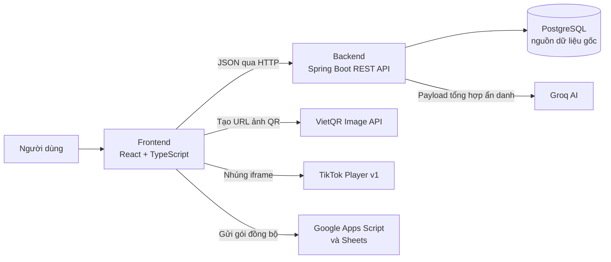

Sơ đồ chỉ thể hiện các ranh giới chính. Ví dụ, TikTok và VietQR không ghi trực tiếp vào PostgreSQL; Google Sheets cũng không phải nguồn dữ liệu gốc. PostgreSQL và các service backend vẫn là nơi quyết định dữ liệu nghiệp vụ như phiếu thu, công nợ, gói tập hay số buổi PT.

Kiểm tra dữ liệu ở frontend chỉ nhằm phản hồi sớm cho người dùng. Vì request có thể được gọi bằng công cụ khác ngoài giao diện, backend luôn kiểm tra lại quyền, định dạng dữ liệu, trạng thái và điều kiện nghiệp vụ trước khi thay đổi database.

## 2.2. Java 21, Spring Boot và Maven

Backend sử dụng **Java 21** và **Spring Boot 4.1.1**, được khai báo trong `backend/pom.xml`. Java cung cấp ngôn ngữ lập trình hướng đối tượng, thư viện chuẩn và cơ chế quản lý tài nguyên; Spring Boot cung cấp khung ứng dụng để cấu hình web server, dependency injection, web MVC, validation, security, data access và actuator mà không cần tự ghép từng thành phần thủ công.

Trong dự án, Spring quản lý vòng đời các bean như controller, service, repository, filter và cấu hình. Dependency injection giúp một service nhận dependency cần thiết qua constructor thay vì tự tạo đối tượng và tự quản lý vòng đời. Nhờ đó, luồng gọi từ controller đến service và repository rõ ràng hơn, đồng thời có thể thay dependency trong kiểm thử khi cần.

Các starter hiện diện trong dự án phản ánh các năng lực chính sau:

| Thành phần | Vai trò trong hệ thống |
| --- | --- |
| Spring Web MVC | Nhận request HTTP, ánh xạ route, đọc/ghi JSON và chạy ứng dụng web trên Tomcat nhúng. |
| Spring Data JPA | Cung cấp repository, làm việc với entity và transaction trên cơ sở dữ liệu quan hệ. |
| Spring Security | Xác thực Bearer JWT, áp dụng role, CORS và chuỗi filter bảo vệ API. |
| Spring Validation | Kiểm tra request DTO bằng các annotation Jakarta Validation trước khi xử lý nghiệp vụ. |
| Spring Boot Actuator | Cung cấp các endpoint giám sát cơ bản được cấu hình cho môi trường local. |
| Flyway dependency | Chuẩn bị khả năng migration versioned cho schema PostgreSQL trong tương lai; hiện chưa được bật. |

**Maven** quản lý dependency, compile, test và chạy backend thông qua Maven Wrapper. Điều này giúp các máy phát triển dùng cùng tập thư viện đã khai báo, thay vì phụ thuộc vào file JAR cài thủ công. Các lệnh như `./mvnw.cmd test` hoặc `./mvnw.cmd spring-boot:run` là điểm vào chuẩn để kiểm thử và chạy backend local.

Ở cấp tổ chức mã nguồn, controller là lớp giao tiếp HTTP; service chứa quy tắc nghiệp vụ và transaction; repository thao tác dữ liệu; entity mô tả mapping; DTO mô tả dữ liệu qua biên API. Việc tách các vai trò này không biến hệ thống thành nhiều service độc lập, nhưng giúp tránh để controller ôm logic nghiệp vụ hoặc để entity trở thành hợp đồng API công khai.

## 2.3. REST API, DTO, validation và xử lý lỗi

Frontend và backend trao đổi qua **REST API** với dữ liệu JSON. Backend local sử dụng context path `/api`; phần lớn endpoint nghiệp vụ nằm dưới `/v1`, ví dụ `POST /api/v1/auth/login`. Các endpoint public, endpoint xác thực và endpoint cần đăng nhập được phân biệt theo cấu hình security và quyền của từng route.

Theo ý nghĩa HTTP, `GET` dùng để truy vấn, `POST` dùng để tạo mới hoặc thực hiện một hành động nghiệp vụ, `PUT` dùng cho cập nhật toàn phần hoặc thao tác cập nhật theo contract hiện có, còn `DELETE` dùng cho một số thao tác xóa. Tuy nhiên, tên method HTTP không tự bảo đảm nghiệp vụ đúng; service vẫn là nơi xác định một request có được phép tạo phiếu thu, trừ buổi PT hay cấp portal hay không.

**DTO (Data Transfer Object)** là lớp dữ liệu tại ranh giới API. Request DTO chỉ chứa trường client được phép gửi và có thể gắn validation như bắt buộc, độ dài, giá trị dương hoặc ngày không ở tương lai. Response DTO chọn lọc dữ liệu mà màn hình thực sự cần, tránh trả trực tiếp entity có quan hệ lazy, dữ liệu nội bộ hoặc trường không phù hợp với vai trò đang gọi.

Luồng xử lý lỗi có hai lớp cần phân biệt:

1. Các lỗi phát sinh từ controller/service, ví dụ request không hợp lệ, không tìm thấy dữ liệu, không đủ quyền, xung đột nghiệp vụ hoặc vượt rate limit, được chuẩn hóa chủ yếu qua `GlobalExceptionHandler` thành response API nhất quán.
2. Một số lỗi ở filter, điển hình JWT không hợp lệ hoặc hết hạn, được filter trả trực tiếp trước khi request vào controller. Vì controller chưa được gọi, các lỗi này không nhất thiết đi qua `GlobalExceptionHandler`.

Giao diện cần xử lý các mã trạng thái theo ý nghĩa: `400` cho dữ liệu không hợp lệ, `401` cho chưa xác thực hoặc token không dùng được, `403` cho không có quyền, `404` cho tài nguyên không tồn tại, `409` cho xung đột, `429` cho giới hạn tần suất và `5xx` cho lỗi phía server. Cách phân loại này giúp người dùng nhận thông báo phù hợp và giúp người phát triển không nhầm lỗi quyền với lỗi dữ liệu.

## 2.4. PostgreSQL, JPA, Hibernate và tính nhất quán dữ liệu

**PostgreSQL** là hệ quản trị cơ sở dữ liệu quan hệ mã nguồn mở. Dữ liệu được tổ chức thành các bảng, mỗi hàng là một bản ghi và các bảng liên hệ với nhau qua khóa chính/khóa ngoại. PostgreSQL hỗ trợ SQL, index, constraint và transaction theo các tính chất ACID, nên phù hợp với những bài toán cần giữ lịch sử và số liệu tiền nhất quán.

**JPA (Jakarta Persistence API)** là đặc tả chuẩn của Java cho ánh xạ đối tượng - quan hệ (ORM). JPA định nghĩa các annotation và API chung, chẳng hạn `@Entity`, `@Id` và `@OneToMany`; bản thân JPA không phải database và cũng không trực tiếp thực thi câu lệnh SQL. **Hibernate** là ORM implementation thực hiện đặc tả JPA trong dự án: nó đọc mapping entity, tạo SQL phù hợp và quản lý trạng thái đối tượng khi làm việc với PostgreSQL. **Spring Data JPA** xây dựng trên JPA/Hibernate để cung cấp repository, giảm phần mã lặp cho các thao tác đọc và lưu dữ liệu. Việc quản lý transaction của dự án được Spring cung cấp qua annotation `@Transactional` ở tầng service.

Trong hệ thống, PostgreSQL là nguồn dữ liệu nghiệp vụ chính, lưu tài khoản, hội viên, gói tập, lượt đăng ký, công nợ, phiếu thu, hồ sơ PT, lịch hẹn, buổi tập, số đo và thư viện bài tập. Entity Java mô tả bảng, cột, khóa và quan hệ; repository là lớp truy vấn/lưu entity; các constraint database vẫn giữ vai trò bảo vệ cuối cùng. ORM giúp mã Java rõ cấu trúc hơn, nhưng không loại bỏ nhu cầu hiểu SQL, khóa ngoại hay ràng buộc dữ liệu.

Các thao tác thay đổi nhiều bản ghi được thực hiện ở service với `@Transactional`. Ví dụ, một lần đăng ký gói có thể cần tạo lượt đăng ký, công nợ, phiếu thu ban đầu và gói buổi PT tùy loại gói cũng như số tiền đã thu. Transaction giúp các thay đổi đó cùng được commit khi hợp lệ hoặc rollback khi có lỗi, tránh trạng thái lưu dở dang. Số tiền dùng `BigDecimal`; dữ liệu nợ và gói buổi PT có `@Version` để phát hiện một số xung đột cập nhật đồng thời theo optimistic locking.

Các nguyên tắc ACID được tận dụng ở mức phù hợp với ứng dụng: database giữ tính nguyên tử của transaction, các ràng buộc và validation góp phần duy trì tính nhất quán, transaction được cô lập theo cấu hình PostgreSQL, và dữ liệu đã commit được PostgreSQL đảm bảo bền vững. Điều này không có nghĩa mọi kịch bản concurrent production đã được kiểm thử đầy đủ; đây vẫn là giới hạn cần nêu rõ khi triển khai thực tế.

Môi trường local hiện dùng `spring.jpa.hibernate.ddl-auto=update`. Dự án giữ dependency Flyway và vị trí `db/migration` để sẵn sàng chuyển sang migration có version khi schema cần thay đổi có kiểm soát, nhưng `spring.flyway.enabled=false` và chưa có migration SQL versioned đang chạy. Vì vậy không được trình bày Flyway là cơ chế hiện hành hoặc coi `ddl-auto=update` là thay thế cho backup/migration. Cột `deleted` trong `BaseEntity` là nền tảng dự phòng; nó chưa tạo thành soft delete hoàn chỉnh và không được xem là một quy tắc áp dụng tự động cho mọi truy vấn.

## 2.5. Spring Security, JWT, phân quyền và bảo vệ API

**Spring Security** là framework bảo mật của hệ sinh thái Spring. Nó tổ chức một chuỗi filter đứng trước controller để xác thực danh tính, thiết lập ngữ cảnh người dùng và kiểm tra quyền truy cập theo route. Cần phân biệt **xác thực** (authentication: “người gọi là ai?”) với **phân quyền** (authorization: “người đó được làm gì?”); cả hai đều cần thiết trong hệ thống có OWNER, PT và MEMBER.

**JWT (JSON Web Token)** là token dạng chuỗi gọn gồm header, payload và chữ ký. Chữ ký giúp server phát hiện token bị sửa đổi; payload chỉ được **mã hóa ký tự theo Base64URL để biểu diễn trong chuỗi token**, không phải mã hóa bảo mật. Người có token vẫn có thể giải mã phần payload, vì vậy JWT không nên chứa mật khẩu hoặc dữ liệu nhạy cảm; khi triển khai qua mạng, HTTPS mới là lớp bảo vệ nội dung trên đường truyền. Với mô hình Bearer token, client chủ động gửi token trong header `Authorization`, thay vì backend tạo session `JSESSIONID` cho trình duyệt.

**BCrypt** là thuật toán băm mật khẩu có salt. Khi người dùng đăng nhập, backend băm mật khẩu được nhập và so sánh với hash đã lưu; mật khẩu rõ không cần, và không nên, được lưu trong database. BCrypt và JWT giải quyết hai vấn đề khác nhau: BCrypt bảo vệ mật khẩu lưu trữ, còn JWT chứng minh phiên xác thực của request sau khi đăng nhập.

Sau đăng nhập thành công, backend cấp JWT và frontend gửi token trong header `Authorization: Bearer <token>` cho các request cần đăng nhập. `JwtAuthenticationFilter` kiểm tra token trước khi request đến controller: cấu trúc, chữ ký, thời hạn, tài khoản hiện tại và `authVersion`. Filter nạp lại user từ database để sử dụng role và trạng thái mới nhất thay vì chỉ tin role cũ nằm trong token. Khi đổi hoặc reset mật khẩu, backend tăng `authVersion`; token phát trước đó mang version cũ sẽ bị từ chối ngay cả khi chưa đến hạn hết hạn tự nhiên.

Policy hiện tại yêu cầu mật khẩu tối thiểu tám ký tự, có chữ và số, không trùng email hoặc số điện thoại. Spring Security kiểm tra role `OWNER`, `PT`, `MEMBER`; ngoài role, service tiếp tục kiểm tra quyền theo bản ghi. Ví dụ, PT chỉ có thể làm việc với học viên thuộc phân công và điều kiện gói/phân công hợp lệ, trong khi OWNER có thể đồng thời mang role PT để trực tiếp huấn luyện.

Hệ thống bổ sung hai lớp bảo vệ hỗ trợ:

- **Rate limit:** đăng nhập sai năm lần trong cửa sổ theo dõi sẽ trả `429` và khóa mới 15 phút tính từ lần sai thứ năm; các endpoint nhạy cảm được giới hạn riêng ở mức vừa phải để hạn chế spam và chi phí AI. Bộ đếm hiện nằm trong bộ nhớ của một instance backend, phù hợp local/MVP nhưng không phải rate limiting phân tán cho nhiều server.
- **Security headers và CORS:** API thêm các header như `X-Content-Type-Options`, `X-Frame-Options`, `Referrer-Policy`, CSP cơ bản, `Permissions-Policy` và chỉ dẫn không cache response API/JWT. CORS giới hạn origin trình duyệt theo cấu hình; CORS không thay thế JWT vì client ngoài trình duyệt vẫn có thể gọi API.

Các cơ chế này tạo nhiều lớp bảo vệ, nhưng không thay thế quản lý secret, HTTPS, sao lưu, giám sát log hay kiểm thử bảo mật chuyên sâu khi triển khai Internet thật.

## 2.6. React, TypeScript, Vite và trải nghiệm giao diện

**React** là thư viện JavaScript xây dựng giao diện theo component và trạng thái. Thay vì thao tác trực tiếp từng phần tử DOM, lập trình viên mô tả giao diện theo dữ liệu/state; React cập nhật phần cần thiết khi state thay đổi. Cách này phù hợp với các màn hình có danh sách, form, modal, trạng thái tải dữ liệu và điều kiện hiển thị theo role.

**TypeScript** là JavaScript có bổ sung hệ thống kiểu tĩnh. Mã TypeScript được biên dịch thành JavaScript để chạy trên trình duyệt; kiểm tra kiểu chủ yếu hỗ trợ phát hiện sớm sai tên trường, sai kiểu request/response hoặc truyền nhầm tham số trong lúc phát triển, không thay thế validation phía backend khi chương trình đang chạy.

**Vite** là công cụ phát triển và build frontend. Trong lúc phát triển, Vite phục vụ mã nguồn nhanh và hỗ trợ cập nhật giao diện; khi build, Vite tạo các static asset để trình duyệt tải. Các thư viện bổ trợ được dùng gồm React Router cho điều hướng phía client, Axios cho gọi HTTP, Tailwind CSS cho style theo utility class và Lucide React cho hệ thống icon.

Frontend của dự án sử dụng React 19, TypeScript, React Router, Axios, Tailwind CSS, Vite và Lucide React theo `frontend/package.json`. React tổ chức giao diện theo feature và page; Axios tập trung cấu hình base URL/gắn Bearer token; Tailwind giúp duy trì thiết kế nhất quán. Các route trang được tải lười bằng `lazy` và `Suspense`, giảm lượng mã JavaScript cần tải ngay từ đầu.

Điều hướng frontend có guard để hướng người dùng chưa đăng nhập hoặc sai role đến màn hình phù hợp, nhưng guard chỉ là hỗ trợ UX: backend mới là nguồn quyết định cuối cùng về xác thực và quyền. Dữ liệu quan trọng không được coi là đúng chỉ vì form phía client đã kiểm tra; mọi số tiền, ngày thu, số buổi, trạng thái gói và quyền thao tác vẫn được backend xác nhận lại.

Giao diện được tổ chức theo feature, tương ứng với các nghiệp vụ như hội viên, gói, thanh toán, lịch PT, báo cáo, cài đặt, thư viện video và portal. Điều này giúp code giao diện gần với ngôn ngữ nghiệp vụ mà người vận hành sử dụng, đồng thời tách màn hình, API client và type liên quan theo phạm vi chức năng.

## 2.7. AI tạo sinh và Groq

**AI tạo sinh** là nhóm công nghệ dùng mô hình ngôn ngữ lớn (LLM) để tạo hoặc diễn giải nội dung từ prompt. LLM phù hợp để tổng hợp, lập luận bằng ngôn ngữ tự nhiên và đề xuất cách diễn đạt; ngược lại, các phép tính tiền, validation và thay đổi dữ liệu cần được hệ thống nghiệp vụ kiểm soát xác định thay vì giao hoàn toàn cho mô hình.

**Groq** là nhà cung cấp API suy luận mô hình ngôn ngữ. Dịch vụ cung cấp endpoint tương thích phần lớn với kiểu API OpenAI tại đường dẫn `/openai/v1`, giúp một backend REST có thể tích hợp bằng HTTP client thông thường. Groq được lựa chọn cho đồ án vì phù hợp các yêu cầu thực tế của giai đoạn phát triển/demo: phản hồi nhanh cho thao tác bấm phân tích, contract API quen thuộc và có Free Plan để thử nghiệm. Free Plan luôn đi kèm quota/rate limit theo tài khoản; không nên diễn giải đây là dịch vụ miễn phí vô hạn, cũng không coi tốc độ quảng bá là một chỉ số hiệu năng đã được đo trong dự án.

Hệ thống dùng Groq cho chức năng **AI Cố vấn Giữ chân và Doanh thu**, với vai trò diễn giải dữ liệu vận hành đã được backend chuẩn bị. Đây không phải mô hình machine learning được huấn luyện riêng trên dữ liệu của phòng gym và cũng không phải công cụ dự đoán churn có độ chính xác đã được đo lường.

Trước khi gọi AI, backend tổng hợp dữ liệu theo quy tắc: số hội viên, trạng thái gói, nhóm gần hết hạn, nợ mở, nhóm PT rủi ro và giá trị tiền theo segment. Payload gửi cho Groq là số liệu tổng hợp/segment ẩn danh, không gửi tên, số điện thoại, Zalo, email, địa chỉ hoặc lịch sử giao dịch cá nhân. Prompt yêu cầu AI đánh giá sức khỏe vận hành, các rủi ro giữ chân, cơ hội doanh thu và kế hoạch hành động ngắn hạn. AI trả về phần diễn giải và ưu tiên hành động; không được phép tự tạo payment, thay đổi gói, đổi công nợ hay liên hệ hội viên.

Phần **kịch bản doanh thu và giữ chân** do backend tính toán xác định bằng ba tỷ lệ do OWNER nhập: khả năng thu hồi công nợ, khả năng khôi phục nhóm PT rủi ro và khả năng gia hạn/quay lại. Backend kiểm tra tỷ lệ, tính tiền, làm tròn và tổng hợp; Groq chỉ diễn giải ưu tiên và lưu ý. Vì vậy các giá trị tiền của kịch bản không phụ thuộc vào việc mô hình ngôn ngữ có tính toán đúng hay không.

Key, model và endpoint Groq được nhận qua cấu hình môi trường. Client thử key theo thứ tự khi gặp lỗi có thể retry, không dùng round-robin chia tải. Nếu thiếu key, provider lỗi hoặc response không đáp ứng contract, service trả fallback dựa trên rule để màn hình báo cáo vẫn có thông tin nền. Kết quả AI luôn là tư vấn cho OWNER, không phải kết luận chắc chắn về hành vi khách hàng hoặc doanh thu tương lai.

## 2.8. Tích hợp hỗ trợ vận hành và xuất dữ liệu

Ngoài API nghiệp vụ chính, sản phẩm dùng một số tích hợp có mục đích rõ ràng. Các tích hợp này hỗ trợ vận hành hoặc hiển thị, không tự thay thế luồng xác nhận nghiệp vụ trong backend.

**VietQR** là cách biểu diễn thông tin chuyển khoản ngân hàng bằng mã QR để người dùng quét trên ứng dụng ngân hàng. Trong hệ thống, OWNER cấu hình ngân hàng, tài khoản, tên người nhận và nội dung chuyển khoản; frontend dùng các thông tin này cùng số tiền để tạo URL ảnh QR qua `img.vietqr.io`. QR được hiển thị ở các nơi cần hỗ trợ chuyển khoản, giúp giảm việc nhập tay thông tin. Tuy nhiên, QR chỉ là hướng dẫn thanh toán: quét mã hoặc chuyển tiền không tự tạo `Payment`, không tự giảm công nợ và không có webhook ngân hàng hay đối soát tự động. Nhân sự vẫn phải xác nhận thực tế rồi lập phiếu thu.

**TikTok Player v1** là cơ chế nhúng trình phát video TikTok vào website bằng thẻ `iframe`. OWNER lưu bài tập cùng URL TikTok đầy đủ dạng `/video/{id}`; backend kiểm tra URL, trích `tiktokVideoId`, còn frontend dựng URL player `https://www.tiktok.com/player/v1/{id}` để phát video trong thư viện và vẫn giữ link mở trên TikTok. Hệ thống chỉ lưu metadata/link cần thiết, không tải hay lưu file video TikTok vào PostgreSQL. MVP không quản lý lượt xem, tác giả hoặc phân tích hiệu suất video; việc hiển thị phụ thuộc TikTok và kết nối mạng.

**Google Apps Script** là nền tảng viết script trên hạ tầng Google, có thể triển khai script thành Web App nhận request HTTP và ghi dữ liệu vào **Google Sheets**, công cụ bảng tính trực tuyến. Trong trang Báo cáo, OWNER nhập Web App URL và token; frontend đóng gói dữ liệu báo cáo rồi gửi trực tiếp đến endpoint Apps Script do đơn vị tự cấu hình. Tích hợp này hỗ trợ sao chép số liệu sang Google Sheets để xem hoặc chia sẻ, nhưng PostgreSQL vẫn là nguồn dữ liệu gốc. URL và token được lưu local trên trình duyệt theo cấu hình hiện tại; chỉ nên dùng Apps Script tin cậy và không đưa token vào ảnh chụp hay tài liệu.

**XLSX** là định dạng workbook bảng tính dựa trên Office Open XML, có thể chứa nhiều worksheet trong một file. Frontend tự tạo workbook `.xlsx` từ các hàng dữ liệu báo cáo đã tải, đóng gói worksheet cần thiết và tải Blob về máy người dùng. Cách này phù hợp để xuất nhanh danh sách hội viên, thu tiền, công nợ, bảng giá hoặc file nhiều sheet nhằm đối soát. Đây là bản xuất có chọn lọc tại thời điểm tải, không phải cơ chế khôi phục đầy đủ database PostgreSQL.

Việc tách rõ vai trò của các tích hợp giúp tránh hai nhầm lẫn thường gặp: VietQR không phải cổng thanh toán tự xác nhận, và Google Sheets/XLSX không phải nguồn dữ liệu nghiệp vụ thay thế cho PostgreSQL. Các quy trình chi tiết, API và ràng buộc dữ liệu của từng chức năng được tiếp tục phân tích ở Chương 3.

# CHƯƠNG 3. PHÂN TÍCH VÀ THIẾT KẾ HỆ THỐNG

## 3.1. Phân tích yêu cầu

### 3.1.1. Tác nhân

| Tác nhân | Vai trò trong hệ thống |
| --- | --- |
| Khách truy cập | Xem website công khai, bảng giá và thư viện video được công bố. |
| Chủ phòng — OWNER | Quản lý dữ liệu và nhân sự trong phạm vi quyền; xem dashboard, báo cáo, AI, cấu hình VietQR và video. |
| Huấn luyện viên — PT | Xem và thao tác nghiệp vụ được cho phép đối với học viên, gói và lịch theo kiểm tra quyền thực tế. |
| Hội viên — MEMBER | Đăng nhập tài khoản portal để xem dữ liệu cá nhân được hệ thống cung cấp. |
| Dịch vụ Groq | Nhận dữ liệu tổng hợp do backend gửi và trả phản hồi AI khi được gọi. |
| TikTok / Apps Script | Các hệ thống ngoài phục vụ hiển thị video hoặc tiếp nhận dữ liệu đồng bộ, phụ thuộc cấu hình và dịch vụ bên thứ ba. |

OWNER kiêm PT cần có role và profile PT hợp lệ khi thực hiện các thao tác yêu cầu PT. `DataInitializer.seedOwner` hiện bổ sung cả role OWNER và PT cho tài khoản owner được cấu hình, đồng thời tạo profile PT nếu thiếu. Tương tự, `TeamUserService` thêm role PT và tạo profile nếu thiếu khi tạo nhân sự hoặc chuyển vai trò sang OWNER qua luồng service. Cần kiểm tra riêng tài khoản được nhập hay thay đổi bên ngoài các luồng này. Trong sơ đồ, OWNER và PT là các vai trò, không nhất thiết là hai con người khác nhau.

### 3.1.2. Yêu cầu chức năng

| Mã | Nhóm chức năng | Yêu cầu chính |
| --- | --- | --- |
| F01 | Tài khoản | Đăng nhập, xem thông tin phiên, đổi mật khẩu; OWNER quản lý tài khoản nhân sự và portal. |
| F02 | Hội viên | Tạo, tìm, xem và cập nhật hồ sơ; hỗ trợ tra cứu lịch sử liên quan. |
| F03 | Gói tập | Quản lý bảng giá, đăng ký hoặc gia hạn gói cho hội viên. |
| F04 | Thu và nợ | Thu ban đầu hoặc nhiều đợt, xem phiếu thu và số dư công nợ. |
| F05 | PT | Phân công, chuyển PT, đặt lịch, ghi buổi PT và tự ôn tập. |
| F06 | Tiến trình | Ghi số đo và mục tiêu; hội viên theo dõi dữ liệu của chính mình. |
| F07 | Báo cáo | Tổng hợp tình trạng hội viên, doanh thu và nhắc việc; xuất XLSX theo dữ liệu đã chọn. |
| F08 | AI cố vấn | Tính nhóm rủi ro/cơ hội, gọi Groq khi có cấu hình và hiển thị kết quả hoặc nội dung dự phòng; mô phỏng kịch bản từ ba tỷ lệ chủ phòng chọn mà không ghi dữ liệu. |
| F09 | Thư viện | OWNER quản lý nội dung video; khách truy cập xem video công bố. |
| F10 | Cài đặt | Quản lý tài khoản nhân sự và cấu hình VietQR theo quyền OWNER. |

### 3.1.3. Yêu cầu phi chức năng

| Nhóm | Yêu cầu và cách tiếp cận hiện tại |
| --- | --- |
| Bảo mật | Xác thực JWT, phân quyền, băm mật khẩu, validation, rate limit và header tại API. |
| Nhất quán | Kiểm tra quan hệ giữa hội viên, gói, nợ và phiếu thu; dùng transaction và optimistic locking ở các entity liên quan. |
| Dễ sử dụng | Giao diện chia theo tác vụ, có tìm kiếm, biểu mẫu, tóm tắt và các trạng thái. |
| Bảo trì | Mã nguồn chia theo nhóm nghiệp vụ; DTO, service và repository có vai trò tương đối rõ ràng. |
| Tính riêng tư | Payload Groq được thiết kế ở mức tổng hợp, không đưa trực tiếp tên, điện thoại, email hoặc từng giao dịch cá nhân. |
| Khả dụng local | Cấu hình và script cho môi trường phát triển; không mặc định có sẵn hệ thống triển khai production. |

Các yêu cầu này là định hướng thiết kế, không phải cam kết an toàn tuyệt đối hoặc số liệu hiệu năng đã đo.

### 3.1.4. Sơ đồ tác nhân và nhóm chức năng

**Hình 3.1. Tổng quan tác nhân và nhóm chức năng**

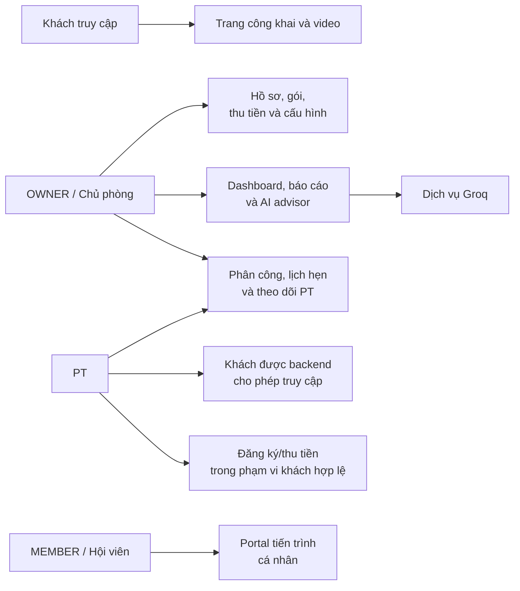

Sơ đồ thể hiện nhóm tương tác tổng quát, không thay thế ma trận quyền ở controller và kiểm tra phạm vi dữ liệu trong service.

### 3.1.5. Ma trận chức năng theo vai trò

| Chức năng | Khách | OWNER | PT | MEMBER |
| --- | --- | --- | --- | --- |
| Xem trang công khai, video công bố | Có | Có | Có | Có |
| Quản lý hồ sơ hội viên và bán gói | Không | Có | Có điều kiện theo service | Không |
| Thu tiền / xem công nợ | Không | Có | Có điều kiện theo hội viên | Xem dữ liệu của mình trên portal |
| Gán và theo dõi PT | Không | Quản lý toàn phòng | Phạm vi được phép, tự nhận theo policy | Xem dữ liệu cá nhân |
| Chuyển PT phụ trách | Không | Có | Không | Không |
| Dashboard, báo cáo và AI | Không | Có | Không theo route báo cáo | Không |
| Quản lý nhân sự, VietQR, video | Không | Có | Không | Không |
| Xem portal cá nhân | Không | Không theo route MEMBER | Không theo route MEMBER | Có |

Những ô “có điều kiện” không có nghĩa PT được xem hoặc thay đổi mọi hội viên. Cần đọc controller và `MemberAccessService`, `PtAssignmentPolicy`, `PtService` cho từng thao tác. Một số trang frontend và API có phạm vi khác nhau; ví dụ route Nhắc việc cho OWNER/PT, trong khi endpoint notifications của dashboard yêu cầu OWNER.

### 3.1.6. Quy ước đặc tả use case

Mỗi use case dưới đây mô tả một mục tiêu nghiệp vụ có thể hoàn thành từ góc nhìn của tác nhân. Các endpoint được nêu để đối chiếu với implementation hiện tại; bảng API đầy đủ hơn được trình bày tại mục 3.5. “PT có điều kiện” nghĩa là controller cho phép role PT, nhưng service vẫn kiểm tra quan hệ với hội viên, gói, phân công hoặc PT phụ trách trước khi thao tác.

### 3.1.7. UC01 - Đăng nhập, xem phiên và đổi mật khẩu

| Thuộc tính | Mô tả |
| --- | --- |
| Actor | OWNER, PT hoặc MEMBER đã được cấp tài khoản. |
| Endpoint/Service | `POST /api/v1/auth/login`, `GET /api/v1/auth/me`, `POST /api/v1/auth/change-password` - `AuthService`. |
| Mục tiêu | Xác thực người dùng, cấp JWT để gọi API theo quyền, cho phép kiểm tra phiên và tự đổi mật khẩu. |
| Tiền điều kiện | Tài khoản tồn tại, có trạng thái cho phép đăng nhập, mật khẩu hợp lệ và không đang bị khóa rate limit. |
| Đầu vào | Email hoặc số điện thoại, mật khẩu, tùy chọn duy trì đăng nhập; khi đổi mật khẩu cần mật khẩu hiện tại và mật khẩu mới theo policy. |
| Luồng chính | 1. Người dùng gửi thông tin đăng nhập.<br/>2. Backend kiểm tra giới hạn đăng nhập theo định danh/IP.<br/>3. Service tìm tài khoản, kiểm tra trạng thái và đối chiếu BCrypt hash.<br/>4. Backend cập nhật `lastLoginAt`, cấp JWT mang thông tin cần thiết cho phiên.<br/>5. Frontend lưu token theo lựa chọn phiên và điều hướng đến màn hình phù hợp role. |
| Luồng thay thế / ngoại lệ | Sai định danh hoặc mật khẩu làm tăng bộ đếm; lần sai thứ năm trong cửa sổ theo dõi trả `429` và khóa mới 15 phút. Token hết hạn, sai chữ ký hoặc có `authVersion` cũ bị filter từ chối trước controller. Mật khẩu mới thiếu điều kiện hoặc trùng định danh bị từ chối. |
| Hậu điều kiện | Đăng nhập thành công xóa bộ đếm liên quan và có JWT hợp lệ. Đổi mật khẩu tăng `authVersion`, khiến JWT cũ không còn dùng được. |

### 3.1.8. UC02 - Quản lý tài khoản nhân sự

| Thuộc tính | Mô tả |
| --- | --- |
| Actor | OWNER. |
| Endpoint/Service | `GET, POST /api/v1/settings/team-users`; `PUT /api/v1/settings/team-users/{id}/role`; `PUT /api/v1/settings/team-users/{id}/status`; `POST /api/v1/settings/team-users/{id}/reset-password` - `TeamUserService`. |
| Mục tiêu | Tạo và duy trì tài khoản nhân sự, kiểm soát role, trạng thái hoạt động và mật khẩu ban đầu/reset. |
| Tiền điều kiện | OWNER đã xác thực; email/số điện thoại và role gửi lên hợp lệ; tài khoản không trùng định danh. |
| Đầu vào | Họ tên, email, số điện thoại, role, trạng thái và mật khẩu theo từng thao tác. |
| Luồng chính | 1. OWNER mở phần nhân sự, nhập hoặc chọn tài khoản cần quản lý.<br/>2. Backend validate request, chính sách mật khẩu và role hợp lệ.<br/>3. Service tạo/cập nhật `User`; khi luồng yêu cầu role PT, profile PT cần thiết được bảo đảm theo service hiện hành.<br/>4. Response trả dữ liệu nhân sự để giao diện tải lại danh sách. |
| Luồng thay thế / ngoại lệ | Email/số điện thoại trùng, role không thuộc tập hợp cho phép, mật khẩu không đạt policy hoặc OWNER không đủ quyền đều bị từ chối. Tài khoản INACTIVE không đăng nhập bình thường. |
| Hậu điều kiện | Thông tin tài khoản/role/trạng thái được cập nhật. `lastLoginAt` chỉ phản ánh lần đăng nhập gần nhất, không phải audit log đầy đủ. Hệ thống không tính lương, hoa hồng hoặc payroll PT. |

### 3.1.9. UC03 - Quản lý hồ sơ hội viên

| Thuộc tính | Mô tả |
| --- | --- |
| Actor | OWNER; PT trong phạm vi service cho phép. |
| Endpoint/Service | `POST, GET /api/v1/members`; `GET, PUT /api/v1/members/{id}`; `GET /api/v1/members/page`; `GET /api/v1/members/statistics` - `MemberService`. |
| Mục tiêu | Tạo, cập nhật, tìm kiếm và tra cứu hồ sơ hội viên làm cơ sở cho gói tập, thanh toán và PT. |
| Tiền điều kiện | Người gọi đã xác thực đúng role; dữ liệu bắt buộc của hồ sơ hợp lệ. |
| Đầu vào | Họ tên, số điện thoại, ngày sinh, giới tính, địa chỉ, nguồn khách, ghi chú và trạng thái theo form. |
| Luồng chính | 1. Người vận hành nhập hoặc tìm hội viên.<br/>2. Backend validate DTO và chuẩn hóa số điện thoại Việt Nam trước khi lưu/tra cứu.<br/>3. Service kiểm tra quyền theo hội viên khi cần, sau đó tạo/cập nhật hoặc trả danh sách phân trang/chi tiết.<br/>4. Giao diện hiển thị hồ sơ và lịch sử liên quan. |
| Luồng thay thế / ngoại lệ | Thiếu dữ liệu, số điện thoại sai định dạng, trùng số điện thoại hoặc vượt phạm vi PT được trả lỗi phù hợp. |
| Hậu điều kiện | Hội viên mới chỉ có hồ sơ; chưa tự có gói, công nợ, portal, phân công PT hay lịch tập. Các dữ liệu này chỉ sinh ở use case riêng. |

### 3.1.10. UC04 - Quản lý danh mục gói tập

| Thuộc tính | Mô tả |
| --- | --- |
| Actor | OWNER quản trị; PT xem gói đang bán; khách truy cập xem bảng giá công khai. |
| Endpoint/Service | `POST /api/v1/membership-plans`; `GET /api/v1/membership-plans`; `GET /api/v1/membership-plans/all`; `PUT /api/v1/membership-plans/{id}/active`; `GET /api/v1/public/membership-plans` - `MembershipPlanService`. |
| Mục tiêu | Quản lý bảng giá, thời hạn, loại gói và định mức buổi để dùng khi bán gói. |
| Tiền điều kiện | OWNER đã đăng nhập khi tạo/đổi trạng thái; dữ liệu gói hợp lệ theo DTO/service. |
| Đầu vào | Tên gói, loại gói, giá niêm yết, thời hạn, định mức PT/tự tập, level PT và trạng thái theo contract. |
| Luồng chính | 1. OWNER tạo gói hoặc bật/tắt trạng thái bán.<br/>2. Service kiểm tra dữ liệu và lưu danh mục.<br/>3. Danh sách active được dùng ở luồng bán và endpoint công khai; OWNER có thể xem cả gói inactive. |
| Luồng thay thế / ngoại lệ | Dữ liệu định mức/giá/thời hạn không hợp lệ hoặc role không phải OWNER bị từ chối. |
| Hậu điều kiện | Danh mục được cập nhật; tắt gói chỉ ngừng bán về sau, không xóa hay thay đổi lịch sử `MemberMembership` đã phát sinh. |

### 3.1.11. UC05 - Đăng ký hoặc gia hạn gói và thu ban đầu

| Thuộc tính | Mô tả |
| --- | --- |
| Actor | OWNER hoặc PT được service cho phép thao tác với hội viên. |
| Endpoint/Service | `POST /api/v1/members/{memberId}/memberships` - `MemberMembershipService.create`. |
| Mục tiêu | Tạo lượt đăng ký/gia hạn gói, ghi nhận khoản thu thực tế ban đầu nếu có và tạo dữ liệu liên quan nhất quán. |
| Tiền điều kiện | Hội viên tồn tại, gói đang active, actor có quyền, giá/giảm giá/ngày/số thu hợp lệ. |
| Đầu vào | ID gói, ngày bắt đầu, giá bán thực tế, giảm giá, số thu ngay, phương thức/ngày thu khi có thu, ghi chú và PT phụ trách khi phù hợp. |
| Luồng chính | 1. Người vận hành chọn gói và nhập các thông tin bán.<br/>2. Backend kiểm tra quyền, gói, thời hạn, ngày và các số tiền.<br/>3. Service lưu `MemberMembership` với giá thực tế của lần bán.<br/>4. Nếu còn phải thu, service tạo `DebtRecord`; nếu thu ngay lớn hơn 0, tạo một `Payment` và đồng bộ số nợ.<br/>5. Nếu gói thuộc loại PT, service tạo gói buổi PT phù hợp.<br/>6. Toàn bộ thay đổi nằm trong transaction. |
| Luồng thay thế / ngoại lệ | Thu ngay bằng `0` không tạo phiếu thu, phần cần thu trở thành công nợ. Ngày thu tương lai, số thu vượt cần thu, gói inactive, dữ liệu PT không hợp lệ hoặc quyền không đúng đều bị từ chối. |
| Hậu điều kiện | Có lượt đăng ký; có công nợ/phiếu thu/gói buổi PT tùy dữ liệu. Doanh thu thực thu chỉ tăng theo `Payment`, không tự bằng giá gói khi còn nợ. |

### 3.1.12. UC06 - Thu công nợ và tra cứu phiếu thu

| Thuộc tính | Mô tả |
| --- | --- |
| Actor | OWNER hoặc PT được service cho phép thao tác với hội viên/khoản nợ. |
| Endpoint/Service | `POST /api/v1/payments`; `GET /api/v1/payments`; `GET /api/v1/payments/page`; `GET /api/v1/debts`; `GET /api/v1/debts/page`; `GET /api/v1/payments/summary` - `PaymentService`. |
| Mục tiêu | Ghi nhận từng lần thu thực tế, đồng bộ số dư công nợ và cho phép đối soát theo hội viên/ngày/phương thức. |
| Tiền điều kiện | Khoản nợ tồn tại, chưa PAID/CANCELLED, actor có quyền và số tiền thu hợp lệ. |
| Đầu vào | Khoản nợ hoặc membership liên quan, số tiền đợt thu, phương thức, ngày thu không ở tương lai và ghi chú. |
| Luồng chính | 1. Người vận hành chọn khoản nợ và nhập số tiền thực thu.<br/>2. Service kiểm tra liên kết hội viên - nợ - gói, quyền, ngày và giới hạn số tiền.<br/>3. Hệ thống tạo một `Payment` riêng cho lần thu.<br/>4. Service cập nhật đã thu, còn nợ và trạng thái `DebtRecord` trong transaction.<br/>5. Danh sách/summary được tải lại theo bộ lọc hoặc phân trang. |
| Luồng thay thế / ngoại lệ | Không tìm thấy khoản nợ hợp lệ, nợ đã trả/hủy, ngày ở tương lai, số tiền không dương hoặc vượt số dư đều bị từ chối. |
| Hậu điều kiện | Mỗi đợt thu là một phiếu có ngày/phương thức riêng; ví dụ trả trước chuyển khoản và trả nốt tiền mặt là hai phiếu, không bị gộp sai thành một phương thức. |

### 3.1.13. UC07 - Cấp và quản lý tài khoản portal cho hội viên

| Thuộc tính | Mô tả |
| --- | --- |
| Actor | OWNER. |
| Endpoint/Service | `POST /api/v1/members/{id}/portal-account`; `PUT /api/v1/members/{id}/portal-account/status`; `POST /api/v1/members/{id}/portal-account/reset-password`; `DELETE /api/v1/members/{id}/portal-account` - `MemberService`. |
| Mục tiêu | Liên kết tài khoản MEMBER với một hồ sơ hội viên để khách có thể xem tiến trình cá nhân. |
| Tiền điều kiện | Hội viên `ACTIVE`, có số điện thoại và ít nhất một membership hiệu lực trong ngày; OWNER đã xác thực. |
| Đầu vào | Thông tin tài khoản portal, mật khẩu theo policy hoặc trạng thái/reset/xóa liên kết theo thao tác. |
| Luồng chính | 1. OWNER mở chi tiết hội viên và yêu cầu cấp portal.<br/>2. Service kiểm tra điều kiện hội viên/gói, trùng hoặc khả năng tái sử dụng user và policy mật khẩu.<br/>3. Backend tạo/liên kết user role MEMBER với hội viên.<br/>4. OWNER có thể khóa/mở, reset mật khẩu hoặc gỡ liên kết qua endpoint tương ứng. |
| Luồng thay thế / ngoại lệ | Hội viên inactive, chưa có gói hiệu lực, gói tương lai/chờ thanh toán/hết hạn/hủy, số điện thoại thiếu/trùng hoặc mật khẩu sai policy đều không đủ điều kiện cấp mới. |
| Hậu điều kiện | Portal được liên kết với đúng một hội viên. Gói tự tập còn hiệu lực cũng có thể được cấp portal; portal đã tồn tại không tự bị xóa chỉ vì gói sau đó hết hạn. Đổi/reset mật khẩu thu hồi JWT cũ theo `authVersion`. |

### 3.1.14. UC08 - Phân công PT và điều phối lịch hẹn

| Thuộc tính | Mô tả |
| --- | --- |
| Actor | OWNER hoặc PT theo policy; chuyển PT phụ trách chỉ OWNER. |
| Endpoint/Service | `GET /api/v1/pt/my-members`; `POST /api/v1/pt/assignments`; `PUT /api/v1/pt/assignments/{assignmentId}/reassign`; `GET, POST /api/v1/pt/schedules`; `DELETE /api/v1/pt/schedules/{scheduleId}` - `PtService`, `PtAssignmentPolicy`. |
| Mục tiêu | Xác định PT phụ trách hội viên và tạo/làm rõ lịch hẹn PT trước khi diễn ra buổi tập thực tế. |
| Tiền điều kiện | PT active có profile hợp lệ, hội viên active có gói PT phù hợp, actor có quyền và ngày phân công nằm trong phạm vi gói. |
| Đầu vào | Hội viên, PT phụ trách, ngày bắt đầu/kết thúc phân công; ngày, giờ bắt đầu/kết thúc, ghi chú cho lịch hẹn. |
| Luồng chính | 1. OWNER/PT hợp lệ tạo phân công.<br/>2. Service kiểm tra quyền, gói PT, hiệu lực ngày và không để tồn tại phân công xung đột.<br/>3. Người phụ trách tạo lịch hẹn cho học viên đã thuộc phạm vi được phép.<br/>4. Service kiểm tra ngày/giờ, phạm vi gói, quyền và xung đột lịch SCHEDULED trước khi lưu. |
| Luồng thay thế / ngoại lệ | Không có gói PT hiệu lực, PT/hội viên inactive, phân công ngoài thời hạn gói, lịch quá khứ hoặc giao giờ với lịch SCHEDULED hợp lệ bị từ chối. |
| Hậu điều kiện | Có bản ghi phân công/lịch hẹn; lịch là kế hoạch và **không tự trừ buổi PT**. Chuyển PT là thao tác riêng của OWNER. |

### 3.1.15. UC09 - Ghi buổi PT và tự ôn tập

| Thuộc tính | Mô tả |
| --- | --- |
| Actor | OWNER hoặc PT trong phạm vi hội viên/gói/phân công hợp lệ. |
| Endpoint/Service | `GET /api/v1/pt/session-packages`; `GET /api/v1/pt/members/{memberId}`; `POST /api/v1/pt/members/{memberId}/session-logs`; `POST /api/v1/pt/members/{memberId}/activity-logs` - `PtService`. |
| Mục tiêu | Lưu nhật ký một buổi PT hoặc tự ôn tập và cập nhật định mức của đúng gói buổi. |
| Tiền điều kiện | Hội viên thuộc quyền truy cập, gói buổi thuộc chính hội viên, đang hiệu lực, còn định mức; ngày ghi hợp lệ. |
| Đầu vào | ID gói buổi, loại/ trạng thái buổi, ngày tập, giáo án, nhận xét, cân nặng trước buổi; `scheduleId` nếu người dùng chủ động liên kết với lịch đã đặt. |
| Luồng chính | 1. PT chọn hội viên và gói buổi phù hợp.<br/>2. Nhập nội dung buổi đã thực hiện hoặc lần tự ôn tập.<br/>3. Service kiểm tra quyền, gói, ngày, liên kết membership - session package, định mức và trùng lặp.<br/>4. Hệ thống lưu log, cập nhật số buổi đã dùng/còn lại; nếu request có `scheduleId` hợp lệ, trạng thái lịch được cập nhật theo luồng service. |
| Luồng thay thế / ngoại lệ | Gói thuộc hội viên khác, gói chờ thanh toán/hết hiệu lực/hủy, không còn buổi, ngày tương lai, lịch không hợp lệ hoặc ghi trùng bị từ chối. |
| Hậu điều kiện | Nhật ký buổi được lưu; `COMPLETED` và `MISSED` hiện thuộc nhóm tiêu buổi PT trong code, còn `CANCELLED`/`RESCHEDULED` không tiêu buổi. Số đo và mục tiêu không tự sinh khi ghi buổi. |

### 3.1.16. UC10 - Ghi số đo và thiết lập mục tiêu huấn luyện

| Thuộc tính | Mô tả |
| --- | --- |
| Actor | OWNER hoặc PT có quyền với hội viên. |
| Endpoint/Service | `POST /api/v1/pt/members/{memberId}/body-measurements`; `POST /api/v1/pt/members/{memberId}/goals` - `PtService`. |
| Mục tiêu | Lưu lịch sử chỉ số cơ thể và lộ trình mục tiêu để PT và hội viên theo dõi tiến trình. |
| Tiền điều kiện | Hội viên thuộc phạm vi PT/OWNER; ngày đo/mục tiêu và dữ liệu request hợp lệ. |
| Đầu vào | Ngày đo, ít nhất một chỉ số cơ thể, ghi chú; hoặc loại mục tiêu, mô tả, ngày dự kiến, cân nặng/vòng eo mục tiêu theo form. |
| Luồng chính | 1. Người có quyền chọn học viên trên trang PT.<br/>2. Nhập số đo hoặc mục tiêu.<br/>3. Backend validate quyền, dữ liệu, ngày và lưu `BodyMeasurement` hoặc `PtGoal` tương ứng.<br/>4. Giao diện/PT portal đọc lại dữ liệu mới nhất và lịch sử được hỗ trợ. |
| Luồng thay thế / ngoại lệ | Request không có chỉ số nào, ngày không hợp lệ, giá trị không hợp lệ hoặc actor không thuộc phạm vi học viên bị từ chối. |
| Hậu điều kiện | Một lần đo là bản ghi lịch sử mới, không tự thay thế mục tiêu. Mục tiêu là đích theo dõi, không phải kết quả sức khỏe đã đạt hay một phép đo thực tế. |

### 3.1.17. UC11 - Hội viên xem portal tiến trình cá nhân

| Thuộc tính | Mô tả |
| --- | --- |
| Actor | MEMBER đã được liên kết portal. |
| Endpoint/Service | `GET /api/v1/member-portal/me` - `MemberPortalService.getPortal`. |
| Mục tiêu | Cho hội viên xem đúng dữ liệu cá nhân về gói, công nợ, lịch PT, số đo, mục tiêu và lịch sử được portal hỗ trợ. |
| Tiền điều kiện | Có JWT hợp lệ mang role MEMBER, tài khoản liên kết hội viên và hội viên đáp ứng kiểm tra trạng thái của service. |
| Đầu vào | Không nhận `memberId` từ client; danh tính lấy từ JWT đã xác thực. |
| Luồng chính | 1. MEMBER đăng nhập và mở `/my-progress`.<br/>2. Frontend gọi endpoint `/me` kèm JWT.<br/>3. Service tìm hội viên bằng user ID trong ngữ cảnh xác thực.<br/>4. Backend tổng hợp dữ liệu của chính hội viên đó và trả portal response. |
| Luồng thay thế / ngoại lệ | JWT không hợp lệ, role không phải MEMBER, user không liên kết hội viên hoặc hội viên không đáp ứng điều kiện service bị từ chối/không trả portal bình thường. |
| Hậu điều kiện | Portal chỉ đọc dữ liệu của chính tài khoản; hội viên không tự kích hoạt gói, xác nhận thanh toán, gán PT hoặc thay đổi dữ liệu nghiệp vụ quản trị. |

### 3.1.18. UC12 - Theo dõi dashboard, báo cáo và nhắc việc

| Thuộc tính | Mô tả |
| --- | --- |
| Actor | OWNER; trang Nhắc việc có phạm vi UI/route riêng cho OWNER/PT. |
| Endpoint/Service | `GET /api/v1/dashboard/owner`; `GET /api/v1/reports/finance`; `GET /api/v1/reports/members`; `GET /api/v1/notifications` - `DashboardService`. |
| Mục tiêu | Tổng hợp tình trạng hội viên, doanh thu thực thu, công nợ và các tình huống cần chú ý để hỗ trợ vận hành. |
| Tiền điều kiện | OWNER đã xác thực với các endpoint dashboard/report; kỳ năm-tháng hợp lệ nếu có truyền vào. |
| Đầu vào | Kỳ báo cáo, bộ lọc hiển thị và dữ liệu đã phát sinh từ các use case hội viên/gói/thanh toán/PT. |
| Luồng chính | 1. OWNER chọn màn hình/kỳ cần xem.<br/>2. Backend tổng hợp số liệu theo dữ liệu nghiệp vụ, trong đó doanh thu dựa vào phiếu thu và ngày thu.<br/>3. Response được frontend trình bày thành KPI, biểu đồ, danh sách và cảnh báo. |
| Luồng thay thế / ngoại lệ | Kỳ không hợp lệ hoặc role không phải OWNER tại endpoint báo cáo bị từ chối. Dữ liệu trống trả trạng thái/giá trị phù hợp, không tự sinh giao dịch. |
| Hậu điều kiện | Chỉ tạo dữ liệu đọc. Nhắc việc không đồng nghĩa hệ thống đã gửi Zalo/SMS tự động; một phần danh sách nhắc việc được dựng tại frontend nên không xem toàn bộ như bảng notification lưu sẵn. |

### 3.1.19. UC13 - Phân tích AI giữ chân, doanh thu và kịch bản

| Thuộc tính | Mô tả |
| --- | --- |
| Actor | OWNER. |
| Endpoint/Service | `POST /api/v1/ai/retention-revenue-advisor` - `RetentionRevenueAdvisorService`, `RetentionRevenueScenarioCalculator`, `GroqAiClient`. |
| Mục tiêu | Xác định nhóm rủi ro/cơ hội, nhận gợi ý ưu tiên vận hành và mô phỏng giá trị có thể tác động từ ba tỷ lệ giả định. |
| Tiền điều kiện | OWNER đã xác thực; nếu gọi Groq cần cấu hình key hợp lệ. Không cần key để nhận fallback theo rule. |
| Đầu vào | Request rỗng để phân tích tổng quan, hoặc ba tỷ lệ nguyên `0..100`: thu công nợ, khôi phục nhóm PT rủi ro và gia hạn/quay lại. |
| Luồng chính | 1. Backend đọc dữ liệu nghiệp vụ và phân nhóm theo rule.<br/>2. Tạo payload tổng hợp/ẩn danh, không đưa PII hay giao dịch cá nhân sang Groq.<br/>3. Calculator tính ba giá trị và tổng kịch bản ở backend.<br/>4. Groq diễn giải sức khỏe vận hành, ưu tiên và lưu ý theo schema yêu cầu.<br/>5. Service chuẩn hóa response; khi lỗi AI, trả insight fallback với `aiGenerated=false`. |
| Luồng thay thế / ngoại lệ | Tỷ lệ ngoài `0..100` hoặc thiếu trường kịch bản bị trả `400`. Thiếu key, provider lỗi hoặc response không đúng contract không tạo lỗi dữ liệu nghiệp vụ mà chuyển sang fallback theo rule. |
| Hậu điều kiện | Request chỉ đọc: không tạo `Payment`, công nợ, gói, lịch, log PT hay tự liên hệ hội viên. Các segment có thể chồng lắp; doanh thu rủi ro/kịch bản là chỉ báo ước tính, không phải dự báo chắc chắn. |

### 3.1.20. UC14 - Quản lý và xem thư viện video bài tập

| Thuộc tính | Mô tả |
| --- | --- |
| Actor | OWNER quản lý; khách truy cập và người đã đăng nhập xem nội dung công bố. |
| Endpoint/Service | OWNER: `GET, POST /api/v1/owner/exercise-categories`, `PUT /api/v1/owner/exercise-categories/{id}`; `GET, POST /api/v1/owner/exercises`, `PUT /api/v1/owner/exercises/{id}`, `PATCH /api/v1/owner/exercises/{id}/published`, `DELETE /api/v1/owner/exercises/{id}`. Public: `GET /api/v1/public/exercise-categories`, `GET /api/v1/public/exercises`, `GET /api/v1/public/exercises/{slugOrId}` - `ExerciseService`. |
| Mục tiêu | Quản lý metadata bài tập và cung cấp video TikTok công bố để người xem tra cứu kỹ thuật. |
| Tiền điều kiện | OWNER đã xác thực khi quản lý; nội dung public phải thỏa trạng thái công bố. Link TikTok phải đúng dạng backend chấp nhận. |
| Đầu vào | Danh mục, tiêu đề, mô tả, hướng dẫn, lỗi thường gặp, độ khó, nhóm cơ, dụng cụ, URL TikTok và trạng thái xuất bản. |
| Luồng chính | 1. OWNER tạo/sửa danh mục hoặc bài tập.<br/>2. Service kiểm tra request và URL TikTok, trích `tiktokVideoId` từ URL đầy đủ.<br/>3. OWNER công bố/ẩn nội dung.<br/>4. Client public gọi endpoint public và frontend nhúng TikTok Player v1 theo video ID khi có. |
| Luồng thay thế / ngoại lệ | Link không thuộc TikTok hoặc link rút gọn không có `/video/{id}`, dữ liệu thiếu, slug trùng hoặc actor không phải OWNER bị từ chối. |
| Hậu điều kiện | PostgreSQL chỉ lưu metadata/link/video ID. Hệ thống không tải video, không quản lý lượt xem và không bảo đảm TikTok luôn cho phép hiển thị. |

### 3.1.21. UC15 - Cấu hình VietQR

| Thuộc tính | Mô tả |
| --- | --- |
| Actor | OWNER. |
| Endpoint/Service | `GET, PUT /api/v1/settings/vietqr` - `VietQrSettingService`; dữ liệu hỗ trợ hiển thị: `GET /api/v1/public/vietqr-setting`. |
| Mục tiêu | Thiết lập thông tin nhận chuyển khoản để giao diện có thể tạo mã QR và nội dung chuyển tiền phù hợp. |
| Tiền điều kiện | OWNER đã xác thực; mã/tên ngân hàng, số/tên tài khoản và các giá trị cấu hình hợp lệ theo request. |
| Đầu vào | Cờ bật/tắt, mã/tên ngân hàng, số/tên tài khoản, tiền tố nội dung và template QR. |
| Luồng chính | 1. OWNER mở Cài đặt và nhập thông tin nhận tiền.<br/>2. Service validate rồi upsert các key VietQR vào `system_settings`.<br/>3. Frontend đọc cấu hình; khi cấu hình bật và đủ dữ liệu, frontend tạo URL ảnh QR để hiển thị tại các nơi hỗ trợ chuyển khoản. |
| Luồng thay thế / ngoại lệ | Dữ liệu cấu hình thiếu/sai hoặc actor không phải OWNER bị từ chối. Khi cấu hình public tắt/thiếu dữ liệu hoặc request lỗi, frontend không dựng QR. |
| Hậu điều kiện | Cấu hình nhận tiền được cập nhật. QR chỉ hướng dẫn chuyển khoản, không tự xác nhận tiền, không tự tạo `Payment` và không tự làm giảm công nợ. |

### 3.1.22. UC16 - Xuất XLSX và đồng bộ Google Sheets

| Thuộc tính | Mô tả |
| --- | --- |
| Actor | OWNER. |
| Endpoint/Service | `ReportsPage`, `xlsxExport.ts` và Web App Google Apps Script do OWNER cấu hình. Đây là luồng frontend, không có endpoint backend chuyên biệt để tạo XLSX hoặc gửi Sheets. |
| Mục tiêu | Xuất nhanh dữ liệu báo cáo để đối soát và chủ động gửi gói dữ liệu sang Google Sheets. |
| Tiền điều kiện | OWNER đã đăng nhập trang Báo cáo; các API báo cáo nguồn trả dữ liệu. Với Sheets, có Web App URL và token của Apps Script tin cậy. |
| Đầu vào | Loại dữ liệu cần export; dữ liệu báo cáo đã tải; Web App URL và token Apps Script khi đồng bộ. |
| Luồng chính | 1. OWNER chọn danh mục hoặc full backup XLSX.<br/>2. Frontend chuyển các hàng dữ liệu đã tải thành worksheet, tạo workbook `.xlsx` và tải Blob về máy.<br/>3. Khi đồng bộ, frontend đóng gói dữ liệu báo cáo rồi POST trực tiếp đến URL Apps Script.<br/>4. Giao diện hiển thị kết quả nhận được từ Apps Script. |
| Luồng thay thế / ngoại lệ | Không có dữ liệu nguồn, URL/token thiếu, URL không hợp lệ, Apps Script lỗi mạng hoặc trả lỗi thì frontend thông báo thất bại; không có thay đổi database nghiệp vụ. |
| Hậu điều kiện | XLSX là bản xuất dữ liệu có chọn lọc tại thời điểm tải; Google Sheets là bản sao ngoài hệ thống. Cả hai không thay PostgreSQL, không hỗ trợ restore database và không mặc định ẩn danh dữ liệu. |

## 3.2. Thiết kế kiến trúc

### 3.2.1. Kiến trúc tổng thể và ranh giới trách nhiệm

**Hình 3.2. Kiến trúc tổng thể hệ thống**

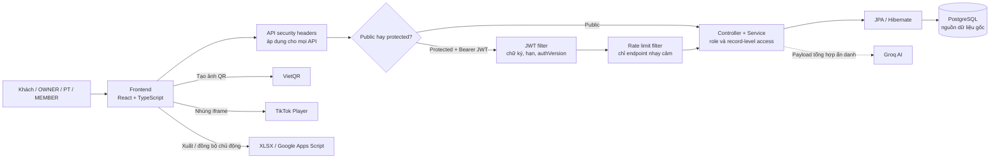

Hệ thống dùng kiến trúc web client-server: React chạy trên trình duyệt, Spring Boot cung cấp REST API, PostgreSQL lưu dữ liệu nghiệp vụ. Frontend chỉ điều hướng, hiển thị và gửi request; backend là nơi xác nhận JWT, quyền, dữ liệu đầu vào và quy tắc nghiệp vụ trước khi thay đổi database.

Ranh giới tích hợp được giữ rõ ràng. Groq chỉ được backend gọi sau khi dữ liệu đã được tổng hợp; TikTok và VietQR hỗ trợ hiển thị trên giao diện; XLSX và Google Apps Script là luồng xuất/đồng bộ do frontend khởi tạo. Không dịch vụ ngoài nào trong số này được coi là nguồn dữ liệu nghiệp vụ thay cho PostgreSQL.

### 3.2.2. Cấu trúc backend

Backend tổ chức theo **module nghiệp vụ trước, lớp kỹ thuật sau**. Mỗi module có thể sở hữu controller, DTO, service, repository và entity phù hợp thay vì gom toàn bộ controller hoặc entity của hệ thống vào một thư mục lớn. Cách tổ chức này giúp một thay đổi trong nghiệp vụ gói tập, PT hoặc tài chính có phạm vi dễ nhận biết.

**Hình 3.3. Cấu trúc các lớp backend**

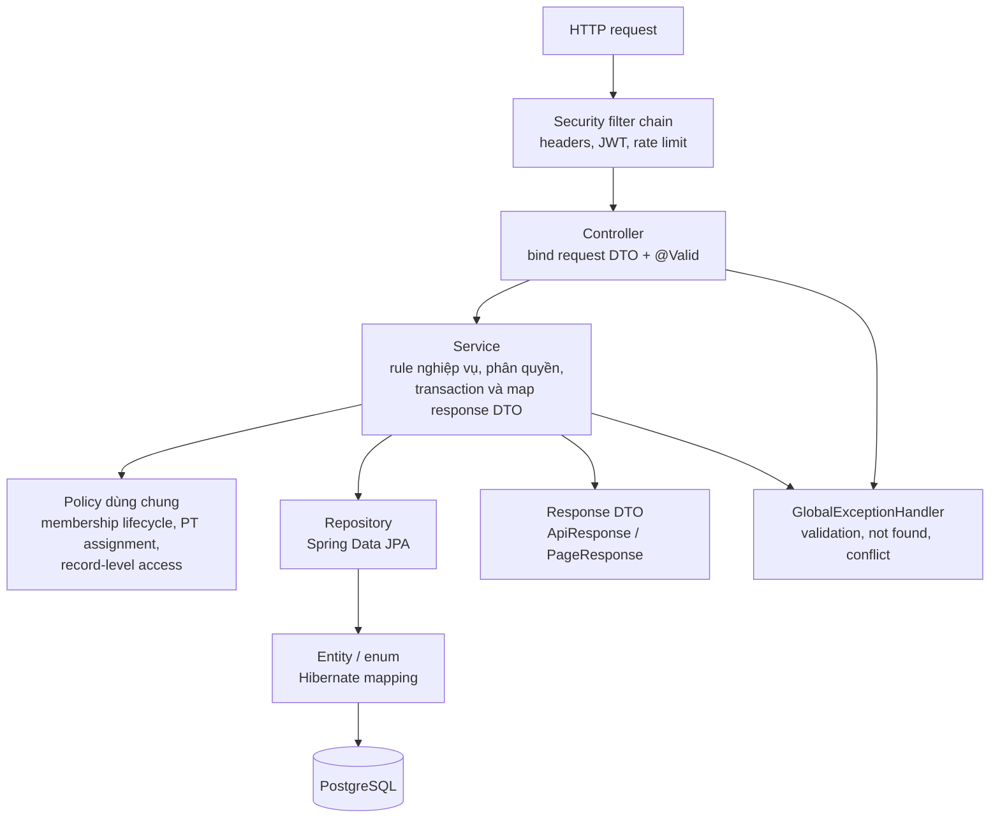

`SecurityConfig` lắp filter chain và chính sách route; `JwtAuthenticationFilter`, `SensitiveEndpointRateLimitFilter` và `ApiSecurityHeadersFilter` là các cross-cutting component dùng chung. Các lỗi trước hoặc trong filter có thể trả JSON trực tiếp qua security handler/filter; lỗi validation và nghiệp vụ trong controller/service thường được chuẩn hóa bởi `GlobalExceptionHandler`. Vì vậy không phải mọi lỗi đều đi qua cùng một lớp xử lý exception.

| Nhóm mã | Trách nhiệm tiêu biểu |
| --- | --- |
| `common` | Cấu hình, security, exception, response chung, enum, đồng hồ ứng dụng, chuẩn hóa số điện thoại và cấu hình VietQR. |
| `auth`, `user` | Đăng nhập, đổi mật khẩu, JWT, tài khoản, role và quản lý nhân sự. |
| `member`, `membership` | Hồ sơ hội viên, portal, danh mục gói, lượt đăng ký/gia hạn và policy vòng đời gói. |
| `finance` | Phiếu thu, công nợ, tổng hợp tài chính và đồng bộ số dư liên quan. |
| `pt`, `training` | Hồ sơ PT, phân công, lịch hẹn, gói buổi, nhật ký tập/ôn tập; entity và repository cho số đo, mục tiêu. |
| `dashboard`, `ai` | Dashboard, báo cáo, nhắc việc, rule rủi ro và cố vấn AI/kịch bản. |
| `exercise` | Danh mục, video bài tập và API public/OWNER. |

Controller chỉ nhận request, áp dụng `@Valid`, lấy principal khi cần và trả DTO. Service giữ phần điều phối/kiểm tra quan hệ bản ghi; ví dụ `MemberMembershipService` phối hợp lượt đăng ký, công nợ, phiếu thu ban đầu và gói buổi PT trong một transaction. Repository không được dùng làm nơi chứa quyết định nghiệp vụ. Entity mô tả mapping JPA; DTO tách contract API khỏi entity nên tránh trả trực tiếp password hash hoặc quan hệ nội bộ.

### 3.2.3. Cấu trúc frontend

Frontend cũng chia theo feature, tránh để toàn bộ page, request và type nằm lẫn trong một nơi. `App.tsx` khai báo route bằng `lazy` và `Suspense`; `AuthProvider` khôi phục phiên qua `/v1/auth/me`; `ProtectedRoute`, `PublicOnlyRoute` và `RoleGuard` hỗ trợ điều hướng theo trạng thái đăng nhập/role.

**Hình 3.4. Cấu trúc ứng dụng frontend**

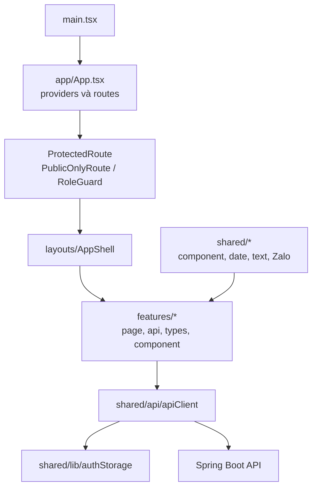

`apiClient` tập trung base URL, gắn `Authorization: Bearer <token>`, mở envelope `ApiResponse` và chuẩn hóa lỗi thành `ApiClientError`. Khi nhận `401`, client xóa token và phát sự kiện để `AuthProvider` đưa người dùng về đăng nhập. Token được lưu ở `localStorage` khi chọn duy trì đăng nhập, hoặc `sessionStorage` khi không chọn; đây là lựa chọn hiện có cho MVP, không thay thế biện pháp phòng chống XSS khi triển khai production.

Các feature như `members`, `payments`, `pt-schedule`, `reports`, `settings`, `exercises` và `member-portal` đặt API client, type và page liên quan gần nhau. Guard frontend nâng chất lượng trải nghiệm nhưng không phải lớp bảo mật cuối: request thủ công vẫn bị backend xác minh JWT, role và quyền trên bản ghi.

### 3.2.4. Điểm tích hợp và dữ liệu đi qua ranh giới

| Tích hợp | Bên khởi tạo | Dữ liệu/ý nghĩa | Không thực hiện |
| --- | --- | --- | --- |
| Groq | Backend | Nhận payload tổng hợp, ẩn danh theo segment để trả tư vấn AI. | Không nhận tên, SĐT, email, địa chỉ hoặc từng giao dịch cá nhân; không tự ghi dữ liệu gym. |
| VietQR | Frontend theo cấu hình backend | Tạo ảnh QR chứa thông tin chuyển khoản và số tiền để người dùng quét. | Không có webhook ngân hàng, không tự tạo `Payment` hoặc giảm nợ. |
| TikTok Player | Frontend | Phát video theo ID được backend trích xuất/lưu từ URL hợp lệ. | Không tải video vào PostgreSQL và không quản lý lượt xem. |
| Google Apps Script | Frontend | Gửi bản sao dữ liệu báo cáo đến Web App khi OWNER chủ động đồng bộ. | Không thay PostgreSQL và không phải API backend. |
| XLSX | Frontend | Tạo file `.xlsx` từ dữ liệu đã tải để đối soát. | Không phải backup/restore đầy đủ database. |

## 3.3. Thiết kế các luồng xử lý

### 3.3.1. Luồng đăng nhập

**Hình 3.5. Trình tự đăng nhập và giới hạn đăng nhập**

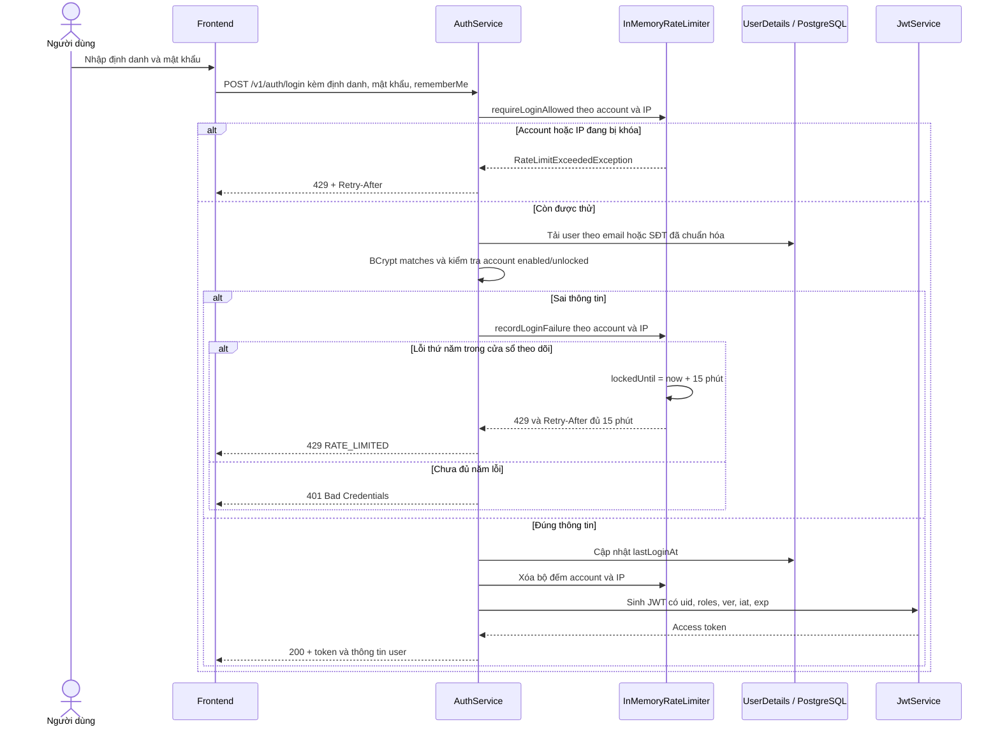

`AuthService` kiểm tra limit trước khi tải tài khoản. Bộ đếm được giữ theo cả định danh và IP server nhìn thấy; nhập đúng chỉ xóa bộ đếm sau khi đã xác thực thành công. Năm lỗi phải nằm trong cửa sổ 15 phút tính từ lần sai đầu. Ngay ở lỗi thứ năm, `lockedUntil` được đặt mới bằng thời điểm lỗi cộng 15 phút, nên mật khẩu đúng trong thời gian khóa vẫn nhận `429`.

Frontend đọc header `Retry-After` để hiển thị thời gian chờ. Bộ đếm dùng `ConcurrentHashMap` trong RAM của một tiến trình: restart làm mất trạng thái, không chia sẻ giữa nhiều instance và không thay thế Redis hoặc cơ chế chống brute-force ở tầng hạ tầng khi triển khai lớn.

### 3.3.2. Luồng đổi mật khẩu và thu hồi phiên cũ

**Hình 3.6. Đổi mật khẩu và thu hồi JWT theo phiên bản**

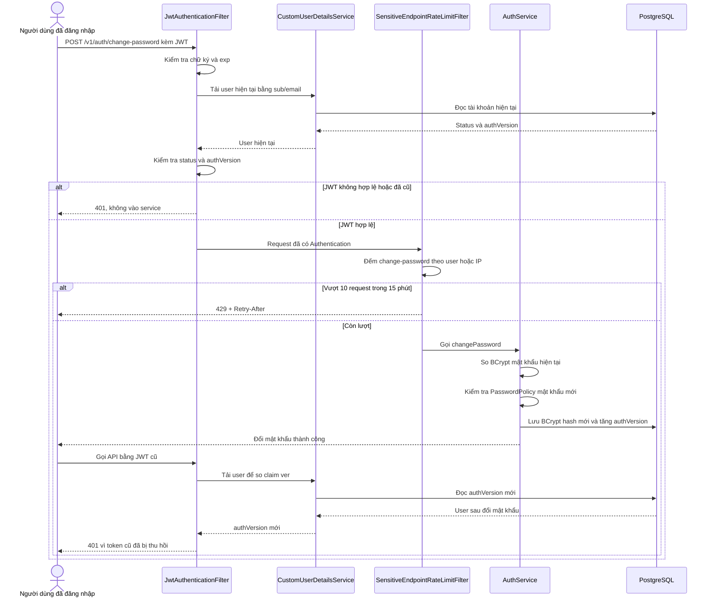

Luồng này yêu cầu JWT đang hợp lệ, mật khẩu hiện tại đúng và mật khẩu mới qua `PasswordPolicy`. `AuthService` băm mật khẩu mới bằng `PasswordEncoder`, rồi gọi `revokeActiveTokens()` trước khi lưu user trong transaction. JWT đã phát hành không bị sửa nội dung, nhưng lần request tiếp theo bị `JwtAuthenticationFilter` từ chối vì claim `ver` không còn bằng `authVersion` hiện tại. Reset mật khẩu PT/portal cũng áp dụng cơ chế version theo luồng service tương ứng.

### 3.3.3. Luồng đăng ký và thu ban đầu

**Hình 3.7. Trình tự đăng ký gói và thu tiền ban đầu**

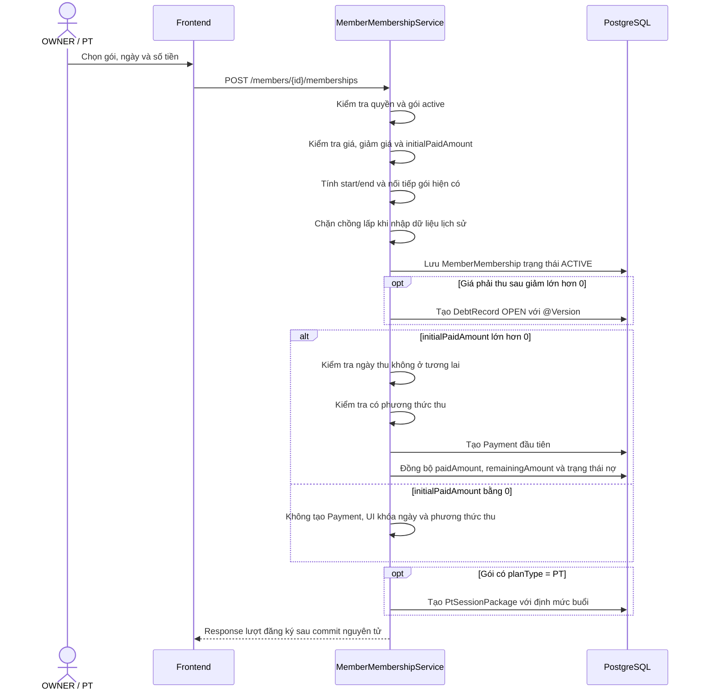

Các thao tác database nằm trong ranh giới transaction của service. Hình là sơ đồ nghiệp vụ rút gọn, không thể hiện từng lời gọi repository hoặc mọi nhánh exception.

### 3.3.4. Thu nhiều đợt và đồng bộ công nợ

**Hình 3.8. Thu nợ nhiều đợt và đồng bộ công nợ**

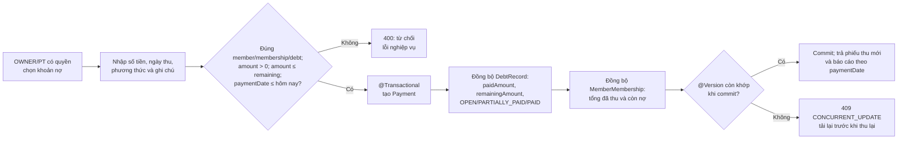

Một lượt đăng ký và một phiếu thu là hai đối tượng khác nhau. Khi đăng ký, `MemberMembershipService` tạo khoản nợ bằng số phải thu sau giảm giá; nếu `initialPaidAmount` lớn hơn 0, service mới tạo phiếu thu đầu tiên. Nếu số tiền thu trước bằng 0, không có `Payment` và không cần lưu ngày/phương thức thu.

Ví dụ giá thực tế 11.200.000 đồng, không giảm giá, khách trả trước 5.000.000 đồng chuyển khoản và vài ngày sau trả 6.200.000 đồng tiền mặt:

| Lần ghi nhận | Số tiền | Phương thức | Kết quả |
| --- | ---: | --- | --- |
| Đăng ký gói | 11.200.000 đồng cần thu | — | Tạo lượt đăng ký và khoản nợ ban đầu. |
| Phiếu thu 1 | 5.000.000 đồng | Chuyển khoản | Một `Payment`; nợ còn 6.200.000 đồng. |
| Phiếu thu 2 | 6.200.000 đồng | Tiền mặt | Một `Payment` khác; nợ về 0 và chuyển `PAID`. |

`PaymentService` kiểm tra hội viên, membership và debt có liên hệ hợp lệ, số tiền không vượt số còn nợ, ngày thu không ở tương lai, rồi lưu phiếu và đồng bộ `paidAmount`, `remainingAmount`, trạng thái nợ và số đã thu/còn nợ của lượt đăng ký trong transaction. Báo cáo doanh thu dùng `paymentDate` của từng phiếu, nên tiền thu ở các tháng khác nhau được tính đúng kỳ phát sinh.

Ngày bắt đầu và kết thúc gói được `MemberMembershipService` xử lý độc lập với ngày thu. Thời hạn mặc định là `startDate + durationDays - 1`; gói bắt đầu từ hôm nay có thể được đẩy sau lượt chưa hủy kết thúc muộn nhất để tránh chồng thời hạn. Dữ liệu lịch sử được phép dùng ngày quá khứ nhưng bị từ chối nếu khoảng gói chồng lên lượt chưa hủy.

### 3.3.5. Phân công PT, lịch hẹn và ghi buổi

**Hình 3.9. Phân công, lịch hẹn và ghi nhận buổi PT**

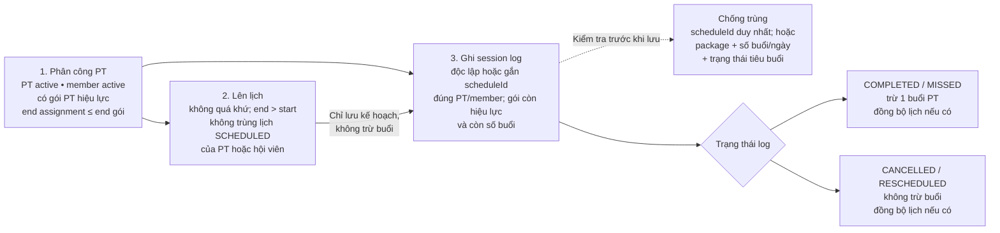

Phân công chỉ hợp lệ khi PT đang hoạt động, hội viên hoạt động và có gói PT phù hợp tại ngày bắt đầu; thời hạn phân công không được vượt giới hạn gói. Khi đặt lịch, service kiểm tra quyền, thời gian và xung đột lịch `SCHEDULED` của PT/học viên. Hai khoảng thời gian chỉ chạm biên, ví dụ 18:00–19:00 và 19:00–20:00, không bị xem là chồng nhau.

Lịch hẹn không tự trừ buổi. Khi ghi nhật ký, request có thể gửi `scheduleId` đã chọn cụ thể hoặc ghi độc lập; nếu có ID lịch, service xác minh lịch thuộc đúng PT/hội viên và đang `SCHEDULED` trước khi cập nhật trạng thái phù hợp. Hệ thống kiểm tra gói còn hiệu lực và còn buổi trước khi ghi; `COMPLETED` và `MISSED` tiêu buổi theo policy hiện tại, còn `CANCELLED`/`RESCHEDULED` không tiêu buổi. Ôn tập dùng activity log và định mức riêng; số đo chỉ được tạo khi thực sự đo.

### 3.3.6. Luồng AI

**Hình 3.10. Trình tự phân tích giữ chân và doanh thu**

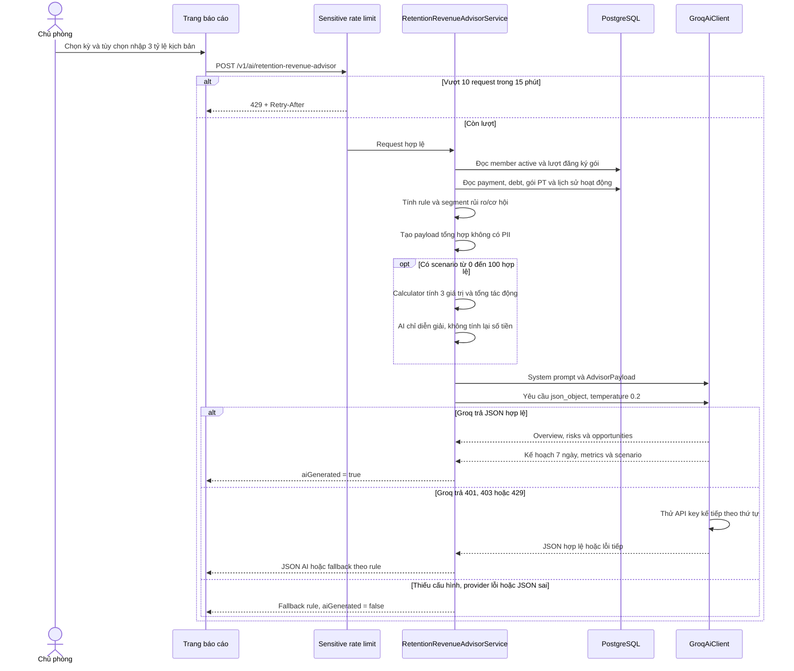

Ví dụ rule trong mã nguồn: gói còn tối đa 7 ngày được xét nhóm sắp hết hạn; gói PT còn tối đa 14 ngày và còn ít nhất 35% buổi PT có thể thuộc nhóm còn nhiều buổi gần hết hạn; gián đoạn hoạt động được xét theo mốc 21 ngày. Ngưỡng cụ thể phải được đối chiếu lại khi code thay đổi. Các phép đánh giá hiện trạng dùng ngày hiện tại, trong khi doanh thu có thể theo tháng được chọn; do đó chọn tháng quá khứ không tạo snapshot rủi ro hoàn chỉnh của tháng đó.

Với kịch bản, request chỉ hợp lệ khi có đủ ba tỷ lệ nguyên `0..100`: thu công nợ, khôi phục nhóm PT rủi ro và gia hạn/quay lại. `RetentionRevenueScenarioCalculator` tính tiền bằng backend trước khi gọi Groq. Nền gia hạn/quay lại loại bỏ các hội viên đã nằm trong nền PT rủi ro để không cộng lặp trong hai nhánh giữ chân. Kịch bản không tạo phiếu thu, công nợ, lượt đăng ký, lịch hay thay đổi trạng thái; nó chỉ trả response cho lần phân tích đang thực hiện.

### 3.3.7. Kiểm tra JWT và phân quyền theo request

**Hình 3.11. Kiểm tra JWT và quyền của request**

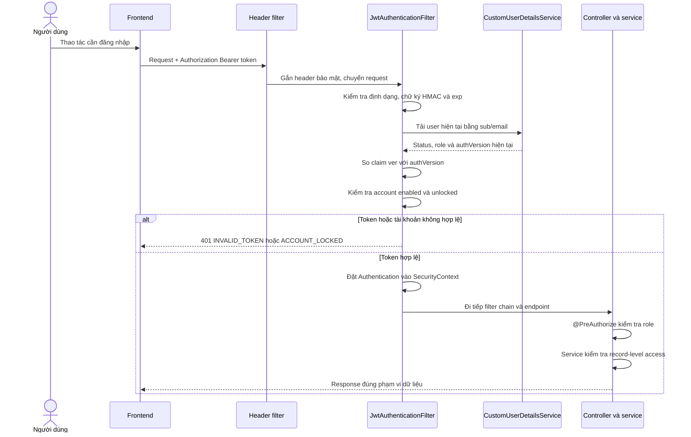

`JwtService` tạo token có header `alg=HS256`, ký HMAC-SHA256 từ secret cấu hình. Payload có `sub`, `uid`, `name`, `roles`, `ver`, `iat`, `exp`. Base64URL không phải mã hóa bảo mật: không đưa mật khẩu, key hoặc dữ liệu bí mật vào payload JWT.

Khi request có Bearer token, filter xác minh token, lấy định danh `sub`, tải lại user và quyền hiện tại, kiểm tra tài khoản còn hoạt động và so `ver` với `authVersion`. Sau đó authentication mới được đặt vào `SecurityContext`. Việc tải user từ database có nghĩa đây không phải cách kiểm tra chỉ dựa trên payload mà không chạm dữ liệu tài khoản.

Sau filter, `@PreAuthorize` và service tiếp tục quyết định request có được phép thao tác với dữ liệu cụ thể không. Nếu không có token hợp lệ, request vào vùng yêu cầu xác thực bị từ chối; có token hợp lệ nhưng thiếu quyền là tình huống khác.

### 3.3.8. Hiệu lực gói và dữ liệu portal

`MembershipLifecyclePolicy` phân biệt trạng thái lưu với hiệu lực theo ngày. Một lượt có `status = ACTIVE` nhưng ngày bắt đầu ở tương lai chưa phải gói đang hiệu lực hôm nay; lượt đã qua ngày kết thúc được diễn giải là `EXPIRED` khi đọc. Hệ thống không chạy scheduler để cập nhật đồng loạt mọi enum hết hạn trong database.

Portal lấy hội viên từ user ID trong `SecurityContext`, nên client MEMBER không truyền tùy ý ID hội viên muốn xem. Khi cấp mới portal, OWNER chỉ cấp cho hội viên `ACTIVE`, có số điện thoại và có ít nhất một membership hiệu lực; điều kiện này không bắt buộc phải là gói PT. Sau khi đã liên kết, account portal là quan hệ riêng và không tự bị xóa chỉ vì gói hết hạn.

## 3.4. Thiết kế cơ sở dữ liệu

### 3.4.1. Nguyên tắc thiết kế

Dữ liệu được chia theo các thực thể nghiệp vụ độc lập: tài khoản, hồ sơ hội viên, danh mục gói, từng lượt đăng ký, công nợ, từng phiếu thu và dữ liệu huấn luyện. Ba nguyên tắc giúp mô hình không bị nhập nhằng là: **gói niêm yết khác lượt mua của khách; lượt mua khác khoản nợ; khoản nợ khác từng phiếu thu**. Nhờ đó, một khách có thể mua/gia hạn nhiều lần và thanh toán nhiều đợt mà lịch sử vẫn truy vết được.

Mã nguồn hiện có 18 entity JPA và một bảng liên kết nhiều-nhiều `user_roles`, tương ứng 19 bảng ở PostgreSQL local đã được kiểm kê. Các entity dùng `BaseEntity` hoặc `AuditableEntity` tùy nhu cầu; trường `deleted` được giữ làm nền tảng soft-delete cho tương lai nhưng chưa phải cơ chế soft-delete áp dụng đồng loạt. `system_settings` là bảng key-value cho cấu hình VietQR nên không có cấu trúc audit giống toàn bộ bảng nghiệp vụ.

Mapping entity là schema ứng dụng mong đợi, không thay cho kiểm tra database thật của từng môi trường. Ở môi trường local, Hibernate đang dùng `ddl-auto: update`; Flyway đã được khai báo nhưng tắt. Vì `update` không phải lịch sử migration, thay đổi schema sau này cần có migration versioned, backup và kiểm tra dữ liệu trước khi triển khai.

### 3.4.2. ERD nhóm hội viên, gói và tài chính

**Hình 3.12. Quan hệ dữ liệu hội viên, gói và tài chính**

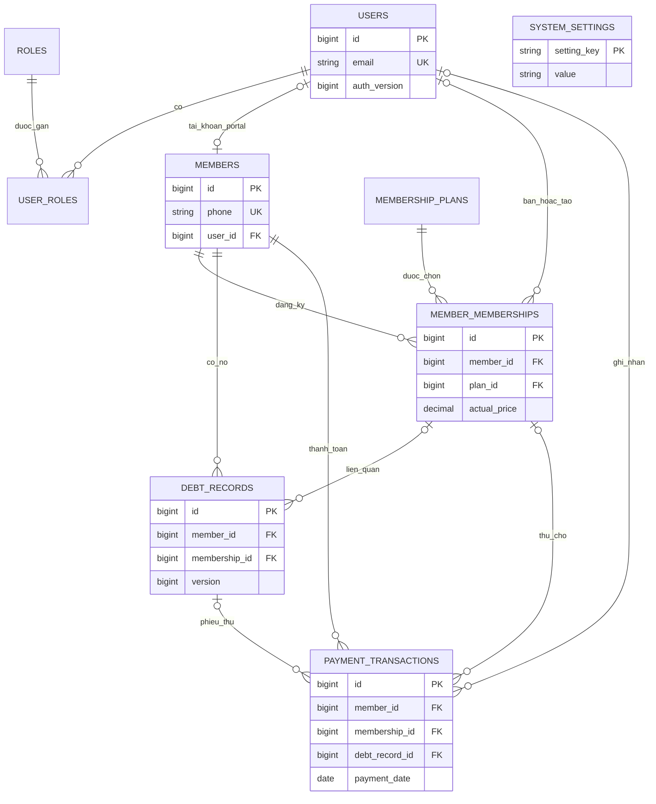

Hình 3.12 cùng Hình 3.13 bao phủ toàn bộ 18 entity JPA và bảng nối `user_roles`. Đây là ERD logic: chỉ giữ khóa/quan hệ quan trọng, không lặp các cột kế thừa `BaseEntity`/audit như `deleted`, `createdAt`, `updatedAt`. Các quan hệ audit tới `users` được gộp theo ý nghĩa “bán/tạo/ghi nhận”. `system_settings` độc lập nên không có đường nối.

### 3.4.3. ERD nhóm huấn luyện và thư viện

**Hình 3.13. Quan hệ dữ liệu huấn luyện và thư viện**

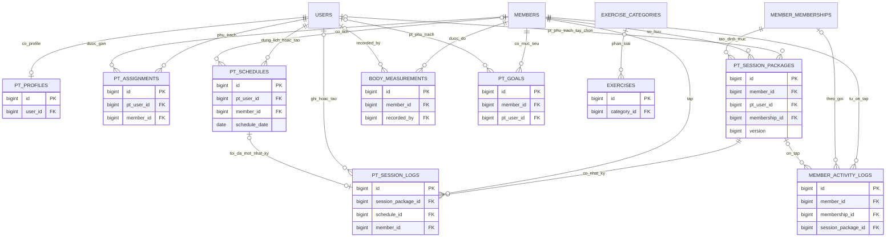

Các bảng `users`, `members` và `member_memberships` xuất hiện lại vì là điểm nối của miền PT. Một lịch hẹn có thể chưa có nhật ký, nhưng khi được liên kết thì service chỉ cho phép tối đa một `PtSessionLog` cho một `scheduleId`; đây là quy tắc nghiệp vụ được kiểm tra bằng service, chưa phải UNIQUE constraint trên bảng. Không diễn giải một quan hệ tùy chọn trong ERD thành quy tắc bắt buộc cho mọi request; các điều kiện hiệu lực, quyền truy cập và trạng thái do service/policy kiểm tra theo ngày thao tác.

### 3.4.4. Từ điển dữ liệu: tài khoản và hội viên

| Bảng | Mục đích | Trường / quan hệ cần chú ý |
| --- | --- | --- |
| `users` | Tài khoản đăng nhập | Email, phone, password hash, họ tên, trạng thái, `last_login_at`, `auth_version`. |
| `roles` | Danh mục vai trò | Các mã OWNER, PT, MEMBER. |
| `user_roles` | Liên kết tài khoản–vai trò | Một user có thể có nhiều role; OWNER có thể kiêm PT. |
| `members` | Hồ sơ hội viên | Họ tên, điện thoại, ngày sinh, giới tính, địa chỉ, nguồn, trạng thái, ghi chú; `phone` UNIQUE sau chuẩn hóa và `user_id` UNIQUE khi liên kết portal. |

Mật khẩu chỉ nên được lưu và xử lý dưới dạng hash trong hệ thống; tài liệu và ảnh demo không chứa mật khẩu thật. Dữ liệu số điện thoại hội viên được chuẩn hóa theo logic đang triển khai trước khi xử lý trùng.

### 3.4.5. Từ điển dữ liệu: gói, đăng ký và tài chính

| Bảng | Mục đích | Trường / quan hệ cần chú ý |
| --- | --- | --- |
| `membership_plans` | Danh mục gói | Loại gói, thời hạn ngày, giá mặc định, số buổi PT/ôn tập/hướng dẫn, trạng thái active. |
| `member_memberships` | Từng lượt mua hoặc gia hạn | Member, plan, ngày bắt đầu/kết thúc, giá thực tế, giảm giá, đã thu, còn nợ, status và người bán. |
| `debt_records` | Khoản cần thu | Member, membership có thể liên kết, số gốc, đã thu, còn lại, hạn, trạng thái và version. |
| `payment_transactions` | Từng lần thu thực tế được ghi nhận | Member, membership, debt, ngày thu, số tiền, phương thức, nhóm doanh thu, ghi chú và `created_by` - tài khoản đã ghi nhận khoản thu. |

Về nghiệp vụ, một lượt đăng ký có thể phát sinh nhiều phiếu thu. `payment_transactions` là nguồn để tổng hợp doanh thu đã ghi nhận; không có bảng chi phí làm căn cứ tính lợi nhuận thực tế trong phạm vi hiện tại.

### 3.4.6. Từ điển dữ liệu: PT và tiến trình

| Bảng | Mục đích | Trường / quan hệ cần chú ý |
| --- | --- | --- |
| `pt_profiles` | Hồ sơ PT | Liên kết user UNIQUE, cấp PT, chuyên môn, giới thiệu và trạng thái hoạt động; không lưu dữ liệu payroll. |
| `pt_assignments` | Phân công học viên | PT, member, khoảng ngày, trạng thái và ghi chú. |
| `pt_schedules` | Lịch hẹn | PT, member có thể liên kết, ngày, giờ, trạng thái, ghi chú, người tạo. |
| `pt_session_packages` | Định mức buổi của lượt đăng ký PT | Member, membership, PT có thể liên kết, tổng/đã dùng/còn lại, thời hạn, trạng thái và version. |
| `pt_session_logs` | Nhật ký buổi PT | Gói buổi, member, PT/lịch liên quan, ngày, số thứ tự buổi tùy chọn, trạng thái, nội dung, cân nặng và ghi chú. |
| `member_activity_logs` | Nhật ký ôn tập hoặc hướng dẫn | Member, membership/gói buổi liên quan, loại hoạt động, ngày, số thứ tự buổi tùy chọn và ghi chú. |
| `body_measurements` | Số đo thực tế | Member bắt buộc bằng khóa ngoại `member_id -> members.id`, ngày đo, người ghi, cân nặng, chiều cao và các vòng đo được hỗ trợ, ghi chú. |
| `pt_goals` | Mục tiêu huấn luyện | Member, PT, loại và mô tả mục tiêu, thời gian, chỉ số mục tiêu, trạng thái. |

`pt_profiles` không chứa lương, tỷ lệ dạy hay hoa hồng. Hệ thống lưu lịch và nhật ký PT để điều phối gói tập và theo dõi tiến trình hội viên, không tự quy đổi các buổi đó thành thu nhập.

### 3.4.7. Từ điển dữ liệu: thư viện và cấu hình

| Bảng | Mục đích | Trường / quan hệ cần chú ý |
| --- | --- | --- |
| `exercise_categories` | Danh mục bài tập | Tên, slug, mô tả, icon, thứ tự và active. |
| `exercises` | Thông tin video bài tập | Danh mục, tên, slug, mô tả, nhóm cơ, độ khó, thiết bị, URL và ID TikTok, trạng thái. |
| `system_settings` | Cấu hình dạng key–value | Các key VietQR, giá trị và thời gian cập nhật. |

Hệ thống hiện không triển khai bộ đếm lượt xem video. TikTok là bên cung cấp nội dung/phát video, không phải nơi lưu hồ sơ hội viên của ứng dụng.

### 3.4.8. Ràng buộc, ACID và cập nhật đồng thời

| Tình huống cần bảo vệ | Cơ chế hiện có | Ý nghĩa trong nghiệp vụ |
| --- | --- | --- |
| Tài khoản và liên kết một-một | UNIQUE email; PostgreSQL local đã có UNIQUE `members.phone`, `members.user_id`, `pt_profiles.user_id`. | Không liên kết một portal/PT profile cho nhiều người; số điện thoại hội viên được chuẩn hóa trước khi kiểm tra trùng. |
| Dữ liệu liên quan | Khóa ngoại và kiểm tra service giữa member, membership, debt và session package. | ID cùng tồn tại không đủ; service vẫn xác nhận chúng thuộc đúng hội viên/gói. |
| Thu tiền | `@Transactional` trong `PaymentService.create`. | Phiếu thu, số đã thu/còn lại của nợ và lượt đăng ký cùng commit hoặc cùng rollback. |
| Đăng ký gói | `@Transactional` trong `MemberMembershipService.create`. | Lượt đăng ký, khoản nợ, phiếu thu đầu nếu có và gói buổi PT nếu có được xử lý như một đơn vị công việc. |
| Ghi buổi PT | Transaction trong `PtService`; kiểm tra gói, lịch và định mức. | Không ghi buổi vào gói hết hạn/hết định mức; lịch chỉ cập nhật khi nhật ký hợp lệ. |
| Cập nhật cạnh tranh | `@Version` trên `DebtRecord` và `PtSessionPackage`. | Hibernate phát hiện bản ghi đã bị transaction khác thay đổi thay vì âm thầm ghi đè số nợ hoặc số buổi. |

Ví dụ phù hợp với mô hình phòng gym là hai tài khoản OWNER, chẳng hạn vợ và chồng, cùng mở một khoản nợ 6,2 triệu đồng. Transaction ghi phiếu đầu tiên cập nhật `DebtRecord` và làm tăng version. Khi transaction còn lại commit với version cũ, Hibernate ném lỗi optimistic locking; `GlobalExceptionHandler` ánh xạ thành HTTP 409 và toàn bộ transaction thu tiền đó rollback. Người thao tác cần tải lại khoản nợ trước khi ghi lại.

`BigDecimal` được dùng cho tiền; `LocalDate` dùng cho ngày nghiệp vụ như ngày thu/ngày tập; `Instant` dùng cho các mốc thời gian kỹ thuật như lần đăng nhập. Các quan hệ chính dùng `LAZY` và `open-in-view` tắt, vì vậy service phải tạo DTO trong phạm vi transaction phù hợp thay vì để giao diện truy cập trực tiếp entity.

**Phân quyền thu tiền hiện trạng:** `PaymentController` và `DebtController` cho phép OWNER hoặc PT thao tác; với PT, `MemberAccessService` chỉ mở dữ liệu của hội viên trong phạm vi được phép. Mỗi phiếu thu mới gắn `created_by` theo tài khoản đang đăng nhập. `PaymentResponse` trả `createdByName`, vì vậy bảng lịch sử Thanh toán và lịch sử thu tiền trong hồ sơ hội viên hiển thị rõ người đã ghi nhận khoản thu. Phiếu dữ liệu cũ không có người tạo hiển thị dấu `-`, không tự suy diễn người thao tác.

### 3.4.9. Quản lý schema và khả năng mở rộng

Entity mô tả schema mà ứng dụng mong đợi; PostgreSQL thực tế có thể khác do lịch sử thay đổi. Khi thay đổi cấu trúc, cần kiểm tra bảng, cột, index, khóa ngoại và dữ liệu trước khi áp dụng. Không dùng reset database hoặc xóa bảng để “làm sạch” khi có dữ liệu vận hành.

Flyway đã được khai báo với vị trí migration chuẩn nhưng đang tắt trong cấu hình local. Đây là nền tảng để khi yêu cầu mở rộng được chốt, mỗi thay đổi schema có thể được version hóa, chạy theo thứ tự và bảo toàn dữ liệu tốt hơn so với chỉ dựa vào Hibernate `ddl-auto: update`.

## 3.5. Thiết kế API

### 3.5.1. Quy ước chung

Backend mặc định chạy tại `http://localhost:8080/api`; các đường dẫn trong bảng dưới đây đã bao gồm `/api`. Phần lớn API nghiệp vụ trả response theo `ApiResponse`; riêng `GET /v1/health` và Actuator dùng response kiểm tra sức khỏe riêng. Lỗi nghiệp vụ do `GlobalExceptionHandler` và lỗi ở security filter do các handler/nhánh response tương ứng xử lý. Không đưa JWT hay thông tin cá nhân thật vào báo cáo kiểm thử.

| Nhóm | Endpoint tiêu biểu | Quyền và chức năng |
| --- | --- | --- |
| Xác thực | `POST /api/v1/auth/login` | Public; xác thực và nhận JWT. |
| Phiên | `GET /api/v1/auth/me`, `POST /api/v1/auth/change-password` | Người dùng đã xác thực. |
| Hội viên | `GET, POST /api/v1/members`; `GET /api/v1/members/page`; `GET /api/v1/members/statistics`; `GET, PUT /api/v1/members/{id}` | OWNER/PT; có kiểm tra phạm vi, bảng quản trị dùng trang phân trang và KPI riêng. |
| Portal | `GET /api/v1/member-portal/me` | MEMBER xem dữ liệu gắn với tài khoản. |
| Tài khoản portal | `/api/v1/members/{id}/portal-account` và các thao tác status/reset | OWNER quản lý; chỉ cấp mới cho hội viên `ACTIVE` có membership hiệu lực, không bắt buộc gói PT. |
| Gói | `/api/v1/membership-plans`; `/api/v1/public/membership-plans`; `/api/v1/members/{id}/memberships` | Danh mục nội bộ, bảng giá công khai chỉ gồm gói đang bán và đăng ký theo quyền. |
| Thu/nợ | `GET, POST /api/v1/payments`; `GET /api/v1/payments/page`, `/summary`; `GET /api/v1/debts`, `/page` | OWNER/PT, kiểm tra hội viên liên quan; bảng quản trị phân trang, KPI tài chính tách response. |
| PT | `/api/v1/pt/assignments`, `/schedules`, `/members/{memberId}/...` | Phân công, lịch và ghi nhận PT theo method và quyền. |
| Dashboard | `/api/v1/dashboard/owner`, `/api/v1/reports/finance`, `/api/v1/reports/members` | OWNER. |
| AI | `POST /api/v1/ai/retention-revenue-advisor` | OWNER. |
| Cài đặt | `/api/v1/settings/team-users`, `/api/v1/settings/vietqr` | OWNER quản lý nhân sự và VietQR. |
| Public settings | `/api/v1/public/membership-plans`, `/api/v1/public/vietqr-setting` | Public; endpoint gói chỉ trả gói active. Endpoint VietQR trả cấu hình hiện có; frontend chỉ dựng QR khi cấu hình đang bật và đủ dữ liệu nhận tiền. |
| Thư viện | `/api/v1/public/exercises`, `/api/v1/owner/exercises` | Public xem nội dung công bố; OWNER quản lý. |

Bảng là danh mục rút gọn. Tên method, tham số và request/response chính xác cần đối chiếu controller, DTO và tài liệu `plans/active/04-api-design.md`. Không suy ra có endpoint sửa hoặc xóa cho một tài nguyên nếu controller không khai báo.

### 3.5.2. Ví dụ dữ liệu và lỗi

Một request thu nợ có thể chứa định danh hội viên/khoản nợ, số tiền, phương thức và ngày thu. Backend kiểm tra dữ liệu này, không chỉ tin vào việc giao diện đã chọn đúng khách. Nếu bỏ ngày trong request được hỗ trợ, service chọn ngày hiện tại theo đồng hồ ứng dụng; ngày tương lai bị từ chối.

Một phản hồi thất bại có thể do dữ liệu không hợp lệ, không có quyền, không tìm thấy bản ghi, xung đột cập nhật hoặc bị giới hạn. Với HTTP 429, frontend có thể đọc `Retry-After` để biết thời gian chờ. Mã trạng thái không thay thế việc xem nội dung lỗi và ngữ cảnh nghiệp vụ.

### 3.5.3. Ví dụ request và cấu trúc phản hồi

Ví dụ minh họa một lần thu công nợ qua `POST /api/v1/payments`. Các ID và ngày dưới đây là dữ liệu giả, phải thay bằng bản ghi hợp lệ trong database thử; giá trị ngày cũng phải không ở tương lai tại thời điểm thực hiện.

```json
{
  "memberId": 101,
  "debtRecordId": 205,
  "membershipId": 301,
  "paymentDate": "2026-10-01",
  "amount": 6200000,
  "paymentMethod": "CASH",
  "note": "Thu phần công nợ còn lại"
}
```

Request cần JWT của người có quyền. `memberId`, `debtRecordId` và `membershipId` trong ví dụ phải chỉ tới các bản ghi có liên hệ hợp lệ; nếu không, backend từ chối. Request DTO yêu cầu `amount` tối thiểu 1 và có `paymentMethod`. Hai ID nợ/gói có thể không cùng được gửi trong một request, nhưng service vẫn phải resolve và kiểm tra khoản nợ tương ứng.

Cấu trúc chung của `ApiResponse` trong code gồm `success`, `message`, `data`, `error` và `timestamp`. Ví dụ hình dạng sau chỉ minh họa envelope, không phải kết quả của giao dịch ở trên:

```json
{
  "success": true,
  "message": "OK",
  "data": {},
  "error": null,
  "timestamp": "2026-10-01T02:00:00Z"
}
```

Nội dung `data`, mã trạng thái và thông báo cụ thể phụ thuộc endpoint; để kiểm thử phải quan sát response thực tế và DTO tương ứng. Không đưa mật khẩu hoặc JWT vào mẫu báo cáo.

### 3.5.4. Danh mục API chi tiết: xác thực, nhân sự, hội viên

Các đường dẫn trong bảng đã bao gồm context `/api`. Quyền ghi ở đây là lớp controller; các điều kiện trên bản ghi vẫn được service kiểm tra.

| Method | Đường dẫn | Quyền / công dụng |
| --- | --- | --- |
| POST | `/api/v1/auth/login` | Public; xác thực, áp dụng bộ đếm thất bại. |
| GET | `/api/v1/auth/me` | Tài khoản đã xác thực; lấy thông tin hiện tại. |
| POST | `/api/v1/auth/change-password` | Tài khoản đã xác thực; đổi mật khẩu của mình. |
| GET, POST | `/api/v1/settings/team-users` | OWNER; danh sách hoặc tạo nhân sự. |
| PUT | `/api/v1/settings/team-users/{id}/role` | OWNER; cập nhật role. |
| PUT | `/api/v1/settings/team-users/{id}/status` | OWNER; cập nhật trạng thái. |
| POST | `/api/v1/settings/team-users/{id}/reset-password` | OWNER; reset mật khẩu nhân sự. |
| GET, POST | `/api/v1/members` | OWNER/PT; danh sách hoặc tạo hội viên. |
| GET, PUT | `/api/v1/members/{id}` | OWNER/PT; xem/sửa theo phạm vi service. |
| POST, DELETE | `/api/v1/members/{id}/portal-account` | OWNER; tạo Portal khi hội viên `ACTIVE` có gói hiệu lực, hoặc gỡ liên kết. |
| PUT | `/api/v1/members/{id}/portal-account/status` | OWNER; đổi trạng thái tài khoản portal. |
| POST | `/api/v1/members/{id}/portal-account/reset-password` | OWNER; reset mật khẩu portal. |
| GET | `/api/v1/member-portal/me` | MEMBER; dữ liệu của tài khoản đang đăng nhập. |

### 3.5.5. Danh mục API chi tiết: gói, tài chính, PT

| Method | Đường dẫn | Quyền / công dụng |
| --- | --- | --- |
| GET | `/api/v1/membership-plans` | OWNER/PT; danh mục dùng trong luồng nghiệp vụ. |
| GET | `/api/v1/membership-plans/all` | OWNER; danh mục quản trị. |
| POST | `/api/v1/membership-plans` | OWNER; tạo gói. |
| PUT | `/api/v1/membership-plans/{id}/active` | OWNER; đổi trạng thái bán gói. |
| GET, POST | `/api/v1/members/{memberId}/memberships` | OWNER/PT; lịch sử hoặc đăng ký theo phạm vi. |
| GET, POST | `/api/v1/payments` | OWNER/PT; tra cứu hoặc tạo phiếu thu. `/page` là contract phân trang; `/summary` trả KPI tài chính. |
| GET | `/api/v1/debts` | OWNER/PT; tra cứu công nợ theo phạm vi. `/page` là contract phân trang. |
| GET, POST | `/api/v1/pt/profiles` | OWNER/PT; xem/lưu profile theo điều kiện quyền. |
| GET | `/api/v1/pt/my-members` | OWNER/PT; danh sách học viên theo quyền. |
| POST | `/api/v1/pt/assignments` | OWNER/PT; phân công theo điều kiện service. |
| PUT | `/api/v1/pt/assignments/{assignmentId}/reassign` | OWNER; chuyển PT phụ trách. |
| GET, POST | `/api/v1/pt/schedules` | OWNER/PT; đọc hoặc tạo lịch. |
| DELETE | `/api/v1/pt/schedules/{scheduleId}` | OWNER/PT; xóa lịch nếu thỏa điều kiện. |
| GET | `/api/v1/pt/session-packages` | OWNER/PT; gói buổi theo phạm vi. |
| GET | `/api/v1/pt/members/{memberId}` | OWNER/PT; chi tiết PT của học viên. |
| POST | `/api/v1/pt/members/{memberId}/session-logs` | OWNER/PT; ghi nhật ký buổi PT. |
| POST | `/api/v1/pt/members/{memberId}/activity-logs` | OWNER/PT; ghi hoạt động ôn tập/hướng dẫn. |
| POST | `/api/v1/pt/members/{memberId}/body-measurements` | OWNER/PT; ghi số đo. |
| POST | `/api/v1/pt/members/{memberId}/goals` | OWNER/PT; tạo mục tiêu. |

### 3.5.6. Danh mục API chi tiết: báo cáo, cài đặt và thư viện

| Method | Đường dẫn | Quyền / công dụng |
| --- | --- | --- |
| GET | `/api/v1/dashboard/owner` | OWNER; tổng quan vận hành. |
| GET | `/api/v1/reports/finance`, `/api/v1/reports/members` | OWNER; tổng hợp báo cáo. |
| GET | `/api/v1/notifications` | OWNER; dữ liệu nhắc việc backend. |
| POST | `/api/v1/ai/retention-revenue-advisor` | OWNER; yêu cầu phân tích. |
| GET, PUT | `/api/v1/settings/vietqr` | OWNER; đọc/cập nhật cấu hình VietQR. |
| GET | `/api/v1/public/membership-plans` | Public; danh sách gói active với DTO công khai tối thiểu. |
| GET | `/api/v1/public/vietqr-setting` | Public; dữ liệu VietQR cho chức năng hiển thị. |
| GET | `/api/v1/public/exercise-categories`, `/api/v1/public/exercises` | Public; danh mục và bài tập được công bố. |
| GET | `/api/v1/public/exercises/{slugOrId}` | Public; chi tiết bài tập. |
| GET, POST | `/api/v1/owner/exercise-categories`, `/api/v1/owner/exercises` | OWNER; danh sách hoặc tạo. |
| PUT | `/api/v1/owner/exercise-categories/{id}`, `/api/v1/owner/exercises/{id}` | OWNER; cập nhật. |
| PATCH | `/api/v1/owner/exercises/{id}/published` | OWNER; thay đổi trạng thái công bố. |
| DELETE | `/api/v1/owner/exercises/{id}` | OWNER; xóa bài tập theo logic service. |
| GET | `/api/v1/health`, `/api/actuator/health` | Public theo security config; kiểm tra tình trạng backend. |

Xuất XLSX và gửi Google Apps Script không xuất hiện trong bảng API backend vì được frontend xử lý; TikTok và Groq có ranh giới khác nhau như mục 2.8.

### 3.5.7. Xử lý lỗi và mã trạng thái

| Tình huống | Status / mã tiêu biểu trong code | Cách hiểu |
| --- | --- | --- |
| DTO hoặc dữ liệu đầu vào không hợp lệ | 400; `VALIDATION_ERROR`, `BAD_REQUEST` hoặc mã liên quan | Kiểm tra field, định dạng và quy tắc service. |
| Sai mật khẩu hoặc thiếu/xấu token | 401; ví dụ `BAD_CREDENTIALS`, `INVALID_TOKEN` | Chưa được xác thực hợp lệ. |
| Không có quyền | 403; `ACCESS_DENIED` | Đã hoặc đang được đánh giá quyền nhưng không được thực hiện. |
| Không tìm thấy tài nguyên | 404; `RESOURCE_NOT_FOUND` | Bản ghi hoặc tài nguyên được yêu cầu không tồn tại theo logic xử lý. |
| Xung đột nghiệp vụ/cập nhật | 409; `CONFLICT` hoặc `CONCURRENT_UPDATE` | Cần kiểm tra trạng thái và tải lại trước khi thử lại. |
| Vượt giới hạn | 429; `RATE_LIMITED` và `Retry-After` | Chờ theo số giây được trả. |
| Lỗi chưa được xử lý riêng | 500; `INTERNAL_SERVER_ERROR` | Xem log backend an toàn để tìm nguyên nhân, không công bố dữ liệu nhạy cảm. |

Không phải mọi lỗi đều đi qua cùng một handler: lỗi bảo mật trong filter có nhánh response riêng, còn lỗi nghiệp vụ thường do `GlobalExceptionHandler` xử lý.

## 3.6. Bảo mật và phân quyền

### 3.6.1. Mật khẩu và phiên

Chính sách mật khẩu trong `PasswordPolicy` yêu cầu tối thiểu 8 ký tự, có chữ và số, không trùng định danh theo các kiểm tra được triển khai. Chính sách được gọi trong các luồng tạo, đổi và reset liên quan. Đổi/reset làm tăng `authVersion`; token có version không còn phù hợp sẽ bị từ chối khi kiểm tra. `lastLoginAt` được cập nhật sau đăng nhập thành công.

Policy bỏ khoảng trắng ở hai đầu trước khi kiểm tra mật khẩu mới. Với định danh có ít nhất tám chữ số, code còn so chuỗi chữ số rút ra từ mật khẩu với chuỗi chữ số của định danh; vì vậy mật khẩu có thêm chữ nhưng toàn bộ phần chữ số vẫn trùng số điện thoại cũng có thể bị từ chối. Đây là điều kiện thực tế của policy, không chỉ là phép so bằng văn bản nguyên vẹn.

Việc thu hồi token theo version không thay thế mọi biện pháp bảo mật: vẫn cần giữ bí mật JWT, quản lý thiết bị, cấu hình môi trường và đánh giá XSS khi triển khai thực tế.

### 3.6.2. Rate limit

Login dùng giới hạn theo định danh và IP như mục 3.3.1. Bộ lọc endpoint nhạy cảm hiện nhận diện một số request POST như đổi mật khẩu, tạo/reset tài khoản nhân sự hoặc portal, và AI advisor; ngưỡng trong code là 10 request/15 phút theo operation và actor hoặc IP. Không khẳng định backend đã rate-limit việc xuất XLSX hoặc đồng bộ Sheets vì các thao tác đó được thực hiện ở frontend và không nằm trong danh sách filter hiện tại.

Các bộ đếm nằm trong RAM, mất khi khởi động lại và không đồng bộ giữa nhiều instance. IP dùng chung có thể ảnh hưởng nhiều người; khi đặt sau proxy, cần thiết kế lại cách xác định IP tin cậy.

### 3.6.3. Security headers và CORS

Backend áp dụng các header như `X-Content-Type-Options: nosniff`, `X-Frame-Options: DENY`, `Referrer-Policy`, `Permissions-Policy`, CSP cho response API và `Cache-Control: no-store`. CORS được cấu hình cho các origin phát triển. Các header trên response API không tự chứng minh HTML frontend đã có cùng chính sách; CORS không thay thế xác thực hay phân quyền.

### 3.6.4. Bảo vệ dữ liệu trong tích hợp ngoài

Payload AI được thiết kế theo cấu trúc tổng hợp, không đưa các trường tên, điện thoại, email hoặc từng giao dịch cá nhân. Tuy nhiên nhóm rất nhỏ có thể làm tăng rủi ro suy luận; không gọi là ẩn danh tuyệt đối. Khi dùng Google Sheets, dữ liệu gửi từ frontend có thể bao gồm hồ sơ và giao dịch, khác payload AI. Cần kiểm tra nơi nhận, quyền truy cập, cơ sở xử lý dữ liệu và không đưa token vào Git hoặc báo cáo.

### 3.6.5. Các lớp bảo vệ và trách nhiệm

| Lớp | Thành phần | Câu hỏi được giải quyết | Giới hạn |
| --- | --- | --- | --- |
| Điều hướng UI | `ProtectedRoute`, `RoleGuard` | Người dùng có nên thấy trang theo phiên/role? | Không ngăn client gọi API trực tiếp. |
| Security chain | `SecurityConfig`, JWT filter | Request có xác thực hợp lệ và được phép đi vào vùng bảo vệ? | Không thay thế kiểm tra quan hệ của dữ liệu. |
| Method security | `@PreAuthorize` | Role có được gọi nhóm endpoint này? | Hai PT cùng role không mặc nhiên có quyền trên mọi học viên. |
| Chính sách dữ liệu | `MemberAccessService`, `PtAssignmentPolicy`, `PtService` | User có quyền trên học viên/gói/lịch ở thời điểm áp dụng? | Cần xem từng method; không suy rộng một điều kiện cho mọi endpoint. |
| DTO/service validation | Validation annotation và service | Dữ liệu, số tiền, ngày và ID có hợp lệ? | Validation ở một tầng không thay thế kiểm tra ở tầng khác. |
| Database/transaction | FK, unique theo schema, transaction, version | Giảm rủi ro dữ liệu liên kết sai và xung đột ghi. | Constraint thực tế cần đối chiếu database; concurrency cần test. |

Các API public được khai báo riêng. Security chain dùng `STATELESS`, tắt form login và HTTP Basic; CSRF được tắt trong cấu hình hiện tại. Đây là mô tả thiết kế API hiện hành, không phải khuyến nghị áp dụng nguyên xi cho bất kỳ hệ thống dùng cookie hay ứng dụng khác.

### 3.6.6. Giải thích cụ thể quyền PT

`MemberAccessService.canAccessMember` cho OWNER đi qua nhánh quyền tổng quát; với PT, code cần user hiện tại, hội viên ACTIVE và policy PT phù hợp. `PtAssignmentPolicy.canAccessMember` yêu cầu có gói PT truy cập được theo ngày và PT liên quan; sau đó cho phép khi **chưa có bản ghi assignment nào**, hoặc có assignment hiệu lực của chính PT đó.

“Không có bản ghi assignment nào” khác “có lịch sử assignment nhưng không có assignment nào đang hiệu lực”. Nhánh đăng ký gói PT cho khách chưa có phân công có quy tắc riêng trong `ensureCanCreateMembership`. Cần đọc đúng method tương ứng trước khi kết luận PT có quyền bán gói, xem hồ sơ, tạo lịch hay ghi buổi.

Khi PT bán gói, các nhánh `resolveSoldByUser` và `resolvePtUserId` ngăn PT ghi nhận ID người khác làm người bán/người phụ trách theo các điều kiện trong service. OWNER có nhánh xử lý khác. Một OWNER kiêm PT có thể đi qua các nhánh OWNER tại những method kiểm tra OWNER trước; đây không phải cơ chế hai tài khoản độc lập.

### 3.6.7. Mật khẩu, JWT và các giới hạn của token

Mật khẩu được so bằng `PasswordEncoder` BCrypt, không lưu plaintext trong bảng user qua luồng thông thường. Chính sách hiện hành yêu cầu tối thiểu 8 ký tự, có chữ và số và so sánh với các định danh được truyền cho policy. Thay/reset mật khẩu tăng version để token cũ bị từ chối ở request tiếp theo.

Token HS256 được ký với secret cấu hình tại server. Người giữ token có thể gửi request trong thời gian token còn hợp lệ và tài khoản/version được chấp nhận; việc ký không làm nội dung payload trở thành bí mật. Không chụp JWT, mật khẩu hoặc secret vào báo cáo; không dùng secret phát triển mặc định trong hệ thống công khai.

Lựa chọn ghi nhớ làm thời hạn phiên dài hơn và dùng localStorage. Điều này thuận tiện nhưng tăng thời gian phơi nhiễm nếu token bị lộ; cần đánh giá XSS, thiết bị dùng chung và thời hạn phiên trước khi vận hành thật. Đăng xuất ở client xóa token lưu tại trình duyệt; không nên mô tả đó là danh sách thu hồi từng token trên server nếu code không có.

### 3.6.8. Rate limit: cơ chế và giới hạn thực tế

| Loại | Key và cửa sổ | Điều kiện chặn |
| --- | --- | --- |
| Login | Định danh trim/lowercase và IP `getRemoteAddr()`; năm lỗi phải nằm trong cửa sổ theo dõi 15 phút từ lỗi đầu. | Lỗi thứ năm đặt `lockedUntil` mới bằng 15 phút và trả 429 ngay; trong thời gian đó, một trong hai key còn khóa sẽ chặn cả mật khẩu đúng. |
| Thao tác nhạy cảm | Operation và actor đã xác thực, hoặc IP; 15 phút. | Được tiêu thụ tối đa 10 request trong cửa sổ; các request sau bị chặn theo logic filter. |

Login chuẩn hóa key bằng trim/lowercase, trong khi tra cứu user còn có chuẩn hóa số điện thoại. Vì vậy các cách viết khác nhau của một số có thể tạo các key định danh khác nhau, dù bộ đếm IP vẫn được áp dụng. Bộ đếm bị xóa khi process restart, không chia sẻ giữa instance và có thể ảnh hưởng người dùng chung IP. Một proxy cần cấu hình IP tin cậy trước khi có thể sử dụng chiến lược theo IP đáng tin cậy.

Filter nhạy cảm chỉ khớp các path/method được liệt kê trong code; ví dụ reset nhân sự và tạo/reset portal, không có nghĩa toàn bộ API được bảo vệ bằng cùng ngưỡng. Frontend hiển thị thời gian thử lại dựa trên thông tin server; không nên ghi nhận “khóa vĩnh viễn” cho trường hợp này.

### 3.6.9. Header và CORS: giải thích từng thành phần

| Thành phần | Tác dụng dự kiến | Không nên hiểu nhầm |
| --- | --- | --- |
| `X-Content-Type-Options: nosniff` | Hạn chế trình duyệt tự suy đoán kiểu nội dung trái khai báo. | Không ngăn mọi dạng nội dung độc hại. |
| `X-Frame-Options: DENY` | Chỉ dẫn không nhúng response vào frame ở trình duyệt hỗ trợ. | Header trên API không tự chứng minh HTML frontend được bảo vệ. |
| `Referrer-Policy: no-referrer` | Hạn chế gửi referrer theo chính sách trình duyệt. | Không mã hóa request. |
| CSP `default-src 'none'` trên API | Chính sách hạn chế tài nguyên với response API. | Không thay CSP cho trang React được phục vụ riêng. |
| `Cache-Control: no-store` | Chỉ dẫn không lưu response qua cache theo chính sách. | Không thay xác thực, phân quyền hoặc bảo vệ token khỏi XSS. |
| CORS | Quy định origin và phương thức được trình duyệt cho phép. | Client không phải trình duyệt không bị CORS bảo vệ như vậy. |

Các filter security được thêm vào chain; `FilterRegistrationBean` tương ứng bị tắt đăng ký tự động để tránh chạy lặp ở servlet container. Log “registration disabled” không tự chứng minh filter đã bị loại khỏi security chain.

## 3.7. Các kỹ thuật và quyết định thiết kế đáng chú ý

1. **Phân chia theo nghiệp vụ:** tập trung entity, repository, service và controller gần nhau theo module.
2. **Policy tách khỏi hiển thị:** hiệu lực gói và quyền PT được tính theo quy tắc, không chỉ dựa vào nhãn giao diện.
3. **Transaction:** gom các thay đổi liên quan trong một đơn vị xử lý.
4. **Optimistic locking:** phát hiện xung đột cập nhật ở nợ và gói buổi thông qua version.
5. **DTO và validation:** kiểm tra đầu vào và lựa chọn dữ liệu trả về.
6. **Fallback AI:** giữ khả năng hiển thị nội dung theo rule khi nhà cung cấp ngoài không xử lý được.
7. **Phân quyền nhiều lớp:** guard frontend hỗ trợ điều hướng, backend kiểm tra role và phạm vi dữ liệu.

Các kỹ thuật trên làm giảm rủi ro ở những tình huống được thiết kế, nhưng không tự chứng minh toàn bộ trường hợp cạnh tranh, an toàn hay hiệu năng đã được kiểm thử đầy đủ.

## 3.8. Flyway và định hướng quản lý thay đổi cơ sở dữ liệu

### 3.8.1. Hiện trạng trong dự án

`backend/pom.xml` đã khai báo `spring-boot-starter-flyway` và module PostgreSQL của Flyway. `application.yml` khai báo vị trí `classpath:db/migration` nhưng đặt `spring.flyway.enabled: false`; thư mục migration hiện chỉ có `.gitkeep`, chưa có tập lệnh SQL versioned được cung cấp. Môi trường local hiện dùng Hibernate `ddl-auto: update`.

Như vậy, dự án **đã chuẩn bị dependency và vị trí để áp dụng Flyway trong tương lai**, chứ chưa có hệ thống migration đang chạy, chưa có baseline đáng tin cậy và chưa chứng minh lịch sử schema trên database hiện tại. Việc có thư viện Flyway trong project không tự bảo vệ dữ liệu.

### 3.8.2. Vai trò khi có yêu cầu mở rộng

Nếu sau này phòng gym cần thay đổi chức năng dẫn đến thay đổi schema, migration versioned có thể giúp quản lý thứ tự, nội dung và lịch sử áp dụng của từng thay đổi. Mục đích là nâng cấp có kiểm soát trên database đang có dữ liệu thay vì mặc định xóa database và khởi tạo lại.

Ví dụ về hướng làm: bổ sung một cột mới theo thiết kế, chuyển hoặc điền dữ liệu cũ theo bước cần thiết, kiểm tra kết quả rồi mới áp constraint phù hợp. Đây là **ví dụ định hướng**, không phải migration đã tồn tại. Một thay đổi cột, kiểu dữ liệu hoặc constraint vẫn có thể gây mất dữ liệu nếu viết hoặc triển khai sai.

### 3.8.3. Các bước chuẩn bị trước khi kích hoạt

1. Kiểm kê schema PostgreSQL hiện tại so với entity, ràng buộc và dữ liệu thực tế; xác định các môi trường đã có lịch sử khác nhau.
2. Sao lưu database và **thử khôi phục** trên môi trường thử. Backup chưa kiểm tra restore không phải bằng chứng đã khôi phục được.
3. Quyết định chiến lược baseline tương ứng schema thật, version và cách xử lý các database đã tồn tại; không bật baseline tùy tiện cho mọi môi trường.
4. Viết migration versioned phù hợp, review SQL, tác động dữ liệu, thời gian khóa và khả năng tương thích với phiên bản ứng dụng.
5. Chạy trên bản sao test có dữ liệu đại diện; kiểm tra cấu trúc, số lượng bản ghi, quan hệ và các luồng tài chính/PT sau migration.
6. Thiết kế kế hoạch triển khai và khôi phục khi có lỗi; chỉ áp dụng trên hệ thống thật sau khi được phê duyệt và có cửa sổ vận hành phù hợp.
7. Khi chuyển sang quản lý migration, xem xét cấu hình Hibernate `validate` hoặc chế độ phù hợp thay cho `update`; không để hai cơ chế cùng âm thầm thay đổi schema mà chưa có kế hoạch.

Flyway giúp quản lý lịch sử và thứ tự thay đổi, **không bảo đảm tuyệt đối không mất dữ liệu**; an toàn còn phụ thuộc nội dung migration, backup, kiểm thử và quy trình vận hành.

## 3.9. Phân tích thiết kế AI cố vấn

### 3.9.1. Vai trò của quy tắc và mô hình ngôn ngữ

Chức năng gồm ba phần: thu thập và phân nhóm dữ liệu nội bộ; đưa payload tổng hợp cho Groq để sinh diễn giải; trả kết quả AI hoặc nội dung fallback. Quy tắc được lập trình dựa trên dữ liệu hiện có, không phải mô hình học máy được huấn luyện từ nhãn churn.

Các thành phần chính:

| Thành phần | Trách nhiệm |
| --- | --- |
| `ReportsPage`, `aiAdvisorApi` | Cho OWNER yêu cầu phân tích và hiển thị phản hồi. |
| `AiAdvisorController` | Nhận yêu cầu phân tích, giới hạn vai trò OWNER. |
| `RetentionRevenueAdvisorService` | Chọn kỳ, đọc dữ liệu, tạo summary/segment và xử lý fallback. |
| `RetentionRevenueScenarioCalculator` | Nhân ba tỷ lệ hợp lệ với ba nền tiền do service đã tính; không đọc/ghi repository. |
| `GroqAiProperties` | Đọc danh sách key, model, endpoint, timeout từ cấu hình. |
| `GroqAiClient` | Tạo request HTTP, xử lý phản hồi JSON và thử key tiếp theo trong trường hợp được phân loại. |

### 3.9.2. Request của OWNER và payload đã ẩn danh gửi Groq

OWNER chỉ gửi request phân tích gồm `year`, `month` và `scenario` tùy chọn. `scenario` chỉ hợp lệ khi có đủ ba tỷ lệ nguyên trong khoảng `0..100`: `debtCollectionPercent`, `ptRecoveryPercent` và `renewalConversionPercent`. Request này không gửi danh sách khách hoặc tiền chi tiết từ trình duyệt để AI tự xử lý.

`RetentionRevenueAdvisorService.buildPayload(...)` mới đọc dữ liệu nghiệp vụ, áp dụng rule, dùng ID nội bộ **chỉ trong bộ nhớ** để gom/loại trùng, rồi tạo `AdvisorPayload` gửi Groq. Shape dưới đây là ví dụ cấu trúc với số liệu minh họa bằng `0`, không phải dữ liệu demo thực tế:

```json
{
  "month": "2026-10",
  "summary": {
    "totalMembers": 0,
    "activeMembers": 0,
    "expiredMembers": 0,
    "nearExpiryMembers": 0,
    "highRiskChurn": 0,
    "mediumRiskChurn": 0,
    "openDebtCount": 0,
    "newMembersThisMonth": 0,
    "renewalsThisMonth": 0,
    "currentMonthRevenue": 0,
    "previousMonthRevenue": 0,
    "renewalOpportunityValue": 0,
    "openDebtAmount": 0
  },
  "riskSegments": [
    {
      "code": "PT_NEAR_EXPIRY_UNUSED_SESSIONS",
      "label": "Khách PT gần hết hạn nhưng còn nhiều buổi",
      "count": 0,
      "estimatedRevenueAtRisk": 0,
      "recommendation": "..."
    }
  ],
  "opportunitySegments": [],
  "sourceMix": { "WALK_IN": 0 },
  "revenueByPlanType": { "PT": 0 },
  "scenario": null
}
```

Khi OWNER nhập kịch bản, `scenario` không chỉ chứa ba tỷ lệ đã chọn mà còn chứa ba nền tính và ba giá trị ước tính do `RetentionRevenueScenarioCalculator` tính ở backend: `debtCollectionPotential`, `ptRecoveryPotential`, `renewalOpportunityPotential`, `estimatedDebtCollection`, `estimatedPtRecoveryValue`, `estimatedRenewalValue` và `estimatedTotalImpact`.

Payload không có tên, số điện thoại, Zalo, email, địa chỉ, ID hội viên, nội dung từng phiếu thu hoặc danh sách giao dịch cá nhân. Điều này giảm dữ liệu định danh trực tiếp gửi ra provider, nhưng không nên gọi là ẩn danh tuyệt đối vì một phân đoạn quá nhỏ vẫn có khả năng bị suy luận trong một số bối cảnh.

### 3.9.3. Prompt contract và cách gọi Groq

`GroqAiClient` gọi Groq Chat Completions với model/endpoint/key lấy từ cấu hình, `temperature = 0.2` để giảm độ ngẫu nhiên, `response_format.type = json_object` và hai message: system prompt cùng JSON payload ở user prompt. Key chỉ nằm ở backend/cấu hình môi trường, không được gửi xuống frontend.

System prompt hiện hành có thể tóm lược trung thực như sau:

```text
Bạn là AI cố vấn vận hành cho phòng gym nhỏ DUONG DOUBLE, quy mô 50-70 hội viên.
Phân tích dữ liệu tổng hợp đã ẩn danh để giúp chủ phòng giữ chân khách và tăng doanh thu tuần tới.
Không yêu cầu thêm dữ liệu cá nhân, không nhắc tên/SĐT/Zalo/email, không tư vấn y tế.
Chỉ trả JSON hợp lệ theo schema đã quy định.
```

Schema được yêu cầu từ Groq không phải response toàn bộ của ứng dụng mà chỉ là phần diễn giải `AiInsightResponse`:

```json
{
  "healthStatus": "GOOD|WATCH|RISK",
  "overview": "2-3 câu tiếng Việt ngắn gọn",
  "topRisks": ["tối đa 3 ý"],
  "revenueOpportunities": ["tối đa 3 ý"],
  "actionPlan7Days": ["tối đa 5 hành động cụ thể"],
  "trackingMetrics": ["tối đa 4 chỉ số cần theo dõi"],
  "revenueRiskNote": "1 câu về giá trị liên quan rủi ro cần theo dõi"
}
```

Nếu `scenario` có giá trị, service nối thêm yêu cầu bắt buộc trả `scenario.overview`, tối đa ba `priorityActions` theo thứ tự ưu tiên và tối đa hai `cautions`. Prompt cũng nêu rõ AI **không tự tính lại** hay khẳng định chắc chắn các số tiền scenario do backend đã tính. Nếu `scenario` là `null`, trường `scenario` trong phần AI phải là `null`.

### 3.9.4. Response trả về giao diện và phân định trách nhiệm

Sau khi nhận JSON, backend chuẩn hóa các trường có thể thiếu/rỗng rồi ghép phần diễn giải với dữ liệu số do backend tạo thành `RetentionRevenueAdvisorResponse`. Response API cho giao diện gồm `year`, `month`, `aiGenerated`, `model`, `generatedAt`, `summary`, `riskSegments`, `opportunitySegments`, `scenario` và `insight`.

| Thành phần response | Nguồn quyết định | Ý nghĩa |
| --- | --- | --- |
| `summary`, `riskSegments`, `opportunitySegments` | Backend rule | Số lượng, giá trị và nhãn segment tính từ dữ liệu hệ thống. |
| `scenario` và các số tiền ước tính | Backend calculator | Ba phép nhân tỷ lệ, làm tròn và tổng tác động; không phụ thuộc Groq. |
| `insight.healthStatus`, `overview`, rủi ro/cơ hội, kế hoạch 7 ngày, chỉ số theo dõi | Groq hoặc fallback | Diễn giải bằng ngôn ngữ tự nhiên để OWNER ưu tiên hành động. |
| `insight.scenario` | Groq hoặc fallback | Nhận xét, hành động ưu tiên và lưu ý cho kịch bản, không phải phép tính tiền. |
| `aiGenerated`, `model`, `generatedAt`, `insight.providerMessage` | Backend | Cho biết nguồn diễn giải, model cấu hình, thời điểm tạo response và thông tin lỗi provider khi có. |

Vì ranh giới trên, Groq không có endpoint hay quyền tạo `Payment`, sửa `DebtRecord`, kích hoạt `MemberMembership`, đặt lịch PT hoặc gửi tin nhắn cho hội viên. OWNER đọc kết quả rồi quyết định thao tác nghiệp vụ bằng các luồng thông thường của hệ thống.

### 3.9.5. Quy tắc và diễn giải số liệu

| Đầu mục | Cách hiểu theo source hiện tại |
| --- | --- |
| Hội viên tổng hợp | `buildPayload` bắt đầu từ danh sách member có status ACTIVE. |
| Gói | Dữ liệu membership bỏ CANCELLED; hiệu lực và lựa chọn gói được policy đánh giá theo ngày. |
| Thanh toán | Doanh thu kỳ chọn và kỳ trước lấy payment theo `paymentDate` trong khoảng tháng. |
| Công nợ | Lấy khoản OPEN/PARTIALLY_PAID có số dư dương; tổng nợ và các segment hội viên có thể khác phạm vi. |
| Hoạt động PT gần nhất | Tổng hợp log PT COMPLETED và activity PRACTICE/GUIDANCE_CHECKIN theo code. |
| Rủi ro gần hết hạn | Một số ngưỡng cố định như 7 ngày hoặc 14 ngày; không phải xác suất churn được huấn luyện. |
| Giá trị liên quan | Nhiều segment dùng `actualPrice`; một hội viên có thể xuất hiện ở nhiều nhóm. |

`MembershipPeriodStatistics` là policy dùng chung cho Dashboard và AI. Policy bỏ lượt `CANCELLED`, nhóm theo hội viên, sắp theo `startDate` và ID rồi đếm theo **hội viên phân biệt**: lượt đầu trong toàn bộ lịch sử của hội viên mà bắt đầu trong kỳ tạo nhóm khách mới; lượt sau bắt đầu trong kỳ tạo nhóm gia hạn. Một hội viên mua lần đầu rồi gia hạn thêm ngay trong cùng tháng có thể xuất hiện ở cả hai nhóm; vì vậy không cộng hai nhãn này để suy ra tổng hội viên duy nhất. Cách dùng chung policy giúp hai màn hình không còn có quy tắc gia hạn khác nhau. Công nợ tổng hợp và phiếu thu vẫn được truy vấn theo điều kiện riêng, không cùng bộ lọc `member.status = ACTIVE` như vòng lặp phân nhóm hội viên; các chỉ số khác phạm vi không nhất thiết cộng khớp nhau.

Hàm `money` chuyển `BigDecimal` sang `long` bằng `longValue()` cho payload AI, nên phần lẻ thập phân bị bỏ khi tạo các tổng đó. Đây là đặc điểm phép tổng hợp AI hiện tại, không phải khẳng định toàn bộ số tiền gốc hoặc dữ liệu lưu trong database bị chuyển sang số nguyên.

`renewalOpportunityValue` được tổng hợp theo hội viên theo logic riêng; `openDebtAmount` là số dư nợ tổng hợp riêng. Không cộng tất cả giá trị ở từng segment rồi gọi đó là tiền chắc chắn mất. Nhóm dữ liệu nhỏ cũng có thể bị suy luận danh tính dù payload không có tên.

Kịch bản không dùng `renewalOpportunityValue` làm tổng chung. Service gom giá trị PT rủi ro theo ID hội viên vào `ptRecoveryOpportunityByMember`, sao chép nền cơ hội gia hạn/quay lại rồi loại các ID PT đã gom. Sau đó calculator áp dụng lần lượt ba tỷ lệ: công nợ trên `openDebtAmount`, PT trên `ptRecoveryPotential`, phần gia hạn/quay lại còn lại trên `renewalOpportunityPotential`. `estimatedTotalImpact` là tổng ba phép nhân đã làm tròn `HALF_UP` đến đồng. Nó là giá trị **có thể tác động theo giả định**, không phải doanh thu đã thu, dự báo thống kê hoặc cam kết kết quả.

### 3.9.6. Failover và fallback

Danh sách key được tách và loại trùng theo cấu hình. Với mỗi request, client thử theo thứ tự danh sách; khi Groq trả 401, 403 hoặc 429, code phân loại để thử key tiếp. Đây là **failover tuần tự**, không phải round-robin chia đều; lỗi khác, lỗi mạng hoặc JSON không hợp lệ không nhất thiết kích hoạt thử key tiếp theo.

Client yêu cầu JSON object, đọc `choices[0].message.content` và xử lý phần bao code fence nếu có. Nếu xảy ra `RuntimeException` trong lời gọi hoặc chuẩn hóa AI, service tạo kết quả dự phòng và trả `aiGenerated=false`. Với request có kịch bản, fallback vẫn tạo `insight.scenario` bằng cách sắp thứ tự ba giá trị backend đã tính và nêu rõ giới hạn mô phỏng. Không kết luận mọi kết quả hiển thị đều do Groq tạo, và không đưa nội dung key vào log, tài liệu hoặc ảnh.

### 3.9.7. Đánh giá trước khi sử dụng thực tế

Người quản lý cần đối chiếu đề xuất với dữ liệu và bối cảnh kinh doanh, không tự coi khuyến nghị là nguyên nhân thực tế hay quyết định bắt buộc. Cần đánh giá bảo mật, chi phí, độ ổn định provider, tính nhất quán số liệu và chất lượng gợi ý bằng dữ liệu test phù hợp. Các nhận định về churn chưa có đo lường độ chính xác bằng tập dữ liệu gán nhãn trong phạm vi hiện tại.

# CHƯƠNG 4. TRIỂN KHAI VÀ GIAO DIỆN CHƯƠNG TRÌNH

## 4.1. Tổ chức chương trình

Dự án gồm hai phần chính:

| Thành phần | Thư mục | Nội dung |
| --- | --- | --- |
| Backend | `backend/` | Java Spring Boot, API, bảo mật, nghiệp vụ, JPA và test. |
| Frontend | `frontend/` | React, TypeScript, trang giao diện, component và client API. |
| Kế hoạch và thiết kế | `plans/active/` | Tài liệu yêu cầu, kiến trúc, database, API, frontend và tiến độ. |
| Tài liệu học tập | `internship/workflow/` | Hướng dẫn đọc mã theo từng nhóm chức năng. |
| Báo cáo tổng kết | `internship/final_report/` | Báo cáo phục vụ trình bày và tổng kết đồ án. |

Chương trình backend có các thư mục `web`, `service`, `repository`, `domain` trong nhiều module. Một số chức năng dùng thêm policy, DTO, client hoặc config tùy độ phức tạp. Frontend chia thành các feature tương ứng với màn hình và nghiệp vụ; điều hướng chính được khai báo trong `frontend/src/app/App.tsx`.

## 4.2. Danh sách màn hình

| Nhóm màn hình | Route tiêu biểu | Người dùng chính |
| --- | --- | --- |
| Công khai và đăng nhập | `/`, `/exercises`, `/login` | Khách, người chưa đăng nhập |
| Tổng quan | `/dashboard` | OWNER |
| Hội viên và gói tập | `/members`, `/members/:memberId`, `/membership-plans` | OWNER, PT theo phạm vi/chức năng |
| Thanh toán và công nợ | `/payments` | OWNER, PT theo phạm vi |
| Lịch PT và huấn luyện | `/pt-schedule` | OWNER, PT theo phạm vi |
| Portal hội viên | `/my-progress` | MEMBER |
| Báo cáo, nhắc việc và AI | `/reports`, `/reminders` | OWNER; route nhắc việc có phạm vi riêng |
| Thư viện, cài đặt và hồ sơ | `/owner/exercises`, `/settings`, `/profile` | OWNER hoặc người đã đăng nhập tùy route |

Route guard kiểm tra quyền để điều hướng giao diện; API và service vẫn kiểm tra quyền khi dữ liệu được yêu cầu.

## 4.3. Trang công khai và đăng nhập

Trang công khai giới thiệu phòng gym, bảng giá gói đang công bố, thông tin liên hệ và thư viện video đã được cho phép hiển thị. Người dùng có tài khoản đăng nhập bằng email hoặc số điện thoại để vào đúng khu vực theo vai trò; màn hình cũng phản hồi lỗi xác thực và thời gian chờ khi rate limit có hiệu lực.

[Chèn hình: Trang công khai và biểu mẫu đăng nhập với dữ liệu demo.]

## 4.4. Màn hình tổng quan

Dashboard dành cho OWNER hiển thị tổng quan hội viên, gói đang hiệu lực, doanh thu đã thu, công nợ và các việc cần ưu tiên. Đây là màn hình theo dõi nhanh; các quy tắc tính chỉ số được trình bày ở Chương 3.

[Chèn hình: Dashboard với dữ liệu demo, che thông tin định danh nếu cần.]

## 4.5. Quản lý hội viên và gói tập

Màn hình hội viên hỗ trợ tìm kiếm, xem hồ sơ và lịch sử gói/phiếu thu/công nợ. Từ hồ sơ, người có quyền có thể đăng ký hoặc gia hạn gói. Danh mục gói tập là nơi quản lý loại gói, giá, thời hạn và định mức buổi PT hoặc tự tập.

[Chèn hình: Trang chi tiết hội viên và biểu mẫu đăng ký gói.]

## 4.6. Thanh toán và công nợ

Trang Thanh toán tách danh sách công nợ khỏi lịch sử phiếu thu để người vận hành dễ đối chiếu. Form thu tiền hỗ trợ tiền mặt/chuyển khoản, ngày thu và VietQR; mỗi lần thu được lưu thành một phiếu độc lập, kèm người đã ghi nhận khoản thu.

[Chèn hình: Danh sách công nợ và biểu mẫu thu tiền.]

## 4.7. Lịch PT và theo dõi huấn luyện

Màn hình Lịch PT tập trung vào một học viên tại một thời điểm. Năm tab gồm Khách PT, Lịch dạy, Ghi buổi tập, Chỉ số và Mục tiêu, giúp PT hoặc OWNER theo dõi gói buổi, đặt lịch, ghi nhận buổi đã hoàn thành, số đo và lộ trình huấn luyện. Việc đặt lịch không tự trừ buổi; số buổi chỉ thay đổi khi người vận hành ghi nhận buổi tập hợp lệ.

[Chèn hình: Phân công học viên, lịch dạy và form ghi buổi với dữ liệu giả lập.]

## 4.8. Portal hội viên

Portal là màn hình riêng để MEMBER xem tiến trình cá nhân: gói đang theo dõi, số buổi, lịch PT sắp tới, số đo, mục tiêu, lịch sử thanh toán và công nợ. Hội viên chỉ có quyền xem dữ liệu của chính mình và đổi mật khẩu; kích hoạt gói, xác nhận thanh toán hay cập nhật nghiệp vụ vẫn do OWNER/PT xử lý.

[Chèn hình: Portal hội viên sau khi đã có gói, lịch và số đo demo.]

## 4.9. Báo cáo, nhắc việc và AI

Trang Báo cáo dành cho OWNER, hiển thị doanh thu đã thu, công nợ, trạng thái hội viên và xu hướng theo kỳ. Tại đây, OWNER có thể xuất các bảng XLSX và yêu cầu AI Cố vấn diễn giải nhóm rủi ro, cơ hội cùng kế hoạch hành động; kết quả AI chỉ hỗ trợ quyết định, không tự thay đổi dữ liệu nghiệp vụ.

[Chèn hình: Trang báo cáo và kết quả AI với dữ liệu demo; không chụp key hoặc thông tin cá nhân.]

## 4.10. Thư viện và cài đặt

OWNER dùng Thư viện để quản lý danh mục bài tập và các video TikTok được nhúng. Trang Cài đặt quản lý tài khoản nhân sự, trạng thái tài khoản và cấu hình VietQR phục vụ thao tác thu tiền.

[Chèn hình: Thư viện video và màn hình cài đặt với dữ liệu demo.]

## 4.11. Hướng dẫn chạy local

### 4.11.1. Chuẩn bị

- Cài Java 21, PostgreSQL và Node.js/npm tương thích với dependency frontend.
- Tạo database phát triển phù hợp với `DB_URL`; kiểm tra PostgreSQL đang chạy.
- Tạo hoặc cập nhật file cấu hình môi trường local tại thư mục gốc theo script, tối thiểu có `DB_PASSWORD`, `JWT_SECRET`, `OWNER_PASSWORD` và các giá trị kết nối/owner cần thiết.
- Nếu thử AI, cấu hình `GROQ_API_KEYS` và `GROQ_MODEL` phù hợp. Không đưa key thật vào mã nguồn, ảnh hoặc báo cáo.
- Chỉ sử dụng dữ liệu demo và mật khẩu do người vận hành tự đặt; tránh dùng cấu hình mặc định trong môi trường thật.

Script `backend/run-backend.ps1` chỉ nạp biến từ `.env` tại thư mục gốc khi biến cùng tên chưa tồn tại trong môi trường process. Do đó, khi thay cấu hình mà kết quả chưa đổi, cần kiểm tra cả biến môi trường đã được đặt từ trước.

### 4.11.2. Khởi động

Tại thư mục gốc dự án trên Windows:

```powershell
.\run-backend.bat
```

Trong một terminal khác:

```powershell
cd frontend
npm install
npm run dev
```

Mở URL Vite được in trong terminal; cổng thường dùng là `5173` nhưng có thể khác nếu đã bị chiếm. Backend mặc định dùng cổng `8080` và context `/api`. Frontend mặc định trỏ đến `http://localhost:8080/api`, có thể cấu hình base URL theo môi trường.

Chỉ chạy `npm install` khi cần cài hoặc cập nhật dependency. Nếu cổng 8080 đã được sử dụng, kiểm tra process đang lắng nghe trước khi quyết định dừng hoặc đổi cổng; không tự xóa database để xử lý lỗi cổng hay lỗi bytecode.

### 4.11.3. Kiểm tra sau khởi động

1. Kiểm tra log Spring Boot có thông báo khởi động thành công và PostgreSQL kết nối được.
2. Truy cập health endpoint `http://localhost:8080/api/actuator/health`.
3. Mở frontend, đăng nhập bằng tài khoản demo được cấu hình cho môi trường.
4. Nếu frontend không gọi được API, kiểm tra base URL, CORS, cổng và trạng thái backend.
5. Nếu nhận 429 khi đăng nhập, kiểm tra thời gian chờ; không xem đó là lỗi kết nối database.

Không dùng `ddl-auto: update` hoặc thao tác khởi tạo dữ liệu như một thay thế cho backup. Tài liệu này không yêu cầu xóa hoặc tạo lại database hiện có.

## 4.12. Cấu hình, khởi tạo dữ liệu và môi trường

`application.yml` chứa cấu hình chung cho datasource, JPA, server, CORS, JWT, seed và Groq. `DataInitializer` tham gia khởi tạo dữ liệu theo code và cấu hình; demo seed được bật mặc định ở profile phát triển trong cấu hình hiện tại. Cần đọc điều kiện seed và dùng database test khi thử; không mặc định mọi lần chạy đều an toàn cho dữ liệu nghiệp vụ.

Cụ thể, `DataInitializer.run` luôn gọi khởi tạo role, xử lý sửa dữ liệu lỗi mã hóa một lần theo marker, seed owner, settings và danh mục gói; việc này không nằm trong nhánh bật/tắt demo. `seedMembershipPlans` có thể cập nhật tên, giá, thời hạn và một số thuộc tính của các gói seed tìm thấy; cũng có nhánh xóa gói cũ bị nhận diện lỗi mã hóa nếu inactive và chưa có lượt đăng ký. Nhóm hội viên demo chỉ được tạo khi `demoSeedEnabled` bật và bảng hội viên đang trống. Do đó, tắt demo seed không đồng nghĩa backend hoàn toàn không thay đổi các dữ liệu khởi tạo khác khi khởi động.

Repository cũng có `application-prod.yml`, trong đó demo seed bị tắt và JWT secret được yêu cầu từ biến môi trường; file này không chứng minh đã có hệ thống production được triển khai hoặc cấu hình migration an toàn. Cả cấu hình hiện có và bí mật thật cần được rà soát trước khi vận hành trên môi trường bên ngoài.

Tại local, `run-backend.bat` ở thư mục gốc gọi `backend/run-backend.ps1`; script PowerShell nạp các biến từ `.env` ở thư mục gốc khi biến đó chưa tồn tại trong process. Không đưa file `.env`, API key hay mật khẩu thật vào tài liệu. Để kiểm tra thay đổi cấu hình, khởi động lại đúng process và đối chiếu môi trường mà process sử dụng.

# CHƯƠNG 5. KIỂM THỬ VÀ ĐÁNH GIÁ

## 5.1. Mục tiêu kiểm thử

Việc kiểm thử trong phạm vi đồ án tập trung vào **kiểm thử chức năng thủ công** trên môi trường local với frontend React, backend Spring Boot, PostgreSQL và dữ liệu demo. Mục tiêu là xác nhận người dùng có thể hoàn thành các luồng nghiệp vụ chính và giao diện phản ánh đúng kết quả thao tác.

Phần này không tuyên bố đã thực hiện đầy đủ kiểm thử đơn vị, integration test, kiểm thử tải, bảo mật chuyên sâu hoặc kiểm thử production. Các tình huống dưới đây là những luồng đã được thao tác và đối chiếu trong quá trình phát triển, không phải biên bản kiểm thử chính thức có độ bao phủ toàn diện.

## 5.2. Các chức năng đã kiểm thử thủ công

| Nhóm chức năng | Thao tác đã kiểm thử | Kết quả quan sát |
| --- | --- | --- |
| Xác thực và phân quyền | Đăng nhập theo tài khoản phù hợp, đổi mật khẩu, thử sai mật khẩu nhiều lần. | Điều hướng theo role; token cũ bị từ chối sau đổi mật khẩu; đăng nhập sai đến ngưỡng bị khóa tạm thời. |
| Hội viên và gói tập | Tạo hội viên, xem hồ sơ, đăng ký/gia hạn gói, nhập ngày lịch sử. | Hồ sơ, thời hạn gói và lịch sử đăng ký hiển thị theo dữ liệu đã lưu. |
| Thu tiền và công nợ | Thu trước một phần, thu nợ nhiều đợt bằng phương thức khác nhau. | Mỗi lần thu tạo phiếu riêng; số đã thu, còn nợ và người ghi nhận phiếu được cập nhật/hiển thị. |
| PT và tiến trình | Phân công học viên, đặt lịch, ghi buổi, ghi số đo và mục tiêu. | Lịch, số buổi còn lại, nhật ký, số đo và mục tiêu được phản ánh trên màn hình PT. |
| Portal hội viên | Đăng nhập bằng tài khoản portal của hội viên đã được cấp. | Hội viên xem được dữ liệu tiến trình, lịch, gói, thanh toán và công nợ của chính mình. |
| Báo cáo, AI và xuất dữ liệu | Mở báo cáo, chạy AI Advisor, nhập kịch bản và xuất XLSX. | Báo cáo hiển thị dữ liệu tổng hợp; AI trả diễn giải hoặc fallback; kịch bản không tự tạo dữ liệu nghiệp vụ. |

# KẾT LUẬN

## Kết quả đạt được

Đồ án xây dựng một ứng dụng web tập trung vào các nghiệp vụ của phòng gym nhỏ: hồ sơ hội viên, bảng giá, đăng ký gói, thu tiền và công nợ, phân công PT, lịch hẹn, ghi buổi, theo dõi chỉ số và portal. Backend sử dụng Spring Boot và PostgreSQL; frontend sử dụng React/TypeScript và gọi API theo vai trò.

Điểm chính trong thiết kế là tách gói niêm yết khỏi từng lượt đăng ký, tách khoản nợ khỏi từng phiếu thu, và tách lịch hẹn khỏi nhật ký buổi tập. Điều này tạo điều kiện đối chiếu đúng bối cảnh dữ liệu khi hội viên thanh toán nhiều lần hoặc huấn luyện trong thời gian dài.

Chức năng AI bổ sung gợi ý quản lý từ dữ liệu tổng hợp, có rule và fallback. Đây là công cụ tham khảo, không phải nguồn quyết định tự động hay dự báo được bảo đảm. Báo cáo và các tài liệu học tập giúp người thực hiện lần lại kiến trúc, quy tắc và cách kiểm thử.

## Hạn chế

Kết quả còn phụ thuộc dữ liệu nhập, cấu hình, môi trường chạy và các dịch vụ bên thứ ba. Báo cáo không khẳng định phần mềm không còn lỗi hoặc đã sẵn sàng triển khai cho mọi phòng gym. Những giới hạn về migration, backup, rate limit, dữ liệu cá nhân, chi phí và lương được nêu trong phần Hạn chế dưới đây.

## Hướng phát triển

Các nội dung sau là **định hướng tương lai, chưa thuộc chức năng hoàn thành**:

- Khảo sát chủ phòng về chính sách tính lương PT trước khi quyết định có xây dựng payroll và quản lý chi phí hay không.
- Xây dựng chiến lược migration có version, backup/restore và quy trình triển khai sau khi có yêu cầu vận hành thật.
- Đánh giá bảo mật, bảo vệ dữ liệu cá nhân, lưu trữ bí mật và giới hạn truy cập trong môi trường production.
- Bổ sung test tích hợp, test đồng thời và đánh giá hiệu năng dựa trên quy mô sử dụng thực tế.
- Theo dõi chất lượng gợi ý AI, xây dựng tiêu chí đánh giá và chỉ mở rộng phân tích khi dữ liệu và yêu cầu thực tế đủ rõ.

## Bài học kinh nghiệm

Đồ án cho thấy một màn hình đơn giản có thể liên quan nhiều khái niệm dữ liệu: ngày đăng ký, ngày bắt đầu gói, ngày thu, công nợ và từng lần thanh toán không nên gộp làm một. Phân quyền phải được kiểm tra ở backend theo bản ghi; lịch hẹn không tương đương buổi đã tập; báo cáo và AI phải giải thích rõ nguồn dữ liệu, phạm vi và giới hạn. Việc ghi kịch bản kiểm thử và đối chiếu với mã nguồn quan trọng không kém việc hoàn thiện giao diện.

# TÀI LIỆU THAM KHẢO

## Tài liệu công nghệ chính thức

1. Spring, tài liệu Spring Boot: <https://docs.spring.io/spring-boot/>.
2. Spring, tài liệu Spring Security: <https://docs.spring.io/spring-security/reference/>.
3. Spring, tài liệu Spring Data JPA: <https://docs.spring.io/spring-data/jpa/reference/>.
4. PostgreSQL Global Development Group, tài liệu PostgreSQL: <https://www.postgresql.org/docs/>.
5. React, tài liệu React: <https://react.dev/>.
6. TypeScript, tài liệu TypeScript: <https://www.typescriptlang.org/docs/>.
7. Groq, tổng quan và tài liệu tương thích OpenAI: <https://console.groq.com/docs/overview>, <https://console.groq.com/docs/openai>.
8. Groq, tài liệu Free Plan và rate limit: <https://console.groq.com/docs/rate-limits>.
9. Mermaid, tài liệu cú pháp sơ đồ: <https://mermaid.js.org/>.
10. Pandoc, tài liệu sử dụng: <https://pandoc.org/MANUAL.html>.

Các tài liệu tham khảo bên ngoài phục vụ học và đối chiếu công nghệ; phiên bản và hành vi sử dụng trong đồ án cần được xác nhận từ dependency và mã nguồn dự án.
