# Mermaid Diagrams for the English Slide Deck

> This file is the English counterpart of [so-do-mermaid-chen-slide.md](../so-do-mermaid-chen-slide.md). It is intended for rendering individual technical diagrams and inserting them into the completed 21-slide English deck; it is **not** source material for AI slide generation.
>
> The figure numbers, diagram structures, technical meanings, and recommended insertion order are kept consistent with the Vietnamese version. Only the explanatory text and Mermaid labels have been translated into English.

## Recommended insertion order

| Insert after content slide | Diagram | Purpose |
| --- | --- | --- |
| Slide 03 | Figure 3.1 (optional) | Quickly visualise actors and permission boundaries. |
| Slide 04 | Figure 2.1 (optional) | Present a compact technical overview. |
| Slide 04 | Figure 3.2 | Present the overall architecture and integration boundaries. |
| Slide 05 | Figure 3.4 (optional) | Explain feature-based frontend organisation. |
| Slide 07 | Figure 3.12 (optional) | Show the ERD for accounts, members, plans, debts, and receipts. |
| Slide 09 | Figure 3.3 (optional) | Show backend layers and where DTO mapping occurs. |
| Slide 10 | No additional diagram required | Use the request-pipeline explanation to connect frontend, filters, Controller, Service, Repository, and DTOs. |
| Slide 11 | Figure 3.11 | Explain JWT validation and authorization for protected requests. |
| Slide 11 | Figure 3.5 | Explain login rate limiting. |
| Slide 11 | Figure 3.6 (optional) | Explain password change and JWT revocation through `authVersion`. |
| Slide 13 | Figure 3.7 | Explain the registration/renewal transaction. |
| Slide 14 | Figure 3.8 | Explain installment collection, `@Version`, and debt synchronisation. |
| Slide 16 | Figure 3.9 | Explain the horizontal PT workflow. |
| Slide 16 | Figure 3.13 (optional) | Show the PT/training ERD when asked in depth. |
| Slide 19 | Figure 3.10 | Explain the AI advisor and scenario simulation. |

## Figure 2.1 — Technical layers and external integrations

**Insertion position:** Insert after **Slide 04** only. This is optional when a simpler architectural overview than Figure 3.2 is needed.

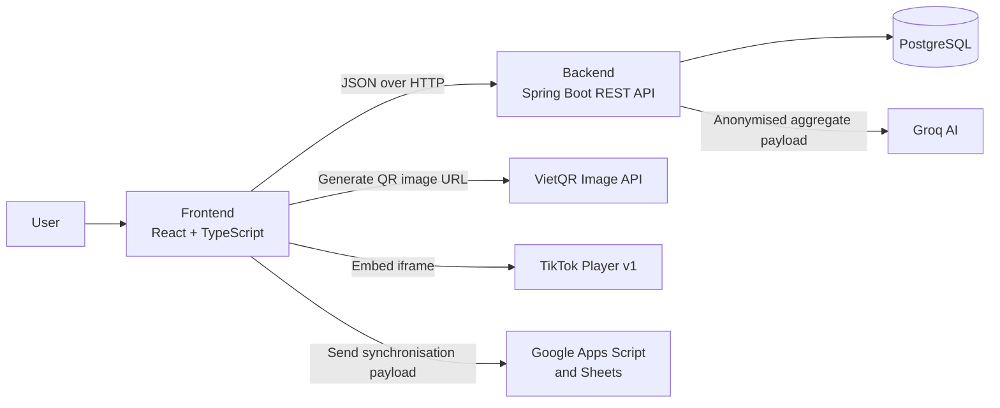

## Figure 3.1 — Actors and functional groups

**Insertion position:** Insert after **Slide 03** only. This is optional when visualising actors and access groups is useful.

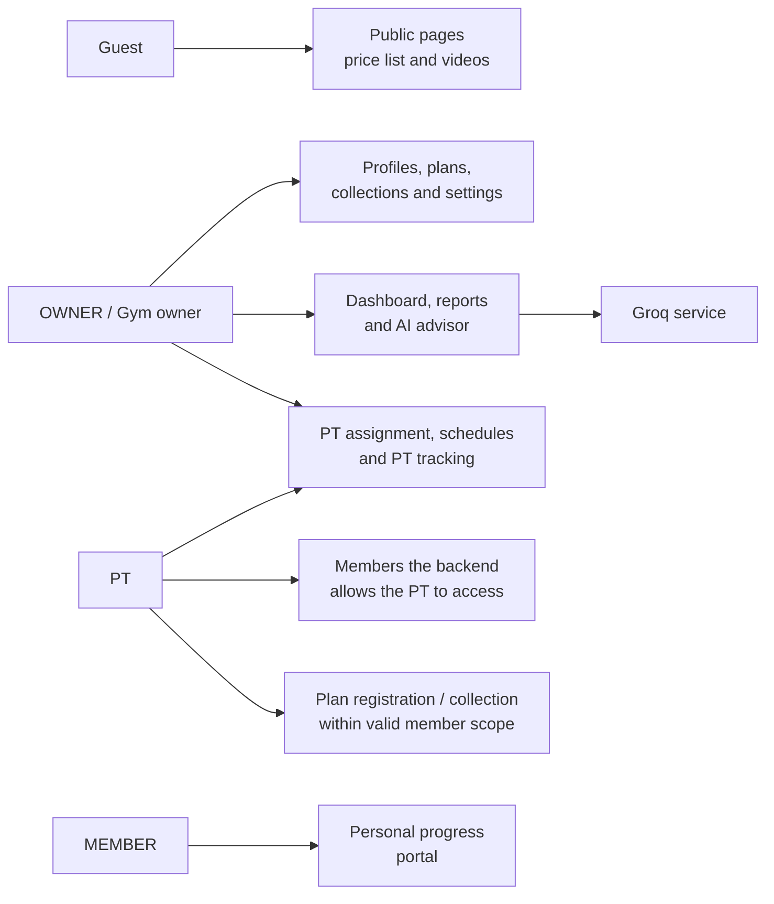

## Figure 3.2 — Overall architecture and processing boundaries

**Insertion position:** Insert after **Slide 04** only.

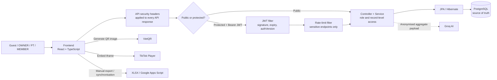

## Figure 3.11 — JWT and request authorization

**Insertion position:** Insert after **Slide 11** only. It deepens the explanation of the control gate for authenticated requests.

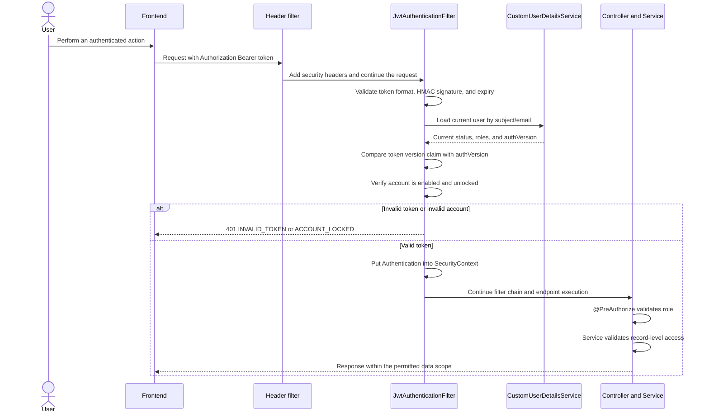

## Figure 3.3 — Backend layer structure

**Insertion position:** Insert after **Slide 09** only. This is optional if the mentor asks for a deeper explanation of Spring Boot code organisation.

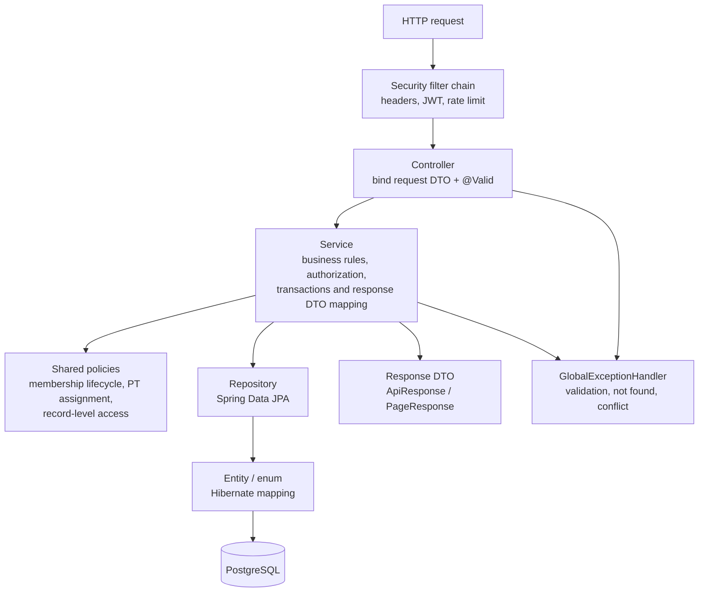

## Figure 3.4 — Frontend application structure

**Insertion position:** Insert after **Slide 05** only. This is optional when explaining React organisation.

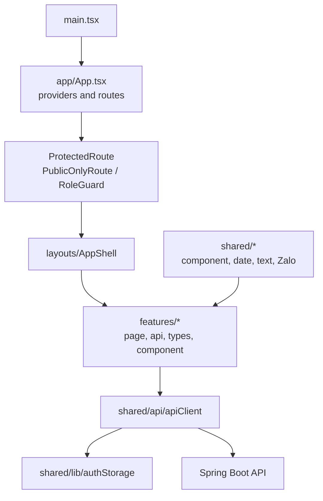

## Figure 3.5 — Login and rate limit

**Insertion position:** Insert after **Slide 11** only.

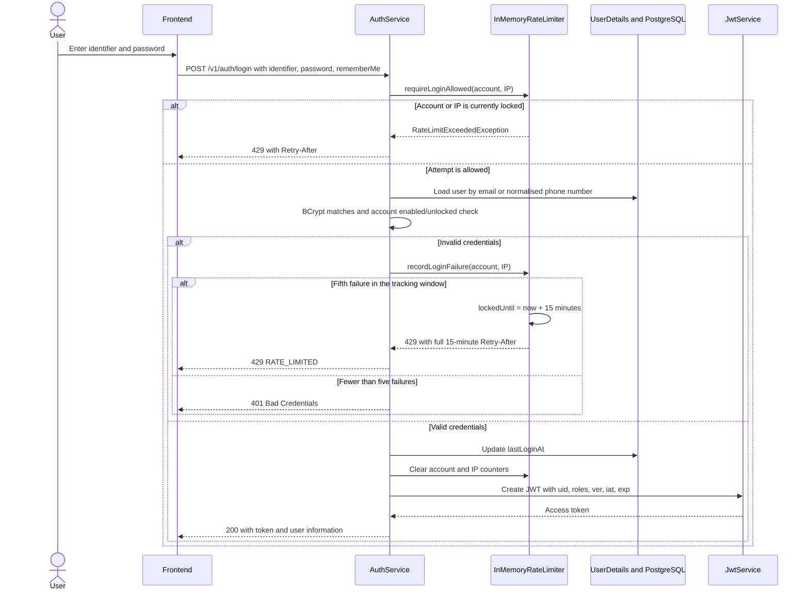

## Figure 3.6 — Change password and revoke JWTs

**Insertion position:** Insert after **Slide 11** only. This is optional when a deeper explanation of `authVersion` is needed.

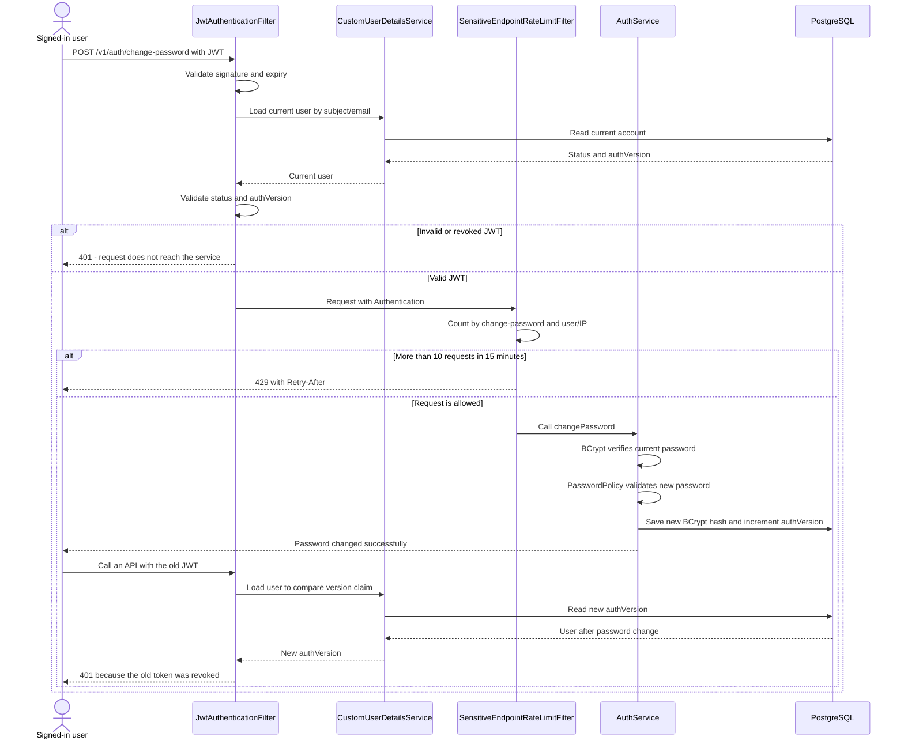

## Figure 3.7 — Plan registration/renewal and initial collection

**Insertion position:** Insert after **Slide 13** only.

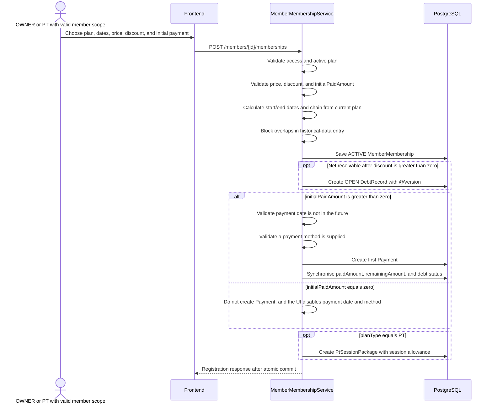

## Figure 3.8 — Installment collection, debt synchronisation, and overwrite prevention

**Insertion position:** Insert after **Slide 14** only.

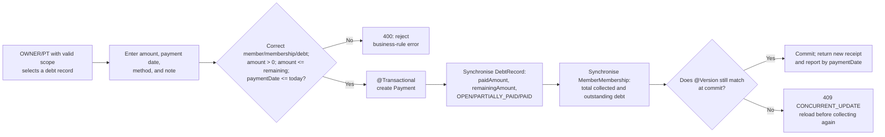

## Figure 3.9 — PT assignment, scheduling, and session recording

**Insertion position:** Insert after **Slide 16** only. The diagram is horizontal to fit a 16:9 slide.

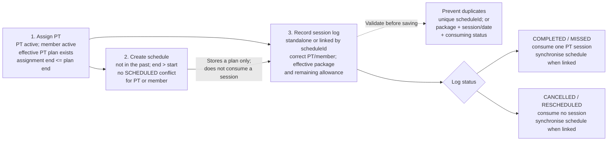

## Figure 3.10 — AI retention, revenue, and scenario analysis

**Insertion position:** Insert after **Slide 19** only.

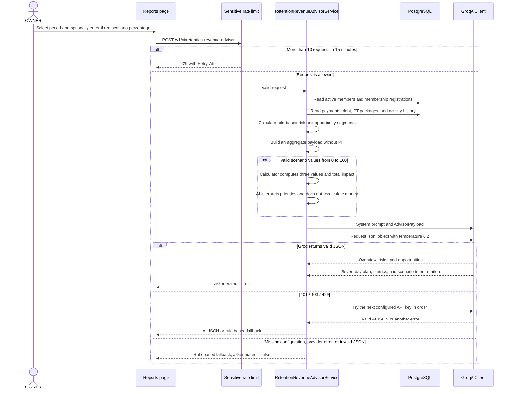

## Figure 3.12 — ERD: accounts, members, plans, and finance

**Insertion position:** Insert after **Slide 07** only. This is optional. Together with Figure 3.13, these diagrams cover all 18 mapped entities and the `user_roles` join table in PostgreSQL. They are logical ERDs: only important keys and relationships are shown; inherited `BaseEntity`/audit columns such as `deleted`, `createdAt`, and `updatedAt` are not repeated. Audit relationships to `users` are summarised by their business meanings: “sold/created/recorded”. `system_settings` is independent, so no relationship line is drawn.

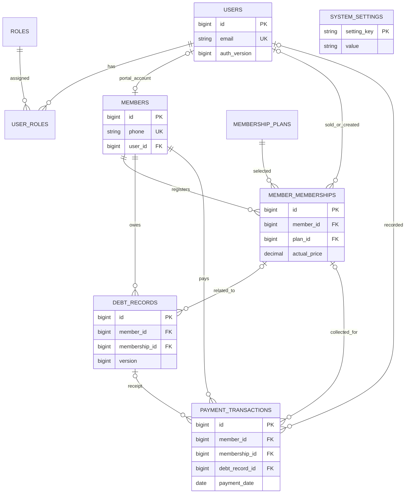

## Figure 3.13 — ERD: PT, progress tracking, and exercise library

**Insertion position:** Insert after **Slide 16** only. This is optional. The `users`, `members`, and `member_memberships` tables are repeated because they connect the PT domain. Combined with Figure 3.12, the two diagrams cover the business tables. A schedule may have no session log, but the service allows at most one `PtSessionLog` linked to the same `scheduleId`; this is a business rule, not a database UNIQUE constraint.

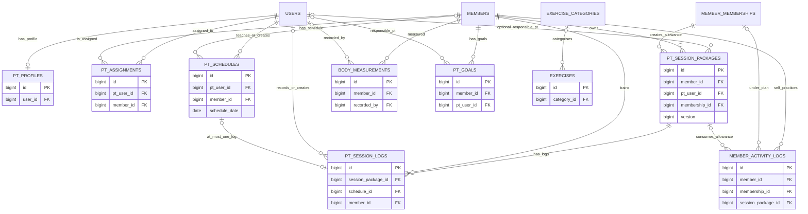
