# Sơ Đồ Mermaid Chèn Vào Slide

> File này là **phiên bản mở rộng để xuất ảnh chèn slide**, không phải nguồn để AI sinh nội dung slide. Các sơ đồ trong báo cáo tổng kết vẫn giữ gọn để in DOCX dễ đọc; các sơ đồ dưới đây bổ sung chi tiết kỹ thuật nhưng không thay đổi nghiệp vụ hay mã nguồn.
>
> Số hình được giữ nguyên theo báo cáo tổng kết để có thể trích dẫn nhất quán. **Thứ tự chèn cho slide có thể khác thứ tự số hình**: Slide 10 trình bày hành trình request tổng quát; Slide 11 đi sâu vào JWT, phân quyền và rate limit như cổng kiểm soát của request đã đăng nhập.

## Thứ tự chèn khuyến nghị

| Sau slide nội dung | Sơ đồ nên chèn | Mục đích |
| --- | --- | --- |
| Slide 03 | Hình 3.1 (tùy chọn) | Nhìn nhanh tác nhân và ranh giới quyền. |
| Slide 04 | Hình 3.2 | Kiến trúc tổng thể và các ranh giới tích hợp. |
| Slide 05 | Hình 3.4 (tùy chọn) | Tổ chức frontend theo feature. |
| Slide 07 | Hình 3.12 (tùy chọn) | ERD tài khoản, hội viên, gói, nợ và phiếu thu. |
| Slide 09 | Hình 3.3 (tùy chọn) | Phân tầng backend và vị trí map DTO. |
| Slide 10 | Không bắt buộc thêm sơ đồ | Dùng phần mô tả request pipeline để nối frontend, filter, Controller, Service, Repository và DTO. |
| Slide 11 | Hình 3.11, sau đó Hình 3.5; Hình 3.6 nếu còn thời gian | Cổng JWT/phân quyền, đăng nhập/rate limit, rồi đổi mật khẩu và thu hồi JWT. |
| Slide 13 | Hình 3.7 | Transaction đăng ký/gia hạn gói. |
| Slide 14 | Hình 3.8 | Thu nhiều đợt, `@Version` và đồng bộ công nợ. |
| Slide 16 | Hình 3.9; Hình 3.13 nếu được hỏi sâu | Luồng PT ngang, sau đó ERD nhóm PT/training. |
| Slide 19 | Hình 3.10 | AI advisor và mô phỏng kịch bản. |

## Hình 2.1 — Tổng quan lớp kỹ thuật và tích hợp ngoài

**Vị trí chèn:** Tùy chọn, sau Slide 04 nếu cần một sơ đồ tổng quan đơn giản hơn Hình 3.2.

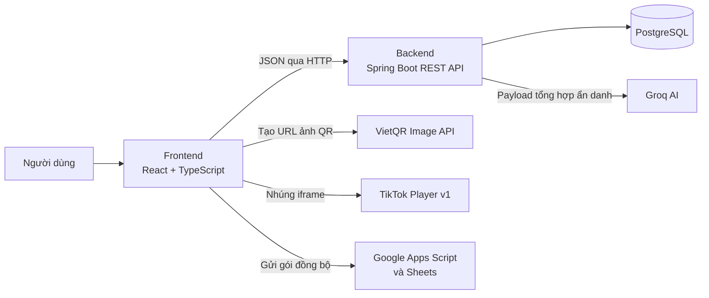

## Hình 3.1 — Tác nhân và nhóm chức năng

**Vị trí chèn:** Tùy chọn, sau Slide 03 khi cần trực quan hóa tác nhân và nhóm quyền.

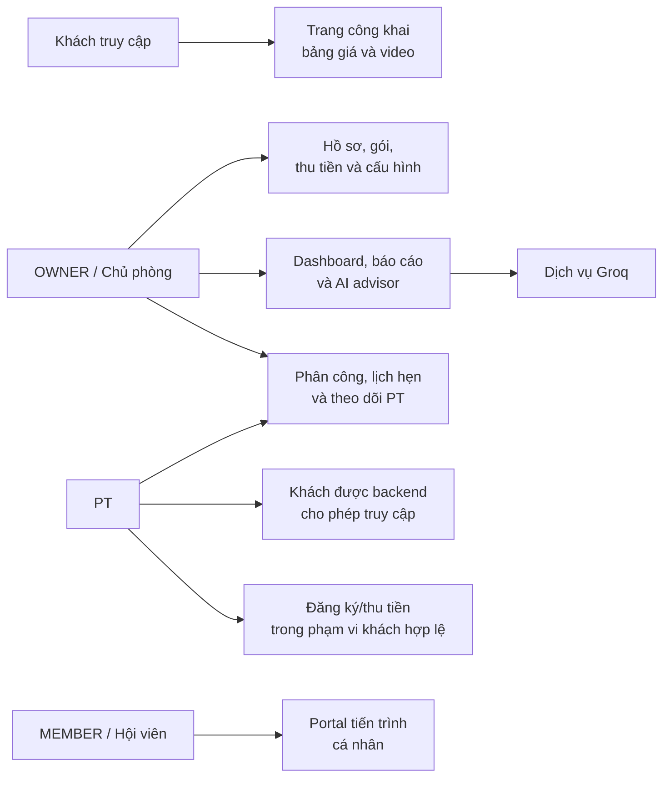

## Hình 3.2 — Kiến trúc tổng thể và các ranh giới xử lý

**Vị trí chèn:** Ưu tiên, chèn thành một slide riêng sau Slide 04 và trước Hình 3.11.

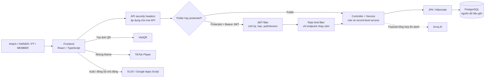

## Hình 3.11 — JWT và phân quyền request

**Vị trí chèn:** **Ưu tiên, chèn sau Slide 11 về bảo mật**. Sau khi Slide 10 đã giới thiệu hành trình request và Slide 09 giới thiệu Spring Boot, sơ đồ này đi sâu vào cổng kiểm soát của mọi request đã đăng nhập. Tiếp theo là Hình 3.5 về login/rate limit và, nếu cần, Hình 3.6 về thu hồi JWT.

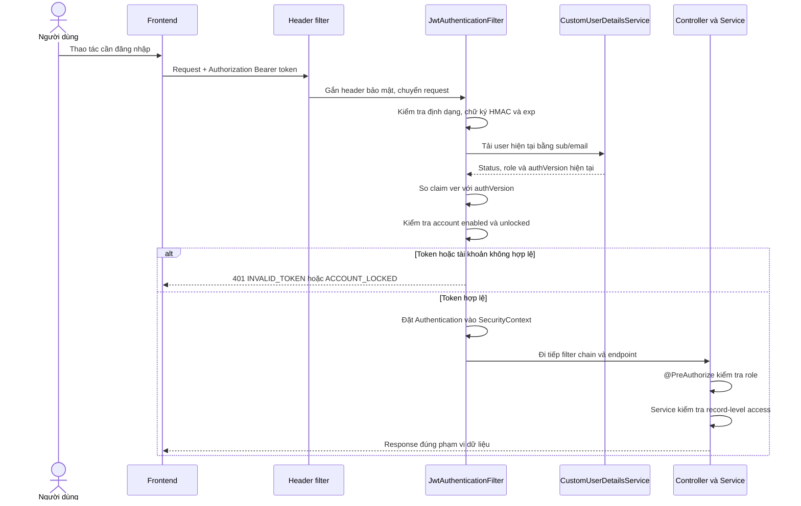

## Hình 3.3 — Cấu trúc các lớp backend

**Vị trí chèn:** Tùy chọn, sau Slide 09 nếu mentor hỏi sâu cách tổ chức mã Spring Boot.

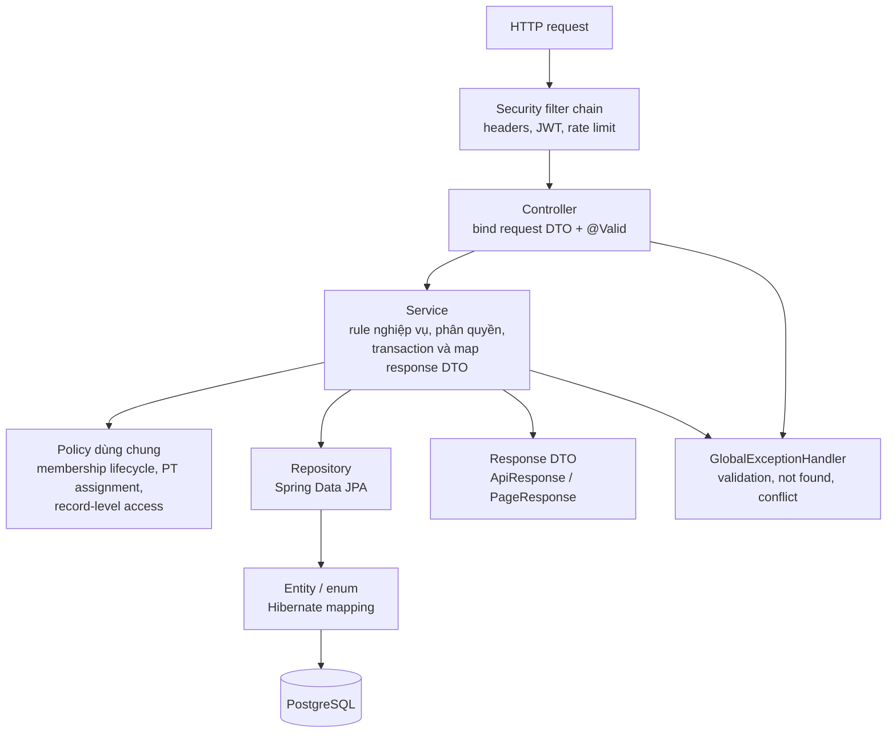

## Hình 3.4 — Cấu trúc ứng dụng frontend

**Vị trí chèn:** Tùy chọn, sau Slide 05 khi cần giải thích cách tổ chức React.

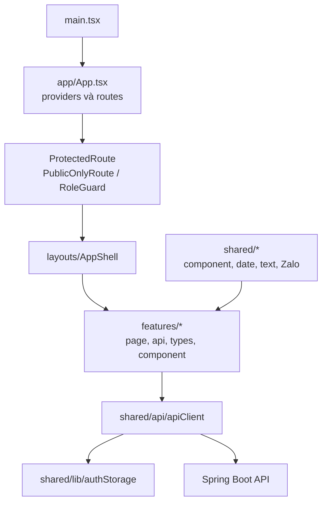

## Hình 3.5 — Đăng nhập và rate limit

**Vị trí chèn:** Ưu tiên, sau Slide 11.

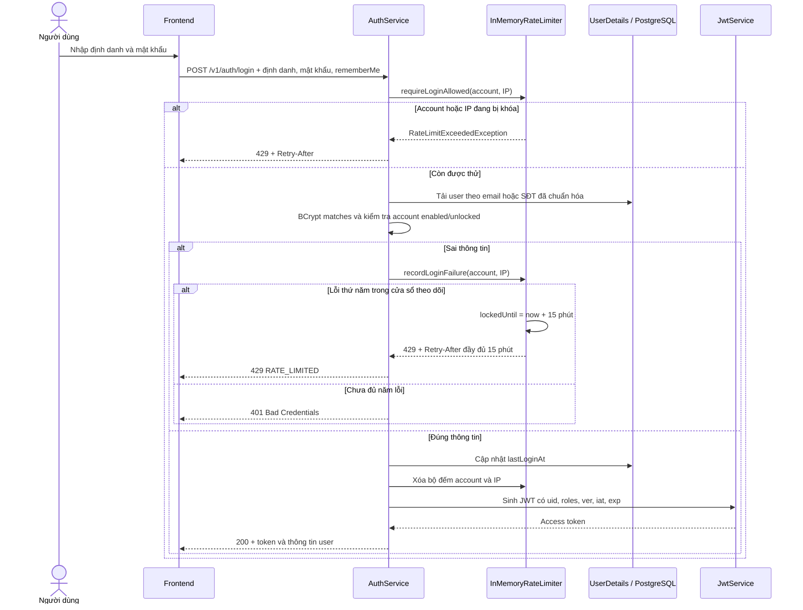

## Hình 3.6 — Đổi mật khẩu và thu hồi JWT

**Vị trí chèn:** Tùy chọn, sau Hình 3.5 nếu cần giải thích sâu `authVersion`.

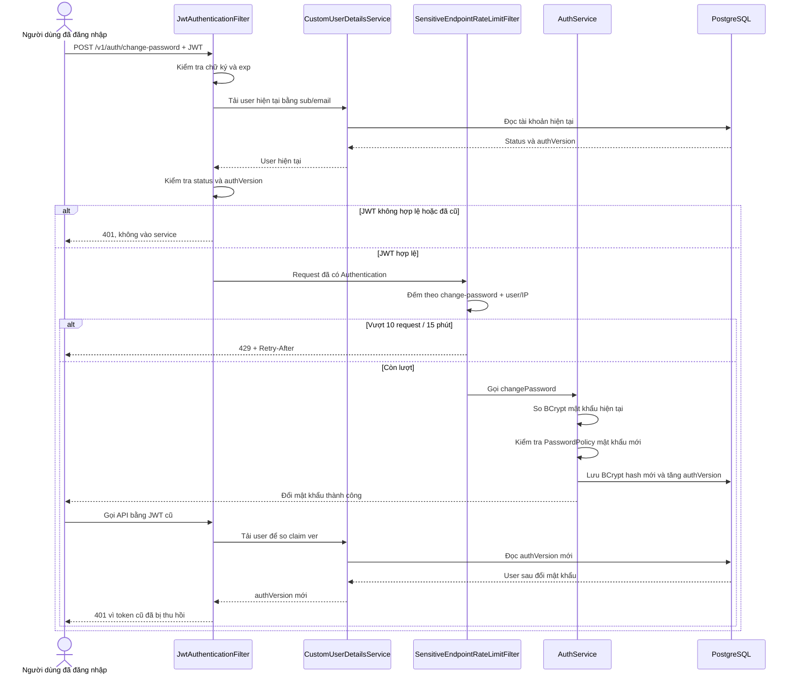

## Hình 3.7 — Đăng ký/gia hạn gói và thu tiền ban đầu

**Vị trí chèn:** Ưu tiên, sau Slide 13.

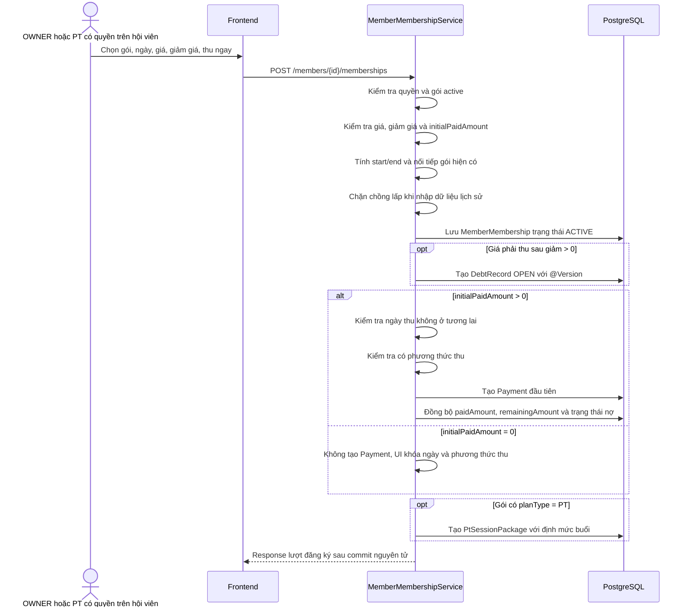

## Hình 3.8 — Thu nhiều đợt, đồng bộ công nợ và chống ghi đè

**Vị trí chèn:** Ưu tiên, sau Slide 14.

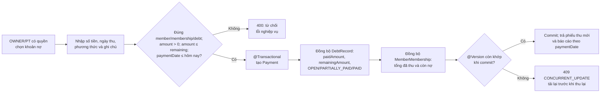

## Hình 3.9 — Phân công, lịch hẹn và ghi buổi PT

**Vị trí chèn:** Ưu tiên, sau Slide 16. Sơ đồ dùng hướng ngang để phù hợp slide 16:9.

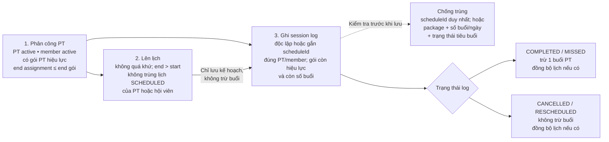

## Hình 3.10 — Phân tích AI giữ chân, doanh thu và kịch bản

**Vị trí chèn:** Ưu tiên, sau Slide 19.

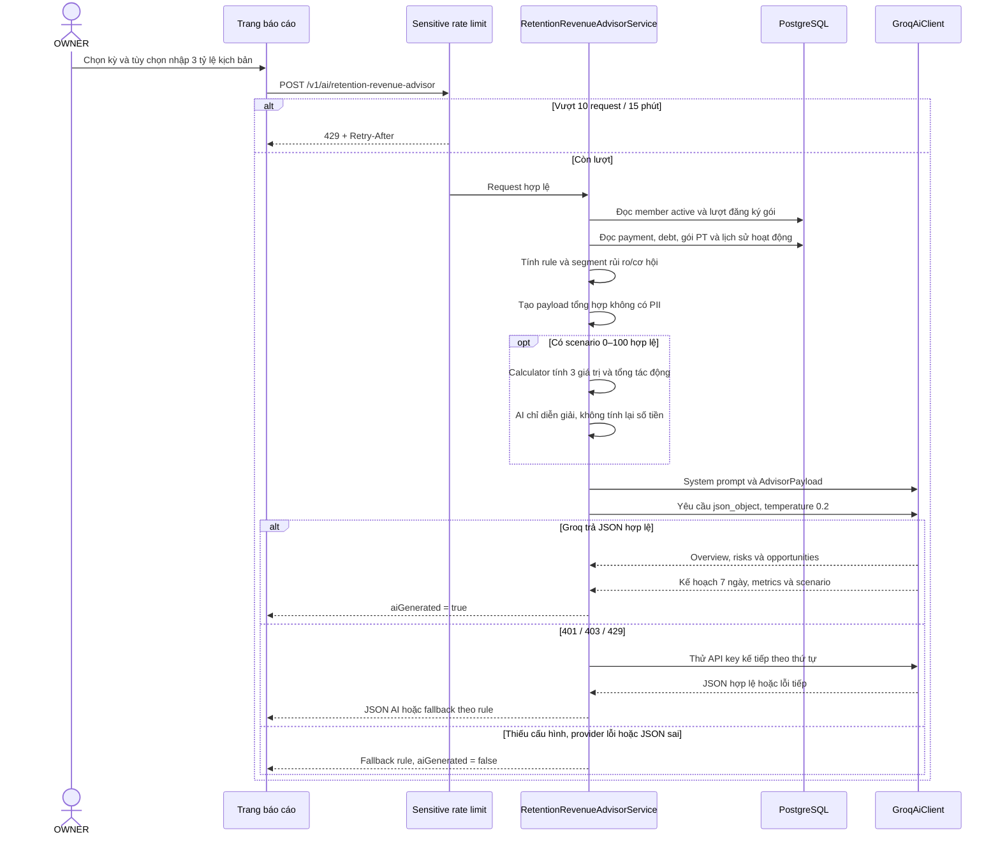

## Hình 3.12 — ERD tài khoản, hội viên, gói và tài chính

**Vị trí chèn:** Tùy chọn, sau Slide 07. Cùng Hình 3.13, hai sơ đồ bao phủ **toàn bộ 18 entity và bảng nối `user_roles`** đang ánh xạ PostgreSQL. Đây là ERD logic: chỉ giữ khóa/quan hệ quan trọng, không lặp các cột kế thừa `BaseEntity`/audit như `deleted`, `createdAt`, `updatedAt`. Các quan hệ audit tới `users` được gộp theo ý nghĩa “bán/tạo/ghi nhận”. `system_settings` độc lập nên không có đường nối.

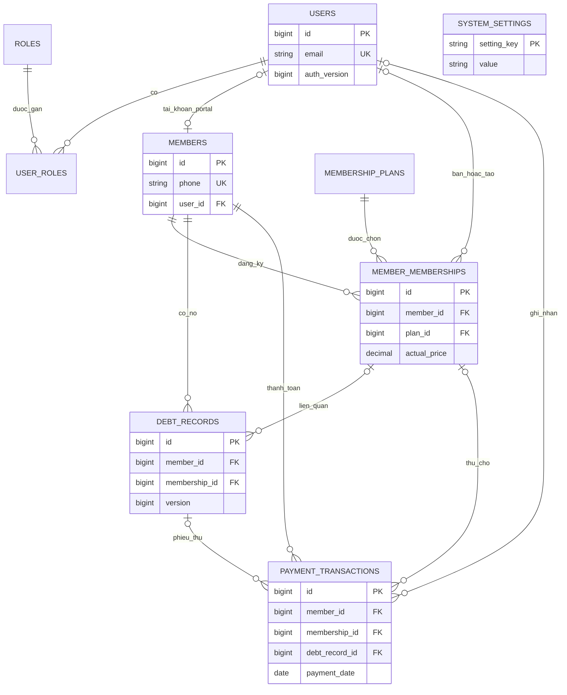

## Hình 3.13 — ERD PT, theo dõi tiến trình và thư viện

**Vị trí chèn:** Tùy chọn, sau Slide 16. Các bảng `users`, `members` và `member_memberships` xuất hiện lại vì là điểm nối của miền PT; kết hợp với Hình 3.12 sẽ bao phủ toàn bộ bảng nghiệp vụ. Một lịch hẹn có thể chưa có nhật ký, nhưng service chỉ cho phép tối đa một `PtSessionLog` liên kết cùng một `scheduleId`; đây là quy tắc nghiệp vụ, chưa phải UNIQUE constraint trong database.

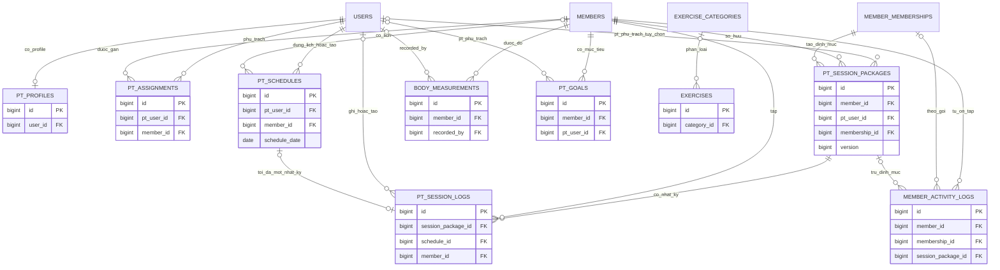
