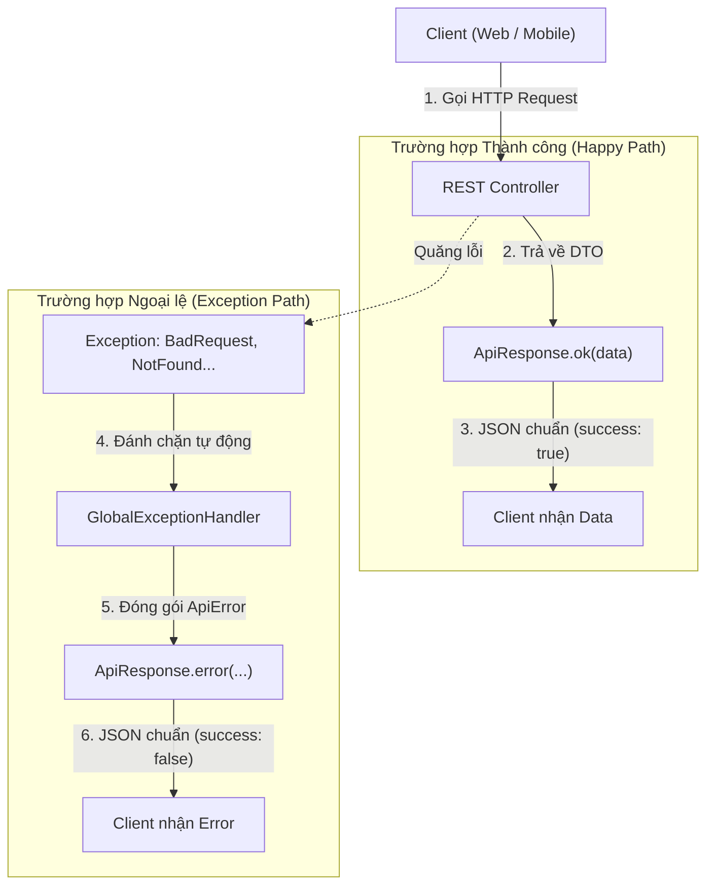

# 📦 CHẶNG 1: CHUẨN HÓA DỮ LIỆU PHẢN HỒI & XỬ LÝ NGOẠI LỆ TOÀN CỤC

Tài liệu này tổng hợp toàn bộ kiến trúc chuẩn hóa API Response và cơ chế xử lý ngoại lệ tập trung (Global Exception Handling) của dự án **Gym Dương Double**.

---

## 🎯 1. Mục tiêu Kiến trúc
- **Một định dạng dữ liệu duy nhất (Single Unified Response Format):** Mọi API trả về cho Frontend (dù thành công hay thất bại) đều tuân theo cùng một cấu trúc JSON nhất quán.
- **Tập trung hóa xử lý lỗi (Centralized Exception Handling):** Controller và Service không cần `try-catch` thủ công; mọi ngoại lệ được tự động bắt và chuyển thành HTTP Status Code phù hợp.
- **Bảo mật & Trải nghiệm lập trình viên (Developer Experience):** Không để lộ Stack Trace nội bộ ra ngoài, cung cấp mã lỗi rõ ràng (`code`, `message`, `details`).

---

## 🗺️ 2. Sơ đồ Luồng Xử lý Dữ liệu & Ngoại lệ



---

## 🔍 3. Chi tiết Các Thành phần Cốt lõi

### 3.1. [ApiResponse.java](file:///d:/gym-management-system/backend/src/main/java/com/gymduongdouble/backend/common/response/ApiResponse.java) - Vỏ bọc phản hồi
Được thiết kế dưới dạng **Generic Java Record `ApiResponse<T>`**:

```java
public record ApiResponse<T>(
    boolean success,      // true: thành công | false: thất bại
    T data,               // Dữ liệu trả về (null nếu có lỗi)
    ApiError error,       // Chi tiết lỗi (null nếu thành công)
    long timestamp        // Thời điểm phản hồi (Unix Milliseconds)
) {
    // Factory method tiện ích cho HTTP 200 OK
    public static <T> ApiResponse<T> ok(T data) {
        return new ApiResponse<>(true, data, null, System.currentTimeMillis());
    }

    // Factory method cho trường hợp lỗi
    public static <T> ApiResponse<T> error(String code, String message, String path, List<String> details) {
        return new ApiResponse<>(false, null, new ApiError(code, message, path, details), System.currentTimeMillis());
    }
}
```

#### JSON Thành công thực tế:
```json
{
  "success": true,
  "data": {
    "id": 1,
    "name": "Gói Tự tập 1 tháng",
    "defaultPrice": 300000
  },
  "error": null,
  "timestamp": 1726620000000
}
```

---

### 3.2. [ApiError.java](file:///d:/gym-management-system/backend/src/main/java/com/gymduongdouble/backend/common/response/ApiError.java) - Cấu trúc chi tiết lỗi

```java
public record ApiError(
    String code,          // Mã định danh lỗi (BAD_REQUEST, NOT_FOUND, UNAUTHORIZED...)
    String message,       // Thông báo thân thiện cho người dùng
    String path,          // Endpoint gây ra lỗi (ví dụ: /api/v1/members)
    List<String> details  // Danh sách chi tiết (thường là lỗi validate từng trường)
) {}
```

#### JSON Lỗi thực tế:
```json
{
  "success": false,
  "data": null,
  "error": {
    "code": "VALIDATION_FAILED",
    "message": "Dữ liệu gửi lên không hợp lệ.",
    "path": "/api/v1/members",
    "details": [
      "phone: Số điện thoại không được để trống.",
      "fullName: Họ tên là bắt buộc."
    ]
  },
  "timestamp": 1726620005000
}
```

---

### 3.3. [PageResponse.java](file:///d:/gym-management-system/backend/src/main/java/com/gymduongdouble/backend/common/response/PageResponse.java) - Phân trang chuẩn

Dùng để bọc các danh sách có phân trang từ Spring Data `Page<T>`:

```java
public record PageResponse<T>(
    List<T> items,        // Danh sách dữ liệu của trang hiện tại
    int pageNumber,       // Số trang hiện tại (0-indexed)
    int pageSize,         // Số phần tử mỗi trang
    long totalElements,   // Tổng số bản ghi trong DB
    int totalPages,       // Tổng số trang
    boolean isLast        // Đã là trang cuối cùng chưa?
) {
    public static <T> PageResponse<T> from(Page<T> page) {
        return new PageResponse<>(
            page.getContent(),
            page.getNumber(),
            page.getSize(),
            page.getTotalElements(),
            page.getTotalPages(),
            page.isLast()
        );
    }
}
```

---

### 3.4. [GlobalExceptionHandler.java](file:///d:/gym-management-system/backend/src/main/java/com/gymduongdouble/backend/common/exception/GlobalExceptionHandler.java) - Bộ đón bắt ngoại lệ toàn cục

Sử dụng `@RestControllerAdvice` để tự động chặn mọi Exception phát sinh từ tầng Controller trở xuống:

| Ngoại lệ | Nguyên nhân | HTTP Status | Mã lỗi `code` |
| :--- | :--- | :---: | :--- |
| `MethodArgumentNotValidException` | Vi phạm `@Valid` trên Request DTO | `400 Bad Request` | `VALIDATION_FAILED` |
| `BadRequestException` | Nghiệp vụ không hợp lệ (ví dụ: gói PT nhưng không nhập số buổi) | `400 Bad Request` | `BAD_REQUEST` |
| `ResourceNotFoundException` | Không tìm thấy ID trong DB (Hội viên, Gói tập...) | `404 Not Found` | `NOT_FOUND` |
| `ConflictException` | Dữ liệu trùng lặp (ví dụ: trùng username, số điện thoại) | `409 Conflict` | `CONFLICT` |
| `BadCredentialsException` | Sai username hoặc mật khẩu khi đăng nhập | `401 Unauthorized` | `UNAUTHORIZED` |
| `AccessDeniedException` | Không đủ quyền hạn truy cập API (ví dụ: STAFF gọi API của OWNER) | `403 Forbidden` | `FORBIDDEN` |
| `Exception` (Mọi lỗi khác) | Lỗi hệ thống bất ngờ (NPE, SQL error...) | `500 Internal Error` | `INTERNAL_SERVER_ERROR` |

---

## 🧠 4. Bảng ghi nhớ & Bài học kinh nghiệm (Key Takeaways)

1. **Không bao giờ trả về trực tiếp Entity:** Luôn chuyển sang DTO và bọc trong `ApiResponse<T>`.
2. **Không nuốt lỗi (Don't swallow exceptions):** Thay vì viết `try { ... } catch (Exception e) { return null; }`, hãy để Service tự nhiên quăng Custom Exception (`ResourceNotFoundException`, `BadRequestException`), `GlobalExceptionHandler` sẽ lo phần còn lại.
3. **Immutability (Tính bất biến):** Sử dụng Java `record` giúp mã nguồn ngắn gọn, an toàn trên môi trường đa luồng (Multi-threading).
