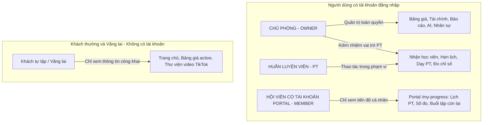
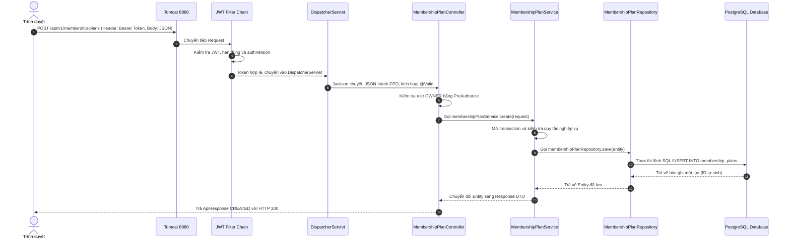
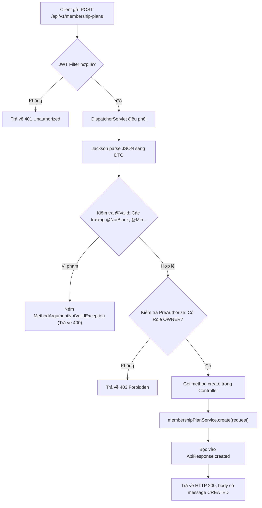

# Bản đồ backend và vòng đời request

## 1. Bài toán phòng gym Dương Double và các vai trò hệ thống

Hệ thống quản lý phòng gym Dương Double được thiết kế tinh gọn, bám sát mô hình vận hành thực tế của một phòng tập cá nhân với cơ cấu vai trò và phân quyền rõ rệt:



### Đặc thù nghiệp vụ cần nhớ:
1. **Chủ phòng (`OWNER`)**: Quản lý toàn bộ hệ thống (bảng giá, hội viên, phiếu thu, công nợ, AI cố vấn). Tài khoản OWNER seed mặc định được cấp cả 2 role `ROLE_OWNER` và `ROLE_PT`, giúp chủ phòng vừa quản lý vừa có thể trực tiếp đứng lớp dạy học viên mà không cần tạo 2 tài khoản riêng.
2. **Huấn luyện viên (`PT`)**: Chỉ được thao tác với học viên do mình phụ trách, đặt lịch hẹn, ghi nhận buổi tập, cập nhật chỉ số cơ thể. Policy còn có nhánh khởi đầu cho khách có gói PT phù hợp nhưng **chưa từng có bản ghi phân công** và chưa gắn PT khác; không được suy rộng thành PT có thể tự xem mọi khách “chưa có lịch hiệu lực”. Không được xem doanh thu tổng, không đổi cấu hình hệ thống.
3. **Hội viên có Portal (`MEMBER`)**: Portal chỉ có quyền xem dữ liệu cá nhân tại `/my-progress`. OWNER chỉ cấp mới khi hội viên `ACTIVE` có ít nhất một gói hiệu lực hôm nay; khách tự tập cũng có thể được cấp để xem gói, hạn, phiếu thu, công nợ và số đo nếu phòng gym đã ghi nhận. Lịch PT, số buổi và mục tiêu sẽ rỗng nếu người đó không có dữ liệu PT.
4. **Khách vãng lai, hội viên chưa có gói, gói tương lai/chờ thanh toán/hết hạn/hủy**: Không đủ điều kiện cấp mới Portal vì chưa có gói hiệu lực. Họ chỉ xem các trang công khai cho đến khi có gói hợp lệ.

> **Phân biệt loại gói với ràng buộc code:** endpoint `POST /v1/members/{id}/portal-account` bắt buộc quyền `OWNER`, hội viên `ACTIVE`, có số điện thoại hợp lệ, chưa có Portal và có ít nhất một membership hiệu lực tại `AppClock.today()`. Service không bắt buộc loại gói PT; đây là chủ đích để khách tự tập còn gói cũng có thể theo dõi dữ liệu cá nhân. API gọi trực tiếp không thể bỏ qua các điều kiện này.

---

## 2. Vòng đời của một HTTP Request (Request Lifecycle)

Khi người dùng thao tác trên trình duyệt, dữ liệu truyền qua mạng và đi qua các lớp bên trong Spring Boot theo sơ đồ tuần tự:



> **Lưu ý kiến trúc:**
> - Filter bảo mật có quyền ngắt request ngay lập tức và trả về HTTP 401 hoặc 429 mà request **chưa bao giờ chạm tới Controller**.
> - Controller chỉ đóng vai trò "cửa ngõ", tiếp nhận HTTP và chuyển tiếp cho Service. Toàn bộ logic ra quyết định, kiểm tra quyền dữ liệu chéo và điều phối nhiều Repository đều nằm trọn vẹn trong tầng Service.

---

## 3. Cấu trúc thư mục nguồn Backend

Mã nguồn Java nằm tại thư mục [`backend/src/main/java/com/gymduongdouble/backend`](../../../backend/src/main/java/com/gymduongdouble/backend). Dự án được tổ chức theo kiến trúc **Package-by-Feature (chia theo nghiệp vụ)** kết hợp với phân tầng bên trong:

Các package nghiệp vụ chính gồm:
* `auth`: Xác thực, đăng nhập bằng Email/SĐT, đổi mật khẩu, thông tin tài khoản hiện tại.
* `user`: Quản lý tài khoản nhân sự (OWNER, PT), phân quyền vai trò.
* `member`: Hồ sơ hội viên, phân quyền truy cập hồ sơ khách hàng, cấp và quản lý tài khoản Portal.
* `membership`: Bảng giá, vòng đời đăng ký và kích hoạt gói tập (tự tập, gói PT, gói hướng dẫn).
* `finance`: Thu tiền (phiếu thu), quản lý công nợ và các quy tắc đối soát dòng tiền.
* `pt`: Hồ sơ PT, phân công học viên, lịch hẹn dạy, gói buổi và nhật ký buổi tập.
* `training`: Số đo cơ thể (Body Measurements) và mục tiêu tập luyện (PT Goals).
* `exercise`: Quản lý danh mục và thư viện video bài tập TikTok công khai.
* `dashboard`: Chỉ số vận hành cho chủ phòng, nhắc việc động (thời hạn, sinh nhật, công nợ).
* `ai`: Cố vấn giữ chân và doanh thu (kết nối Groq API, mô phỏng kịch bản giả định).
* `common`: Cấu hình hệ thống (bao gồm VietQR), bảo mật, thời gian (`AppClock`), validation dùng chung, exception handling và các base entity.

Bên trong mỗi package nghiệp vụ thường có 5 tầng chuẩn:

| Thư mục / Lớp | Trách nhiệm chính trong hệ thống |
| :--- | :--- |
| `web` | Khai báo Controller (`@RestController`), định nghĩa endpoint URL, HTTP Method và quyền truy cập (`@PreAuthorize`). |
| `web/dto` | Chứa các Java `record` làm DTO đầu vào (Request) và đầu ra (Response). Khai báo các Bean Validation (`@NotBlank`, `@Min`). |
| `service` | Trái tim nghiệp vụ. Chứa các quy tắc logic, tính toán tiền bạc, trừ buổi tập, mở ranh giới giao dịch (`@Transactional`). |
| `repository` | Các interface Spring Data JPA kế thừa `JpaRepository`, chịu trách nhiệm truy vấn và lưu trữ dữ liệu. |
| `domain` | Các JPA Entity ánh xạ trực tiếp xuống các bảng vật lý trong database PostgreSQL. |

---

## 4. Khởi động ứng dụng, Context Path và Địa chỉ API

1. **Điểm vào ứng dụng**: Class [`BackendApplication`](../../../backend/src/main/java/com/gymduongdouble/backend/BackendApplication.java) chứa hàm `public static void main(String[] args)` khởi động Spring Boot Container.
2. **Cấu hình Context-Path**: Trong file cấu hình [`application.yml`](../../../backend/src/main/resources/application.yml#L30-L34):
   ```yaml
   server:
     port: 8080
     servlet:
       context-path: /api
   ```
   * **Quy tắc ghép URL:** URL gọi thực tế từ client luôn là:
     $$\text{http://localhost:8080} + \text{context-path (/api)} + \text{Class @RequestMapping} + \text{Method Mapping}$$
   * **Ví dụ:** Nếu Controller khai báo `@RequestMapping("/v1/membership-plans")`, thì địa chỉ đầy đủ mà client bắt buộc phải gọi là:
     `http://localhost:8080/api/v1/membership-plans`
3. **Biến môi trường**: Script [`run-backend.ps1`](../../../backend/run-backend.ps1) đọc biến môi trường từ `.env` (mật khẩu database, JWT secret, tài khoản OWNER). Các thông tin nhạy cảm này không được hardcode vào mã nguồn.

---

## 5. Chi tiết một luồng Request: API lấy danh sách gói tập

Xét ví dụ endpoint lấy danh sách gói đang bán trong [`MembershipPlanController`](../../../backend/src/main/java/com/gymduongdouble/backend/membership/web/MembershipPlanController.java):

```java
@GetMapping
@PreAuthorize("hasAnyRole('OWNER', 'PT')")
public ApiResponse<List<MembershipPlanResponse>> listActive() {
    return ApiResponse.ok(membershipPlanService.listActive());
}
```

Hành trình chi tiết của request `GET /api/v1/membership-plans`:
1. **Gửi Request:** Trình duyệt gửi HTTP GET kèm Header: `Authorization: Bearer <jwt_token>`.
2. **Xác thực (Authentication):** `JwtAuthenticationFilter` giải mã token, kiểm tra chữ ký bí mật, hạn dùng và trường `authVersion`. Nếu hợp lệ, nạp thông tin người dùng vào `SecurityContextHolder`.
3. **Phân quyền (Authorization):** `@PreAuthorize("hasAnyRole('OWNER', 'PT')")` chặn lại nếu người dùng chỉ có role `MEMBER` (trả về 403 Forbidden). Cả OWNER và PT đều có quyền gọi để xem bảng giá bán cho khách.
4. **Gọi Service:** Controller chuyển tiếp lời gọi sang `membershipPlanService.listActive()`.
5. **Truy vấn Database:** `MembershipPlanService` gọi `membershipPlanRepository.findByActiveTrueOrderByNameAsc()`. Hibernate sinh câu lệnh SQL `SELECT ... FROM membership_plans WHERE active = true ORDER BY name ASC`.
6. **Chuyển đổi DTO:** Service duyệt danh sách Entity và gọi `MembershipPlanResponse.from(plan)` để chuyển thành DTO.
7. **Đóng gói Response:** Controller bọc danh sách DTO qua `ApiResponse.ok(...)`. Spring MVC dùng thư viện Jackson chuyển đối tượng thành chuỗi JSON và trả về HTTP Status 200 OK.

---

## 6. Giải phẫu chi tiết từng Annotation trong Controller

Đoạn trích thực tế từ [`MembershipPlanController`](../../../backend/src/main/java/com/gymduongdouble/backend/membership/web/MembershipPlanController.java):

```java
@RestController
@RequestMapping("/v1/membership-plans")
@RequiredArgsConstructor
public class MembershipPlanController {
    private final MembershipPlanService membershipPlanService;

    @PostMapping
    @PreAuthorize("hasRole('OWNER')")
    public ApiResponse<MembershipPlanResponse> create(@Valid @RequestBody MembershipPlanRequest request) {
        return ApiResponse.created(membershipPlanService.create(request));
    }

    @GetMapping
    @PreAuthorize("hasAnyRole('OWNER', 'PT')")
    public ApiResponse<List<MembershipPlanResponse>> listActive() {
        return ApiResponse.ok(membershipPlanService.listActive());
    }
}
```

Sơ đồ cơ chế xử lý nội bộ của phương thức `create`:



Phân tích bản chất kỹ thuật của từng annotation:
1. **`@RestController`**: Đánh dấu lớp là một Spring Web Controller, tích hợp sẵn `@ResponseBody`. Tất cả các method khi trả về object sẽ được tự động chuyển thành chuỗi JSON.
2. **`@RequestMapping("/v1/membership-plans")`**: Định nghĩa tiền tố đường dẫn cho toàn bộ các handler method trong Controller này.
3. **`@RequiredArgsConstructor` (Lombok)**:
   * Tự động sinh ra constructor chứa các tham số cho tất cả các trường có từ khóa `final` (`private final MembershipPlanService membershipPlanService;`).
   * Spring Boot phát hiện constructor này và tự động tiêm (Inject) bean `MembershipPlanService` vào.
   * **Tại sao không dùng `@Autowired` trên field?** Dùng Field Injection (`@Autowired private MembershipPlanService service;`) bị coi là bad practice vì khiến class bị phụ thuộc chặt vào Spring Container, khó viết Unit Test (không thể truyền mock service qua constructor) và dễ gây lỗi `NullPointerException` nếu khởi tạo ngoài container. **Constructor Injection qua Lombok là chuẩn mực hiện đại**.
4. **`@PostMapping` / `@GetMapping`**: Chỉ định phương thức HTTP tương ứng. Spring phân biệt các handler method dựa trên sự kết hợp giữa **URL path** và **HTTP Method**. Cùng một đường dẫn `/v1/membership-plans`, nhưng `GET` sẽ vào hàm xem danh sách, còn `POST` sẽ vào hàm tạo mới.
5. **`@PreAuthorize`**: Khai báo quyền hạn yêu cầu. `@PreAuthorize("hasRole('OWNER')")` bắt buộc người dùng phải có quyền `ROLE_OWNER`.
6. **`@RequestBody`**: Yêu cầu Spring đọc phần thân (body) của HTTP request và nhờ Jackson deserialize thành Java record `MembershipPlanRequest`.
7. **`@Valid`**: Ra lệnh cho Spring kích hoạt bộ kiểm tra Bean Validation trên đối tượng DTO. Nếu dữ liệu không thỏa mãn các annotation như `@NotBlank`, `@Min`, Spring sẽ ngắt xử lý và ném ngoại lệ `MethodArgumentNotValidException`.

---

## 7. Phân biệt các khái niệm kỹ thuật cốt lõi

* **Spring Bean**: Là một đối tượng được khởi tạo, cấu hình và quản lý vòng đời bởi Spring IoC (Inversion of Control) Container. Các class được đánh dấu `@Component`, `@Service`, `@Repository`, `@RestController` đều là Bean.
* **Request DTO (Data Transfer Object)**: Khuôn mẫu dữ liệu nhận từ client. Dự án dùng Java `record` vì tính bất biến (immutable), thread-safe và ngắn gọn.
* **Response DTO**: Khuôn mẫu dữ liệu trả về cho client. Giúp bảo mật thông tin (không để lộ mật khẩu, trường nhạy cảm) và cắt đứt các quan hệ lồng nhau tránh lỗi tràn bộ nhớ khi serialize JSON.
* **JPA Entity**: Đối tượng Java đại diện cho một bản ghi trong cơ sở dữ liệu quan hệ, được quản lý bởi Hibernate Persistence Context.
* **Transaction (`@Transactional`)**: Ranh giới đảm bảo tính toàn vẹn dữ liệu (ACID). Nếu trong quá trình thực thi xảy ra lỗi (`RuntimeException`), toàn bộ các thao tác ghi dữ liệu vào PostgreSQL sẽ được rollback tự động.

---

## 8. Trả lời chi tiết các câu hỏi tự kiểm tra

### Bộ câu hỏi 1:
1. **Vì sao đường dẫn client có `/api` dù controller chỉ khai báo `/v1/...`?**
   * **Đáp án:** Do cấu hình `server.servlet.context-path: /api` trong file [`application.yml`](../../../backend/src/main/resources/application.yml). Thuộc tính này áp dụng tiền tố `/api` cho toàn bộ các servlet và controller trong ứng dụng.
2. **Khi nào một request không tới được controller?**
   * **Đáp án:**
     - Khi bị `JwtAuthenticationFilter` chặn vì không có token, token sai hoặc token hết hạn (HTTP 401).
     - Khi bị bộ kiểm soát tần suất (Rate Limiter) chặn vì gửi quá số lượng request cho phép (HTTP 429).
     - Khi bị `@PreAuthorize` chặn vì role trong token không đủ quyền (HTTP 403).
     - Khi body gửi lên không đúng định dạng JSON hoặc sai kiểu dữ liệu khiến Jackson không parse được (HTTP 400 `HttpMessageNotReadableException`).
3. **DTO khác entity ở mục đích nào? Vì sao cần xem service trước khi khẳng định nghiệp vụ?**
   * **Đáp án:**
     - Entity đại diện cho cấu trúc lưu trữ database; DTO đại diện cho hợp đồng trao đổi dữ liệu với bên ngoài. DTO bảo vệ database schema không bị lộ và tránh lỗi tải ngầm quan hệ (Lazy Loading).
     - Controller chỉ đóng vai trò tiếp nhận và phản hồi HTTP. Toàn bộ logic nghiệp vụ thực sự (ví dụ: gói nào được bán, ngày hết hạn tính thế nào, có được giảm giá không) đều nằm trong tầng Service.

### Bộ câu hỏi 2:
1. **Nếu bỏ `@Valid`, ràng buộc trên DTO có còn tự chạy ở điểm này không?**
   * **Đáp án:** **KHÔNG**. Nếu bỏ `@Valid`, các annotation như `@NotBlank`, `@NotNull`, `@Min` khai báo trên DTO sẽ bị bỏ qua hoàn toàn. Dữ liệu rác hoặc rỗng sẽ lọt thẳng vào bên trong method của Controller và Service.
2. **Nếu PT gọi POST tạo gói tập, lỗi xuất hiện trước hay sau khi service tạo gói?**
   * **Đáp án:** **XUẤT HIỆN TRƯỚC**. Cơ chế `@PreAuthorize("hasRole('OWNER')")` hoạt động thông qua Spring AOP Proxy, chặn request ngay trước khi method `create` của Controller được thực thi. Do đó tầng Service chưa bao giờ được gọi. Mã lỗi trả về là HTTP 403 Forbidden.
3. **Nếu `@RequestMapping` giống nhau nhưng HTTP method khác, Spring phân biệt hai handler bằng gì?**
   * **Đáp án:** Spring MVC phân biệt dựa vào thông tin của giao thức HTTP: tổ hợp giữa **Request URI Path** và **HTTP Request Method** (GET, POST, PUT, DELETE, PATCH). Khi tìm trong bảng ánh xạ `HandlerMapping`, DispatcherServlet sẽ chọn method có annotation ánh xạ khớp cả đường dẫn lẫn method HTTP đó.

---

## 9. Góc nhìn Mentor: Bộ câu hỏi phỏng vấn và phản biện đồ án

> [!TIP]
> **Câu hỏi 1: Tại sao em lại chọn tiêm phụ thuộc qua Constructor (`@RequiredArgsConstructor`) thay vì dùng `@Autowired` trên thuộc tính?**
> * **Cách trả lời:** Em sử dụng Constructor Injection vì đây là best practice được Spring khuyến nghị. Cách này giúp các dependency được khai báo `final`, đảm bảo tính bất biến (immutability), tránh việc dependency bị thay đổi sau khi khởi tạo. Đồng thời, nó giúp việc viết Unit Test trở nên dễ dàng và minh bạch vì ta có thể truyền mock dependency trực tiếp qua constructor mà không cần dựa vào Spring IoC Container.
>
> **Câu hỏi 2: Vì sao không tạo Portal cho mọi hồ sơ hội viên ngay khi nhập dữ liệu?**
> * **Cách trả lời:** `Member` là hồ sơ vận hành, còn `User` là danh tính đăng nhập nên không phải hội viên nào cũng cần tài khoản. Backend chỉ cho OWNER cấp mới khi hội viên đang hoạt động và có gói còn hiệu lực; điều này tránh tạo credential cho khách vãng lai hoặc dữ liệu lịch sử. Khách PT là nhóm hưởng lợi nhiều nhất vì có lịch, buổi và số đo, nhưng khách tự tập có gói hợp lệ vẫn có thể được cấp để xem thông tin cá nhân.
