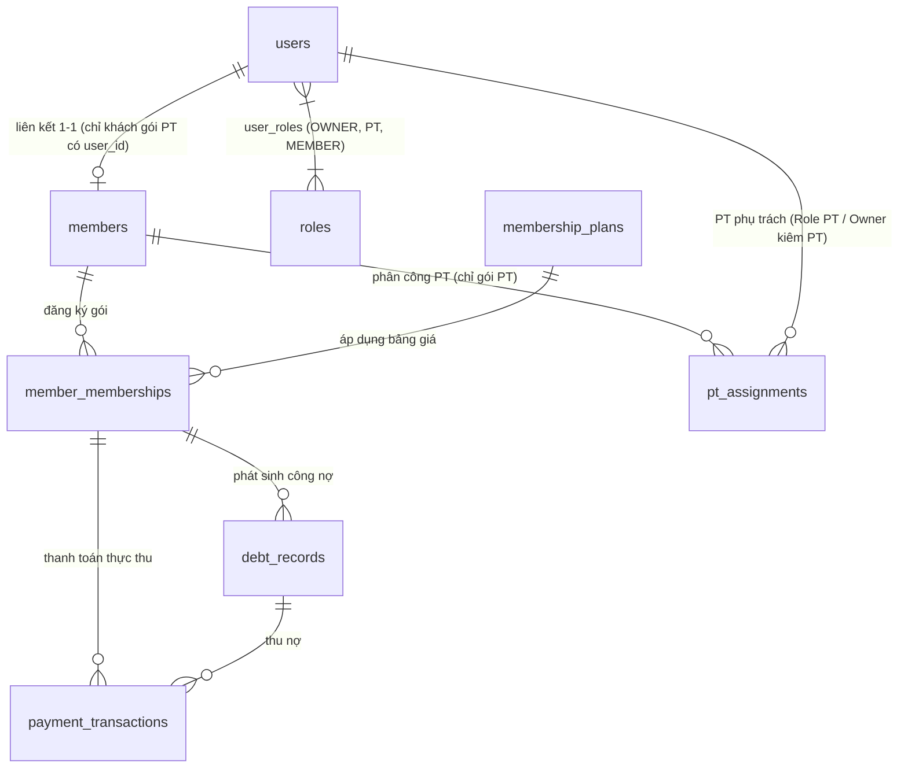
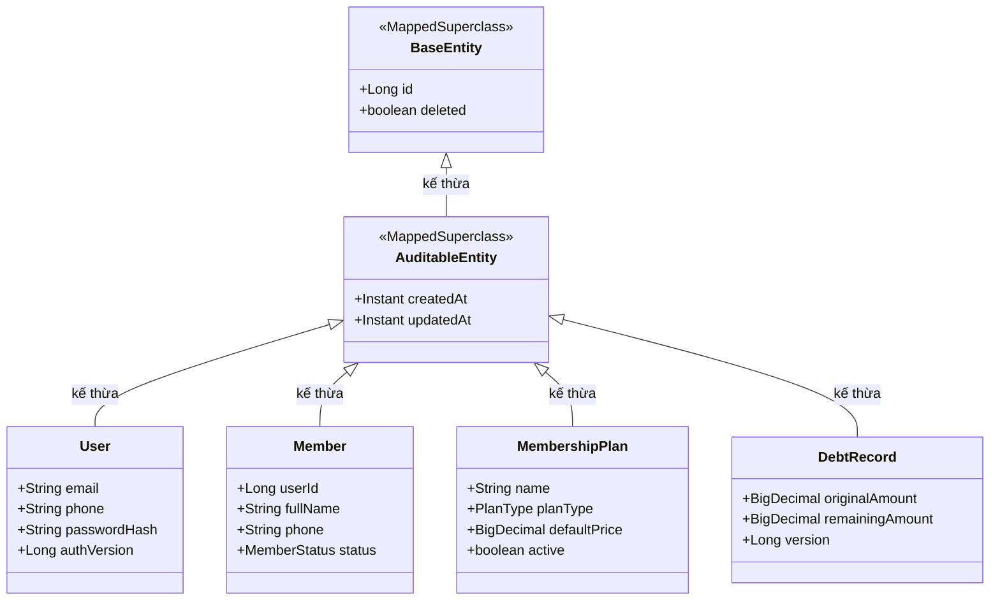
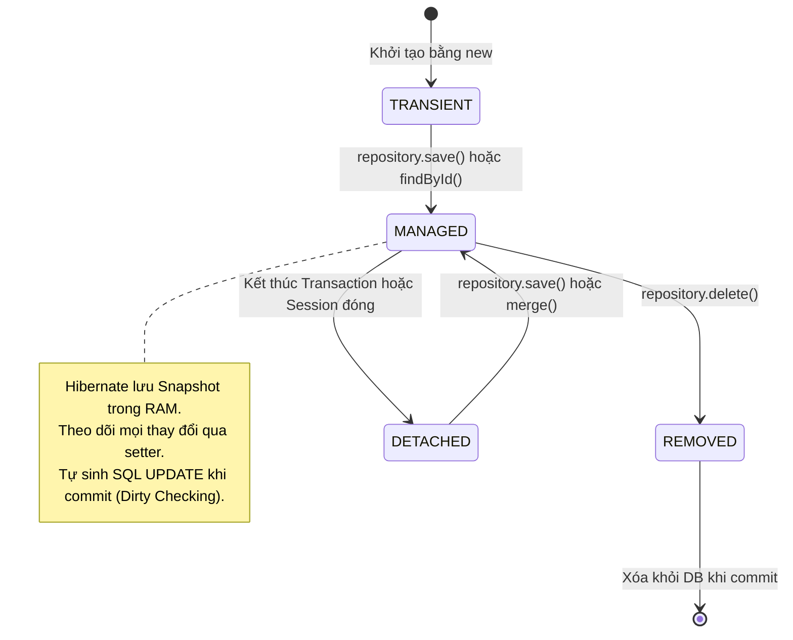
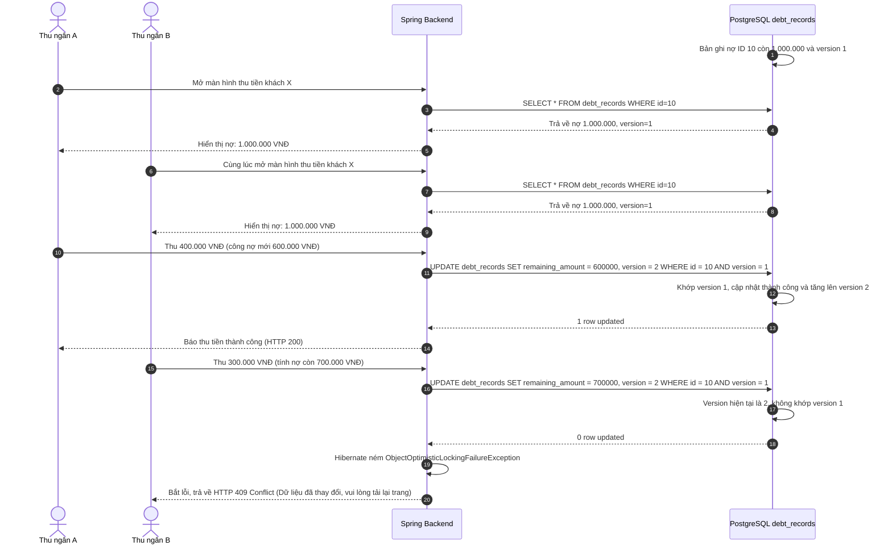

# Entity, repository, transaction và dữ liệu local

## 1. Bản chất Entity và Cơ chế Ánh xạ ORM

JPA Entity là một đối tượng Java được thư viện Hibernate ánh xạ tương ứng với một bảng trong cơ sở dữ liệu quan hệ PostgreSQL.
* Ví dụ: Class [`User`](../../../backend/src/main/java/com/gymduongdouble/backend/user/domain/User.java) ánh xạ với bảng `users`.
* Thuộc tính `email` có ràng buộc duy nhất (`unique = true`).
* Thuộc tính `status` kiểu enum được lưu dưới dạng chuỗi văn bản (`@Enumerated(EnumType.STRING)`), tránh lưu số nguyên (ORDINAL) vì nếu sau này enum thêm phần tử mới sẽ làm sai lệch dữ liệu cũ.
* Quan hệ giữa `User` và `Role` là quan hệ nhiều - nhiều (`@ManyToMany`), được nối qua bảng trung gian `user_roles`.

### Mối liên kết thực tế giữa Hồ sơ hội viên (`Member`) và Tài khoản (`User`):
Trong phòng gym Dương Double:
* Mọi khách hàng đến phòng tập đều có một hồ sơ trong bảng `members`.
* **Khách tự tập thông thường**: Có thể chỉ lưu thông tin trong bảng `members`, trường `user_id = null` khi không cần đăng nhập. Nếu đang `ACTIVE` và có gói hiệu lực, OWNER vẫn có thể cấp Portal để khách xem dữ liệu cá nhân.
* **Khách được cấp Portal**: Có thể là khách tự tập hoặc PT, nhưng tại thời điểm cấp mới đều phải đang `ACTIVE` và có membership hiệu lực. Khi được cấp Portal, bản ghi `members` liên kết 1-1 với `users` qua `members.user_id`.

> Service tạo Portal không yêu cầu hội viên có **gói PT**, nhưng có ràng buộc backend khác: hội viên phải `ACTIVE` và có ít nhất một membership hiệu lực hôm nay theo `MembershipLifecyclePolicy`. Đây là quy tắc service, không phải `CHECK` constraint vật lý trong database; đừng diễn giải nhầm thành ràng buộc theo `plan_type = PT`.



---

## 2. Cây kế thừa Entity: `BaseEntity` và `AuditableEntity`

Trong dự án, hầu hết các Entity đều kế thừa từ hai lớp cơ sở tại [`backend/src/main/java/com/gymduongdouble/backend/common/domain/`](../../../backend/src/main/java/com/gymduongdouble/backend/common/domain/):



### Chi tiết mã nguồn [`BaseEntity.java`](../../../backend/src/main/java/com/gymduongdouble/backend/common/domain/BaseEntity.java):
```java
@Getter
@Setter
@MappedSuperclass
public abstract class BaseEntity {
    @Id
    @GeneratedValue(strategy = GenerationType.IDENTITY)
    private Long id;

    @Column(nullable = false)
    private boolean deleted = false;
}
```
* **`@MappedSuperclass`**: Báo cho JPA biết đây là lớp cha dùng để chia sẻ thuộc tính mapping. JPA sẽ nhúng cột `id` và `deleted` vào tất cả các bảng của Entity con. **Nó không tạo ra bảng `base_entity` trong database**.
* **`@Id` & `@GeneratedValue(strategy = GenerationType.IDENTITY)`**: Đánh dấu khóa chính. Chiến lược `IDENTITY` yêu cầu PostgreSQL tự sinh giá trị tăng dần thông qua cột kiểu `BIGSERIAL` (hoặc sequence). Khóa chính dùng kiểu `Long` (wrapper object) để có thể mang giá trị `null` trước khi được lưu xuống database.
* **`deleted = false`**: Cờ đánh dấu trạng thái xóa.

### Chi tiết mã nguồn [`AuditableEntity.java`](../../../backend/src/main/java/com/gymduongdouble/backend/common/domain/AuditableEntity.java):
```java
@Getter
@Setter
@MappedSuperclass
@EntityListeners(AuditingEntityListener.class)
public abstract class AuditableEntity extends BaseEntity {
    @CreatedDate
    @Column(nullable = false, updatable = false)
    private Instant createdAt;

    @LastModifiedDate
    @Column(nullable = false)
    private Instant updatedAt;
}
```
* **`@EntityListeners(AuditingEntityListener.class)`**: Lắng nghe sự kiện vòng đời của entity. Khi một bản ghi được `INSERT`, nó tự động gán thời gian hiện tại vào `createdAt`. Khi bản ghi được `UPDATE`, nó tự động cập nhật thời gian vào `updatedAt`.
* Để tính năng này hoạt động, file [`JpaConfig.java`](../../../backend/src/main/java/com/gymduongdouble/backend/common/config/JpaConfig.java) bắt buộc phải có annotation `@EnableJpaAuditing`.
* Cột `createdAt` có thuộc tính `updatable = false`, đảm bảo Hibernate không bao giờ ghi đè ngày tạo ban đầu khi chạy các lệnh `UPDATE` sau này.

> [!WARNING]
> **SỰ THẬT VỀ CỘT `deleted` (LƯU Ý PHẢN BIỆN ĐỒ ÁN CỰC KỲ QUAN TRỌNG):**
> Cột `deleted = false` trong dự án hiện chỉ là **nền tảng dữ liệu dự phòng**, **chưa phải là hệ thống Soft Delete hoàn chỉnh tự động**.
> * Một cơ chế Soft Delete hoàn chỉnh trong Hibernate bắt buộc phải có annotation `@SQLDelete(sql = "UPDATE ... SET deleted = true WHERE id = ?")` và `@SQLRestriction("deleted = false")` để tự động lọc các bản ghi đã xóa trong mọi câu lệnh `SELECT`.
> * Hiện tại, dự án chưa cấu hình các annotation này trên toàn hệ thống. Vì vậy, **tuyệt đối không khẳng định trước hội đồng rằng dự án đã có Soft Delete hoàn chỉnh**, mà hãy giải thích chính xác: *"Dự án đã thiết kế sẵn cột `deleted` ở tầng Data Model làm nền tảng để sau này nâng cấp cơ chế lưu trữ (archiving) và khôi phục dữ liệu mà không làm mất tính toàn vẹn khóa ngoại."*

---

## 3. Tầng Repository và Spring Data JPA

Tầng Repository nằm trong thư mục `repository` của từng module (ví dụ: [`UserRepository.java`](../../../backend/src/main/java/com/gymduongdouble/backend/user/repository/UserRepository.java)):

```java
public interface UserRepository extends JpaRepository<User, Long> {
    Optional<User> findByEmailIgnoreCase(String email);
    Optional<User> findByPhone(String phone);
}
```

* **Cơ chế hoạt động**: Bạn chỉ cần định nghĩa interface kế thừa `JpaRepository<Entity, ID>`. Khi Spring khởi động, nó tự động phân tích tên method (Query Derivation) và sinh ra class Proxy triển khai câu lệnh SQL tương ứng trong runtime.
* Bạn không cần viết một dòng code JDBC hay câu lệnh SQL thủ công nào cho các thao tác CRUD cơ bản (`save`, `findById`, `findAll`, `deleteById`).

---

## 4. Vòng đời Entity, Persistence Context và "Dirty Checking"

Đây là kiến thức quan trọng nhất về Hibernate mà bất kỳ lập trình viên Java Backend nào cũng phải nắm vững.

### 4 trạng thái của một JPA Entity:



1. **New / Transient**: Object vừa được tạo bằng từ khóa `new`, chưa có ID, chưa liên kết với Hibernate Session và chưa có bản ghi trong DB.
2. **Managed / Persistent**: Object đã gắn liền với một Session (Persistence Context), có ID đại diện trong DB. Mọi thay đổi trên thuộc tính của object này đều được Hibernate theo dõi.
3. **Detached**: Object từng ở trạng thái Managed nhưng Session đã đóng lại (ví dụ sau khi kết thúc Transaction). Hibernate không còn theo dõi các thay đổi của nó nữa.
4. **Removed**: Object được đánh dấu để xóa khỏi Database khi transaction commit.

### Cơ chế Dirty Checking diễn ra như thế nào?
Hãy xem xét method `login` trong [`AuthService.java`](../../../backend/src/main/java/com/gymduongdouble/backend/auth/service/AuthService.java#L47-L56):
```java
@Transactional
public LoginResponse login(LoginRequest request, String clientIp) {
    ...
    userRepository.findById(user.getId())
        .ifPresent(account -> account.setLastLoginAt(Instant.now()));
    // KHÔNG HỀ CÓ userRepository.save(user); nhưng database vẫn được UPDATE!
    ...
}
```
**Bản chất từng bước:**
1. Khi gọi `findById()`, Hibernate tải dữ liệu từ PostgreSQL lên, đưa instance `account` trong lambda vào trạng thái **Managed**.
2. Đồng thời, Hibernate tạo một bản sao trạng thái ban đầu của đối tượng này lưu trong RAM, gọi là **Snapshot**.
3. Lập trình viên gọi `account.setLastLoginAt(...)`, thay đổi giá trị thuộc tính trong bộ nhớ.
4. Khi method `login` kết thúc, Spring Transaction chuẩn bị **Commit**.
5. Hibernate tự động thực hiện **Dirty Checking**: nó so sánh từng trường của đối tượng `user` hiện tại với bản `Snapshot` ban đầu.
6. Phát hiện trường `lastLoginAt` đã bị thay đổi, Hibernate **tự động sinh ra câu lệnh SQL `UPDATE users SET last_login_at = ? WHERE id = ?`** và gửi xuống PostgreSQL.
$\rightarrow$ **Quy tắc vàng:** Trong một method có `@Transactional`, bạn **không cần gọi `repository.save()`** khi cập nhật dữ liệu của một Entity đã ở trạng thái Managed!

---

## 5. Quan hệ `LAZY` và Cấu hình `open-in-view: false`

### Quan hệ LAZY vs EAGER
* Mặc định các quan hệ tập hợp (`@OneToMany`, `@ManyToMany`) trong JPA có chiến lược tải là `FetchType.LAZY`.
* Ví dụ: Trong class `User`, quan hệ `roles` là `LAZY`. Khi bạn truy vấn `userRepository.findById(1L)`, Hibernate chỉ sinh câu SQL `SELECT * FROM users WHERE id = 1`. Nó **chưa hề tải danh sách roles** để tối ưu hiệu năng.
* Chỉ khi nào bạn thực sự gọi `user.getRoles().size()`, Hibernate mới phát sinh thêm một câu lệnh SQL thứ hai để lấy các vai trò từ bảng `user_roles`.

### Tại sao dự án tắt OSIV (`spring.jpa.open-in-view: false`)?
Trong [`application.yml`](../../../backend/src/main/resources/application.yml#L19), ta thấy:
```yaml
spring:
  jpa:
    open-in-view: false
```
* **Mặc định của Spring Boot (OSIV = true):** Mở kết nối Database từ lúc request bắt đầu cho đến tận khi Controller chuyển đổi JSON xong. Nếu có 1000 người dùng đồng thời, connection pool của PostgreSQL sẽ cạn kiệt rất nhanh, làm tê liệt hệ thống.
* **Khi đặt `open-in-view: false`:** Kết nối Database sẽ được giải phóng ngay khi luồng chạy kết thúc tầng `@Service` (khi transaction đóng lại).
* **Hậu quả nếu code ẩu:** Nếu Service trả về thẳng Entity cho Controller, đến khi Jackson chuyển đổi JSON ở tầng Web, việc gọi getter của quan hệ LAZY sẽ ném ngoại lệ kinh điển:
  `LazyInitializationException: could not initialize proxy - no Session`.
* **Giải pháp chuẩn mực của dự án:** Luôn chuyển đổi Entity sang DTO ngay trong tầng Service (ví dụ: `UserResponse.from(user)` trong phương thức có `@Transactional`).

---

## 6. Kiểu Dữ Liệu Tiền Tệ: `BigDecimal`

Trong hệ thống phòng gym, tiền bạc (giá gói, số tiền đã thu, công nợ) được lưu trữ cực kỳ nghiêm ngặt:
* **Tuyệt đối không dùng `float` hay `double`:** Các kiểu số thực dấu phẩy động tuân theo chuẩn IEEE 754, gây ra lỗi làm tròn số học (ví dụ: $0.1 + 0.2 = 0.30000000000000004$). Trong tài chính, sai lệch 1 đồng cũng là lỗi nghiêm trọng.
* **Dự án dùng `BigDecimal`:**
  * Trong Database: Khai báo `@Column(precision = 15, scale = 2)`. Cho phép lưu tối đa 15 chữ số, trong đó có 2 chữ số thập phân (đáp ứng số tiền lên đến hàng nghìn tỷ đồng).
  * Trong Java: Không dùng toán tử `+`, `-`, `>`, `<`. Toàn bộ phép tính phải dùng method: `.add()`, `.subtract()`, `.multiply()`, và so sánh bằng `.compareTo()`.

---

## 7. Ranh giới Transaction và Khóa Lạc Quan (`@Version`)

### Ranh giới Transaction (`@Transactional`)
Xét ví dụ thu tiền trong [`PaymentService.java`](../../../backend/src/main/java/com/gymduongdouble/backend/finance/service/PaymentService.java):
```java
@Transactional
public PaymentResponse create(CreatePaymentRequest request) {
    // 1. Tạo phiếu thu mới trong bảng payment_transactions
    Payment payment = paymentRepository.save(...);

    // 2. Cập nhật số tiền đã trả và số tiền còn nợ trong bảng debt_records
    debtRecord.setPaidAmount(newPaidAmount);
    debtRecord.setRemainingAmount(newRemainingAmount);

    // Nếu bước 2 bị lỗi ngoại lệ (RuntimeException), bước 1 sẽ tự động ROLLBACK!
}
```
Nhờ `@Transactional`, hai thao tác trên được bọc chung trong một Atomic Transaction: **cùng thành công (Commit) hoặc cùng thất bại (Rollback)**. Không bao giờ xảy ra tình trạng tiền đã lưu phiếu thu nhưng công nợ thì không giảm.

### Khóa Lạc Quan (Optimistic Locking) với `@Version`
Trong file [`DebtRecord.java`](../../../backend/src/main/java/com/gymduongdouble/backend/finance/domain/DebtRecord.java#L48):
```java
@Version
private Long version;
```

Sơ đồ trình tự xử lý xung đột đồng thời giữa 2 thu ngân:



---

## 8. Trả lời chi tiết các câu hỏi tự kiểm tra

1. **`@MappedSuperclass` khác `@Entity` thế nào?**
   * **Đáp án:** `@Entity` đại diện cho một bảng độc lập trong database. `@MappedSuperclass` không đại diện cho bảng nào cả, nó chỉ định nghĩa các trường dùng chung để các entity con kế thừa và nhúng các cột đó vào bảng riêng của chúng.
2. **Tại sao sửa `lastLoginAt` trong transaction có thể được lưu dù không gọi `save()` ngay tại dòng đó?**
   * **Đáp án:** Nhờ cơ chế **Dirty Checking** của Hibernate. Khi một Entity đã ở trạng thái Managed bên trong `@Transactional`, trước khi transaction commit, Hibernate sẽ so sánh đối tượng với bản snapshot lưu trong RAM. Nếu thấy có sự thay đổi, Hibernate tự động sinh câu lệnh SQL `UPDATE`.
3. **Vì sao `deleted` và Flyway hiện tại không nên được giới thiệu là hai cơ chế đã hoàn chỉnh?**
   * **Đáp án:**
     - Cột `deleted` hiện mới chỉ là một trường boolean thông thường, hệ thống chưa có cấu hình `@SQLRestriction` để tự động lọc bản ghi bị xóa trên tất cả các câu truy vấn.
     - Flyway đã được thêm dependency trong `pom.xml`, nhưng trong `application.yml` đang đặt cấu hình `flyway.enabled: false`. Database hiện chạy bằng chế độ tự cập nhật của Hibernate (`ddl-auto: update`), chưa phải là các file migration versioned chính thức.
4. **Tại sao hai transaction cập nhật cùng bản ghi công nợ cần kiểm tra phiên bản `@Version`?**
   * **Đáp án:** Để ngăn chặn lỗi mất dữ liệu do ghi đè (Lost Update Problem). Nếu không có `@Version`, thao tác của thu ngân B sẽ ghi đè một cách mù quáng lên kết quả của thu ngân A, khiến số tiền nợ bị tính toán sai lệch nghiêm trọng. Khóa lạc quan giúp phát hiện xung đột và yêu cầu người thao tác sau phải tải lại dữ liệu mới nhất.

---

## 9. Góc nhìn Mentor: Bộ câu hỏi phỏng vấn và phản biện đồ án

> [!TIP]
> **Câu hỏi 1: Tại sao em lại cấu hình `spring.jpa.open-in-view: false`? Việc này đem lại lợi ích gì và đòi hỏi lập trình viên phải lưu ý điều gì?**
> * **Cách trả lời:** Em tắt Open-Session-In-View để giải phóng kết nối database ngay sau khi rời khỏi tầng Service. Việc này giúp tiết kiệm tài nguyên connection pool của PostgreSQL, tránh tình trạng ứng dụng bị nghẽn kết nối khi tải cao. Tuy nhiên, việc này đòi hỏi lập trình viên phải chuyển đổi đầy đủ các quan hệ LAZY sang DTO ngay trong tầng Service khi Transaction còn đang mở, nếu không sẽ gặp lỗi `LazyInitializationException` khi serialize JSON ở tầng Controller.
>
> **Câu hỏi 2: Sự khác nhau giữa Khóa lạc quan (Optimistic Locking) và Khóa bi quan (Pessimistic Locking)? Tại sao em lại chọn Khóa lạc quan cho công nợ?**
> * **Cách trả lời:**
>   - Khóa bi quan (`Pessimistic Lock`) sử dụng câu lệnh `SELECT ... FOR UPDATE` của Database để khóa cứng dòng dữ liệu, bắt các transaction khác phải chờ (block). Cách này làm giảm hiệu năng hệ thống nếu giữ khóa lâu.
>   - Khóa lạc quan (`Optimistic Lock`) không khóa dòng trong database, mà dựa vào cột `@Version`. Các transaction cứ đọc ghi tự do; khi lưu mới kiểm tra version. Nếu có xung đột, hệ thống sẽ báo lỗi để người dùng tải lại dữ liệu.
>   - Trong nghiệp vụ thu tiền phòng gym, xác suất hai thu ngân cùng mở và thu tiền cho một khách hàng tại cùng một giây là rất thấp, do đó dùng Khóa lạc quan vừa đảm bảo toàn vẹn dữ liệu, vừa giúp hệ thống đạt hiệu năng cao nhất.
