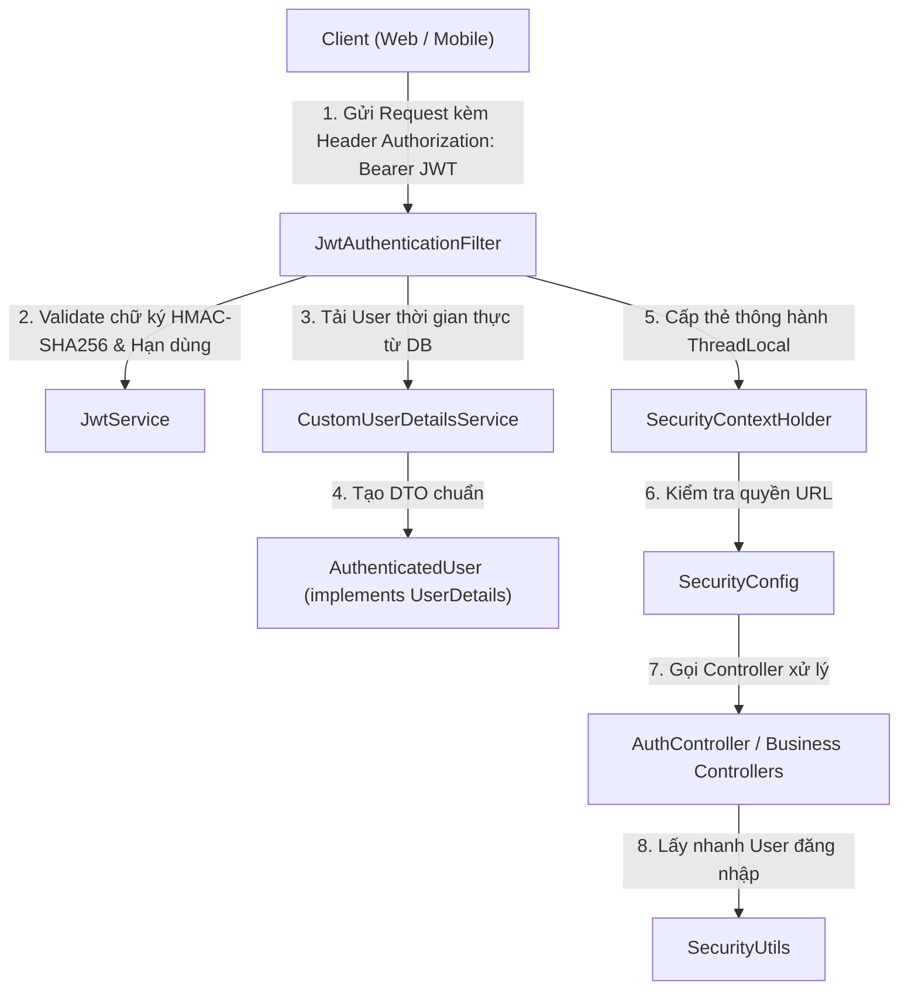

# 🔐 CHẶNG 2: KIẾN TRÚC BẢO MẬT, STATELESS JWT & XÁC THỰC PHÂN QUYỀN

Tài liệu này ghi chú chi tiết toàn bộ kiến trúc Bảo mật, Xác thực (Authentication) và Phân quyền (Authorization) dựa trên Stateless JWT và Spring Security của dự án **Gym Dương Double**.

---

## 🎯 1. Mục tiêu & Nguyên lý Thiết kế
1. **Stateless (Phi trạng thái):** Server hoàn toàn không lưu `HttpSession` trong RAM. Mỗi request gửi lên đều độc lập và tự mang theo thẻ bài xác thực (JWT Bearer Token).
2. **Tự phát triển JWT (In-house JWT):** Sử dụng thư viện chuẩn của Java `javax.crypto.Mac` (HMAC-SHA256) và Jackson `ObjectMapper`, không phụ thuộc vào thư viện bên ngoài (như `jjwt`, `nimbus-jose`) để loại bỏ hoàn toàn rủi ro xung đột version hoặc hàm bị deprecated.
3. **Chống tấn công thời gian (Timing Attack Prevention):** Sử dụng so sánh mảng byte thời gian hằng số `MessageDigestSupport.constantTimeEquals()`.
4. **Tách biệt tầng dữ liệu (Decoupled Security DTO):** Sử dụng `AuthenticatedUser` triển khai `UserDetails`, tách rời hoàn toàn Entity JPA `User` khỏi Spring Security Context để tránh rò rỉ dữ liệu nhạy cảm và lỗi `LazyInitializationException`.

---

## 🗺️ 2. Sơ đồ Luồng Xác thực Toàn diện (Request Lifecycle)



---

## 🔍 3. Phân tích Chi tiết Từng Mắt xích (Step-by-step)

### 3.1. [JwtProperties.java](file:///d:/gym-management-system/backend/src/main/java/com/gymduongdouble/backend/common/security/JwtProperties.java) - Cấu hình JWT từ `application.yml`
- Đọc tham số `jwt.secret` (chuỗi khóa bí mật) và `jwt.access-token-minutes` (thời hạn sống của Token, mặc định 1440 phút = 24 giờ).
- Được ánh xạ an toàn qua `@ConfigurationProperties(prefix = "jwt")`.

---

### 3.2. [JwtService.java](file:///d:/gym-management-system/backend/src/main/java/com/gymduongdouble/backend/common/security/JwtService.java) - Thuật toán Ký & Giải mã HMAC-SHA256

Một chuỗi JWT gồm 3 phần ngăn cách bởi dấu chấm: `Header.Payload.Signature`

```
eyJhbGciOiJIUzI1NiIsInR5cCI6IkpXVCJ9 . eyJzdWIiOiJvd25lciIsInVpZCI6MSwicm9sZXMiOlsiT1dORVIiXX0 . 5h6j7k...
        [Phần 1: HEADER]                           [Phần 2: PAYLOAD]                           [Phần 3: SIGNATURE]
```

1. **Header:** `{"alg": "HS256", "typ": "JWT"}` -> mã hóa Base64URL.
2. **Payload (Claims):** Chứa dữ liệu định danh người dùng:
   - `sub` (Subject): `username`
   - `uid` (User ID): `id`
   - `name`: `fullName`
   - `roles`: Danh sách quyền (`["OWNER"]`, `["PT"]`...)
   - `iat` (Issued At): Thời điểm sinh token
   - `exp` (Expires At): Thời điểm hết hạn token
3. **Signature (Chữ ký điện tử):**
   ```
   Signature = HMAC-SHA256(Base64URL(Header) + "." + Base64URL(Payload), secretKey)
   ```
   Nếu hacker sửa bất kỳ ký tự nào trong Payload (ví dụ đổi `uid=2` thành `uid=1`), chữ ký tính lại sẽ sai lệch ngay lập tức!

#### Cơ chế Chống Timing Attack ([MessageDigestSupport.java](file:///d:/gym-management-system/backend/src/main/java/com/gymduongdouble/backend/common/security/MessageDigestSupport.java)):
- Thay vì dùng `String.equals()` (dừng ngay khi gặp ký tự đầu tiên khác nhau, làm lộ thời gian xử lý cho hacker đoán chữ ký), hệ thống dùng:
  ```java
  public static boolean constantTimeEquals(byte[] a, byte[] b) {
      if (a.length != b.length) return false;
      int result = 0;
      for (int i = 0; i < a.length; i++) {
          result |= a[i] ^ b[i]; // Luôn duyệt hết mảng bất kể đúng hay sai
      }
      return result == 0;
  }
  ```

---

### 3.3. [AuthenticatedUser.java](file:///d:/gym-management-system/backend/src/main/java/com/gymduongdouble/backend/common/security/AuthenticatedUser.java) - Cầu nối Security DTO & UserDetails

**Tại sao phải có lớp này?**
- Spring Security bắt buộc cần một đối tượng thực thi Interface `UserDetails` để kiểm tra quyền (`getAuthorities()`, `isEnabled()`, `isAccountNonLocked()`).
- Nếu ta cho Entity JPA `User` `implements UserDetails` trực tiếp, nó sẽ làm Entity bị "nhiễm bẩn", dễ gây lỗi `LazyInitializationException` và lộ mật khẩu.
- `AuthenticatedUser` đóng vai trò là một DTO độc lập, chỉ trích xuất đúng các thông tin cần thiết:

```java
public class AuthenticatedUser implements UserDetails {
    private final Long id;
    private final String username;
    private final String password;
    private final String fullName;
    private final boolean enabled;
    private final boolean accountNonLocked;
    private final List<GrantedAuthority> authorities;

    public AuthenticatedUser(User user) {
        this.id = user.getId();
        this.username = user.getUsername();
        this.password = user.getPasswordHash();
        this.fullName = user.getFullName();
        this.enabled = user.getStatus() == UserStatus.ACTIVE;
        this.accountNonLocked = user.getStatus() != UserStatus.LOCKED;

        // Map Role code thành GrantedAuthority có tiền tố ROLE_
        this.authorities = user.getUserRoles().stream()
            .map(UserRole::getRole)
            .map(role -> new SimpleGrantedAuthority("ROLE_" + role.getCode()))
            .map(GrantedAuthority.class::cast)
            .toList();
    }
}
```

---

### 3.4. [CustomUserDetailsService.java](file:///d:/gym-management-system/backend/src/main/java/com/gymduongdouble/backend/common/security/CustomUserDetailsService.java) - Tải User thời gian thực

**Tại sao đã có JWT rồi mà vẫn phải query DB khi nhận Request?**
- **Bảo mật thời gian thực (Real-time Revocation):** Nếu một tài khoản vừa bị Admin khóa (`status = LOCKED`) hoặc thu hồi quyền 1 giây trước, request tiếp theo sẽ bị chặn ngay lập tức, không để kẻ xấu lợi dụng thời hạn 24h còn lại của Token.

```java
@Service
@RequiredArgsConstructor
public class CustomUserDetailsService implements UserDetailsService {

    private final UserRepository userRepository;

    @Override
    public UserDetails loadUserByUsername(String username) throws UsernameNotFoundException {
        User user = userRepository.findByUsername(username)
            .orElseThrow(() -> new UsernameNotFoundException("Không tìm thấy người dùng: " + username));
        return new AuthenticatedUser(user);
    }
}
```

---

### 3.5. [JwtAuthenticationFilter.java](file:///d:/gym-management-system/backend/src/main/java/com/gymduongdouble/backend/common/security/JwtAuthenticationFilter.java) - Người gác cổng từng Request

Kế thừa `OncePerRequestFilter`, chạy một lần duy nhất cho mỗi HTTP Request:

```java
@Component
@RequiredArgsConstructor
public class JwtAuthenticationFilter extends OncePerRequestFilter {

    @Override
    protected void doFilterInternal(HttpServletRequest request, HttpServletResponse response, FilterChain filterChain)
            throws ServletException, IOException {

        // 1. Trích xuất Token từ header Authorization: Bearer <token>
        String token = extractBearerToken(request);

        // 2. Nếu có token và chưa được xác thực trong Request này
        if (token != null && SecurityContextHolder.getContext().getAuthentication() == null) {
            String username = jwtService.extractUsername(token);
            UserDetails userDetails = userDetailsService.loadUserByUsername(username);

            // 3. Tạo thẻ thông hành Authentication đã được cộp dấu hợp lệ
            UsernamePasswordAuthenticationToken authentication = new UsernamePasswordAuthenticationToken(
                userDetails,
                null,
                userDetails.getAuthorities() // Danh sách ROLE_*
            );
            authentication.setDetails(new WebAuthenticationDetailsSource().buildDetails(request));

            // 4. Lưu vào SecurityContext (ThreadLocal) để dùng trong suốt vòng đời của request này
            SecurityContextHolder.getContext().setAuthentication(authentication);
        }

        // 5. Cho phép request đi tiếp vào Controller
        filterChain.doFilter(request, response);
    }
}
```

---

### 3.6. [SecurityConfig.java](file:///d:/gym-management-system/backend/src/main/java/com/gymduongdouble/backend/common/config/SecurityConfig.java) - Cấu hình Luật Bảo mật

```java
@Configuration
@EnableWebSecurity
@EnableMethodSecurity // Cho phép dùng @PreAuthorize("hasRole('OWNER')") trên method
@RequiredArgsConstructor
public class SecurityConfig {

    private final JwtAuthenticationFilter jwtAuthenticationFilter;

    @Bean
    public SecurityFilterChain securityFilterChain(HttpSecurity http) throws Exception {
        return http
            .csrf(AbstractHttpConfigurer::disable)       // Tắt CSRF vì dùng Stateless JWT
            .cors(Customizer.withDefaults())             // Bật CORS cho phép Frontend gọi API
            .sessionManagement(session -> session.sessionCreationPolicy(SessionCreationPolicy.STATELESS)) // Không lưu Session
            .authorizeHttpRequests(auth -> auth
                .requestMatchers(HttpMethod.POST, "/v1/auth/login").permitAll() // Cho phép public API login
                .requestMatchers("/v1/health").permitAll()                     // Public health check
                .anyRequest().authenticated()                                  // Tất cả API còn lại đều phải có Token
            )
            .addFilterBefore(jwtAuthenticationFilter, UsernamePasswordAuthenticationFilter.class)
            .build();
    }

    @Bean
    public PasswordEncoder passwordEncoder() {
        return new BCryptPasswordEncoder(); // Mã hóa mật khẩu 1 chiều bằng BCrypt
    }
}
```

---

### 3.7. [SecurityUtils.java](file:///d:/gym-management-system/backend/src/main/java/com/gymduongdouble/backend/common/security/SecurityUtils.java) - Tiện ích lấy User đang đăng nhập

Không cần truyền `userId` từ Frontend gửi lên (dễ bị giả mạo ID người khác), tầng Service chỉ cần gọi:
```java
Long currentUserId = SecurityUtils.currentUserIdOrNull();
```
Hàm này trích xuất trực tiếp từ `SecurityContextHolder` đã được kiểm duyệt an toàn.

---

## 🧠 4. Bảng Tra cứu Khái niệm & Câu hỏi Phỏng vấn Cốt lõi

| Khái niệm | Ý nghĩa & Bản chất |
| :--- | :--- |
| **Stateless là gì?** | Server không lưu trạng thái đăng nhập vào bộ nhớ RAM (`HttpSession`). Token lưu ở Client, mỗi request tự gửi kèm token để Server giải mã xác thực. |
| **`UserDetails` vs `AuthenticatedUser`** | `UserDetails` là Interface quy chuẩn của Spring Security. `AuthenticatedUser` là DTO của riêng dự án Gym thực thi Interface đó. |
| **`ThreadLocal` trong `SecurityContext`** | Mỗi Request được xử lý bởi một Thread riêng. `SecurityContextHolder` gắn thẻ thông hành vào Thread đó, khi Request kết thúc thì giải phóng bộ nhớ. |
| **Tại sao dùng BCrypt?** | BCrypt tự sinh Salt ngẫu nhiên và có chi phí tính toán (Work Factor) cao, chống lại tấn công Rainbow Table và Brute-force mật khẩu. |
