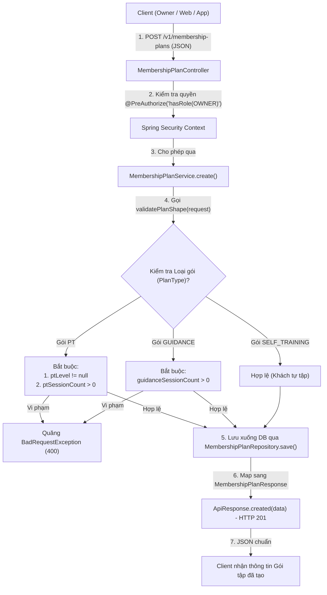

# 🏋️ CHẶNG 3: QUẢN LÝ GÓI TẬP (MEMBERSHIP PLANS)

Tài liệu này tổng hợp toàn bộ kiến trúc và logic nghiệp vụ của phân hệ **Quản lý Gói tập (Membership Plans)** trong hệ thống **Gym Dương Double**.

---

## 🎯 1. Mục tiêu Nghiệp vụ
- **Hạt nhân kinh doanh:** Gói tập định nghĩa bảng giá và các quyền lợi dịch vụ của phòng gym (`SELF_TRAINING` - Tự tập, `PT` - Kèm 1-1, `GUIDANCE` - Giáo án, `COMBO`...).
- **Toàn vẹn dữ liệu (Business Shape Validation):** Kiểm tra chặt chẽ các ràng buộc đặc thù theo từng loại gói (ví dụ: gói PT bắt buộc phải có cấp PT và số buổi tập > 0).
- **Phân quyền bảo mật cao cấp:** Chỉ duy nhất vai trò `OWNER` (Chủ phòng gym) mới có quyền tạo bảng giá (`@PreAuthorize("hasRole('OWNER')")`), trong khi toàn bộ nhân viên (`PT`) đều được xem bảng giá để bán hàng.
- **Tiền tệ chuẩn xác:** Sử dụng `BigDecimal` để tính toán tài chính, tuyệt đối tránh lỗi làm tròn của `double`/`float`.

---

## 🗺️ 2. Sơ đồ Luồng Nghiệp vụ Tạo & Kiểm tra Gói tập

---

## 🔍 3. Chi tiết Các Thành phần Cốt lõi

### 3.1. DTOs: Nhận & Trả Dữ liệu
- **[MembershipPlanRequest.java](file:///d:/gym-management-system/backend/src/main/java/com/gymduongdouble/backend/membership/web/dto/MembershipPlanRequest.java):**
  - Sử dụng Java `record` với các Bean Validation: `@NotBlank(name)`, `@NotNull(planType)`, `@Min(durationDays >= 1)`, `@DecimalMin(defaultPrice >= 0.0)`.
- **[MembershipPlanResponse.java](file:///d:/gym-management-system/backend/src/main/java/com/gymduongdouble/backend/membership/web/dto/MembershipPlanResponse.java):**
  - Cung cấp hàm tĩnh `from(MembershipPlan plan)` làm điểm chuyển đổi tập trung (Single point of mapping) từ Entity sang DTO an toàn.

---

### 3.2. [MembershipPlanService.java](file:///d:/gym-management-system/backend/src/main/java/com/gymduongdouble/backend/membership/service/MembershipPlanService.java) - Xử lý Nghiệp vụ
Bao gồm 3 hàm quan trọng:
1. **`create(MembershipPlanRequest request)`:**
   - Được đánh dấu `@Transactional` (Giao dịch ghi).
   - Kiểm tra `validatePlanShape(request)`.
   - Dùng `valueOrZero(request.defaultPrice())` để chống lỗi `NullPointerException` tiền tệ.
   - Lưu xuống DB và trả về DTO đã có `id` tự sinh từ PostgreSQL.
2. **`listActive()`:**
   - Được đánh dấu `@Transactional(readOnly = true)` (Giao dịch đọc).
   - Truy vấn `findByActiveTrueOrderByNameAsc()`.
   - Dùng Stream & Method Reference `map(MembershipPlanResponse::from)` để biến đổi danh sách Entity thành danh sách DTO.
3. **`validatePlanShape(MembershipPlanRequest request)`:**
   - Dùng cú pháp `switch-case expression` (Java 21) kiểm tra logic phụ thuộc chéo của từng loại gói.

---

### 3.3. [MembershipPlanController.java](file:///d:/gym-management-system/backend/src/main/java/com/gymduongdouble/backend/membership/web/MembershipPlanController.java) - Định nghĩa REST API
- `POST /v1/membership-plans`: Yêu cầu quyền `@PreAuthorize("hasRole('OWNER')")`. Trả về HTTP `201 Created` (`ApiResponse.created(...)`).
- `GET /v1/membership-plans`: Cho phép tất cả tài khoản đã xác thực xem danh sách gói. Trả về HTTP `200 OK` (`ApiResponse.ok(...)`).

---

## 🧠 4. Bảng Ghi nhớ Kiến thức Cốt lõi (Key Takeaways)

| Khái niệm / Kỹ thuật | Bản chất & Ý nghĩa |
| :--- | :--- |
| **Công thức `@Transactional`** | • Thao tác ĐỌC: `@Transactional(readOnly = true)` (Tắt dirty checking, chống lỗi `LazyInitializationException`) • Thao tác GHI: `@Transactional` (Tự động Commit / Rollback) |
| **`BigDecimal.ZERO`** | Hằng số tĩnh có sẵn trong Java, dùng để gán giá trị mặc định `0` mà không cần cấp phát thêm bộ nhớ RAM (`new`). |
| **Business Shape Validation** | Logic kiểm tra nghiệp vụ phụ thuộc chéo giữa các trường (không thể kiểm tra bằng annotation đơn lẻ) phải viết trong Service. |
| **`@PreAuthorize`** | Phân quyền tại mức Method của Spring Security dựa trên danh sách quyền `ROLE_*` đã nạp vào `SecurityContextHolder`. |
