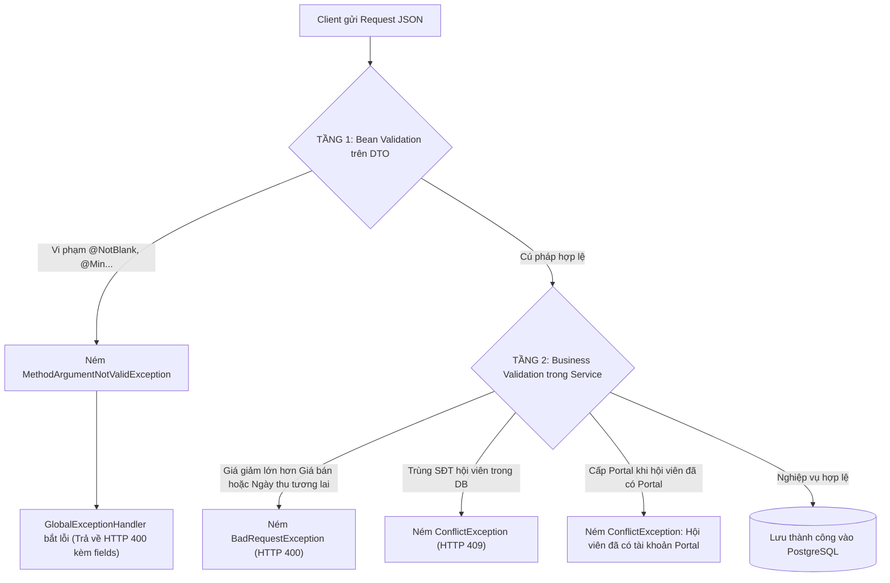
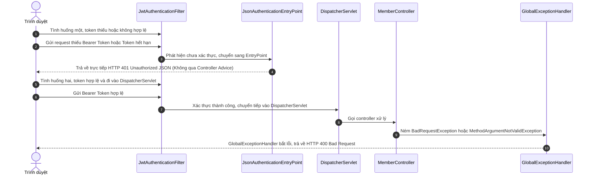

# Response, validation và xử lý ngoại lệ

## 1. Chuẩn Hóa Phản Hồi với `ApiResponse<T>`

Hệ thống không trả về các đối tượng JSON tùy tiện hoặc các chuỗi văn bản trần trụi. Toàn bộ các API trong dự án đều tuân theo một khuôn mẫu phản hồi thống nhất được định nghĩa tại [`ApiResponse.java`](../../../backend/src/main/java/com/gymduongdouble/backend/common/web/dto/ApiResponse.java):

```java
public record ApiResponse<T>(
    boolean success,
    String message,
    T data,
    ApiError error,
    Instant timestamp
) {
    public static <T> ApiResponse<T> ok(T data) {
        return new ApiResponse<>(true, "OK", data, null, Instant.now());
    }

    public static <T> ApiResponse<T> created(T data) {
        return new ApiResponse<>(true, "CREATED", data, null, Instant.now());
    }

    public static <T> ApiResponse<T> fail(String message, ApiError error) {
        return new ApiResponse<>(false, message, null, error, Instant.now());
    }
}
```

### Ý nghĩa của các trường:
* `success`: Cờ boolean cho client biết thao tác thành công (`true`) hay thất bại (`false`).
* `message`: Thông điệp ngắn gọn mô tả trạng thái (ví dụ: `"OK"`, `"CREATED"`, `"Dữ liệu không hợp lệ."`).
* `data`: Phần thân dữ liệu trả về kiểu Generic `<T>`, có thể là một DTO đơn lẻ (như `MemberResponse`), một danh sách (`List<MembershipPlanResponse>`), một trang phân trang (`PageResponse<T>`), hoặc `null` khi có lỗi.
* `error`: Đối tượng [`ApiError`](../../../backend/src/main/java/com/gymduongdouble/backend/common/web/dto/ApiError.java) chứa chi tiết lỗi khi `success = false`. Nếu thành công, trường này luôn là `null`.
* `timestamp`: Thời điểm server sinh ra response (dùng `Instant.now()`), giúp ích cho việc đối soát log và debug.

---

## 2. Chi Tiết và Minh Họa Phân Trang với `PageResponse<T>`

### 2.1. Phân trang đang được dùng ở đâu trong dự án?
`PageResponse<T>` là hạ tầng dùng lại được cho danh sách lớn. Code hiện dùng nó theo hai cách phù hợp với từng nghiệp vụ:

* `GET /api/v1/public/exercises` và `GET /api/v1/owner/exercises`: Spring Data JPA tạo `Page<T>` trực tiếp từ truy vấn PostgreSQL.
* `GET /api/v1/members/page`, `GET /api/v1/payments/page`, `GET /api/v1/debts/page`: danh sách quản trị trả `PageResponse<T>` sau khi service đã áp dụng quyền truy cập theo hội viên, bộ lọc nghiệp vụ và tìm kiếm.

Các endpoint danh sách gốc như `GET /api/v1/members`, `GET /api/v1/payments` và `GET /api/v1/debts` vẫn trả `List<T>` để các màn hình tổng hợp hiện có như Báo cáo, Nhắc việc và tra cứu chi tiết không bị đổi contract. Giao diện quản trị danh sách dùng endpoint `/page`; đây là chủ ý tương thích, không phải endpoint chết.

**Vì sao cần hai cách này?** Thư viện video có thể phân trang ngay trong database vì điều kiện public/owner được biểu diễn bằng `Specification`. Với hội viên, phiếu thu và công nợ, `MemberAccessService` còn quyết định quyền theo tài khoản và bản ghi; service lọc đúng phạm vi trước, sau đó `PageResponse.fromItems(...)` cắt trang. Cách này bảo đảm `totalItems` và nội dung trang không chứa bản ghi ngoài quyền của PT. Nó phù hợp quy mô phòng gym hiện tại, nhưng khi dữ liệu lớn hơn cần tối ưu quyền/lọc xuống truy vấn database thay vì coi đây là giải pháp phân tán quy mô lớn.

### 2.2. Cấu trúc mã nguồn [`PageResponse.java`](../../../backend/src/main/java/com/gymduongdouble/backend/common/web/dto/PageResponse.java)
Trong dự án, DTO phân trang được định nghĩa bằng Java `record`:

```java
public record PageResponse<T>(
    List<T> items,
    int page,
    int size,
    long totalItems,
    int totalPages,
    boolean first,
    boolean last
) {
    public static <T> PageResponse<T> from(Page<T> page) {
        return new PageResponse<>(
            page.getContent(),
            page.getNumber(),
            page.getSize(),
            page.getTotalElements(),
            page.getTotalPages(),
            page.isFirst(),
            page.isLast()
        );
    }
}
```

#### Giải thích chi tiết các thuộc tính:
* `items`: Danh sách dữ liệu của trang hiện tại (`List<T>`), ví dụ `ExerciseResponse`, `MemberSummaryResponse`, `PaymentResponse` hoặc `DebtRecordResponse` tùy endpoint.
* `page`: **Chỉ số trang hiện tại**.
  > [!IMPORTANT]
  > **Quy ước Zero-based Index của Spring Data:**
  > Spring Data JPA đếm trang **bắt đầu từ số 0**. Tức là:
  > - Trang 1 trên giao diện người dùng $\longleftrightarrow$ `page = 0` ở Backend.
  > - Trang 2 trên giao diện người dùng $\longleftrightarrow$ `page = 1` ở Backend.
* `size`: Số phần tử tối đa trên mỗi trang (ví dụ: 10).
* `totalItems`: Tổng số bản ghi thỏa điều kiện lọc **và quyền truy cập**. Với bài tập, số này đến từ `page.getTotalElements()`; với ba danh sách quản trị, số này là kích thước danh sách đã được service lọc trước khi cắt trang.
* `totalPages`: Tổng số trang được tính toán tự động: $\lceil \text{totalItems} / \text{size} \rceil$.
* `first`: Cờ boolean cho biết đây có phải trang đầu tiên không (`page == 0`).
* `last`: Cờ boolean cho biết đây có phải trang cuối cùng không (`page == totalPages - 1`).

### 2.3. Sơ đồ luồng phân trang từ Client xuống PostgreSQL

```mermaid
sequenceDiagram
    autonumber
    actor Client as Trình duyệt
    participant Controller as OwnerExerciseController
    participant Service as ExerciseService
    participant Repo as ExerciseRepository
    participant DB as PostgreSQL Database

    Client->>Controller: GET /api/v1/owner/exercises?page=0&size=12
    Controller->>Controller: Xác thực OWNER và đọc page, size bằng RequestParam
    Controller->>Service: listOwnerExercises(..., page, size)
    Service->>Repo: findAll(exerciseSpec(...), PageRequest.of(...))

    Repo->>Repo: Hibernate chuẩn bị truy vấn danh sách và truy vấn đếm
    Repo->>DB: 1. SELECT bài tập theo filter, ORDER BY updated_at DESC, LIMIT/OFFSET
    DB-->>Repo: Trả về tối đa 12 dòng bản ghi
    Repo->>DB: 2. SELECT count(*) theo cùng điều kiện filter
    DB-->>Repo: Trả về tổng số bản ghi phù hợp

    Repo-->>Service: Trả về đối tượng org.springframework.data.domain.Page
    Service-->>Controller: Gọi PageResponse.from(page) bọc vào DTO
    Controller-->>Client: Trả ApiResponse chứa PageResponse với HTTP 200
```



### 2.4. Ví dụ chuỗi JSON phân trang hoàn chỉnh trả về cho Client:

```json
{
  "success": true,
  "message": "OK",
  "data": {
    "items": [
        {
          "id": 101,
          "title": "Goblet Squat cơ bản",
          "slug": "goblet-squat-co-ban",
          "published": true
        }
    ],
    "page": 0,
    "size": 12,
    "totalItems": 25,
    "totalPages": 3,
    "first": true,
    "last": false
  },
  "error": null,
  "timestamp": "2026-10-19T15:30:00Z"
}
```

### 2.5. Client sử dụng dữ liệu phân trang như thế nào?
Nhờ metadata trong `PageResponse`, client có thể điều khiển danh sách video, hội viên, phiếu thu hoặc công nợ một cách rõ ràng:
* **Hiển thị thông số:** `"Hiển thị trang 1 / 3 (Tổng số 25 video)"`.
* **Nút "Trang trước" (Previous Button):** Disable khi `data.first === true`.
* **Nút "Trang sau" (Next Button):** Disable khi `data.last === true`.
* **Khi người dùng bấm Trang 2:** Frontend gọi lại đúng endpoint `/page` cùng `page`, `size` và các bộ lọc đang chọn. Ví dụ thư viện dùng `/api/v1/owner/exercises?page=1&size=12`; trang hội viên dùng `/api/v1/members/page?page=1&size=10`.

---

## 3. Hai Tầng Validation: Cú Pháp vs Nghiệp Vụ

Dự án áp dụng cơ chế xác thực dữ liệu 2 lớp nghiêm ngặt nhằm đảm bảo tính toàn vẹn dữ liệu của phòng gym:



### Tầng 1: Bean Validation trên Java Record DTO
Định nghĩa tại các file Request DTO (ví dụ: [`MembershipPlanRequest.java`](../../../backend/src/main/java/com/gymduongdouble/backend/membership/web/dto/MembershipPlanRequest.java)):

```java
public record MembershipPlanRequest(
    @NotBlank(message = "Tên gói tập là bắt buộc.")
    String name,

    @NotNull(message = "Loại gói tập là bắt buộc.")
    PlanType planType,

    @NotNull(message = "Thời hạn gói tập là bắt buộc.")
    @Min(value = 1, message = "Thời hạn gói tập phải lớn hơn 0.")
    Integer durationDays,

    @DecimalMin(value = "0.0", inclusive = true, message = "Giá gói tập không được âm.")
    BigDecimal defaultPrice
) {}
```

#### Phân biệt các annotation Bean Validation thường gặp:
* `@NotNull`: Trường không được phép mang giá trị `null` (nhưng có thể là chuỗi rỗng `""` hoặc danh sách rỗng `[]`).
* `@NotEmpty`: Trường không được phép là `null` VÀ độ dài phải lớn hơn 0 (dùng cho String, List, Map).
* `@NotBlank`: **Chỉ dùng cho kiểu `String`**. Trường không được phép là `null`, không được là rỗng `""`, và **không được chứa toàn khoảng trắng `"   "`**.
* `@DecimalMin(value = "0.0")`: Áp dụng cho `BigDecimal`, kiểm tra giá trị số không được nhỏ hơn ngưỡng chỉ định. **Lưu ý:** `@DecimalMin` nếu không đi kèm `@NotNull` thì `null` vẫn hợp lệ. `MembershipPlanRequest.defaultPrice` hiện đúng là trường tùy chọn và `MembershipPlanService` đổi `null` thành `BigDecimal.ZERO`.

### Tầng 2: Validation Nghiệp vụ trong Service
Bean Validation trên DTO không thể kiểm tra được các điều kiện liên quan đến nhiều trường hoặc cần truy vấn cơ sở dữ liệu:
* *Ví dụ 1:* Trong [`MemberMembershipService`](../../../backend/src/main/java/com/gymduongdouble/backend/membership/service/MemberMembershipService.java), hệ thống phải kiểm tra: `discountAmount` không được lớn hơn `actualPrice`. Ràng buộc này phụ thuộc giá trị của 2 trường khác nhau, Bean Validation trên từng trường không thể làm được.
* *Ví dụ 2:* Trong [`PaymentService`](../../../backend/src/main/java/com/gymduongdouble/backend/finance/service/PaymentService.java), hệ thống kiểm tra: `paymentDate` không được là ngày trong tương lai so với ngày hiện tại của hệ thống.
* *Ví dụ 3:* Kiểm tra trùng số điện thoại trong [`MemberService`](../../../backend/src/main/java/com/gymduongdouble/backend/member/service/MemberService.java) bắt buộc phải chuẩn hoá số điện thoại Việt Nam (`phoneNormalizer`) và truy vấn database `memberRepository.findByPhone(normalizedPhone)`. Nếu tìm thấy, ném ngoại lệ `ConflictException("Số điện thoại đã tồn tại")`.
* *Ví dụ 4 (Ràng buộc Portal hiện có):* Khi chủ phòng cấp Portal tại `MemberService.createPortalAccount()`, backend kiểm tra quyền OWNER, hội viên chưa liên kết `User`, trạng thái `ACTIVE`, có membership hiệu lực hôm nay, số điện thoại hợp lệ và mật khẩu hợp lệ. Service không yêu cầu loại gói PT, nên khách tự tập có gói hiệu lực cũng có thể được cấp Portal.

---

## 4. Bắt Lỗi Tập Trung với `@RestControllerAdvice`

Dự án sử dụng lớp [`GlobalExceptionHandler.java`](../../../backend/src/main/java/com/gymduongdouble/backend/common/exception/GlobalExceptionHandler.java) để chặn bắt toàn bộ ngoại lệ phát sinh trong quá trình xử lý request của Controller:

```mermaid
flowchart TD
    ErrOccur["Exception xảy ra trong Controller hoặc Service"] --> HandlerCheck{"@RestControllerAdvice bắt lỗi"}

    HandlerCheck -->|MethodArgumentNotValidException| Res400Val["HTTP 400 VALIDATION_ERROR kèm map fields"]
    HandlerCheck -->|ConstraintViolationException| Res400Constraint["HTTP 400 VALIDATION_ERROR kèm map fields"]
    HandlerCheck -->|BadRequestException| Res400Bad["HTTP 400 BAD_REQUEST"]
    HandlerCheck -->|HttpMessageNotReadableException| Res400Body["HTTP 400 INVALID_REQUEST_BODY"]
    HandlerCheck -->|MethodArgumentTypeMismatchException| Res400Param["HTTP 400 INVALID_REQUEST_PARAMETER"]
    HandlerCheck -->|BadCredentialsException| Res401["HTTP 401 BAD_CREDENTIALS"]
    HandlerCheck -->|AccessDeniedException| Res403["HTTP 403 ACCESS_DENIED"]
    HandlerCheck -->|ResourceNotFoundException| Res404["HTTP 404 RESOURCE_NOT_FOUND"]
    HandlerCheck -->|NoResourceFoundException| Res404Static["HTTP 404 RESOURCE_NOT_FOUND"]
    HandlerCheck -->|HttpRequestMethodNotSupportedException| Res405["HTTP 405 METHOD_NOT_ALLOWED"]
    HandlerCheck -->|ConflictException| Res409Conf["HTTP 409 CONFLICT"]
    HandlerCheck -->|ObjectOptimisticLockingFailureException| Res409Lock["HTTP 409 CONCURRENT_UPDATE"]
    HandlerCheck -->|RateLimitExceededException| Res429["HTTP 429 RATE_LIMITED + Header Retry-After"]
    HandlerCheck -->|Exception khác| Res500["HTTP 500 INTERNAL_SERVER_ERROR"]
```



### Bảng Ánh Xạ Ngoại Lệ Sang HTTP Status Code:

| Ngoại Lệ (Exception Class) | HTTP Status | Mã Lỗi (`error.code`) | Mô Tả Ý Nghĩa |
| :--- | :---: | :--- | :--- |
| `MethodArgumentNotValidException` | **400** | `VALIDATION_ERROR` | Vi phạm Bean Validation (`@Valid`) trên DTO đầu vào. Có kèm danh sách chi tiết từng trường bị lỗi trong `fields`. |
| `ConstraintViolationException` | **400** | `VALIDATION_ERROR` | Vi phạm ràng buộc tham số method, ví dụ `@RequestParam`/`@PathVariable` có validation. Có map `fields`. |
| `BadRequestException` | **400** | `BAD_REQUEST` | Vi phạm quy tắc nghiệp vụ ở tầng Service (ví dụ: ngày thu trong tương lai, nợ vượt quá giá trị gói). |
| `HttpMessageNotReadableException` | **400** | `INVALID_REQUEST_BODY` | Body gửi lên sai định dạng cú pháp JSON, hoặc sai kiểu dữ liệu (ví dụ: truyền chữ vào trường số). |
| `MethodArgumentTypeMismatchException` | **400** | `INVALID_REQUEST_PARAMETER` | Query/path parameter không thể chuyển sang kiểu Java mà endpoint yêu cầu. |
| `BadCredentialsException` | **401** | `BAD_CREDENTIALS` | Sai thông tin đăng nhập (email, số điện thoại hoặc mật khẩu không khớp). |
| `AccessDeniedException` | **403** | `ACCESS_DENIED` | Người dùng đã đăng nhập nhưng không đủ quyền Role hoặc vi phạm ranh giới dữ liệu PT. |
| `ResourceNotFoundException` | **404** | `RESOURCE_NOT_FOUND` | Không tìm thấy bản ghi với ID yêu cầu trong database. |
| `NoResourceFoundException` | **404** | `RESOURCE_NOT_FOUND` | Không có static resource hoặc route phù hợp với URL được gọi. |
| `HttpRequestMethodNotSupportedException` | **405** | `METHOD_NOT_ALLOWED` | URL có route nhưng HTTP method gửi lên không được endpoint hỗ trợ. |
| `ConflictException` | **409** | `CONFLICT` | Xung đột nghiệp vụ (ví dụ: trùng số điện thoại, trùng lịch hẹn PT). |
| `ObjectOptimisticLockingFailureException` | **409** | `CONCURRENT_UPDATE` | Xung đột phiên bản Khóa lạc quan (`@Version`) khi có thao tác khác đã cập nhật bản ghi trước đó. |
| `RateLimitExceededException` | **429** | `RATE_LIMITED` | Vượt quá số lần gọi API cho phép trong cửa sổ thời gian. Kèm header `Retry-After`. |
| `Exception` (Ngoại lệ chung) | **500** | `INTERNAL_SERVER_ERROR` | Lỗi hệ thống ngoài tầm kiểm soát (NullPointerException, lỗi kết nối DB...). |

---

## 5. Chi tiết Handler bắt lỗi Validation DTO

Đoạn trích thực tế từ [`GlobalExceptionHandler.java`](../../../backend/src/main/java/com/gymduongdouble/backend/common/exception/GlobalExceptionHandler.java#L47-L58):

```java
@ExceptionHandler(MethodArgumentNotValidException.class)
ResponseEntity<ApiResponse<Void>> handleValidation(MethodArgumentNotValidException exception) {
    Map<String, String> fields = new LinkedHashMap<>();
    exception.getBindingResult().getFieldErrors().forEach(error ->
        fields.put(error.getField(), error.getDefaultMessage())
    );

    ApiError error = ApiError.withFields("VALIDATION_ERROR", "Dữ liệu không hợp lệ.", fields);
    return ResponseEntity.badRequest().body(ApiResponse.fail("Dữ liệu không hợp lệ.", error));
}
```

### Cơ chế hoạt động:
1. Khi `@Valid` phát hiện lỗi, Spring MVC đóng gói toàn bộ lỗi vào đối tượng `BindingResult`.
2. Handler duyệt qua từng `FieldError`, bóc tách `error.getField()` (tên thuộc tính bị sai) và `error.getDefaultMessage()` (thông báo lỗi cấu hình trong annotation).
3. Đóng gói vào cấu trúc JSON chuẩn:
   ```json
   {
     "success": false,
     "message": "Dữ liệu không hợp lệ.",
     "data": null,
     "error": {
       "code": "VALIDATION_ERROR",
       "message": "Dữ liệu không hợp lệ.",
       "fields": {
         "name": "Tên gói tập là bắt buộc.",
         "durationDays": "Thời hạn gói tập phải lớn hơn 0."
       }
     },
     "timestamp": "2026-10-19T14:15:00Z"
   }
   ```
4. Frontend React nhận response này sẽ dễ dàng map các thông báo lỗi trong object `fields` để hiển thị chữ đỏ ngay dưới đúng từng ô nhập liệu tương ứng trên giao diện!

---

## 6. Phân biệt Lỗi Tầng Filter và Lỗi Tầng Controller Advice

Một câu hỏi rất hay khi phỏng vấn: *"Tại sao có những lỗi 401 hoặc 403 không bao giờ đi qua `@RestControllerAdvice`?"*



* `@RestControllerAdvice` chỉ có thể bắt được các Exception xảy ra **bên trong DispatcherServlet** (từ Controller, Service, Repository trở vào).
* Nếu request bị lỗi xác thực ngay tại tầng lọc bảo mật (`JwtAuthenticationFilter`), lúc này request **chưa hề chạm tới DispatcherServlet**. Lỗi sẽ được xử lý trực tiếp bởi:
  * [`JsonAuthenticationEntryPoint.java`](../../../backend/src/main/java/com/gymduongdouble/backend/common/security/JsonAuthenticationEntryPoint.java): Xử lý lỗi **401 Unauthorized** khi chưa xác thực.
  * [`JsonAccessDeniedHandler.java`](../../../backend/src/main/java/com/gymduongdouble/backend/common/security/JsonAccessDeniedHandler.java): Xử lý lỗi **403 Forbidden** ở tầng Security Filter.
  * [`JwtAuthenticationFilter.java`](../../../backend/src/main/java/com/gymduongdouble/backend/common/security/JwtAuthenticationFilter.java): Tự ghi response **401 `INVALID_TOKEN`** khi Bearer token có chữ ký sai, hết hạn hoặc không hợp lệ; tài khoản bị khóa/ngừng hoạt động nhận **401 `ACCOUNT_LOCKED`**.
  * [`SensitiveEndpointRateLimitFilter.java`](../../../backend/src/main/java/com/gymduongdouble/backend/common/security/SensitiveEndpointRateLimitFilter.java): Tự ghi **429 `RATE_LIMITED`** cùng `Retry-After` khi vượt quota endpoint nhạy cảm.

`RateLimitExceededException` trong bảng mapping vẫn có ý nghĩa: nó là nhánh đăng nhập do `AuthService` ném ra và được `GlobalExceptionHandler` đổi thành 429. Cùng mã lỗi HTTP có thể được tạo ở hai tầng khác nhau; khi debug phải xem request đã đi đến Controller hay chưa.

---

## 7. Trả lời chi tiết các câu hỏi tự kiểm tra

1. **Vì sao `ApiResponse.created()` không đủ để khẳng định HTTP status là 201?**
   * **Đáp án:** `ApiResponse` chỉ là một Java Record đóng gói cấu trúc body JSON trả về cho client. HTTP Status Code là thuộc tính của giao thức HTTP trên tầng mạng. Nếu phương thức trong Controller chỉ trả về `ApiResponse.created()` mà không khai báo `@ResponseStatus(HttpStatus.CREATED)` hoặc không dùng `ResponseEntity.status(201)`, mặc định Spring MVC vẫn trả về HTTP Status **200 OK** dù trong chuỗi JSON có ghi `"message": "CREATED"`.
2. **`@DecimalMin` không đi kèm `@NotNull` có buộc phải nhập giá trị không?**
   * **Đáp án:** **KHÔNG**. Trong đặc tả của Bean Validation (JSR-380 / Hibernate Validator), hầu hết các annotation kiểm tra giá trị (như `@DecimalMin`, `@Min`, `@Max`, `@Pattern`, `@Size`) đều coi giá trị `null` là hợp lệ. Nếu muốn một trường số bắt buộc phải nhập VÀ không được âm, bắt buộc phải khai báo đồng thời cả hai: `@NotNull` VÀ `@DecimalMin`.
3. **Vì sao phải kiểm tra cả filter lẫn `GlobalExceptionHandler` khi tìm nguồn lỗi 401?**
   * **Đáp án:** Vì lỗi 401 có thể phát sinh ở 2 vị trí hoàn toàn khác nhau trong kiến trúc Spring Boot:
     - Phát sinh ở tầng **Filter/Security**: thiếu token bị `JsonAuthenticationEntryPoint` xử lý; Bearer token sai/hết hạn bị `JwtAuthenticationFilter` ghi trực tiếp `INVALID_TOKEN`; quota endpoint nhạy cảm bị `SensitiveEndpointRateLimitFilter` ghi trực tiếp `RATE_LIMITED`. Các nhánh này đều không đi qua Controller.
     - Phát sinh ở tầng **Controller/Service**: ví dụ API đăng nhập `POST /v1/auth/login` kiểm tra sai mật khẩu trong `AuthService`, ném ra `BadCredentialsException`. Lỗi này mới đi qua `GlobalExceptionHandler`.

---

## 8. Góc nhìn Mentor: Bộ câu hỏi phỏng vấn và phản biện đồ án

> [!TIP]
> **Câu hỏi 1: Tại sao em lại trả về cấu trúc lỗi có `fields` thay vì chỉ trả về một thông báo text đơn giản?**
> * **Cách trả lời:** Em thiết kế đối tượng `ApiError` chứa map `fields: { "tên_trường": "thông_báo_lỗi" }` để phục vụ tối ưu cho trải nghiệm người dùng (UX) trên giao diện Frontend. Khi form đăng ký có 10 trường nhập liệu mà người dùng điền sai 3 trường, Frontend chỉ cần duyệt qua object `fields` để hiển thị lỗi đỏ ngay bên dưới 3 ô input tương ứng, thay vì chỉ hiện một câu thông báo chung chung khiến người dùng bối rối không biết mình điền sai ở đâu.
>
> **Câu hỏi 2: Sự khác nhau giữa HTTP 401 Unauthorized và HTTP 403 Forbidden là gì? Trong dự án em áp dụng chúng ra sao?**
> * **Cách trả lời:**
>   - **401 Unauthorized** thực chất là lỗi **Unauthenticated (Chưa được xác thực danh tính)**: Xảy ra khi client không gửi token, token sai hoặc đã hết hạn. Hệ thống không biết người gửi request là ai.
>   - **403 Forbidden** là lỗi **Unauthorized / Access Denied (Đã biết danh tính nhưng không có quyền)**: Hệ thống đã xác thực danh tính người dùng thành công, nhưng vai trò (Role) của người dùng đó không đủ quyền truy cập tài nguyên (ví dụ: tài khoản có role `PT` cố tình gọi API tạo gói tập chỉ dành cho `OWNER`).
