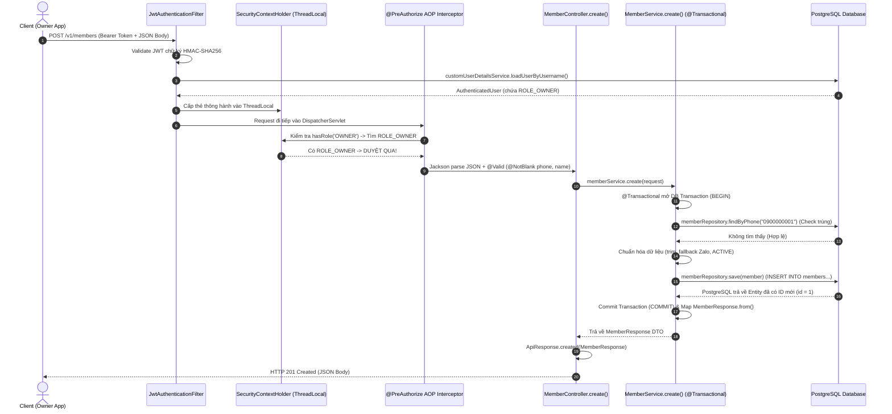

# 🧑‍🤝‍🧑 CHẶNG 4: QUẢN LÝ HỘI VIÊN (MEMBER MANAGEMENT)

Tài liệu này ghi chú chi tiết toàn bộ kiến trúc và luồng nghiệp vụ của phân hệ **Quản lý Hội viên (Member Management)** trong hệ thống **Gym Dương Double**.

---

## 🎯 1. Mục tiêu Nghiệp vụ
- **Quản lý thông tin Hội viên trung tâm:** Tiếp nhận thông tin cá nhân khách hàng (họ tên, số điện thoại, ngày sinh, giới tính, nguồn khách `WALK_IN`/`FACEBOOK`...).
- **Chống trùng lặp dữ liệu khách hàng (Unique Phone):** Số điện thoại là định danh tự nhiên duy nhất. Nếu đăng ký trùng số điện thoại -> tự động quăng `ConflictException` (HTTP 409 Conflict).
- **Tối ưu hiển thị Bảng điều khiển Lễ tân (Data Composition):** Tách biệt DTO chi tiết cá nhân ([MemberResponse.java](file:///d:/gym-management-system/backend/src/main/java/com/gymduongdouble/backend/member/web/dto/MemberResponse.java)) và DTO danh sách ([MemberSummaryResponse.java](file:///d:/gym-management-system/backend/src/main/java/com/gymduongdouble/backend/member/web/dto/MemberSummaryResponse.java)) tự động tính số ngày còn lại của gói tập (`daysUntilExpiration`).
- **Phân quyền bảo mật cao cấp:** Phân quyền method `@PreAuthorize("hasRole('OWNER')")` bảo vệ hành động thêm hội viên mới.

---

## 🗺️ 2. Sơ đồ Luồng Chi tiết: Tạo mới Hội viên (`POST /v1/members`)



---

## 🔍 3. Chi tiết Các Thành phần Cốt lõi

### 3.1. Bộ ba DTOs Giao tiếp
1. **[MemberCreateRequest.java](file:///d:/gym-management-system/backend/src/main/java/com/gymduongdouble/backend/member/web/dto/MemberCreateRequest.java):**
   - `@NotBlank(fullName)`: Họ tên bắt buộc.
   - `@NotBlank(phone)`: Số điện thoại bắt buộc.
2. **[MemberResponse.java](file:///d:/gym-management-system/backend/src/main/java/com/gymduongdouble/backend/member/web/dto/MemberResponse.java):**
   - DTO chi tiết đầy đủ 10 trường thông tin cá nhân của hội viên.
3. **[MemberSummaryResponse.java](file:///d:/gym-management-system/backend/src/main/java/com/gymduongdouble/backend/member/web/dto/MemberSummaryResponse.java):**
   - DTO thông minh tổng hợp đa bảng: ghép thông tin `Member` và gói tập gần nhất `MemberMembership`.
   - Tính khoảng cách ngày hết hạn bằng `ChronoUnit.DAYS.between(LocalDate.now(), membership.getEndDate())`:
     - Số **DƯƠNG** (`+8`): Gói còn hạn 8 ngày.
     - Số **`0`**: Hết hạn hôm nay.
     - Số **ÂM** (`-5`): Đã quá hạn 5 ngày.
     - **`null`**: Khách mới chưa mua gói nào.

---

### 3.2. [MemberService.java](file:///d:/gym-management-system/backend/src/main/java/com/gymduongdouble/backend/member/service/MemberService.java) - Xử lý Nghiệp vụ
- **Kiểm tra trùng SĐT:**
  ```java
  memberRepository.findByPhone(request.phone().trim()).ifPresent(member -> {
      throw new ConflictException("Số điện thoại đã tồn tại trong hệ thống.");
  });
  ```
- **Fallback số điện thoại Zalo thông minh:**
  ```java
  member.setZaloPhone(StringUtils.hasText(request.zaloPhone()) ? request.zaloPhone().trim() : request.phone().trim());
  ```
- **Tìm kiếm linh hoạt & Sắp xếp mới nhất lên đầu:**
  ```java
  List<Member> members = StringUtils.hasText(keyword)
      ? memberRepository.findByFullNameContainingIgnoreCase(keyword.trim())
      : memberRepository.findAll();

  return members.stream()
      .sorted(Comparator.comparing(Member::getCreatedAt).reversed())
      .map(member -> MemberSummaryResponse.from(member, latestMembership(member.getId())))
      .toList();
  ```

---

### 3.3. [MemberController.java](file:///d:/gym-management-system/backend/src/main/java/com/gymduongdouble/backend/member/web/MemberController.java) - RESTful API
- `POST /v1/members`: Tạo hội viên mới (yêu cầu `@PreAuthorize("hasRole('OWNER')")`), trả về HTTP `201 Created`.
- `GET /v1/members/{id}`: Xem chi tiết 1 hội viên, trả về HTTP `200 OK`.
- `GET /v1/members?keyword=...`: Tìm kiếm danh sách kèm trạng thái gói tập, trả về HTTP `200 OK`.

---

## 🧠 4. Bảng Ghi nhớ Kiến thức Cốt lõi (Key Takeaways)

| Khái niệm / Kỹ thuật | Bản chất & Ý nghĩa |
| :--- | :--- |
| **`hasRole('OWNER')`** | Spring Security tự động thêm tiền tố `"ROLE_"` ngầm phía trước -> so sánh với `"ROLE_OWNER"` trong `UserDetails.getAuthorities()`. |
| **`ChronoUnit.DAYS.between`** | Chuẩn Java 8 Date-Time API, tự động xử lý năm nhuận, tháng thiếu/đủ và múi giờ, trả về số âm/dương chuẩn xác cho nghiệp vụ ngày hết hạn. |
| **`ConflictException` (HTTP 409)** | Ngoại lệ báo lỗi xung đột dữ liệu (trùng số điện thoại duy nhất). |
| **Data Composition** | Ghép nối dữ liệu giữa nhiều Entity (`Member` + `MemberMembership`) trong 1 DTO tóm tắt để tối ưu trải nghiệm người dùng trên giao diện Lễ tân. |
