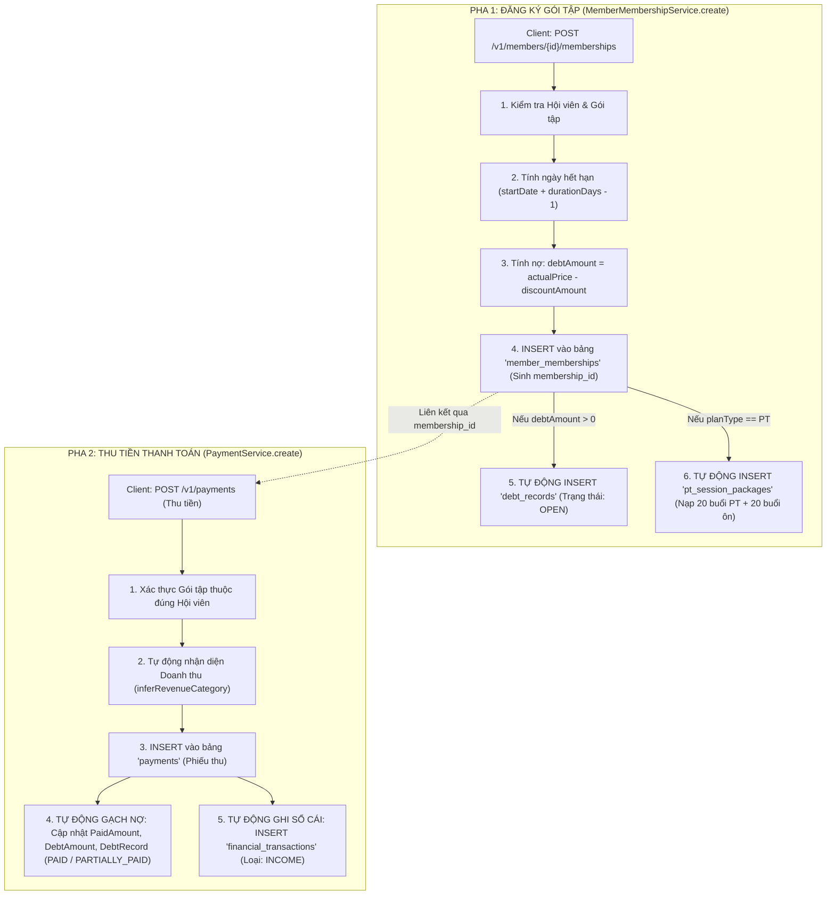

# 💳 CHẶNG 5: ĐĂNG KÝ GÓI TẬP & ĐỒNG BỘ TÀI CHÍNH / CÔNG NỢ

Tài liệu này ghi chú chi tiết toàn bộ kiến trúc, luồng giao dịch đa bảng và logic nghiệp vụ của phân hệ **Đăng ký Gói tập (Subscriptions)** và **Thu tiền Thanh toán (Payments / Financial Sync)** trong hệ thống **Gym Dương Double**.

---

## 🎯 1. Mục tiêu Nghiệp vụ & Triết lý Thiết kế

1. **Tách rời Đăng ký Gói và Thu tiền (POS Model):**
   - Không gộp đăng ký và thu tiền làm một nhằm hỗ trợ nghiệp vụ thực tế: **Đặt cọc, Trả góp nhiều lần (Partial Payments)** và kiểm soát dòng tiền độc lập.
2. **Tự động hóa 100% (Eventual Consistency & Single Source of Truth):**
   - Chỉ với **1 hành động Mua gói:** Hệ thống tự động mở hồ sơ công nợ (`DebtRecord`) và tự động cấp kho buổi tập PT (`PtSessionPackage`).
   - Chỉ với **1 hành động Thu tiền:** Hệ thống tự động trừ dần công nợ (gạch nợ) và tự động ghi nhận vào Sổ cái Doanh thu (`FinancialTransaction` loại `INCOME`).
3. **Toàn vẹn Dữ liệu Tài chính (ACID & Transactional Boundaries):**
   - Mọi thao tác ghi nhiều bảng đều được bao bọc trong `@Transactional`, cam kết không bao giờ bị lệch sổ kế toán hay sinh dữ liệu rác.

---

## 🗺️ 2. Sơ đồ Luồng Nghiệp vụ Toàn diện (2 Pha Liên Hoàn)



---

## 🔍 3. Chi tiết Mã nguồn Từng Mắt xích

### 3.1. Phân hệ Đăng ký Gói ([MemberMembershipService.java](file:///d:/gym-management-system/backend/src/main/java/com/gymduongdouble/backend/membership/service/MemberMembershipService.java))

#### 1. Thuật toán Tính Ngày Hết Hạn (`resolveEndDate` - Dòng 91):
```java
private LocalDate resolveEndDate(MembershipPlan plan, CreateMemberMembershipRequest request) {
    if (request.endDate() != null) {
        return request.endDate(); // Ưu tiên ngày người dùng nhập tay
    }
    if (plan.getDurationDays() == null || plan.getDurationDays() <= 0) {
        throw new BadRequestException("Gói chưa có thời hạn, cần nhập ngày kết thúc.");
    }
    // Công thức chuẩn: startDate + durationDays - 1 ngày
    return request.startDate().plusDays(plan.getDurationDays() - 1L);
}
```
> **Giải thích:** Gói 30 ngày bắt đầu ngày `22/09` -> Hết hạn vào cuối ngày `22/09 + 29 ngày = 21/10`. Đảm bảo khách tập đúng 30 ngày.

#### 2. Tính Tiền Bán & Công Nợ Ban Đầu (Dòng 53 - 55):
```java
BigDecimal actualPrice = request.actualPrice() == null ? plan.getDefaultPrice() : request.actualPrice();
BigDecimal discountAmount = request.discountAmount() == null ? BigDecimal.ZERO : request.discountAmount();
BigDecimal debtAmount = actualPrice.subtract(discountAmount).max(BigDecimal.ZERO);
```
> **Giải thích:** `.max(BigDecimal.ZERO)` ngăn chặn trường hợp giảm giá vượt quá giá bán làm nợ bị âm tiền.

#### 3. Tự động Sinh Công Nợ (`createDebtIfNeeded` - Dòng 101):
```java
private void createDebtIfNeeded(MemberMembership membership, BigDecimal debtAmount) {
    if (debtAmount.compareTo(BigDecimal.ZERO) <= 0) return;

    DebtRecord debtRecord = new DebtRecord();
    debtRecord.setMember(membership.getMember());
    debtRecord.setMembership(membership);
    debtRecord.setOriginalAmount(debtAmount);  // Số nợ gốc ban đầu
    debtRecord.setPaidAmount(BigDecimal.ZERO); // Đã trả = 0
    debtRecord.setRemainingAmount(debtAmount); // Còn nợ = debtAmount
    debtRecord.setDueDate(membership.getStartDate());
    debtRecord.setStatus(DebtStatus.OPEN);     // Trạng thái: OPEN (Đang nợ)
    debtRecord.setNote("Công nợ phát sinh khi đăng ký gói.");
    debtRecordRepository.save(debtRecord);
}
```

#### 4. Tự động Cấp Buổi tập PT (`createPtPackageIfNeeded` - Dòng 118):
```java
private void createPtPackageIfNeeded(MemberMembership membership, Long ptUserId) {
    if (membership.getPlan().getPlanType() != PlanType.PT) return;

    PtSessionPackage sessionPackage = new PtSessionPackage();
    sessionPackage.setMember(membership.getMember());
    sessionPackage.setPtUser(findUserOrNull(ptUserId)); // PT được phân công
    sessionPackage.setMembership(membership);
    sessionPackage.setTotalPtSessions(valueOrZero(plan.getPtSessionCount()));
    sessionPackage.setUsedPtSessions(0);
    sessionPackage.setRemainingPtSessions(valueOrZero(plan.getPtSessionCount()));
    sessionPackage.setTotalPracticeSessions(valueOrZero(plan.getPracticeSessionCount()));
    sessionPackage.setUsedPracticeSessions(0);
    sessionPackage.setRemainingPracticeSessions(valueOrZero(plan.getPracticeSessionCount()));
    sessionPackage.setStartDate(membership.getStartDate());
    sessionPackage.setEndDate(membership.getEndDate());
    sessionPackage.setStatus(SessionPackageStatus.ACTIVE);
    ptSessionPackageRepository.save(sessionPackage);
}
```

---

### 3.2. Phân hệ Thu tiền & Đồng bộ Tài chính ([PaymentService.java](file:///d:/gym-management-system/backend/src/main/java/com/gymduongdouble/backend/finance/service/PaymentService.java))

#### 1. Tự động Nhận diện Danh mục Doanh thu (`inferRevenueCategory` - Dòng 78):
Tự động phân loại tiền thu vào nhóm doanh thu tương ứng mà Lễ tân không cần chọn tay:
- `PlanType.SELF_TRAINING` $\rightarrow$ `RevenueCategory.SELF_TRAINING`
- `PlanType.GUIDANCE` $\rightarrow$ `RevenueCategory.GUIDANCE`
- `PlanType.PT` (PT mới) $\rightarrow$ `RevenueCategory.PT_NEW`
- `PlanType.PT` (PT chính) $\rightarrow$ `RevenueCategory.PT_MAIN`

#### 2. Tự động Gạch Nợ (`syncMembershipDebt` - Dòng 99):
```java
private void syncMembershipDebt(MemberMembership membership, BigDecimal amount) {
    if (membership == null) return;

    // 1. Tăng số tiền đã trả:
    BigDecimal paidAmount = membership.getPaidAmount().add(amount);

    // 2. Tính lại số tiền nợ còn lại:
    BigDecimal payableAmount = membership.getActualPrice().subtract(membership.getDiscountAmount()).max(BigDecimal.ZERO);
    BigDecimal debtAmount = payableAmount.subtract(paidAmount).max(BigDecimal.ZERO);

    membership.setPaidAmount(paidAmount);
    membership.setDebtAmount(debtAmount);

    // 3. Cập nhật bản ghi Công nợ (debt_records):
    debtRecordRepository.findByMembershipIdOrderByCreatedAtDesc(membership.getId()).stream()
        .findFirst()
        .ifPresent(debtRecord -> {
            debtRecord.setPaidAmount(paidAmount.min(debtRecord.getOriginalAmount()));
            debtRecord.setRemainingAmount(debtAmount);
            debtRecord.setStatus(resolveDebtStatus(debtRecord)); // Cập nhật trạng thái
        });
}

private DebtStatus resolveDebtStatus(DebtRecord debtRecord) {
    if (debtRecord.getRemainingAmount().compareTo(BigDecimal.ZERO) <= 0) return DebtStatus.PAID; // Hết nợ
    if (debtRecord.getPaidAmount().compareTo(BigDecimal.ZERO) > 0) return DebtStatus.PARTIALLY_PAID; // Trả 1 phần
    return DebtStatus.OPEN; // Chưa trả
}
```

#### 3. Tự động Ghi Sổ cái Thu tiền (`createIncomeTransaction` - Dòng 129):
```java
private void createIncomeTransaction(Payment payment, RevenueCategory revenueCategory) {
    FinancialCategory category = financialCategoryRepository.findByCode(revenueCategory.name())
        .orElseGet(() -> { ... }); // Tự tạo Category nếu chưa có

    FinancialTransaction transaction = new FinancialTransaction();
    transaction.setType(FinancialTransactionType.INCOME); // Thu tiền (INCOME)
    transaction.setCategory(category);
    transaction.setAmount(payment.getAmount());
    transaction.setTransactionDate(payment.getPaymentDate());
    transaction.setMember(payment.getMember());
    transaction.setMembership(payment.getMembership());
    transaction.setPayment(payment);
    transaction.setDescription(payment.getDescription());
    transaction.setCreatedBy(payment.getCreatedBy());
    financialTransactionRepository.save(transaction);
}
```

---

## 📊 4. Sự Biến đổi Trạng thái CSDL Qua Ví dụ Thực tế

**Tình huống:** Khách Nguyễn Văn A mua Gói PT 1 Tháng giá **`4.500.000đ`**, trả làm 2 đợt:

```
[BƯỚC 1: ĐĂNG KÝ GÓI]
├── member_memberships: paidAmount = 0, debtAmount = 4.500.000
├── debt_records: original = 4.500.000, remaining = 4.500.000, status = OPEN
└── pt_session_packages: total_pt = 20, remaining_pt = 20, status = ACTIVE

[BƯỚC 2: KHÁCH CỌC ĐỢT 1: 1.500.000đ (Tiền mặt)]
├── payments: amount = 1.500.000, method = CASH
├── member_memberships: paidAmount = 1.500.000, debtAmount = 3.000.000
├── debt_records: remaining = 3.000.000, status = PARTIALLY_PAID
└── financial_transactions: amount = 1.500.000, type = INCOME

[BƯỚC 3: KHÁCH ĐÓNG ĐỢT 2: 3.000.000đ (Chuyển khoản)]
├── payments: amount = 3.000.000, method = BANK_TRANSFER
├── member_memberships: paidAmount = 4.500.000, debtAmount = 0
├── debt_records: remaining = 0, status = PAID (HOÀN TẤT CÔNG NỢ)
└── financial_transactions: amount = 3.000.000, type = INCOME
```

---

## 🧠 5. Bảng Ghi nhớ Kiến thức Cốt lõi (Key Takeaways)

| Khái niệm / Kỹ thuật | Bản chất & Ý nghĩa |
| :--- | :--- |
| **Atomic Transaction (`@Transactional`)** | Toàn bộ chuỗi ghi 3 bảng (Gói + Nợ + Buổi PT) hoặc chuỗi gạch nợ (Phiếu thu + Cập nhật nợ + Sổ cái) thành công hoặc cùng thất bại (Rollback). |
| **`BigDecimal.max(BigDecimal.ZERO)`** | Kỹ thuật chặn số âm cho tiền tệ và công nợ. |
| **POS Accounting Model** | Tách rời đăng ký gói và thu tiền giúp hệ thống linh hoạt hỗ trợ trả góp, đặt cọc và kiểm soát thất thoát tài chính. |
| **Data Synchronization** | Tự động hóa liên kết giữa `payments` $\rightarrow$ `debt_records` $\rightarrow$ `financial_transactions` giúp dữ liệu luôn là Single Source of Truth. |
