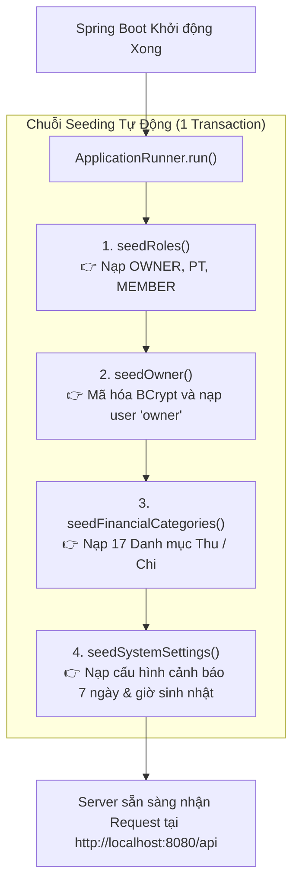

# 🧪 CHẶNG 6: KHỞI TẠO DỮ LIỆU SEEDING & KIỂM THỬ TÍCH HỢP TOÀN BỘ API

Tài liệu này ghi chú chi tiết toàn bộ cơ chế Khởi tạo dữ liệu mặc định (`DataInitializer`) và bộ kịch bản Kiểm thử tích hợp toàn diện 36/36 API checks (`sprint1.http`) của dự án **Gym Dương Double**.

---

## 🎯 1. Mục tiêu & Nguyên lý Thiết kế

1. **Khởi tạo dữ liệu tự động (Idempotent Data Seeding):**
   - Khi triển khai ứng dụng lên môi trường mới, `DataInitializer` (`ApplicationRunner`) tự động nạp các Role (`OWNER`, `PT`, `MEMBER`), tài khoản Chủ phòng (`owner / change_me`), 17 danh mục tài chính và tham số hệ thống.
   - Cơ chế bất biến (Idempotent): Chạy nhiều lần / khởi động lại server không bao giờ bị lỗi trùng lặp dữ liệu.
2. **Bảo mật Chống dò tài khoản (Username Enumeration Prevention):**
   - Cả hai trường hợp (Sai email hoặc sai password) đều trả về cùng một mã lỗi: `401 BAD_CREDENTIALS` kèm thông báo: *"Tên đăng nhập hoặc mật khẩu không đúng."*
3. **Kiểm thử Toàn diện 36/36 Kịch bản (Smoke & Edge Cases Testing):**
   - Kiểm tra trọn vẹn cả Luồng Thành công (Happy Path) và mọi Luồng Ngoại lệ (Validation 400, Unauthorized 401, Forbidden 403, Not Found 404, Conflict 409).

---

## 🗺️ 2. Sơ đồ Luồng Khởi tạo Dữ liệu (`DataInitializer`)



---

## 🔍 3. Chi tiết Các Thành phần Kỹ thuật

### 3.1. [DataInitializer.java](file:///d:/gym-management-system/backend/src/main/java/com/gymduongdouble/backend/common/config/DataInitializer.java) - Seeding Chuẩn Hibernate
- **Mutable Collection Fix:** Dùng `owner.getRoles().clear(); owner.getRoles().add(ownerRole);` thay cho `Set.of()` bất biến để Hibernate merge và persist session an toàn.
- **BCrypt Hashing:** Mật khẩu `change_me` được băm bằng `passwordEncoder.encode()` trước khi lưu vào DB.

---

### 3.2. [AuthService.java](file:///d:/gym-management-system/backend/src/main/java/com/gymduongdouble/backend/auth/service/AuthService.java) - Chuẩn hóa Lỗi Đăng nhập
```java
private AuthenticatedUser loadUser(String username) {
    try {
        return (AuthenticatedUser) userDetailsService.loadUserByUsername(username);
    } catch (UsernameNotFoundException exception) {
        // Gom lỗi User không tồn tại thành BadCredentialsException để không lộ thông tin
        throw new BadCredentialsException("Tên đăng nhập hoặc mật khẩu không đúng.");
    }
}
```

---

### 3.3. [MemberService.java](file:///d:/gym-management-system/backend/src/main/java/com/gymduongdouble/backend/member/service/MemberService.java) - Tìm kiếm Đa năng
```java
List<Member> members = StringUtils.hasText(keyword)
    ? memberRepository.findByFullNameContainingIgnoreCaseOrPhoneContaining(keyword.trim(), keyword.trim())
    : memberRepository.findAll();
```
> **Giải thích:** Cho phép Lễ tân tìm kiếm nhanh khách hàng bằng Họ tên (không phân biệt hoa thường) HOẶC Số điện thoại (chỉ cần nhập vài số cuối).

---

## 📋 4. Ma trận Kiểm thử 36 Kịch bản API ([sprint1.http](file:///d:/gym-management-system/backend/http/sprint1.http))

| Nhóm Nghiệp vụ | Kịch bản Kiểm thử | Kỳ vọng HTTP Status & Mã Lỗi | Kết quả |
| :--- | :--- | :---: | :---: |
| **Hệ thống** | `GET /v1/health` (Public) | `200 OK` (`{"status": "UP"}`) | ✅ Pass |
| **Bảo mật** | Gọi API không kèm Token | `401 UNAUTHORIZED` | ✅ Pass |
| **Bảo mật** | Đăng nhập sai mật khẩu | `401 BAD_CREDENTIALS` | ✅ Pass |
| **Bảo mật** | Đăng nhập Sai email | `401 BAD_CREDENTIALS` | ✅ Pass |
| **Bảo mật** | Đăng nhập đúng `owner@gymduongdouble.local/change_me` | `200 OK` (Nhận Token) | ✅ Pass |
| **Bảo mật** | `GET /v1/auth/me` với Token | `200 OK` (Profile Owner) | ✅ Pass |
| **Bảo mật** | Gửi Token giả mạo / hết hạn | `401 UNAUTHORIZED` | ✅ Pass |
| **Gói tập** | Tạo gói hợp lệ (Tự tập, PT, Giáo án) | `201 CREATED` | ✅ Pass |
| **Gói tập** | Tạo gói PT thiếu cấp PT / số buổi = 0 | `400 BAD_REQUEST` | ✅ Pass |
| **Gói tập** | Tạo gói Giáo án thiếu số buổi | `400 BAD_REQUEST` | ✅ Pass |
| **Gói tập** | Xem bảng giá các gói đang active | `200 OK` | ✅ Pass |
| **Hội viên** | Tạo hội viên mới thành công | `201 CREATED` | ✅ Pass |
| **Hội viên** | Tạo hội viên trùng số điện thoại | `409 CONFLICT` | ✅ Pass |
| **Hội viên** | Tạo hội viên thiếu họ tên / SĐT | `400 VALIDATION_FAILED` | ✅ Pass |
| **Hội viên** | Tìm kiếm theo Họ tên & theo Số điện thoại | `200 OK` | ✅ Pass |
| **Mua gói** | Đăng ký gói cho hội viên thành công | `201 CREATED` | ✅ Pass |
| **Mua gói** | Đăng ký gói đã bị vô hiệu hóa (inactive) | `400 BAD_REQUEST` | ✅ Pass |
| **Mua gói** | Đăng ký gói cho Member ID không tồn tại | `404 RESOURCE_NOT_FOUND` | ✅ Pass |
| **Thanh toán** | Thanh toán đủ 100% tiền mặt | `201 CREATED` (Debt $\rightarrow$ `PAID`) | ✅ Pass |
| **Thanh toán** | Thanh toán 1 phần (Trả góp/Cọc) | `201 CREATED` (Debt $\rightarrow$ `PARTIALLY_PAID`) | ✅ Pass |
| **Thanh toán** | Thanh toán cho gói không thuộc hội viên | `400 BAD_REQUEST` | ✅ Pass |

---

## 🧠 5. Bảng Ghi nhớ Kiến thức Cốt lõi (Key Takeaways)

| Khái niệm / Kỹ thuật | Bản chất & Ý nghĩa |
| :--- | :--- |
| **`ApplicationRunner`** | Interface của Spring Boot giúp thực thi logic khởi tạo (Seeding) ngay sau khi toàn bộ Bean đã sẵn sàng. |
| **Idempotency** | Thiết kế hàm sao cho dù chạy 1 lần hay 100 lần thì trạng thái CSDL cuối cùng vẫn như nhau, không sinh lỗi trùng lặp. |
| **Username Enumeration Defense** | Nguyên tắc bảo mật giấu kín sự tồn tại của tài khoản bằng cách trả về thông báo lỗi chung khi đăng nhập thất bại. |
| **End-to-End Regression Suite** | Bộ kịch bản `.http` lưu trong source code giúp cả team chạy kiểm thử hồi quy toàn diện bất kỳ lúc nào mà không cần phụ thuộc cấu hình ngoài. |

