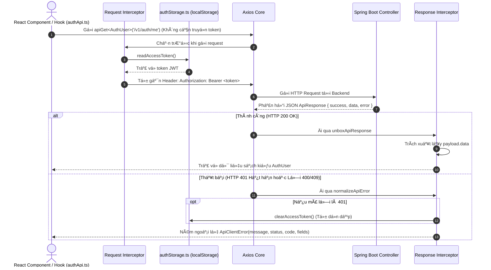

# 🔌 CHẶNG 08: CHUẨN HÓA KIỂU Dá»® LIỆU TYPE-SAFE & LỚP AXIOS CLIENT (INTERCEPTORS)

Tài liệu này ghi chú chi tiết về cơ chế **Đồng bộ Kiểu dữ liệu Type-Safe (TypeScript ↔ Spring Boot DTOs)**, **Lớp Axios Client Tự động Gắn Token (Request/Response Interceptors)**, và **Kỹ thuật Mở hộp Kiểu Dữ Liệu (`UnboxedAxiosInstance`)**.

---

## 🎯 1. Mục tiêu & Tại sao Chuyển sang Axios?

1. **Tự động gắn Bearer Token:** Nhờ `Request Interceptor`, mọi request gửi đi đều tự động đọc token từ `authStorage` và đính kèm vào Header `Authorization`, các hàm gọi API không còn phải nhận tham số `token` thủ công.
2. **Tự động Unboxing dữ liệu & Bắt lỗi 401:** Nhờ `Response Interceptor`, tầng UI nhận thẳng dữ liệu thực `data` sạch sẽ, đồng thời nếu gặp lỗi 401 (token hết hạn) thì tự động dọn sạch `localStorage`.
3. **Type-Safe Tuyệt đối (`UnboxedAxiosInstance`):** Dạy cho TypeScript hiểu rằng Axios sau khi qua Interceptor sẽ trả về `Promise<T>` thay vì `Promise<AxiosResponse<T>>`.

---

## 🗺️ 2. Sơ đồ Luồng Hoạt động của Axios Interceptors



---

## 🔍 3. Chi tiết Các Thành phần Kỹ thuật

### 3.1. Đồng bộ Kiểu Dữ liệu Type-Safe ([shared/types/api.ts](file:///d:/gym-management-system/frontend/src/shared/types/api.ts))

```typescript
// Khớp với ApiError.java của Spring Boot
export type ApiError = {
  code: string
  message: string
  fields: Record<string, string> // Ví dụ: { phone: "Số điện thoại đã tồn tại" }
}

// Khớp với ApiResponse.java của Spring Boot
export type ApiResponse<T> = {
  success: boolean
  message: string
  data: T | null
  error: ApiError | null
  timestamp: string
}
```

---

### 3.2. Cấu hình Axios Instance & Interceptors ([shared/api/apiClient.ts](file:///d:/gym-management-system/frontend/src/shared/api/apiClient.ts))

```typescript
import axios from 'axios'
import type { AxiosError, AxiosInstance, AxiosRequestConfig, AxiosResponse } from 'axios'
import { clearAccessToken, readAccessToken } from '../lib/authStorage'
import type { ApiResponse } from '../types/api'

// 1. Tạo instance với URL gốc từ .env
const axiosInstance = axios.create({
  baseURL: import.meta.env.VITE_API_BASE_URL ?? 'http://localhost:8080/api',
  headers: {
    Accept: 'application/json',
    'Content-Type': 'application/json',
  },
})

// 2. REQUEST INTERCEPTOR: Tự động gắn Token vào mọi Request
axiosInstance.interceptors.request.use((config) => {
  const token = readAccessToken()
  if (token) {
    config.headers.Authorization = `Bearer ${token}`
  }
  return config
})

// 3. RESPONSE INTERCEPTOR: Mở hộp (Unbox) và Bắt lỗi tập trung
function unboxApiResponse(response: AxiosResponse<ApiResponse<unknown>>) {
  const payload = response.data
  if (!payload || typeof payload.success !== 'boolean') {
    throw new ApiClientError('Phản hồi từ máy chủ không hợp lệ.', response.status)
  }
  if (!payload.success) {
    throw new ApiClientError(payload.error?.message ?? 'Yêu cầu không thành công.', response.status, payload.error?.code, payload.error?.fields)
  }
  return payload.data // 👉 Trả về thẳng data bên trong
}

function normalizeApiError(error: AxiosError<ApiResponse<unknown>>) {
  const status = error.response?.status ?? 0
  const payload = error.response?.data
  if (status === 401) {
    clearAccessToken() // 👉 Tự xóa token khi hết hạn
  }
  throw new ApiClientError(payload?.error?.message ?? 'Không thể kết nối đến máy chủ.', status, payload?.error?.code, payload?.error?.fields)
}

axiosInstance.interceptors.response.use(
  unboxApiResponse as unknown as (response: AxiosResponse) => AxiosResponse,
  normalizeApiError,
)
```

---

### 3.3. Bí quyết TypeScript: `UnboxedAxiosInstance`
Trong Axios mặc định, hàm `get<T>()` trả về `Promise<AxiosResponse<T>>`. Nhưng vì Response Interceptor đã bóc vỏ để trả về thẳng `T`, Codex đã định nghĩa kiểu `UnboxedAxiosInstance` để trình biên dịch TypeScript không bắt ta phải gõ `res.data` thêm một lần nữa:

```typescript
type UnboxedAxiosInstance = Omit<AxiosInstance, 'get' | 'post'> & {
  get<T>(url: string, config?: AxiosRequestConfig): Promise<T>
  post<T, TBody = unknown>(url: string, data?: TBody, config?: AxiosRequestConfig<TBody>): Promise<T>
}

export const apiClient = axiosInstance as UnboxedAxiosInstance

export function apiGet<T>(url: string, config?: AxiosRequestConfig): Promise<T> {
  return apiClient.get<T>(url, config)
}

export function apiPost<T, TBody = unknown>(url: string, data?: TBody, config?: AxiosRequestConfig<TBody>): Promise<T> {
  return apiClient.post<T, TBody>(url, data, config)
}
```

---

### 3.4. Gọi API Siêu Tinh Gọn ([features/auth/api/authApi.ts](file:///d:/gym-management-system/frontend/src/features/auth/api/authApi.ts))
Nhìn sự khác biệt khi dùng Axios Interceptors:

```typescript
// Trước đây (fetch): Phải truyền token thủ công
// export function getCurrentUser(token: string) { ... }

// Hiện tại (Axios Interceptor): Hoàn toàn không cần truyền token!
export function login(email: string, password: string) {
  return apiPost<LoginResponse>('/v1/auth/login', { email, password })
}

export function getCurrentUser() {
  return apiGet<AuthUser>('/v1/auth/me') // 👉 Interceptor tự động gắn token ngầm
}
```

---

## 🧠 4. Bảng Ghi nhớ Kiến thức Cốt lõi (Key Takeaways)

| Khái niệm / Kỹ thuật | Bản chất & Ý nghĩa |
| :--- | :--- |
| **Request Interceptor** | "Trạm gác" trước khi request bay đi: Tự động lấy token trong `localStorage` gắn vào Header `Authorization`. |
| **Response Interceptor** | "Trạm kiểm soát" khi server phản hồi: Tự động unbox lấy `payload.data`, nếu gặp mã 401 thì tự động xóa token cũ. |
| **`UnboxedAxiosInstance`** | Ép kiểu TypeScript để hàm `apiGet<T>()` trả về đúng kiểu dữ liệu `Promise<T>` sạch sẽ, chuẩn Type-safe. |
| **Zero Parameter API Call** | Các hàm gọi dữ liệu cá nhân như `getCurrentUser()` không cần tham số `token`, giúp code UI cực kỳ gọn gàng. |

