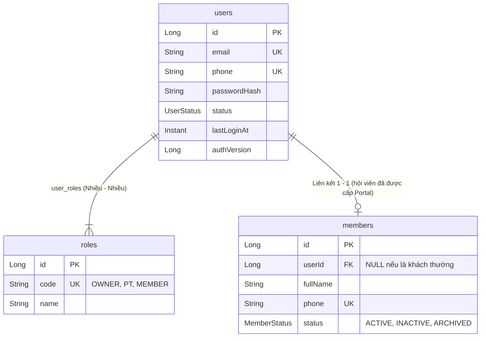
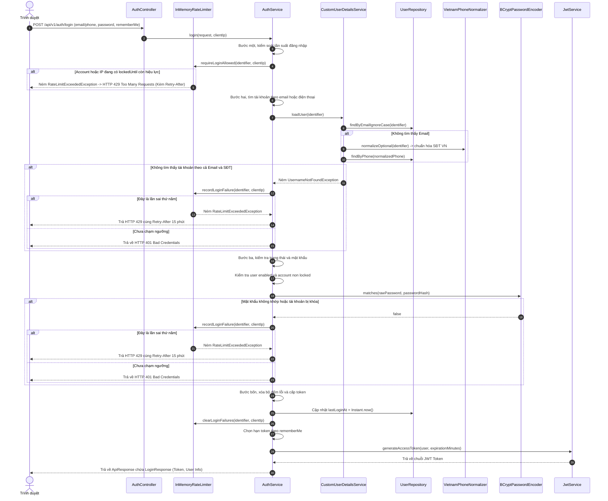
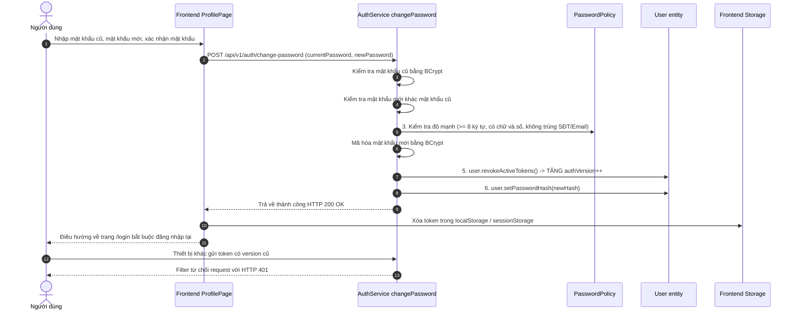

# Tài khoản và luồng đăng nhập

## 1. Phân Biệt Giữa Tài Khoản (`User`) và Hồ Sơ Hội Viên (`Member`)

Trong hệ thống phòng gym Dương Double, hai khái niệm này được tách bạch hoàn toàn:



### Đặc thù phân quyền và đối tượng tài khoản:
1. **`User` (Tài khoản đăng nhập)**: Đại diện cho người có quyền truy cập vào hệ thống phần mềm, gồm email, số điện thoại, mật khẩu mã hóa BCrypt, trạng thái hoạt động (`ACTIVE`, `INACTIVE`, `LOCKED`), mốc đăng nhập cuối `lastLoginAt`, phiên bản xác thực `authVersion`, và danh sách vai trò (`Role`).
2. **`Member` (Hồ sơ khách hàng phòng gym)**: Đại diện cho người đến tập gym (lưu họ tên, ngày sinh, giới tính, địa chỉ, số Zalo, nguồn khách, ghi chú).
3. **Quy tắc cấp tài khoản trong phòng gym Dương Double:**
   * **Chủ phòng (`OWNER`)**: Có tài khoản quản trị tối cao. Bản ghi seed mặc định của chủ phòng có cả 2 role `ROLE_OWNER` và `ROLE_PT`, cho phép chủ phòng vừa quản trị vừa trực tiếp dạy PT.
   * **Huấn luyện viên (`PT`)**: Được cấp tài khoản để quản lý học viên phân công, đặt lịch, chấm buổi tập.
    * **Hội viên Portal (`MEMBER`)**: OWNER có thể cấp khi hội viên `ACTIVE` có gói tập hiệu lực để họ xem dữ liệu tại `/my-progress`; khi tạo, `member.user_id` trỏ đến `users.id`. Khách PT có thêm dữ liệu tiến độ nếu đã được PT ghi nhận.
    * **Khách vãng lai hoặc chưa có gói hiệu lực**: Không cấp mới Portal (`member.user_id = null`) và chỉ xem trang công khai. Khách tự tập có gói hiệu lực không thuộc nhóm này.

> **Điểm cần đọc đúng code:** endpoint cấp Portal chỉ dành cho `OWNER`, kiểm tra hội viên chưa có tài khoản, số điện thoại/mật khẩu hợp lệ, trạng thái `ACTIVE` và ít nhất một membership hiệu lực hôm nay. `MemberService.createPortalAccount()` không kiểm tra loại gói PT, nên khách tự tập có gói hiệu lực vẫn có thể được cấp.

---

## 2. Điểm Vào và DTO Đăng Nhập

### Các Endpoint Xác Thực trong [`AuthController.java`](../../../backend/src/main/java/com/gymduongdouble/backend/auth/web/AuthController.java):

| HTTP Method | Endpoint đầy đủ | Quyền hạn | Chức năng |
| :--- | :--- | :--- | :--- |
| `POST` | `/api/v1/auth/login` | Public (Không cần token) | Đăng nhập bằng Email hoặc SĐT, nhận JWT Token. |
| `GET` | `/api/v1/auth/me` | Authenticated (Cần Bearer token) | Lấy thông tin tài khoản hiện tại và danh sách role. |
| `POST` | `/api/v1/auth/change-password` | Authenticated (Cần Bearer token) | Đổi mật khẩu của chính mình, đồng thời thu hồi JWT cũ. |

### Cấu trúc [`LoginRequest.java`](../../../backend/src/main/java/com/gymduongdouble/backend/auth/web/dto/LoginRequest.java):
```java
public record LoginRequest(
    @NotBlank(message = "Email hoặc số điện thoại là bắt buộc.")
    String email,

    @NotBlank(message = "Mật khẩu là bắt buộc.")
    String password,

    Boolean rememberMe
) {
    @Override
    public String toString() {
        return "LoginRequest[email=" + email + ", password=***, rememberMe=" + rememberMe + "]";
    }
}
```
* **Tính năng linh hoạt**: Trường tên là `email` nhưng người dùng có thể nhập **địa chỉ Email** hoặc **Số điện thoại di động Việt Nam**.
* **Bảo mật log**: Ghi đè `toString()` để in ra `password=***`, ngăn việc vô tình in mật khẩu rõ (plaintext password) vào log khi debug.

---

## 3. Sơ Đồ Tuần Tự Luồng Đăng Nhập (`AuthService.login`)

Dưới đây là sơ đồ chi tiết từng bước kiểm tra từ lúc người dùng bấm nút "Đăng nhập" đến khi nhận Token:



---

## 4. Giải Phẫu Chi Tiết Mã Nguồn [`AuthService.login`](../../../backend/src/main/java/com/gymduongdouble/backend/auth/service/AuthService.java)

```java
@Transactional
public LoginResponse login(LoginRequest request, String clientIp) {
    // 1. Kiểm tra Rate Limiter trước tiên (chặn IP hoặc account đang bị khóa tạm thời)
    rateLimiter.requireLoginAllowed(request.email(), clientIp);

    try {
        // 2. Tra cứu tài khoản theo Email hoặc Số điện thoại
        AuthenticatedUser user = loadUser(request.email());

        // 3. Kiểm tra trạng thái hoạt động và so khớp mật khẩu bằng BCrypt
        if (!user.isEnabled() || !user.isAccountNonLocked() ||
            !passwordEncoder.matches(request.password(), user.getPassword())) {
            throw new BadCredentialsException("Email hoặc mật khẩu không đúng.");
        }

        // 4. Cập nhật thời điểm đăng nhập thành công (Dirty checking trong @Transactional)
    userRepository.findById(user.getId())
            .ifPresent(account -> account.setLastLoginAt(Instant.now()));

        // 5. Xác định thời hạn token theo tùy chọn Remember Me
        boolean remember = Boolean.TRUE.equals(request.rememberMe());
        long expirationMinutes = remember ? 30L * 24 * 60 : jwtProperties.accessTokenMinutes();

        // 6. Sinh token JWT chứa authVersion hiện tại của người dùng
        String token = jwtService.generateAccessToken(user, expirationMinutes);

        // 7. Đăng nhập thành công -> Xóa sạch bộ đếm sai của IP và Account này
        rateLimiter.clearLoginFailures(request.email(), clientIp);

        return new LoginResponse("Bearer", token, expirationMinutes, AuthUserResponse.from(user));
    } catch (BadCredentialsException exception) {
        // Ghi nhận thêm 1 lần thất bại vào bộ đếm RAM
        rateLimiter.recordLoginFailure(request.email(), clientIp);
        throw exception;
    }
}
```

### Các điểm mấu chốt cần lưu ý:
1. **Kiểm tra Rate Limit chạy TRƯỚC kiểm tra mật khẩu**: Nếu tài khoản hoặc IP đã bị khóa tạm thời (429), kể cả bạn nhập đúng mật khẩu 100% thì request vẫn bị ngắt ngay từ dòng đầu tiên, không thực hiện truy vấn DB hay so khớp hash.
2. **Khóa bộ đếm Rate Limiter**: Sử dụng chuỗi định danh sau khi `trim().toLowerCase()`.
3. **Mã hóa BCrypt là một chiều**: Không bao giờ có chuyện giải mã hash ngược về mật khẩu ban đầu. Hàm `passwordEncoder.matches(raw, hash)` sẽ băm chuỗi thô với `salt` được trích từ chính chuỗi `hash` để so sánh xem kết quả có trùng khớp không.

---

## 5. Luồng Đổi Mật Khẩu và Thu Hồi Phiên Đăng Nhập

Khi người dùng thực hiện đổi mật khẩu tại trang [`ProfilePage.tsx`](../../../frontend/src/features/profile/pages/ProfilePage.tsx):



* **Bản chất `authVersion`**: Khi đổi mật khẩu, hệ thống tăng `authVersion` từ $N \longrightarrow N + 1$. Mọi JWT cũ trước đó chỉ mang claim `ver = N`. Khi gửi lên, `JwtAuthenticationFilter` phát hiện `ver` trong token khác với `authVersion` trong database sẽ từ chối ngay lập tức!

---

## 6. Trả Lời Chi Tiết Các Câu Hỏi Tự Kiểm Tra

1. **Có hồ sơ hội viên có đồng nghĩa đã có tài khoản portal không?**
   * **Đáp án:** **HOÀN TOÀN KHÔNG**. Hồ sơ hội viên (`members`) chỉ lưu thông tin khách hàng ở quầy lễ tân. Portal là tài khoản được OWNER chủ động cấp qua API `POST /v1/members/{id}/portal-account`, sau khi backend xác nhận hội viên `ACTIVE` và có ít nhất một gói hiệu lực hôm nay. Vì vậy, một hội viên mới vẫn mặc định `user_id = null` cho đến khi có gói hợp lệ và OWNER cấp Portal.
2. **`rememberMe` ảnh hưởng cả thời hạn token và vị trí lưu ở frontend như thế nào?**
   * **Đáp án:**
     - **Ở Backend:** Nếu `rememberMe = true`, JWT token có hạn 30 ngày (43.200 phút). Nếu `false`, token có hạn mặc định 120 phút.
     - **Ở Frontend:** Nếu `rememberMe = true`, token được lưu trong `localStorage` (tồn tại vĩnh viễn cả khi tắt trình duyệt). Nếu `false`, token lưu trong `sessionStorage` (tự động mất khi đóng tab trình duyệt).
3. **Nếu bị rate limit rồi nhập đúng mật khẩu ngay, tại sao vẫn không đăng nhập được?**
   * **Đáp án:** Vì `rateLimiter.requireLoginAllowed()` nằm ở đầu `login()`, trước `loadUser()` và `passwordEncoder.matches()`. Lần sai thứ năm đã đặt `lockedUntil` bằng thời điểm đó cộng 15 phút. Trong thời gian này, kể cả mật khẩu đúng, request vẫn bị dừng bằng `RateLimitExceededException` (HTTP 429); người dùng phải đợi hết `Retry-After` mới có thể thử lại.

---

## 7. Góc Nhìn Mentor: Bộ Câu Hỏi Phỏng Vấn và Phản Biện Đồ Án

> [!TIP]
> **Câu hỏi 1: Tại sao em lại lưu `authVersion` trong bảng `users`? Việc này giải quyết điểm yếu gì của kiến trúc JWT Stateless?**
> * **Cách trả lời:** JWT vốn dĩ là Stateless (phi trạng thái) — server không lưu một `HttpSession` cho từng thiết bị. `authVersion` bổ sung một điểm kiểm tra nhỏ trong database để thu hồi token khi đổi hoặc reset mật khẩu: token cũ có `ver` khác DB sẽ bị từ chối. Lưu ý, **khóa tài khoản không tăng `authVersion`**; filter chặn ngay nhờ trạng thái `LOCKED`/không hoạt động. Nếu sau đó mở khóa lại mà chưa đổi/reset mật khẩu, token cũ còn hạn có thể dùng lại. Đây là khác biệt quan trọng giữa “chặn theo status” và “thu hồi theo version”.
>
> **Câu hỏi 2: Tại sao em lại cho phép đăng nhập bằng cả Số điện thoại lẫn Email trên cùng một ô input?**
> * **Cách trả lời:** Trong mô hình phòng gym thực tế, phần lớn hội viên đi tập chỉ nhớ số điện thoại cá nhân chứ ít khi nhớ email đăng ký. Việc hỗ trợ cả hai giúp tối ưu trải nghiệm người dùng (UX). Ở tầng Backend, `CustomUserDetailsService` sẽ tra cứu Email trước; nếu không thấy, hệ thống dùng `VietnamPhoneNormalizer` để loại bỏ khoảng trắng, dấu chấm, chuẩn hóa đầu số `+84` hoặc `0` rồi truy vấn theo cột `phone`.
