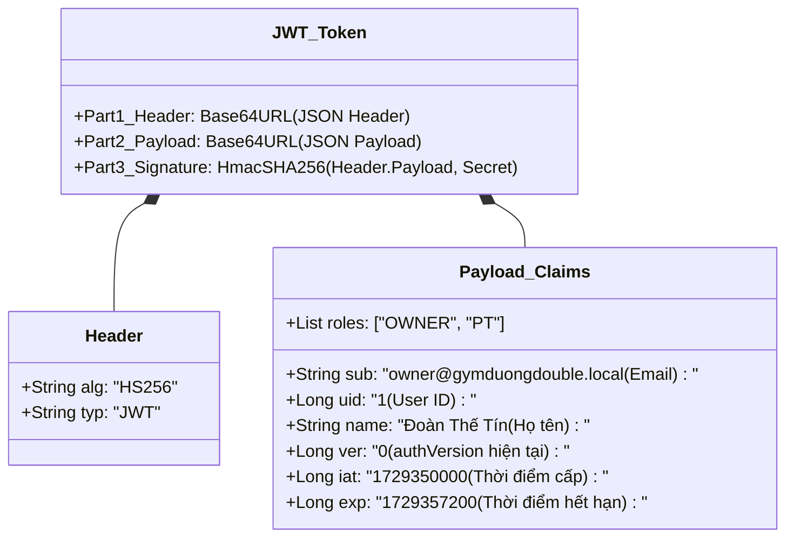
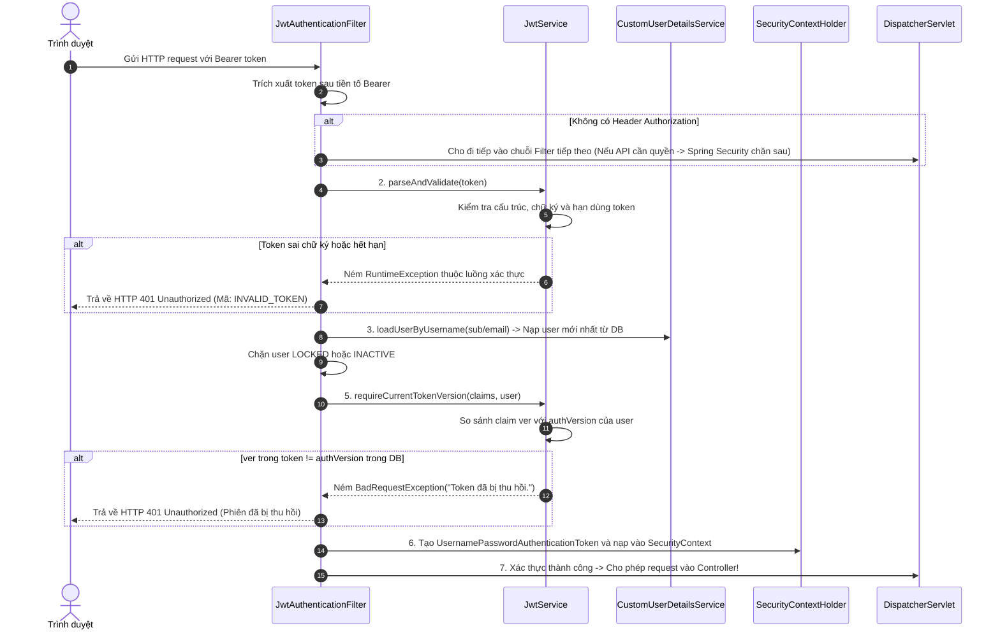
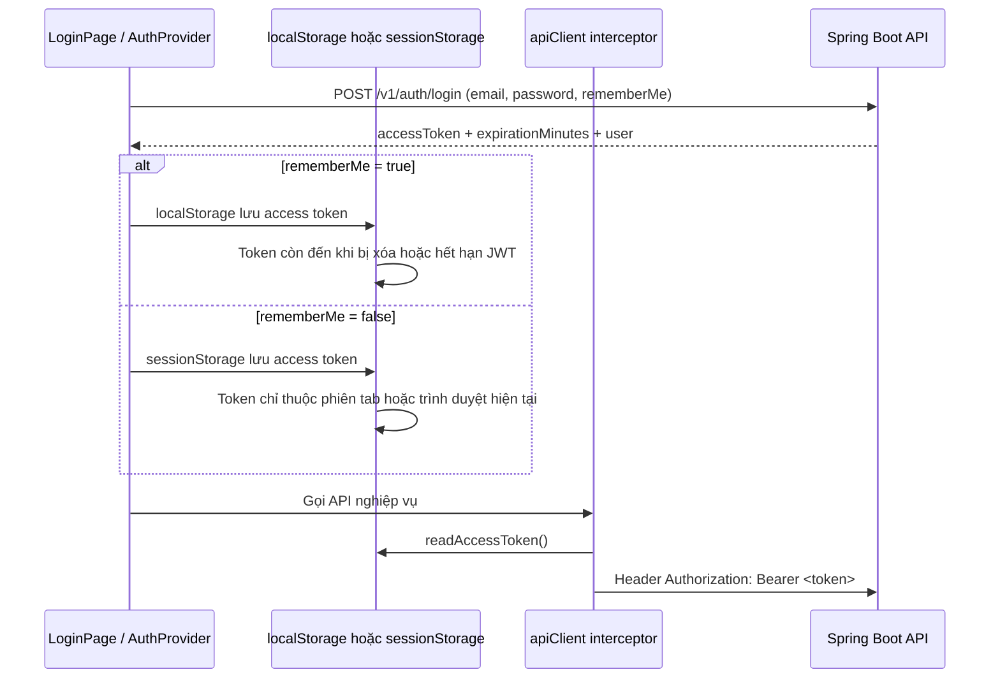
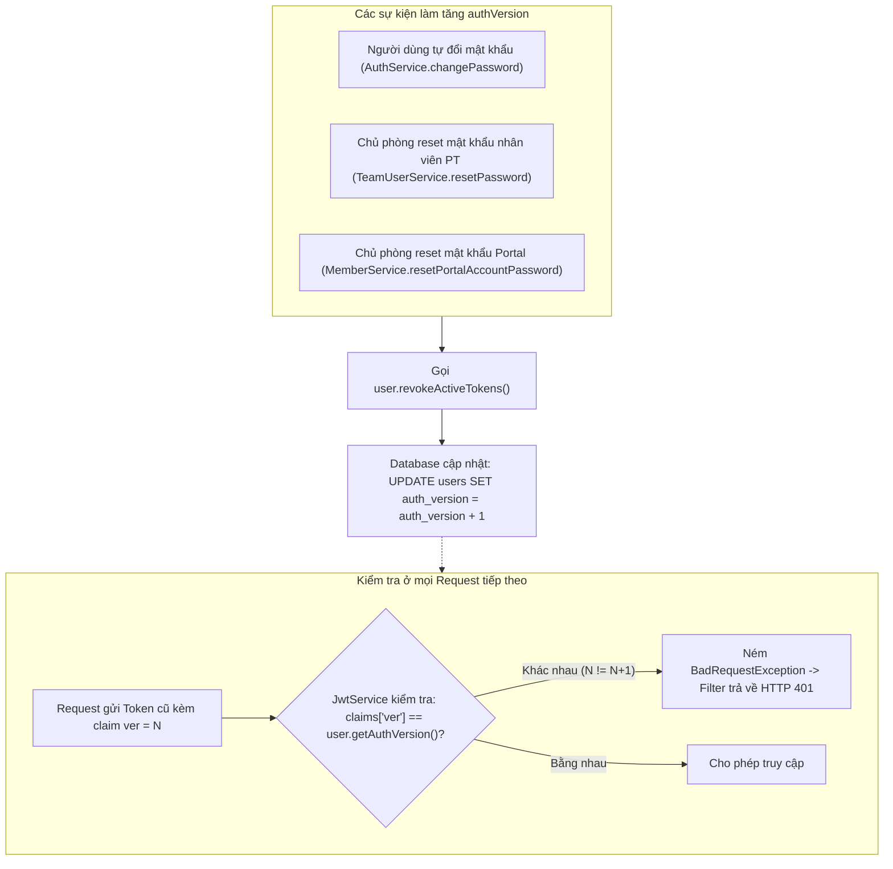
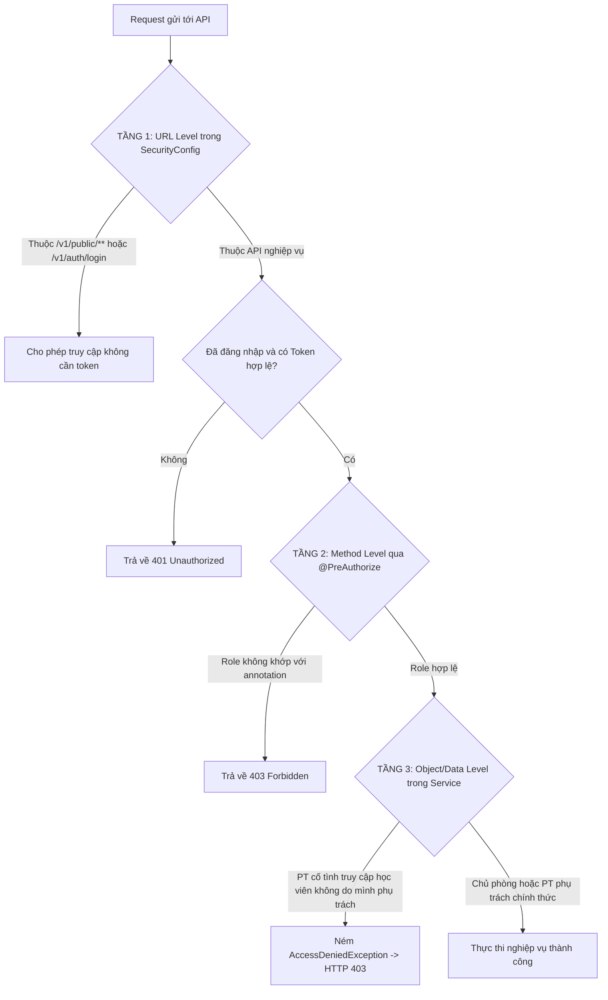

# JWT, phân quyền và phiên trình duyệt

## 1. Cấu Trúc Bản Chất Của Một JSON Web Token (JWT)

Trong hệ thống phòng gym Dương Double, class [`JwtService.java`](../../../backend/src/main/java/com/gymduongdouble/backend/common/security/JwtService.java) tự tạo và xác thực token JWT bằng thuật toán HMAC-SHA256 (`HS256`) kết hợp thư viện Jackson.

> **Cách hình dung dễ nhớ:** JWT giống một “thẻ ra vào có chữ ký của phòng gym”. Client cầm thẻ và gửi lại ở mỗi request; server kiểm tra chữ ký, hạn dùng và tình trạng tài khoản. Thẻ **không phải** một session lưu trong server, cũng không phải hộp khóa bí mật: phần payload vẫn có thể đọc được.

Một chuỗi JWT gồm 3 phần tách biệt bởi dấu chấm (`.`):
$$\mathbf{Header} \ .\ \mathbf{Payload} \ .\ \mathbf{Signature}$$



> [!WARNING]
> **LƯU Ý CỐT LÕI VỀ BẢO MẬT JWT:**
> 1. **Base64URL chỉ là mã hóa hiển thị (Encoding), KHÔNG PHẢI mã hóa bảo mật (Encryption)**: Bất kỳ ai cầm được token đều có thể copy vào `jwt.io` hoặc dùng hàm giải mã Base64 để đọc toàn bộ thông tin bên trong Payload. Do đó, **tuyệt đối không bao giờ đưa mật khẩu, thông tin thẻ ngân hàng hay dữ liệu nhạy cảm vào Claim của JWT**.
> 2. **Chữ ký (Signature) dùng để làm gì?** Chữ ký được tính bằng:
>    $$\text{Signature} = \text{HmacSHA256}(\text{HeaderBase64} + "." + \text{PayloadBase64},\ \text{JWT\_SECRET})$$
>    Chữ ký đảm bảo **Tính toàn vẹn (Integrity)**: Nếu kẻ gian cố tình sửa `roles` từ `["PT"]` thành `["OWNER"]`, khi gửi lên server, server dùng `JWT_SECRET` tính lại chữ ký sẽ thấy không khớp và từ chối token ngay lập tức!

---

## 2. Hành Trình Thẩm Tra Request Tại `JwtAuthenticationFilter`

Khi client gửi request có kèm header `Authorization: Bearer <token>`, filter [`JwtAuthenticationFilter.java`](../../../backend/src/main/java/com/gymduongdouble/backend/common/security/JwtAuthenticationFilter.java) sẽ thẩm định theo các bước chặt chẽ:



---

## 3. Tại Sao Cấu Hình `STATELESS` Mà Vẫn Truy Vấn Database?

Trong [`SecurityConfig.java`](../../../backend/src/main/java/com/gymduongdouble/backend/common/config/SecurityConfig.java#L46):
```java
http.sessionManagement(session -> session.sessionCreationPolicy(SessionCreationPolicy.STATELESS))
```

* **Khái niệm `STATELESS` ở đây nghĩa là gì?**
  Tomcat **không tạo và không lưu `HttpSession`** (không dùng cookie `JSESSIONID`). Mỗi request tự mang `Authorization: Bearer ...`. `SecurityContextHolder` chỉ là “bảng tạm” trong luồng xử lý request hiện tại; hết request nó không trở thành phiên đăng nhập lưu trên server.
* **Tại sao Filter vẫn truy vấn Database để nạp lại User?**
  Nhiều hệ thống JWT đơn giản chỉ đọc `roles` trong payload và tin hoàn toàn vào token. Nếu quyền của nhân viên vừa đổi hoặc tài khoản vừa bị khóa, token cũ còn hạn sẽ thành thông tin cũ.
* **Cách dự án của bạn giải quyết**: `JwtAuthenticationFilter` dùng email trong token để nạp lại `AuthenticatedUser` từ database trong mỗi request. Nhờ vậy:
  - Nếu tài khoản vừa bị khóa $\rightarrow$ Bị chặn ngay theo status, dù token chưa hết hạn.
  - Nếu tài khoản vừa đổi vai trò $\rightarrow$ Quyền mới nhất được cập nhật ngay.
  - Nếu tài khoản vừa đổi mật khẩu $\rightarrow$ `authVersion` lệch và token bị từ chối ngay.

### 3.1. Token nằm ở đâu trong trình duyệt và được gửi đi như thế nào?

Đây là phần dễ bị nhầm giữa **JWT**, **browser storage** và **session server**:



Code hiện tại được chia làm ba việc rõ ràng:

1. [`AuthProvider.tsx`](../../../frontend/src/features/auth/context/AuthProvider.tsx) gọi API đăng nhập, gọi `saveAccessToken(response.accessToken, rememberMe)` và giữ token trong React state để UI biết đang đăng nhập.
2. [`authStorage.ts`](../../../frontend/src/shared/lib/authStorage.ts) lưu token vào `localStorage` nếu chọn **Duy trì đăng nhập**; nếu không chọn thì lưu `sessionStorage`. Hàm `readAccessToken()` đọc cả hai nơi, còn `clearAccessToken()` xóa ở cả hai nơi.
3. [`apiClient.ts`](../../../frontend/src/shared/api/apiClient.ts) có Axios request interceptor. Mỗi request sẽ tự đọc token rồi thêm `Authorization: Bearer <token>`. Vì vậy từng màn hình nghiệp vụ không phải tự viết lặp lại đoạn gắn header.

**`rememberMe` không chỉ thay đổi nơi lưu token.** Ở backend, `AuthService` cấp JWT khoảng **30 ngày** khi `rememberMe = true`; nếu không chọn, backend dùng `jwt.access-token-minutes` (cấu hình dev hiện tại là thời hạn ngắn hơn). Dù token đặt ở đâu, server vẫn quyết định token có hợp lệ hay không bằng chữ ký, `exp`, status tài khoản và `authVersion`.

> [!IMPORTANT]
> `localStorage` tiện cho trải nghiệm “mở lại vẫn đăng nhập”, nhưng JavaScript cùng origin có thể đọc nó. Đây là lý do dự án không để token trong log, đặt security headers cho API, validate input và vẫn cần phòng XSS ở frontend khi triển khai Internet thật. `sessionStorage` giảm thời gian token còn trên máy dùng chung, nhưng không thay thế các lớp kiểm tra của backend.

---

## 4. Cơ Chế Thu Hồi Phiên (Token Revocation) Với `authVersion`

Mở file [`User.java`](../../../backend/src/main/java/com/gymduongdouble/backend/user/domain/User.java#L47-L50):
```java
public void revokeActiveTokens() {
    authVersion++;
}
```



> [!NOTE]
> **Đăng xuất ở Frontend khác gì với Thu hồi Token ở Server?**
> * Khi người dùng bấm **"Đăng xuất"** trên giao diện, file [`authStorage.ts`](../../../frontend/src/shared/lib/authStorage.ts) chỉ đơn thuần xóa token khỏi `localStorage` hoặc `sessionStorage` của trình duyệt hiện tại.
> * Thao tác đăng xuất này **không gọi API tăng `authVersion`**, bởi vì nếu người dùng đăng nhập trên cả điện thoại và máy tính, việc họ bấm đăng xuất ở máy tính không nên làm văng phiên đăng nhập ở điện thoại.
> * Chỉ khi có thao tác **đổi mật khẩu** hoặc **reset mật khẩu**, toàn bộ token cũ trên mọi thiết bị mới bị vô hiệu hóa theo `authVersion`. Khóa tài khoản chặn request theo status; nó không tăng version.

### Ví dụ rất ngắn về status và `authVersion`

* Token của Khánh có `ver = 0`, user trong DB có `authVersion = 0`, status `ACTIVE`: request được đi tiếp.
* Chủ phòng **khóa** Khánh: DB vẫn là `ver = 0`, nhưng status `LOCKED`; filter trả `401 ACCOUNT_LOCKED`. Nếu mở khóa lại khi token chưa hết hạn, token có thể dùng lại.
* Chủ phòng **reset mật khẩu** Khánh: DB thành `authVersion = 1`; token cũ `ver = 0` bị filter trả `401 INVALID_TOKEN`, kể cả tài khoản đang `ACTIVE`.

Điểm này cho thấy hai cơ chế bổ sung cho nhau: status kiểm soát “hiện tại được dùng tài khoản không”, còn version vô hiệu hóa “toàn bộ thẻ JWT đã phát trước đó”.

---

## 5. Phân Quyền 3 Tầng Nghiêm Ngặt (Three-Tier Authorization)

Để ngăn chặn triệt để lỗ hổng truy cập trái phép và lỗ hổng **IDOR (Insecure Direct Object References)**, hệ thống áp dụng bảo vệ 3 lớp:



### Chi tiết 3 tầng:
1. **Tầng 1 - Cấu hình URL (`SecurityConfig.java`)**:
   Phân loại ranh giới chung: API nào công khai (`permitAll()`), API nào bắt buộc phải có token (`authenticated()`).
2. **Tầng 2 - Khai báo quyền trên Controller (`@PreAuthorize`)**:
   - Quản trị viên tối cao: `@PreAuthorize("hasRole('OWNER')")` (áp dụng cho cài đặt hệ thống, báo cáo doanh thu, tạo nhân sự, tạo gói tập).
   - Tác vụ vận hành: `@PreAuthorize("hasAnyRole('OWNER', 'PT')")` (áp dụng cho xem lịch, ghi buổi tập, thu tiền).
    - Hội viên có Portal: `@PreAuthorize("hasRole('MEMBER')")` (áp dụng cho Portal `/v1/member-portal/me`).
3. **Tầng 3 - Kiểm tra phạm vi dữ liệu theo bản ghi ([`MemberAccessService.java`](../../../backend/src/main/java/com/gymduongdouble/backend/member/service/MemberAccessService.java))**:
   - Nếu người gọi là `OWNER`: Cho phép xem và thao tác trên mọi học viên.
    - Nếu người gọi là `PT`: `PtAssignmentPolicy` yêu cầu hội viên đang `ACTIVE`, có **gói PT còn hiệu lực** phù hợp với PT đó, và có phân công hiệu lực cho PT. Ngoại lệ chỉ áp dụng khi khách PT **chưa từng có bản ghi phân công** và gói chưa gắn PT khác; khách chỉ có phân công cũ hết hiệu lực cũng không thỏa nhánh này. Khách tự tập không thỏa điều kiện. PT A gửi ID của khách PT B sẽ bị `AccessDeniedException`.

---

## 6. Trả Lời Chi Tiết Các Câu Hỏi Tự Kiểm Tra

1. **JWT có chữ ký có đồng nghĩa payload được mã hóa không?**
   * **Đáp án:** **HOÀN TOÀN KHÔNG**. Chữ ký HMAC-SHA256 chỉ đảm bảo tính toàn vẹn (chống giả mạo, chống sửa đổi dữ liệu bên trong token). Phần Payload của JWT chỉ được mã hóa dạng **Base64URL** (một kỹ thuật biểu diễn dữ liệu nhị phân thành chuỗi văn bản ASCII an toàn cho URL), bất kỳ ai có token đều giải mã và đọc được toàn bộ nội dung JSON trong Payload.
2. **Tại sao role và trạng thái mới trong DB vẫn ảnh hưởng request dùng token cũ?**
   * **Đáp án:** Vì trong [`JwtAuthenticationFilter`](../../../backend/src/main/java/com/gymduongdouble/backend/common/security/JwtAuthenticationFilter.java), sau khi xác minh chữ ký token thành công, hệ thống **không lấy quyền trực tiếp từ token**, mà lấy `email` trong claim `sub` để truy vấn lại Database thông qua `userDetailsService.loadUserByUsername(email)`. Danh sách quyền và trạng thái nạp vào `SecurityContextHolder` là dữ liệu mới nhất trong PostgreSQL.
3. **Đăng xuất ở trình duyệt khác gì tăng `authVersion` trong DB?**
   * **Đáp án:**
     - Đăng xuất ở trình duyệt chỉ xóa token lưu cục bộ trong `localStorage`/`sessionStorage` của thiết bị đó. Nếu token đó đã bị kẻ gian sao chép trước đó, kẻ gian vẫn dùng token đó được cho đến khi nó hết hạn (`exp`).
     - Tăng `authVersion` là thao tác ở phía Server. Ngay khi `authVersion` tăng lên trong DB, mọi bản sao của token cũ mang `ver` trước đó đều bị `JwtAuthenticationFilter` từ chối trên tất cả các thiết bị.

4. **Vì sao token có claim `roles` nhưng backend vẫn nạp role từ database?**
   * **Đáp án:** Claim trong token hữu ích để mô tả token đã được phát cho ai, nhưng filter tạo `Authentication` từ `AuthenticatedUser` vừa nạp lại ở DB. Vì vậy `@PreAuthorize` dùng quyền mới nhất trong DB, không đặt niềm tin bảo mật tuyệt đối vào bản roles cũ nằm trong token.

5. **Chọn “Duy trì đăng nhập” có bỏ qua thời hạn JWT hay làm server tạo session không?**
   * **Đáp án:** **Không.** Tùy chọn này chỉ làm frontend lưu token lâu hơn ở `localStorage` thay vì `sessionStorage`, đồng thời backend cấp token có `expirationMinutes` dài hơn (30 ngày). Mỗi request vẫn phải gửi Bearer token và đi qua `JwtAuthenticationFilter`; không có `HttpSession` hay `JSESSIONID` được tạo.

---

## 7. Góc Nhìn Mentor: Bộ Câu Hỏi Phỏng Vấn và Phản Biện Đồ Án

> [!TIP]
> **Câu hỏi 1: Lỗ hổng IDOR (Insecure Direct Object References) là gì? Trong dự án của em, nếu một PT biết được ID của học viên do PT khác phụ trách thì họ có sửa được dữ liệu không?**
> * **Cách trả lời:** IDOR là lỗ hổng xảy ra khi hệ thống nhận tham số ID từ client nhưng không kiểm tra xem người dùng hiện tại có quyền thao tác trên bản ghi có ID đó hay không. Trong dự án, các luồng hội viên/tài chính dùng [`MemberAccessService`](../../../backend/src/main/java/com/gymduongdouble/backend/member/service/MemberAccessService.java), còn các thao tác chuyên PT dùng `PtService.ensureCanAccessMember(...)` theo ngày thao tác; cả hai cùng dựa vào `PtAssignmentPolicy`. Vì vậy không chỉ tin `memberId` client gửi lên: nếu người đăng nhập là PT, code đối chiếu hội viên, gói PT và phân công theo policy trước khi tiếp tục. Đây là lớp giảm rủi ro IDOR ở các route đã triển khai; khi thêm endpoint mới vẫn phải gắn kiểm tra tương ứng, không được suy luận rằng tên service tự bảo vệ mọi route trong tương lai.
>
> **Câu hỏi 2: Tại sao em không dùng thư viện jjwt (Java JWT) mà lại tự viết `JwtService` bằng HMAC-SHA256?**
> * **Cách trả lời:** Việc tự triển khai `JwtService` bằng thuật toán chuẩn `HmacSHA256` có sẵn của thư viện chuẩn Java (`javax.crypto.Mac`) kết hợp với Jackson giúp em nắm vững bản chất toán học và cấu tạo 3 phần của JWT. Đồng thời, giải pháp này giúp dự án giảm bớt sự phụ thuộc vào các thư viện bên thứ ba, tối ưu dung lượng ứng dụng và cho phép em tùy biến linh hoạt việc nhúng trường `authVersion` để phục vụ cơ chế thu hồi phiên tức thì.
