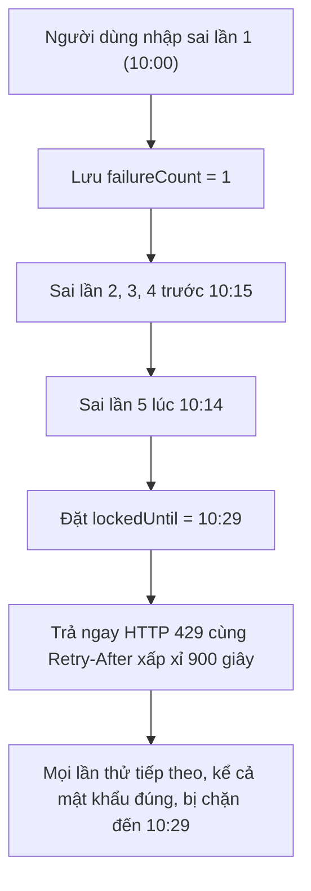
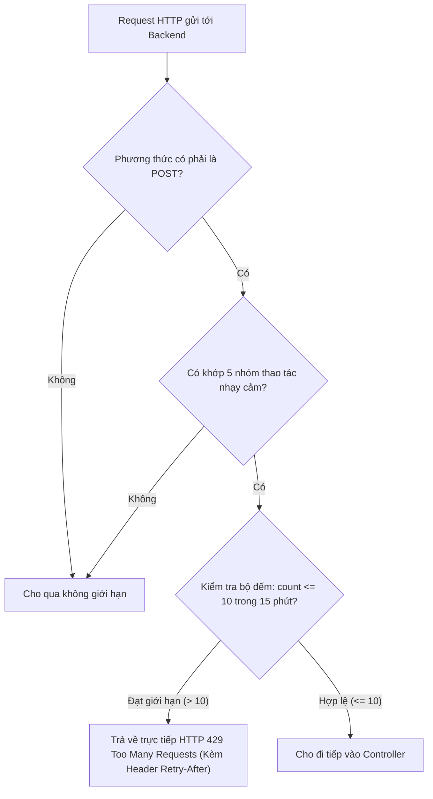

# Rate limit, mật khẩu và security headers

## 1. Cơ Chế Giới Hạn Đăng Nhập (`InMemoryRateLimiter`)

Để chống dò mật khẩu (brute-force) và giảm lạm dụng trên một số endpoint tốn kém/nhạy cảm, lớp [`InMemoryRateLimiter.java`](../../../backend/src/main/java/com/gymduongdouble/backend/common/security/InMemoryRateLimiter.java) kiểm soát tần suất request. Đây không phải lá chắn DoS tổng quát cho mọi URL của hệ thống.

### 1.1. Cấu trúc lưu trữ và khóa trọn 15 phút từ lần sai thứ năm
Limiter chạy trực tiếp trong RAM của ứng dụng Java. Hai mục đích dùng hai state khác nhau: endpoint nhạy cảm dùng `ConcurrentHashMap<String, WindowCounter>`, còn login dùng `ConcurrentHashMap<String, LoginAttemptState>`. State login giữ `firstFailureAt`, `failureCount` và `lockedUntil`; do đó nó phân biệt được giai đoạn **đếm lỗi** với giai đoạn **đang khóa**.

```java
static final int LOGIN_FAILURE_LIMIT = 5;
static final Duration LOGIN_FAILURE_WINDOW = Duration.ofMinutes(15);
static final Duration LOGIN_LOCK_DURATION = Duration.ofMinutes(15);
```



### 1.2. Cơ chế khóa kép (Dual-key Tracking):
Khi một người dùng đăng nhập, hệ thống tạo ra **hai khóa độc lập** để kiểm tra:
1. **Khóa theo tài khoản (Account Key)**: `login:account:<identifier>` với `identifier` đã được chuẩn hóa qua `trim().toLowerCase()`.
2. **Khóa theo địa chỉ mạng (IP Key)**: `login:ip:<clientIp>`.

* **Nguyên tắc**: Request chỉ được phép tiếp tục nếu **CẢ HAI KHÓA** không có `lockedUntil` còn hiệu lực. Khi một key chạm lần sai thứ năm, request đó nhận `429` ngay; lần đăng nhập sau cũng bị chặn nếu bất kỳ key nào còn khóa.
* **Ý nghĩa thực tế**:
  - Nếu kẻ gian dùng 1 địa chỉ IP để dò mật khẩu của nhiều tài khoản khác nhau $\rightarrow$ Bị chặn bởi khóa IP.
  - Nếu kẻ gian dùng mạng botnet đổi IP liên tục để tấn công vào 1 tài khoản chủ phòng $\rightarrow$ Bị chặn bởi khóa Account.

> [!NOTE]
> **Ý nghĩa của “IP” trong code hiện tại:** limiter lấy `request.getRemoteAddr()`. Khi chạy local, đây là IP client mà Tomcat thấy (thường là `127.0.0.1`). Nếu sau này backend đặt sau Nginx, Cloudflare hoặc load balancer, `remoteAddr` có thể chỉ là IP của proxy. Khi đó cần cấu hình proxy đáng tin cậy/forwarded headers trước khi dùng `X-Forwarded-For`; không được tin header này một cách mù quáng vì client có thể tự giả mạo nó. Với phạm vi local hiện tại, cách lấy `remoteAddr()` là đúng và đủ đơn giản.

> [!IMPORTANT]
> **HAI MỐC THỜI GIAN KHÁC NHAU:**
> * Bốn lần sai đầu được gom trong cửa sổ theo dõi 15 phút tính từ `firstFailureAt`. Nếu chưa chạm ngưỡng mà cửa sổ hết hạn, lần sai tiếp theo bắt đầu một state mới với `failureCount = 1`.
> * Khi chạm **lần sai thứ năm**, code đặt `lockedUntil = now + 15 phút`. Vì vậy lần sai thứ năm lúc 10:14 sẽ khóa đến 10:29, không còn bị rút ngắn theo thời điểm lỗi đầu.
> * Đăng nhập thành công trước khi bị khóa gọi `clearLoginFailures()` để xóa state của cả IP và account. Khi đang khóa, `requireLoginAllowed()` chạy trước kiểm tra mật khẩu nên không thể dùng mật khẩu đúng để tự mở khóa.

---

## 2. Kiểm Soát Tần Suất Trên Các Endpoint Nhạy Cảm

Lớp [`SensitiveEndpointRateLimitFilter.java`](../../../backend/src/main/java/com/gymduongdouble/backend/common/security/SensitiveEndpointRateLimitFilter.java) áp dụng giới hạn **10 request / 15 phút** cho mỗi đối tượng (User đã xác thực hoặc IP nếu là ẩn danh).



### Danh sách 5 nhóm thao tác nhạy cảm được bảo vệ:
1. `POST /api/v1/auth/change-password` (Chống spam đổi mật khẩu).
2. `POST /api/v1/settings/team-users` (Chống spam tạo tài khoản nhân viên PT).
3. `POST /api/v1/settings/team-users/{id}/reset-password` (Chống spam reset mật khẩu nhân sự).
4. `POST /api/v1/members/{id}/portal-account` và `.../reset-password` (Chống spam cấp/reset Portal; hai URL dùng chung quota `portal-account` cho cùng actor).
5. `POST /api/v1/ai/retention-revenue-advisor` (Chống spam gọi API AI Groq tốn chi phí).

> Nhóm Portal thực tế gồm **hai route**: tạo/cấp lại Portal và reset mật khẩu Portal. Chúng cùng dùng operation key `portal-account`, vì vậy đây là “5 nhóm thao tác” chứ không phải đúng năm URL đơn lẻ. Cách gom này tránh một người dùng né giới hạn bằng cách đổi qua route còn lại nhưng vẫn không tạo thêm bộ đếm dư thừa.

> [!NOTE]
> **ĐỐI CHIẾU CHUẨN XÁC MÃ NGUỒN DỰ ÁN:**
> Tính năng xuất báo cáo Excel (`/reports/export-xlsx`) và đồng bộ Google Sheets được thực thi ở Frontend hoặc dùng các API truy vấn thông thường, **hiện tại KHÔNG nằm trong danh sách kiểm soát của Filter này**. Khi bảo vệ đồ án, không được khẳng định rằng xuất Excel đã được Rate Limit ở Backend.

> **Filter này trả 429 trực tiếp, không ném exception lên Controller.** Khi vượt quota, `SensitiveEndpointRateLimitFilter` tự đặt status `429`, header `Retry-After`, ghi JSON `ApiResponse.fail(...)` rồi `return`. Do request chưa vào `DispatcherServlet`, `GlobalExceptionHandler` không tham gia vào nhánh này. `RateLimitExceededException` vẫn tồn tại cho luồng đăng nhập, nơi `AuthService` gọi limiter và ném exception vào tầng Controller/Advice.

---

## 3. Chính Sách Mật Khẩu Nghiêm Ngặt ([`PasswordPolicy.java`](../../../backend/src/main/java/com/gymduongdouble/backend/common/security/PasswordPolicy.java))

Để bảo vệ an toàn cho tài khoản chủ phòng, huấn luyện viên và hội viên có Portal, hệ thống kiểm tra mật khẩu ở tầng Service:

### Các quy tắc bắt buộc:
1. **Độ dài tối thiểu**: Ít nhất **8 ký tự**.
2. **Thành phần ký tự**: Bắt buộc phải chứa **ít nhất 1 chữ cái** (a-z, A-Z) và **ít nhất 1 chữ số** (0-9).
3. **Chống trùng lặp định danh**: Mật khẩu không được trùng với Email, Số điện thoại hoặc chuỗi chữ số của số điện thoại.
4. **Mật khẩu mới không trùng mật khẩu cũ**: Khi người dùng đổi mật khẩu tại `AuthService.changePassword()`, hệ thống dùng `passwordEncoder.matches()` kiểm tra mật khẩu mới khác mật khẩu hiện tại.

---

## 4. Bảo Vệ Tầng HTTP: Security Headers và Cấu Hình CORS

### 4.1. Các Header Bảo Mật ([`ApiSecurityHeadersFilter.java`](../../../backend/src/main/java/com/gymduongdouble/backend/common/security/ApiSecurityHeadersFilter.java))
Mọi response trả về từ Backend đều được tự động gắn các header bảo vệ chuẩn OWASP:

| Header Name | Giá Trị Cấu Hình | Tác Dụng Bảo Vệ |
| :--- | :--- | :--- |
| `X-Content-Type-Options` | `nosniff` | Ngăn trình duyệt tự ý đoán định dạng file (MIME sniffing), chống tấn công chèn mã độc vào file tĩnh. |
| `X-Frame-Options` | `DENY` | Nghiêm cấm hoàn toàn việc nhúng giao diện API vào `<iframe>`, ngăn chặn triệt để tấn công **Clickjacking**. |
| `Referrer-Policy` | `no-referrer` | Không gửi thông tin trang gốc trong header `Referer` khi chuyển hướng, bảo vệ tính riêng tư. |
| `Permissions-Policy` | `camera=(), geolocation=(), microphone=()` | Không cho response API yêu cầu các quyền camera, vị trí, microphone từ trình duyệt. |
| `Content-Security-Policy` | `default-src 'none'; base-uri 'none'; frame-ancestors 'none'; form-action 'none'` | Chính sách CSP nghiêm ngặt cho **response API**: không tải tài nguyên, không làm base URL, không cho iframe nhúng và không submit form từ response đó. |
| `Cache-Control` | `no-store, max-age=0` | Chỉ dẫn trình duyệt và proxy trung gian **không bao giờ lưu cache** các response dữ liệu nhạy cảm. |
| `Pragma` | `no-cache` | Tương thích ngược với các client HTTP 1.0 cũ. |

### 4.2. Cấu hình CORS ([`SecurityConfig.java`](../../../backend/src/main/java/com/gymduongdouble/backend/common/config/SecurityConfig.java#L91-L102))
```java
configuration.setAllowedOrigins(List.of("http://localhost:5173", "http://localhost:5174", "http://localhost:3000"));
configuration.setAllowedMethods(List.of("GET", "POST", "PUT", "PATCH", "DELETE", "OPTIONS"));
configuration.setExposedHeaders(List.of(HttpHeaders.RETRY_AFTER));
configuration.setAllowCredentials(true);
```
* **`setAllowedOrigins`**: Chỉ cho phép các ứng dụng Frontend ở origin được cấu hình gọi API và **đọc response bằng JavaScript**. CORS là luật của trình duyệt, không phải xác thực: Postman/curl không bị CORS ngăn và vẫn cần JWT/authorization ở server.
* **`setExposedHeaders(List.of(HttpHeaders.RETRY_AFTER))`**: Mặc định trình duyệt giấu các header tùy biến. Cấu hình này giúp Axios trên React Frontend có thể đọc được giá trị `Retry-After` để hiển thị đồng hồ đếm ngược khi bị lỗi 429!

### 4.3. Tại sao phải có `disabledFilterRegistration` trong `SecurityConfig`?
```java
@Bean
FilterRegistrationBean<JwtAuthenticationFilter> jwtAuthenticationFilterRegistration(
    JwtAuthenticationFilter jwtAuthenticationFilter
) {
    return disabledFilterRegistration(jwtAuthenticationFilter);
}
```
* **Bản chất Spring Boot**: Khi bạn đánh dấu một Filter bằng `@Component`, Spring Boot sẽ tự động đăng ký nó vào Servlet Container của Tomcat.
* Tuy nhiên, trong `SecurityConfig`, các filter được gắn rõ thứ tự bằng `addFilterBefore(...)`/`addFilterAfter(...)` trong Spring Security.
* Nếu không có hàm `disabledFilterRegistration` (đặt `registration.setEnabled(false)`), **filter đó sẽ bị gọi 2 lần cho mỗi request**! Đây là kinh nghiệm xử lý Spring Security rất tinh tế của dự án.

### 4.4. Vì sao `csrf` được tắt nhưng không có nghĩa là bỏ bảo mật?
`SecurityConfig` có `csrf(csrf -> csrf.disable())`. Điều này hợp lý với cách xác thực hiện tại vì backend dùng **Bearer JWT do frontend chủ động gắn vào header `Authorization`**, không dùng cookie `JSESSIONID` tự gửi theo mỗi request.

* Với ứng dụng dùng cookie session, một website lạ có thể khiến trình duyệt tự kèm cookie vào request nguy hiểm; CSRF token là lớp chống lại tình huống đó.
* Với ứng dụng này, website lạ không tự có được `Authorization: Bearer <JWT>` của người dùng. Backend vẫn xác thực JWT, quyền role và quyền dữ liệu, nên `csrf.disable()` không đồng nghĩa endpoint trở nên công khai.
* Đây **không** làm JWT bất khả xâm phạm. Nếu có lỗ hổng XSS ở frontend và token bị đánh cắp từ browser storage, kẻ tấn công vẫn có thể gửi Bearer token. Vì vậy CSP/header của API, kiểm soát input và không đưa token vào log vẫn quan trọng; nếu triển khai Internet thật cần tiếp tục hardening frontend.

---

## 5. Trả Lời Chi Tiết Các Câu Hỏi Tự Kiểm Tra

1. **Sau lần sai thứ năm, bộ đếm có luôn khóa đúng 15 phút kể từ thời điểm đó không?**
   * **Đáp án:** **CÓ**. Năm lỗi vẫn phải nằm trong cửa sổ theo dõi 15 phút từ lỗi đầu, nhưng khi lỗi thứ năm xảy ra, limiter đặt `lockedUntil` bằng thời điểm hiện tại cộng 15 phút. `recordLoginFailure()` ném `RateLimitExceededException` ngay trên request thứ năm để frontend nhận `429` và bắt đầu đếm ngược đầy đủ.
2. **Khởi động lại backend local có giữ bộ đếm rate limit không?**
   * **Đáp án:** **KHÔNG**. Toàn bộ bộ đếm được lưu trong cấu trúc `ConcurrentHashMap` trên RAM của tiến trình JVM. Khi restart server, bộ nhớ RAM được giải phóng và toàn bộ bộ đếm bị reset về 0. (Để giữ được bộ đếm khi chạy thực tế nhiều server, hệ thống sẽ cần nâng cấp dùng Redis).
3. **CORS, CSP và `@PreAuthorize` giải quyết cùng một vấn đề hay các vấn đề khác nhau?**
   * **Đáp án:** Giải quyết 3 vấn đề hoàn toàn khác nhau:
     - **CORS (Cross-Origin Resource Sharing)**: Chính sách bảo mật của trình duyệt, kiểm soát xem ứng dụng web ở domain này có được phép đọc dữ liệu API từ domain khác hay không.
      - **CSP (Content-Security-Policy)**: Header giới hạn những gì **response API** được phép làm khi bị trình duyệt diễn giải như tài liệu. Ở đây CSP rất chặt vì backend chủ yếu trả JSON; nó không thay thế CSP riêng cho ứng dụng React.
     - **`@PreAuthorize`**: Cơ chế phân quyền nội bộ của Server, kiểm tra xem người dùng đã đăng nhập có vai trò (Role) phù hợp để thực thi hàm trong Controller hay không.

4. **Rate limit có phải là cơ chế xác thực không?**
   * **Đáp án:** Không. Rate limit chỉ nói “một key/IP đã gửi quá nhiều request trong một khoảng ngắn”, nên nó trả `429` để giảm brute-force hoặc chi phí AI. Nó không biết request đó có quyền OWNER/PT/MEMBER hay không. JWT và `@PreAuthorize` vẫn là lớp quyết định danh tính và quyền truy cập.

5. **Vì sao không đọc thẳng `X-Forwarded-For` để có IP thật khi deploy?**
   * **Đáp án:** Header đó chỉ đáng tin khi backend biết request chắc chắn đi qua một reverse proxy do mình quản trị và proxy đã ghi đè header đúng cách. Nếu backend nhận request trực tiếp từ Internet rồi tin giá trị client tự gửi, người gọi có thể đổi IP giả để né rate limit. Code local hiện dùng `request.getRemoteAddr()` để không tạo một giả định triển khai chưa được cấu hình.

---

## 6. Góc Nhìn Mentor: Bộ Câu Hỏi Phỏng Vấn và Phản Biện Đồ Án

> [!TIP]
> **Câu hỏi 1: Tại sao em lại cấu hình `exposedHeaders: ["Retry-After"]` trong CORS? Nếu không cấu hình dòng này thì Frontend sẽ gặp vấn đề gì?**
> * **Cách trả lời:** Theo chuẩn bảo mật CORS của trình duyệt (W3C), Javascript/Axios trên client chỉ được phép đọc các header cơ bản (như `Content-Type`, `Cache-Control`). Mọi header khác (bao gồm cả `Retry-After`) đều bị trình duyệt ẩn đi vì lý do an toàn. Nếu backend không khai báo `exposedHeaders: ["Retry-After"]`, khi bị lỗi 429, Frontend sẽ nhận được `error.response.headers['retry-after']` là `undefined`, không thể lấy được số giây còn lại để hiển thị đồng hồ đếm ngược chờ đợi cho người dùng.
>
> **Câu hỏi 2: Giải pháp Rate Limiting bằng `ConcurrentHashMap` trong RAM của em có ưu và nhược điểm gì?**
> * **Cách trả lời:**
>   - **Ưu điểm**: Cực kỳ nhanh (độ trễ microsecond), không tốn chi phí hạ tầng, không cần cài đặt thêm phần mềm bên ngoài (như Redis), hoàn toàn phù hợp với quy mô phòng gym nhỏ chạy local.
>   - **Nhược điểm**: Dữ liệu lưu trong RAM nên sẽ mất sạch khi ứng dụng restart; không hỗ trợ phân tán nếu sau này phòng gym mở rộng quy mô chạy nhiều cụm server (Load Balancing). Code hiện tại **chưa tách interface `RateLimiter`**; khi cần dùng Redis phải tạo abstraction và đổi các dependency đang tiêm trực tiếp `InMemoryRateLimiter`. Đây là hướng mở rộng hợp lý, nhưng không nên nói rằng dự án đã có sẵn interface để thay thế ngay.
