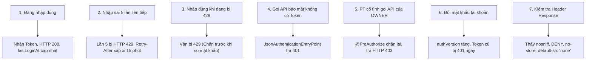
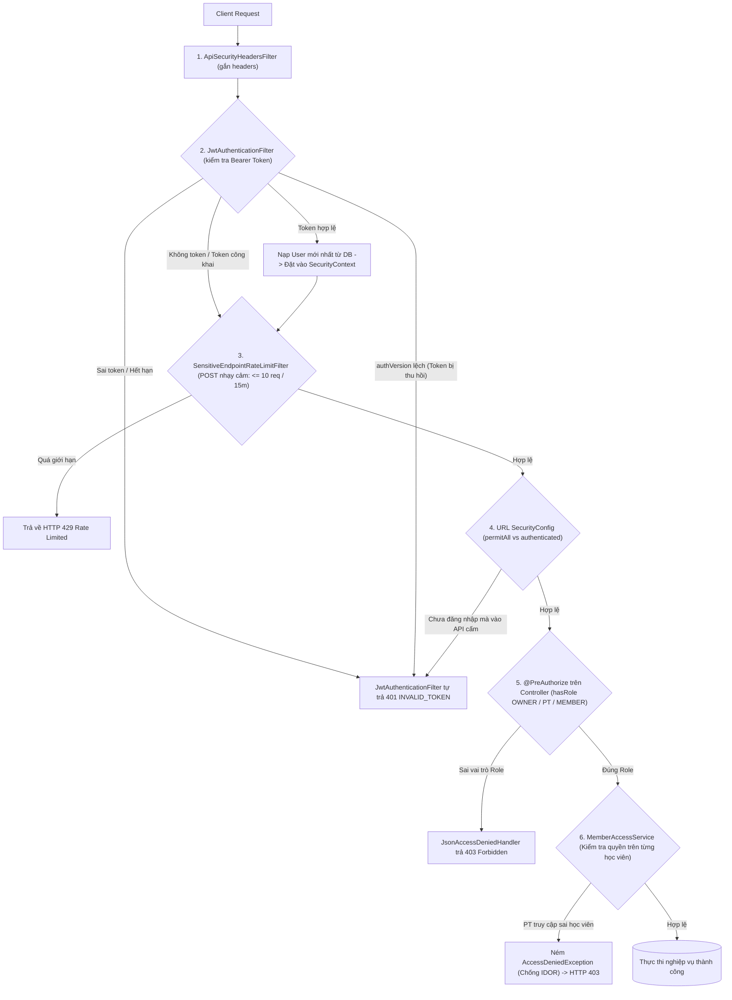

# Kiểm tra và ôn tập bảo mật

## 1. Hệ Thống Kiểm Thử Tự Động (Unit Tests)

Trong mã nguồn [`BackendApplicationTests.java`](../../../backend/src/test/java/com/gymduongdouble/backend/BackendApplicationTests.java), hệ thống đã xây dựng sẵn bộ kiểm thử tự động cho các thành phần bảo mật cốt lõi:

| Tên Phương Thức Test | Thành Phần Được Kiểm Thử | Mục Đích Assertion |
| :--- | :--- | :--- |
| `loginRequestDoesNotExposePasswordInLogs` | [`LoginRequest`](../../../backend/src/main/java/com/gymduongdouble/backend/auth/web/dto/LoginRequest.java) | Xác nhận `toString()` in `password=***`, không để lộ mật khẩu thô trong log. |
| `vietnamPhoneNormalizerUsesOneCanonicalMobileFormat` | [`VietnamPhoneNormalizer`](../../../backend/src/main/java/com/gymduongdouble/backend/common/validation/VietnamPhoneNormalizer.java) | Xác nhận `0901 000 004`, `+84 901-000-004`, `84901000004` cùng chuẩn hóa về một số 10 chữ số. |
| `jwtTokenIsRejectedAfterPasswordResetRevokesActiveTokens` | [`JwtService`](../../../backend/src/main/java/com/gymduongdouble/backend/common/security/JwtService.java) | Xác nhận sau `user.revokeActiveTokens()`, token mang `ver` cũ bị từ chối. |
| `passwordPolicyRequiresLettersDigitsAndNonIdentifierValue` | [`PasswordPolicy`](../../../backend/src/main/java/com/gymduongdouble/backend/common/security/PasswordPolicy.java) | Xác nhận mật khẩu thiếu chữ/số hoặc trùng số điện thoại bị từ chối. |
| `loginRateLimiterLocksForFullWindowOnFifthFailureAndClearsAfterSuccess` | [`InMemoryRateLimiter`](../../../backend/src/main/java/com/gymduongdouble/backend/common/security/InMemoryRateLimiter.java) | Ghi nhận bốn lỗi, xác nhận lần lỗi thứ năm trả `RateLimitExceededException` với thời gian chờ gần 15 phút, xác nhận request tiếp theo vẫn bị chặn, rồi gọi trực tiếp `clearLoginFailures()` và xác nhận request lại được phép. Bản thân unit test không gọi `AuthService.login()`. |
| `sensitiveRateLimiterAllowsTenRequestsThenBlocksTheNextOne` | [`InMemoryRateLimiter`](../../../backend/src/main/java/com/gymduongdouble/backend/common/security/InMemoryRateLimiter.java) | Xác nhận component cho phép 10 request nhạy cảm và từ chối request thứ 11. Test này kiểm tra limiter trực tiếp, không phải servlet filter qua HTTP. |

### Lệnh chạy test từ Terminal:
```powershell
cd backend
.\mvnw.cmd test
```

> [!NOTE]
> **PHÂN BIỆT UNIT TEST VÀ END-TO-END TEST:**
> Các phương thức trong `BackendApplicationTests` là **Unit Test** (kiểm thử đơn vị), tức là tạo đối tượng Java trong bộ nhớ và gọi trực tiếp method để kiểm tra logic. Để kiểm tra toàn diện, bạn cần kết hợp kịch bản kiểm thử thủ công qua HTTP Request thực tế dưới đây.

---

## 2. Kịch Bản Kiểm Thử Thủ Công Local (Manual Testing Matrix)

Hãy dùng tài khoản demo hoặc tài khoản OWNER để kiểm thử các tình huống thực tế:



### Chi tiết các bước thực hiện:
1. **Kiểm tra đăng nhập linh hoạt**:
   - Thử đăng nhập bằng email `owner@gymduongdouble.local` $\rightarrow$ Thành công.
   - Thử đăng nhập bằng số điện thoại `0965193907` $\rightarrow$ Thành công.
   - Mở database kiểm tra cột `last_login_at` trong bảng `users` được cập nhật thời gian vừa đăng nhập.
2. **Kiểm tra cơ chế chống dò mật khẩu (Rate Limit)**:
   - Nhập sai mật khẩu liên tiếp 5 lần cho một tài khoản.
   - Ở lần thứ 5: Server trả về HTTP Status `429 Too Many Requests` kèm JSON có `error.code = "RATE_LIMITED"`.
   - Mở tab Network trên trình duyệt kiểm tra Response Header: thấy có `Retry-After: <số giây còn lại>`.
   - Cố tình nhập đúng mật khẩu ngay lúc này $\rightarrow$ Vẫn nhận mã 429, chứng minh hệ thống chặn ngay từ cửa sổ kiểm soát mà không tốn tài nguyên so sánh mật khẩu.
3. **Kiểm tra thu hồi phiên khi đổi mật khẩu**:
   - Đăng nhập tài khoản trên 2 trình duyệt khác nhau (ví dụ Chrome và Edge). Cả 2 đều có token hợp lệ.
   - Tại Chrome: Vào trang `/profile`, thực hiện đổi mật khẩu mới.
   - Tại Edge: Không đăng xuất, bấm vào một tính năng (ví dụ: xem danh sách hội viên) $\rightarrow$ Ngay lập tức bị văng về trang `/login` do request gửi token cũ bị trả về HTTP 401!

---

## 3. Tổng Hợp Kiến Trúc Bảo Mật Stage 2 Bằng Sơ Đồ Mermaid

Sơ đồ tổng kết toàn bộ các lớp bảo vệ từ khi client gửi request đến khi hoàn tất xử lý:



---

## 4. Giải Đáp Toàn Diện Bộ Câu Hỏi Thuyết Trình / Phản Biện Đồ Án

### Câu 1: Phân biệt BCrypt, JWT HMAC và Base64URL: thành phần nào để kiểm tra mật khẩu, thành phần nào chống sửa token, thành phần nào chỉ biểu diễn dữ liệu?
* **Đáp án:**
  - **BCrypt**: Dùng để **kiểm tra mật khẩu**. Đây là thuật toán băm mật khẩu một chiều (One-way Hashing) có muối (Salt) và chi phí tính toán (Work factor). Không thể giải mã ngược về mật khẩu ban đầu; server dùng `passwordEncoder.matches()` để đối soát.
  - **JWT HMAC (HS256)**: Dùng để **chống sửa đổi token (Đảm bảo tính toàn vẹn)**. Chữ ký được tính toán từ Header, Payload và khóa bí mật `JWT_SECRET`. Bất kỳ thay đổi nào trên Payload mà không có `secret` đều tạo ra chữ ký không hợp lệ.
  - **Base64URL**: Chỉ dùng để **biểu diễn dữ liệu (Encoding)**. Nó biến đổi các byte dữ liệu nhị phân của chuỗi JSON thành các ký tự văn bản an toàn để truyền qua URL và HTTP Header. Base64URL hoàn toàn không có tính năng bảo mật, ai cũng có thể giải mã được.

### Câu 2: Nêu cơ chế và giới hạn của `authVersion`, Rate Limit in-memory, CORS và Security Headers?
* **Đáp án:**
  - **`authVersion`**:
    - *Cơ chế:* Lưu một số nguyên trong bảng `users` và đưa vào claim `ver` của JWT. Khi đổi mật khẩu, số này tăng lên, khiến mọi token cũ bị từ chối ngay lập tức.
    - *Giới hạn:* Bắt buộc mỗi request phải truy vấn database để đối chiếu `authVersion` hiện tại của user, làm tăng nhẹ số lượng câu truy vấn database.
  - **Rate Limit in-memory**:
    - *Cơ chế:* Lưu số lần thất bại trong `ConcurrentHashMap` trên RAM, chặn sau 5 lần sai login hoặc 10 request nhạy cảm.
    - *Giới hạn:* Dữ liệu mất sạch khi restart server; không chia sẻ được bộ đếm giữa nhiều cụm server nếu triển khai microservices/load balancer.
  - **CORS**:
    - *Cơ chế:* Chỉ thị trình duyệt chỉ cho phép các domain Frontend được chỉ định (`localhost:5173`, `3000`) gọi API và đọc header `Retry-After`.
    - *Giới hạn:* Chỉ có tác dụng trên trình duyệt web; không ngăn chặn được các tool gọi API trực tiếp như Postman hay curl.
  - **Security Headers**:
    - *Cơ chế:* Gắn các chỉ thị bảo vệ (`X-Frame-Options: DENY`, `nosniff`, `Cache-Control: no-store`) vào response của API.
    - *Giới hạn:* Chỉ bảo vệ response của API backend; không tự động cấu hình bảo vệ cho trang web tĩnh HTML/React của frontend.

### Câu 3: Vì sao Frontend ẩn nút bấm không đủ để bảo vệ API?
* **Đáp án:** Vì mã nguồn Frontend chạy hoàn toàn trên trình duyệt của người dùng. Kẻ tấn công hoặc người dùng am hiểu công nghệ có thể dễ dàng:
  1. Mở Chrome DevTools (F12) để sửa mã HTML, bỏ thuộc tính `hidden` hoặc `disabled` của nút bấm.
  2. Dùng Postman, curl hoặc câu lệnh Javascript `fetch()` để gửi thẳng HTTP request tới URL của API mà không cần thông qua nút bấm trên giao diện.
  $\rightarrow$ **Quy tắc bảo mật:** Frontend ẩn nút chỉ để tối ưu trải nghiệm người dùng (UX). **Mọi cơ chế bảo vệ thực sự bắt buộc phải nằm ở Backend** thông qua Spring Security, `@PreAuthorize` và Service Policy.

### Câu 4: Với tài khoản OWNER kiêm PT, cần kiểm tra cả role và điều kiện nghiệp vụ nào trước khi truy cập dữ liệu hội viên?
* **Đáp án:**
  - *Về Role:* Kiểm tra tài khoản có role `OWNER` hoặc `PT` (`@PreAuthorize("hasAnyRole('OWNER', 'PT')")`).
  - *Về Nghiệp vụ:* Trong [`MemberAccessService.java`](../../../backend/src/main/java/com/gymduongdouble/backend/member/service/MemberAccessService.java):
    - Nếu tài khoản có quyền `OWNER`: Được phép xem và thao tác trên **tất cả** hội viên.
     - Nếu tài khoản chỉ đóng vai trò `PT`: `PtAssignmentPolicy` kiểm tra hội viên đang ACTIVE, có gói PT còn hiệu lực phù hợp và phân công hiệu lực cho PT đó. Khách tự tập hoặc khách PT của PT khác bị chặn; khách PT chưa gán có thể được tiếp cận khi gói chưa thuộc PT khác.
