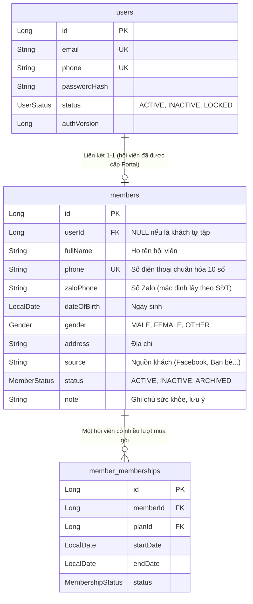
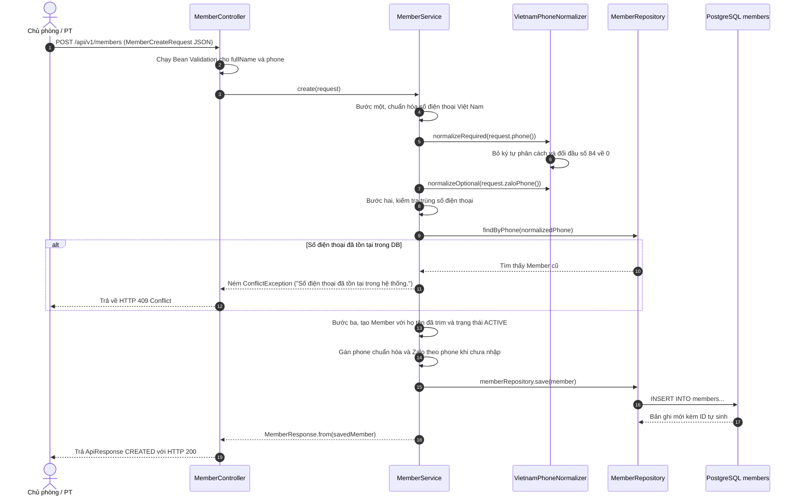
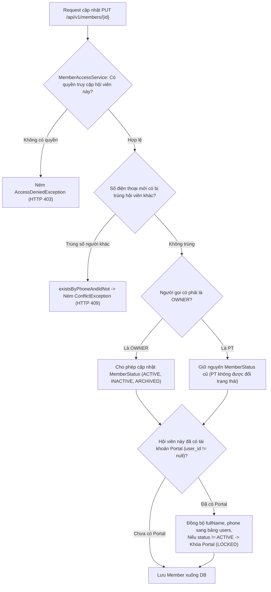
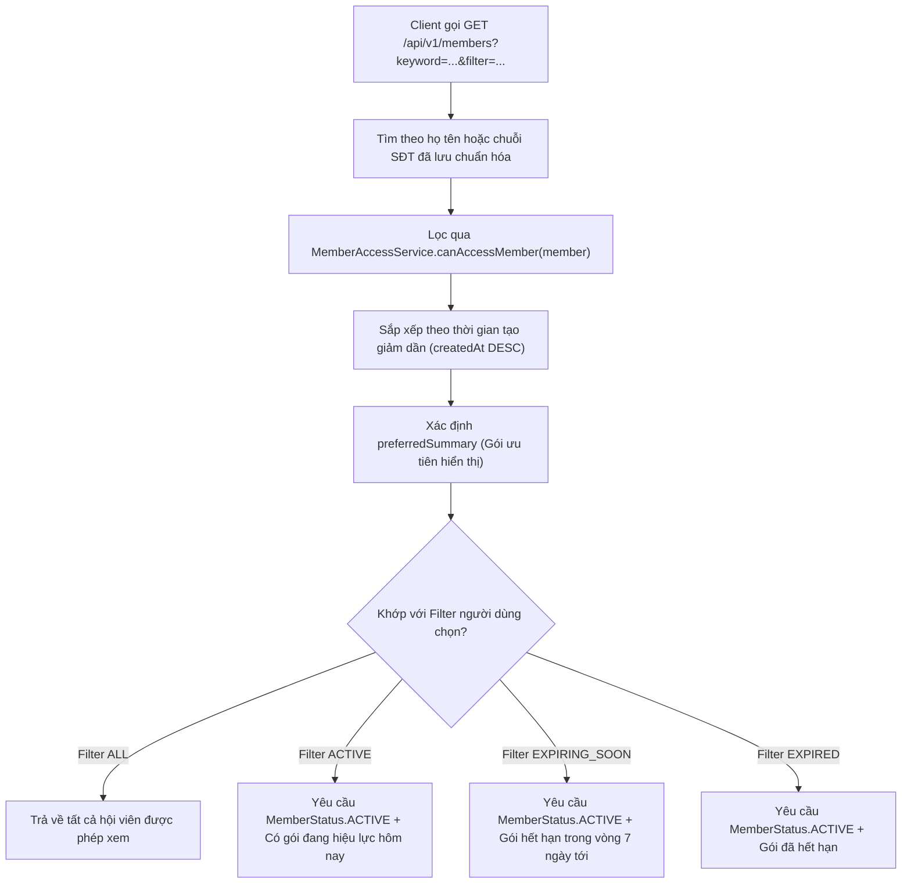
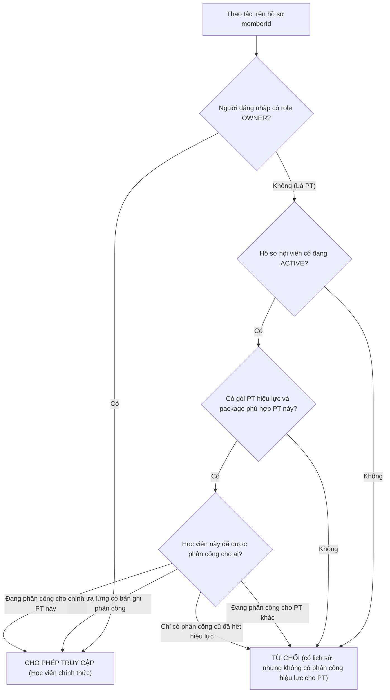

# Hồ sơ, số điện thoại và quyền truy cập hội viên

## 1. Phân Biệt Giữa Hồ Sơ Hội Viên (`Member`) và Tài Khoản (`User`)

Trong hệ thống phòng gym Dương Double, hai thực thể này phục vụ hai mục đích hoàn toàn khác biệt:

### Bản chất nghiệp vụ phòng gym:
1. **`Member` (Hồ sơ khách hàng)**: Đại diện cho người tập gym đến quầy làm thủ tục.
   * Một người có thể tạo hồ sơ trước khi mua bất kỳ gói tập nào.
   * Một hồ sơ `Member` có thể gắn liền với nhiều lượt đăng ký gói (`MemberMembership`) theo thời gian (ví dụ: tháng 1 mua gói tự tập, tháng 3 nâng cấp lên gói PT).
2. **Quy tắc cấp tài khoản trong phòng gym Dương Double**:
   * **Điều kiện cấp mới bắt buộc**: hội viên phải có `status = ACTIVE` và ít nhất một `MemberMembership` hiệu lực ở ngày hiện tại. Khách vãng lai, chưa mua gói, gói tương lai, `PENDING_PAYMENT`, hết hạn hoặc hủy không thể có Portal mới.
   * **Khách tự tập có gói hiệu lực**: Có thể được cấp Portal để xem gói, hạn, phiếu thu, công nợ và chỉ số nếu phòng gym có ghi nhận. Họ không tự tạo check-in, lịch hay chỉ số qua Portal.
   * **Khách PT có Portal**: Có thêm nhu cầu xem buổi còn lại, lịch hẹn, mục tiêu và số đo. Chủ phòng (`OWNER`) gọi `POST /api/v1/members/{id}/portal-account` để tạo `users` role `MEMBER` và gán `members.user_id = users.id`.

> **Chính xác theo code:** `MemberService.createPortalAccount()` kiểm tra quyền OWNER ở controller, hội viên chưa có Portal, số điện thoại/mật khẩu hợp lệ, trạng thái `ACTIVE` và membership hiệu lực qua `MembershipLifecyclePolicy`. Không có ràng buộc `plan_type = PT`, nên đây không phải ràng buộc database chỉ dành cho khách PT.

---

## 2. Bản Đồ Mã Nguồn Cần Đọc

| Tầng | File Mã Nguồn | Trách Nhiệm Nghiệp Vụ |
| :--- | :--- | :--- |
| **Frontend Danh sách** | [`MembersPage.tsx`](../../../frontend/src/features/members/pages/MembersPage.tsx) | Hiển thị bảng danh sách hội viên, ô tìm kiếm từ khóa, bộ lọc trạng thái gói, phân trang phía server, số liệu tổng hợp và modal tạo mới hội viên. |
| **Frontend Chi tiết** | [`MemberDetailPage.tsx`](../../../frontend/src/features/members/pages/MemberDetailPage.tsx) | Xem chi tiết hồ sơ, lịch sử các gói tập, danh sách phiếu thu, công nợ, gói buổi PT và quản lý tài khoản Portal. |
| **Controller** | [`MemberController.java`](../../../backend/src/main/java/com/gymduongdouble/backend/member/web/MemberController.java) | Khai báo các endpoint REST API, gồm `/v1/members/page` và `/v1/members/statistics` cho màn danh sách; phân quyền `@PreAuthorize`, nhận DTO và bọc kết quả trả về `ApiResponse`. |
| **Service Nghiệp vụ** | [`MemberService.java`](../../../backend/src/main/java/com/gymduongdouble/backend/member/service/MemberService.java) | Thực thi logic nghiệp vụ: chuẩn hóa SĐT, kiểm tra trùng lặp, tạo hồ sơ, cập nhật, đồng bộ Portal user. |
| **Repository** | [`MemberRepository.java`](../../../backend/src/main/java/com/gymduongdouble/backend/member/repository/MemberRepository.java) | Giao tiếp PostgreSQL, kiểm tra trùng số điện thoại (`findByPhone`, `existsByPhoneAndIdNot`). |
| **Phân quyền dữ liệu** | [`MemberAccessService.java`](../../../backend/src/main/java/com/gymduongdouble/backend/member/service/MemberAccessService.java) | Kiểm soát quyền truy cập chéo giữa các Huấn luyện viên (PT chỉ được xem học viên do mình phụ trách). |
| **Chuẩn hóa SĐT** | [`VietnamPhoneNormalizer.java`](../../../backend/src/main/java/com/gymduongdouble/backend/common/validation/VietnamPhoneNormalizer.java) | Xử lý chuỗi số điện thoại di động Việt Nam về định dạng chuẩn 10 chữ số. |

---

## 3. Luồng Tạo Hồ Sơ Hội Viên và Chuẩn Hóa Số Điện Thoại

Khi nhân viên hoặc chủ phòng điền form tạo hội viên trên giao diện, quy trình xử lý tại Backend diễn ra tuần tự:

### Chi tiết giải thuật chuẩn hóa [`VietnamPhoneNormalizer`](../../../backend/src/main/java/com/gymduongdouble/backend/common/validation/VietnamPhoneNormalizer.java):
* **Loại bỏ ký tự phân cách**: Chuyển các chuỗi `0901 000 004`, `0901-000-004`, `0901.000.004` thành `0901000004`.
* **Quy đổi mã quốc gia**: Chuyển đầu số quốc tế `+84901000004` hoặc `84901000004` thành `0901000004`.
* **Kiểm tra đầu số hợp lệ**: Sử dụng Regex để xác nhận số điện thoại bắt đầu bằng các đầu số mạng di động Việt Nam hợp lệ (`03`, `05`, `07`, `08`, `09`) và có đúng 10 chữ số.
* **Lợi ích thực tế**: Ngăn chặn tình trạng một khách hàng bị tạo 2 hồ sơ khác nhau chỉ vì lễ tân nhập có dấu cách hoặc có dấu gạch ngang.

---

## 4. Cập Nhật Hồ Sơ và Đồng Bộ Tài Khoản Portal

Khi cập nhật hồ sơ khách hàng tại method `MemberService.update(id, request)`:

> [!IMPORTANT]
> **TÍNH TOÀN VẸN KHI ĐỒNG BỘ:**
> 1. Phương thức `memberRepository.existsByPhoneAndIdNot(phone, id)` giúp bỏ qua chính ID của hội viên đang sửa. Nếu chỉ dùng hàm `existsByPhone()`, khi bạn bấm lưu mà vẫn giữ nguyên số điện thoại cũ thì hệ thống sẽ báo trùng với chính mình!
> 2. Nếu chủ phòng đổi trạng thái của hội viên từ `ACTIVE` sang `INACTIVE` hoặc `ARCHIVED`, hệ thống tự động khóa tài khoản Portal của hội viên đó (`portalUser.setStatus(UserStatus.LOCKED)`).
> 3. Chiều ngược lại **không tự động**: đổi hồ sơ từ `INACTIVE`/`ARCHIVED` về `ACTIVE` không tự mở lại Portal đã bị `LOCKED`. Chủ phòng cần chủ động dùng endpoint cập nhật trạng thái Portal. Đây là chủ ý an toàn để việc kích hoạt lại hồ sơ không vô tình khôi phục quyền đăng nhập cũ.

---

## 5. Xem Danh Sách và Bộ Lọc Hội Viên

Phương thức `MemberService.list(keyword, filter)` trong [`MemberService.java`](../../../backend/src/main/java/com/gymduongdouble/backend/member/service/MemberService.java#L110-L150) thực hiện truy vấn và lọc dữ liệu đa tầng:

> **Phân biệt lúc ghi và lúc tìm:** khi tạo/cập nhật, `VietnamPhoneNormalizer` luôn đưa số điện thoại về dạng 10 chữ số trước khi lưu. Tuy nhiên ở luồng danh sách hiện tại, `keyword` chỉ được `trim()` rồi truyền vào repository; service **không** gọi normalizer thêm lần nữa cho từ khóa tìm kiếm. Vì vậy, dữ liệu trong DB đã sạch nhưng người dùng nên gõ `0901000004` thay vì `0901 000 004` để tìm chính xác theo số. Đây là giới hạn UX hiện tại, không phải việc tạo trùng dữ liệu; nếu nâng cấp sau này, có thể chuẩn hóa riêng nhánh tìm kiếm.

* **Ngưỡng sắp hết hạn (`EXPIRING_SOON_DAYS = 7`)**: Giúp chủ phòng và PT nhanh chóng lọc ra các hội viên sắp hết hạn gói trong 7 ngày tới để chủ động liên hệ nhắc nhở gia hạn.
* **Không có `NO_MEMBERSHIP` ở API hiện tại**: `MemberListFilter` chỉ nhận `ALL`, `ACTIVE`, `EXPIRING_SOON`, `EXPIRED`. Một hồ sơ mới chưa có gói vẫn xuất hiện trong `ALL`, nhưng không có tham số lọc riêng cho nhóm này.

---

## 6. Phân Quyền Theo Từng Hội Viên ([`MemberAccessService.java`](../../../backend/src/main/java/com/gymduongdouble/backend/member/service/MemberAccessService.java))

Để ngăn chặn lỗ hổng IDOR (PT này tò mò xem thông tin khách của PT khác), lớp `MemberAccessService` phối hợp với [`PtAssignmentPolicy.java`](../../../backend/src/main/java/com/gymduongdouble/backend/pt/service/PtAssignmentPolicy.java) kiểm soát như sau:

---

## 7. Trả Lời Chi Tiết Các Câu Hỏi Tự Kiểm Tra

1. **Theo dõi `POST /v1/members` từ request DTO tới response. Tìm nơi đặt trạng thái ban đầu và nơi kiểm tra trùng điện thoại?**
   * **Đáp án:**
     - Kiểm tra trùng số điện thoại: Diễn ra tại dòng 67 của [`MemberService.java`](../../../backend/src/main/java/com/gymduongdouble/backend/member/service/MemberService.java):
       `memberRepository.findByPhone(normalizedPhone).ifPresent(...)` $\rightarrow$ Ném `ConflictException` nếu đã tồn tại.
     - Đặt trạng thái ban đầu: Diễn ra tại dòng 73 của `MemberService.java`:
       `member.setStatus(MemberStatus.ACTIVE)`.
2. **Tạo hai cách viết cùng một số điện thoại trong dữ liệu thử (ví dụ: `0901 000 004` và `+84901000004`), kết quả ra sao?**
   * **Đáp án:** Khi gọi lần đầu với `0901 000 004`, `VietnamPhoneNormalizer` chuẩn hóa thành `0901000004` và lưu thành công. Khi gọi lần hai với `+84901000004`, bộ chuẩn hóa tiếp tục đưa về chuỗi `0901000004`. Hàm `findByPhone("0901000004")` phát hiện đã tồn tại $\rightarrow$ ném ngay `ConflictException` và `GlobalExceptionHandler` trả về HTTP 409 Conflict. Không bao giờ bị tạo 2 hồ sơ trùng lặp.
3. **Tại sao một hội viên có `MemberStatus.ACTIVE` chưa chắc đã có gói tập hiệu lực?**
   * **Đáp án:** Vì `Member.status` là trạng thái quản lý hành chính của hồ sơ (đang hoạt động, tạm ngưng hay đã lưu trữ). Còn việc có gói tập hiệu lực phụ thuộc vào `member_memberships` (đã mua gói chưa, ngày bắt đầu/kết thúc có bao trùm hôm nay không). Một khách mới có thể `ACTIVE` nhưng chưa có gói; API hiện hiển thị họ trong `ALL` thay vì có filter `NO_MEMBERSHIP` riêng.
4. **Vì sao hiển thị hay ẩn nút bấm ở Frontend chưa đủ để bảo vệ API?**
   * **Đáp án:** Vì mã Frontend chạy trên máy người dùng, kẻ gian có thể dùng Postman hoặc sửa code Javascript trong trình duyệt để gửi trực tiếp request `PUT /v1/members/{id}`. Nếu Backend không có hàm kiểm tra quyền [`MemberAccessService.ensureCanAccessMember()`](../../../backend/src/main/java/com/gymduongdouble/backend/member/service/MemberAccessService.java), kẻ tấn công sẽ sửa được dữ liệu trái phép.

---

## 8. Góc Nhìn Mentor: Bộ Câu Hỏi Phỏng Vấn và Phản Biện Đồ Án

> [!TIP]
> **Câu hỏi 1: Tại sao em lại thiết kế bảng `members` riêng biệt với bảng `users` mà không gộp chung vào làm một?**
> * **Cách trả lời:** Em tách riêng vì hai thực thể này đại diện cho hai đối tượng nghiệp vụ khác nhau:
>   - `User` phục vụ việc xác thực bảo mật đăng nhập hệ thống phần mềm (cần username, password hash, roles, authVersion).
>   - `Member` phục vụ nghiệp vụ vận hành phòng gym (họ tên khách hàng, số điện thoại, ngày sinh, số đo, nguồn khách).
>   - Phần lớn khách tự tập có thể không cần Portal, nhưng service không chặn theo loại gói. Việc tách rời vẫn giúp bảng `users` chỉ chứa tài khoản thực sự được cấp quyền đăng nhập (OWNER, PT, MEMBER), còn điều kiện cấp mới là hội viên `ACTIVE` có gói hiệu lực chứ không phải mọi hồ sơ `Member`.
>
> **Câu hỏi 2: Làm sao em đảm bảo số điện thoại hội viên không bị trùng lặp ngay cả khi có 2 nhân viên cùng bấm tạo hồ sơ tại cùng một phần nghìn giây?**
> * **Cách trả lời:** Em áp dụng nguyên tắc **Bảo vệ 2 tầng (Defense in Depth)**:
>   1. Tầng ứng dụng (Service Layer): Hàm `memberRepository.findByPhone()` kiểm tra trước để trả về thông báo lỗi thân thiện (HTTP 409 Conflict).
>   2. Tầng cơ sở dữ liệu (Database Layer): Cột `phone` trong bảng `members` được đặt ràng buộc duy nhất `UNIQUE (phone)`. Nếu có 2 request chạy song song vượt qua được tầng kiểm tra code, câu lệnh `INSERT` thứ hai sẽ bị PostgreSQL chặn cứng lại bởi lỗi vi phạm ràng buộc Unique Constraint.
