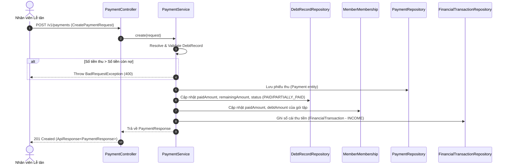

# 🎯 GIAI ĐOẠN 3 (SPRINT 3) - CHẶNG 01: NGHIỆP VỤ CÔNG NỢ & LẬP PHIẾU THU (BACKEND)

Tài liệu này phân tích chi tiết lát cắt nghiệp vụ đầu tiên của **Sprint 3: Quản lý Thanh toán & Công nợ (Payment & Debt Management)**. Toàn bộ mã nguồn đã được triển khai hoàn chỉnh trong tầng Backend (Spring Boot 4 / Java 21 / PostgreSQL).

---

## 🧭 1. Mục tiêu Nghiệp vụ của Chặng 01

Trong hoạt động tài chính của phòng gym, việc quản lý dòng tiền và công nợ đòi hỏi tính chuẩn xác tuyệt đối (Transaction Isolation & Consistency). Hệ thống giải quyết 3 bài toán cốt lõi:
1. **Lập Phiếu thu & Thanh toán (`POST /v1/payments`):**
   - Tiếp nhận thanh toán theo mã công nợ cụ thể (`debtRecordId`) hoặc theo gói đăng ký (`membershipId`).
   - Hỗ trợ **thanh toán từng phần** (trả góp nhiều lần) hoặc **thanh toán toàn phần** (tất toán 100%).
   - Kiểm soát tính hợp lệ: Không cho phép thu số tiền lớn hơn số nợ còn lại (`remainingAmount`), không cho thu trên khoản nợ đã hoàn thành (`PAID`) hoặc đã hủy (`CANCELLED`).
2. **Tra cứu & Quản lý Công nợ (`GET /v1/debts`):**
   - Xem danh sách công nợ toàn phòng tập hoặc lọc theo từng hội viên (`memberId`).
   - Lọc theo trạng thái nợ: Đang nợ (`OPEN`), Trả một phần (`PARTIALLY_PAID`), Đã trả hết (`PAID`).
3. **Tra cứu Lịch sử Dòng tiền (`GET /v1/payments`):**
   - Xem toàn bộ các giao dịch thu tiền đã phát sinh trong hệ thống.
   - Hỗ trợ bộ lọc nâng cao theo: Khách hàng (`memberId`), Khoảng thời gian thu (`fromDate` - `toDate`), Phương thức thanh toán (`CASH`, `BANK_TRANSFER`, `POS`, `CARD`, `OTHER`).

---

## 🏗️ 2. Phân tích Chi tiết Từng File Mã Nguồn

### 📌 2.1. DTO Yêu cầu Thu tiền: [CreatePaymentRequest.java](file:///d:/gym-management-system/backend/src/main/java/com/gymduongdouble/backend/finance/web/dto/CreatePaymentRequest.java)

```java
package com.gymduongdouble.backend.finance.web.dto;

import com.gymduongdouble.backend.common.enums.PaymentMethod;
import com.gymduongdouble.backend.common.enums.RevenueCategory;
import jakarta.validation.constraints.DecimalMin;
import jakarta.validation.constraints.NotNull;
import java.math.BigDecimal;
import java.time.LocalDate;

public record CreatePaymentRequest(
    @NotNull(message = "Khách hàng là bắt buộc.")
    Long memberId,

    Long debtRecordId,

    Long membershipId,

    LocalDate paymentDate,

    @NotNull(message = "Số tiền là bắt buộc.")
    @DecimalMin(value = "1.0", message = "Số tiền phải lớn hơn 0.")
    BigDecimal amount,

    @NotNull(message = "Phương thức thanh toán là bắt buộc.")
    PaymentMethod paymentMethod,

    RevenueCategory revenueCategory,
    String note
) {
}
```

#### 🔍 Điểm sáng kỹ thuật:
- Sử dụng Java 21 `record` bất biến (immutable) làm DTO đầu vào.
- `@NotNull` trên `memberId`, `amount`, `paymentMethod`: Đảm bảo không bao giờ nhận dữ liệu thiếu thành phần cơ bản của một giao dịch tài chính.
- `@DecimalMin(value = "1.0")`: Nghiêm cấm số tiền thanh toán âm hoặc bằng 0.
- Linh hoạt giữa `debtRecordId` (thu chỉ định đúng phiếu nợ) và `membershipId` (thu theo lượt đăng ký gói - hệ thống sẽ tự động tìm phiếu nợ mở tương ứng).

---

### 📌 2.2. DTO Phản hồi Công nợ: [DebtRecordResponse.java](file:///d:/gym-management-system/backend/src/main/java/com/gymduongdouble/backend/finance/web/dto/DebtRecordResponse.java)

```java
package com.gymduongdouble.backend.finance.web.dto;

import com.gymduongdouble.backend.common.enums.DebtStatus;
import com.gymduongdouble.backend.finance.domain.DebtRecord;
import java.math.BigDecimal;
import java.time.LocalDate;

public record DebtRecordResponse(
    Long id,
    Long memberId,
    String memberName,
    String memberPhone,
    Long membershipId,
    String planName,
    BigDecimal originalAmount,
    BigDecimal paidAmount,
    BigDecimal remainingAmount,
    LocalDate dueDate,
    DebtStatus status,
    String note
) {

    public static DebtRecordResponse from(DebtRecord debtRecord) {
        return new DebtRecordResponse(
            debtRecord.getId(),
            debtRecord.getMember().getId(),
            debtRecord.getMember().getFullName(),
            debtRecord.getMember().getPhone(),
            debtRecord.getMembership() == null ? null : debtRecord.getMembership().getId(),
            debtRecord.getMembership() == null ? null : debtRecord.getMembership().getPlan().getName(),
            debtRecord.getOriginalAmount(),
            debtRecord.getPaidAmount(),
            debtRecord.getRemainingAmount(),
            debtRecord.getDueDate(),
            debtRecord.getStatus(),
            debtRecord.getNote()
        );
    }
}
```

#### 🔍 Điểm sáng kỹ thuật:
- **Factory Method `from(DebtRecord)`:** Đóng gói toàn bộ logic trích xuất và biến đổi từ Entity sang DTO ngay bên trong `record`, bảo đảm tính Encapsulation.
- **Null-safe Navigation:** Sử dụng `debtRecord.getMembership() == null ? null : ...` để hỗ trợ cả các khoản công nợ tự do không gắn với gói tập.
- Cung cấp đầy đủ thông tin định danh: Tên khách hàng (`memberName`), SĐT (`memberPhone`), Tên gói (`planName`), Tổng nợ gốc (`originalAmount`), Đã trả (`paidAmount`), Còn lại (`remainingAmount`).

---

### 📌 2.3. DTO Phản hồi Phiếu thu: [PaymentResponse.java](file:///d:/gym-management-system/backend/src/main/java/com/gymduongdouble/backend/finance/web/dto/PaymentResponse.java)

```java
package com.gymduongdouble.backend.finance.web.dto;

import com.gymduongdouble.backend.common.enums.PaymentMethod;
import com.gymduongdouble.backend.common.enums.RevenueCategory;
import com.gymduongdouble.backend.finance.domain.Payment;
import java.math.BigDecimal;
import java.time.LocalDate;

public record PaymentResponse(
    Long id,
    Long memberId,
    String memberName,
    Long debtRecordId,
    Long membershipId,
    LocalDate paymentDate,
    BigDecimal amount,
    PaymentMethod paymentMethod,
    RevenueCategory revenueCategory,
    String note
) {

    public static PaymentResponse from(Payment payment) {
        return new PaymentResponse(
            payment.getId(),
            payment.getMember().getId(),
            payment.getMember().getFullName(),
            payment.getDebtRecord() == null ? null : payment.getDebtRecord().getId(),
            payment.getMembership() == null ? null : payment.getMembership().getId(),
            payment.getPaymentDate(),
            payment.getAmount(),
            payment.getPaymentMethod(),
            payment.getRevenueCategory(),
            payment.getDescription()
        );
    }
}
```

---

### 📌 2.4. Controller Quản lý Công nợ: [DebtController.java](file:///d:/gym-management-system/backend/src/main/java/com/gymduongdouble/backend/finance/web/DebtController.java)

```java
package com.gymduongdouble.backend.finance.web;

import com.gymduongdouble.backend.common.enums.DebtStatus;
import com.gymduongdouble.backend.common.web.dto.ApiResponse;
import com.gymduongdouble.backend.finance.service.PaymentService;
import com.gymduongdouble.backend.finance.web.dto.DebtRecordResponse;
import java.util.List;
import lombok.RequiredArgsConstructor;
import org.springframework.web.bind.annotation.GetMapping;
import org.springframework.web.bind.annotation.RequestMapping;
import org.springframework.web.bind.annotation.RequestParam;
import org.springframework.web.bind.annotation.RestController;

@RestController
@RequestMapping("/v1/debts")
@RequiredArgsConstructor
public class DebtController {

    private final PaymentService paymentService;

    @GetMapping
    public ApiResponse<List<DebtRecordResponse>> list(
        @RequestParam(required = false) Long memberId,
        @RequestParam(required = false) DebtStatus status
    ) {
        return ApiResponse.ok(paymentService.listDebts(memberId, status));
    }
}
```

#### 🔍 Điểm sáng kỹ thuật:
- Định tuyến chuẩn RESTful: `GET /v1/debts`.
- Tiếp nhận 2 `RequestParam` tùy chọn (`memberId`, `status`) để đáp ứng cả trang Quản lý công nợ tổng và Tab công nợ trong Hồ sơ chi tiết hội viên.
- Bọc kết quả bằng `ApiResponse.ok(...)` tạo cấu trúc JSON phản hồi đồng nhất toàn hệ thống (`{ "status": "SUCCESS", "data": [...] }`).

---

### 📌 2.5. Controller Thu tiền & Lịch sử: [PaymentController.java](file:///d:/gym-management-system/backend/src/main/java/com/gymduongdouble/backend/finance/web/PaymentController.java)

```java
package com.gymduongdouble.backend.finance.web;

import com.gymduongdouble.backend.common.web.dto.ApiResponse;
import com.gymduongdouble.backend.common.enums.PaymentMethod;
import com.gymduongdouble.backend.finance.service.PaymentService;
import com.gymduongdouble.backend.finance.web.dto.CreatePaymentRequest;
import com.gymduongdouble.backend.finance.web.dto.PaymentResponse;
import jakarta.validation.Valid;
import java.time.LocalDate;
import java.util.List;
import lombok.RequiredArgsConstructor;
import org.springframework.web.bind.annotation.GetMapping;
import org.springframework.security.access.prepost.PreAuthorize;
import org.springframework.web.bind.annotation.PostMapping;
import org.springframework.web.bind.annotation.RequestBody;
import org.springframework.web.bind.annotation.RequestMapping;
import org.springframework.web.bind.annotation.RequestParam;
import org.springframework.web.bind.annotation.RestController;

@RestController
@RequestMapping("/v1/payments")
@RequiredArgsConstructor
public class PaymentController {

    private final PaymentService paymentService;

    @PostMapping
    @PreAuthorize("hasAnyRole('OWNER', 'PT')")
    public ApiResponse<PaymentResponse> create(@Valid @RequestBody CreatePaymentRequest request) {
        return ApiResponse.created(paymentService.create(request));
    }

    @GetMapping
    public ApiResponse<List<PaymentResponse>> list(
        @RequestParam(required = false) Long memberId,
        @RequestParam(required = false) LocalDate fromDate,
        @RequestParam(required = false) LocalDate toDate,
        @RequestParam(required = false) PaymentMethod paymentMethod
    ) {
        return ApiResponse.ok(paymentService.listPayments(memberId, fromDate, toDate, paymentMethod));
    }
}
```

#### 🔍 Phân quyền & RBAC:
- `@PreAuthorize("hasAnyRole('OWNER', 'PT')")`: Cả Chủ phòng tập (`OWNER`) và HLV/PT vận hành (`PT`) đều có quyền lập phiếu thu tiền khi khách đóng phí.
- Trả về mã HTTP `201 Created` (`ApiResponse.created`) theo đúng chuẩn RFC cho thao tác tạo mới tài nguyên giao dịch.

---

### 📌 2.6. Trái tim Nghiệp vụ Tài chính: [PaymentService.java](file:///d:/gym-management-system/backend/src/main/java/com/gymduongdouble/backend/finance/service/PaymentService.java)

Toàn bộ quy trình thu tiền và khấu trừ công nợ được thực hiện nguyên tử trong hàm `@Transactional public PaymentResponse create(...)`:



#### Các khâu xử lý then chốt trong `PaymentService`:

1. **Tìm & Xác định Khoản nợ (`resolveDebtRecord`):**
   - Nếu client gửi `debtRecordId`: Truy vấn trực tiếp từ `debtRecordRepository`.
   - Nếu client chỉ gửi `membershipId`: Tự động tìm khoản công nợ gần nhất chưa tất toán (`status != PAID` và `status != CANCELLED`) của gói tập đó.

2. **Kiểm tra Ràng buộc Nghiệp vụ Chặt chẽ (`validateDebtRecord` & `validatePaymentAmount`):**
   ```java
   if (!debtRecord.getMember().getId().equals(member.getId())) {
       throw new BadRequestException("Khoản công nợ không thuộc khách hàng này.");
   }
   if (debtRecord.getStatus() == DebtStatus.PAID) {
       throw new BadRequestException("Khoản công nợ đã được thanh toán đủ.");
   }
   if (amount.compareTo(debtRecord.getRemainingAmount()) > 0) {
       throw new BadRequestException("Số tiền thu không được lớn hơn số tiền còn nợ.");
   }
   ```

3. **Đồng bộ Công nợ & Gói tập (`syncDebtAndMembership`):**
   ```java
   BigDecimal paidAmount = debtRecord.getPaidAmount().add(amount);
   BigDecimal remainingAmount = debtRecord.getRemainingAmount().subtract(amount).max(BigDecimal.ZERO);
   debtRecord.setPaidAmount(paidAmount.min(debtRecord.getOriginalAmount()));
   debtRecord.setRemainingAmount(remainingAmount);
   debtRecord.setStatus(resolveDebtStatus(debtRecord)); // Tự chuyển PARTIALLY_PAID hoặc PAID
   ```

4. **Tự động Ghi Sổ cái Dòng tiền (`createIncomeTransaction`):**
   - Mọi khoản thanh toán thành công đều tự động sinh một bản ghi `FinancialTransaction` loại `INCOME` tương ứng, liên kết với hạng mục thu (`RevenueCategory`), sẵn sàng cho báo cáo doanh thu lãi lỗ.

---

## 💡 3. Tổng kết Kiến trúc & Bài học Kinh nghiệm

1. **Nguyên tử hóa giao dịch (`@Transactional`):** Toàn bộ chuỗi thao tác (tạo phiếu thu, trừ nợ `DebtRecord`, trừ nợ `MemberMembership`, ghi sổ cái `FinancialTransaction`) phải nằm trong một transaction duy nhất. Nếu bất kỳ bước nào lỗi, toàn bộ sẽ rollback về trạng thái ban đầu.
2. **Khấu trừ an toàn với `BigDecimal`:** Sử dụng `.min()`, `.max(BigDecimal.ZERO)` để triệt tiêu hoàn toàn rủi ro công nợ bị âm do làm tròn số học.
3. **Phản hồi nghiệp vụ rõ ràng:** Các lỗi vượt quá số nợ, nợ đã trả hết, nợ không đúng hội viên đều trả về `BadRequestException` với thông điệp tiếng Việt thân thiện cho người dùng.
