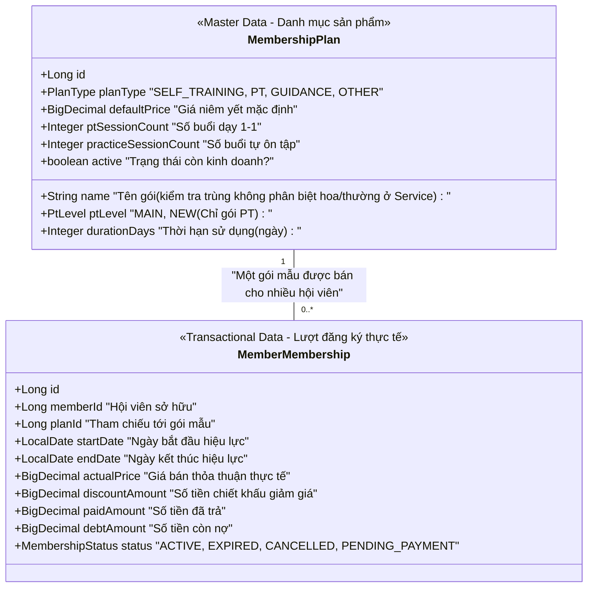
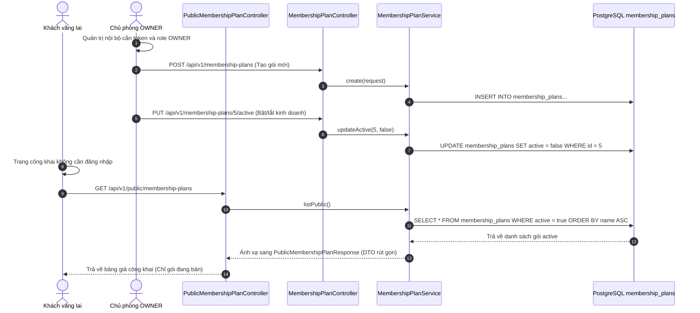
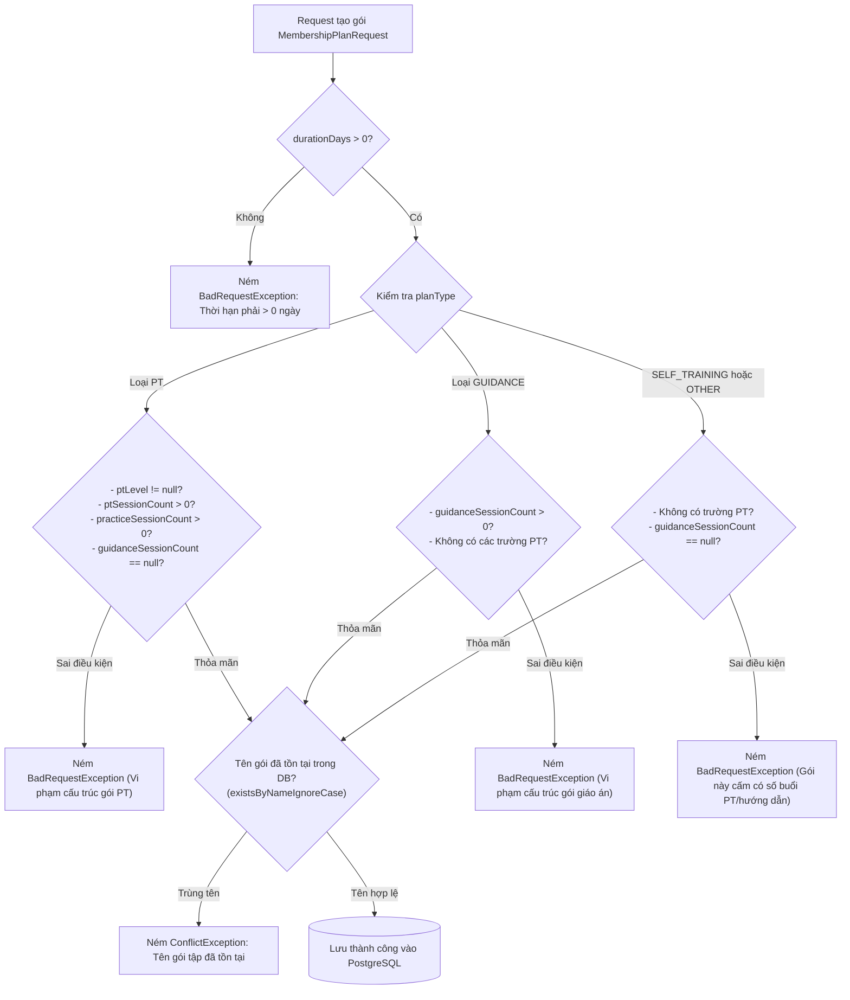

# Danh mục gói tập: mô hình, API và kiểm tra nghiệp vụ

## 1. Phân Biệt Gói Mẫu (`MembershipPlan`) và Lượt Đăng Ký (`MemberMembership`)

Trong hệ thống phòng gym, hai khái niệm này tuyệt đối không được nhầm lẫn:

### Bản chất kỹ thuật cần ghi nhớ:
1. **`MembershipPlan` (Bảng giá niêm yết)**: Là danh mục sản phẩm do chủ phòng (`OWNER`) thiết kế sẵn (ví dụ: "Gói Tự Tập 1 Tháng", "Gói PT 30 Buổi Huấn Luyện Viên Chính").
2. **`MemberMembership` (Hợp đồng mua gói của hội viên)**: Mỗi lần hội viên mua gói, một bản ghi mới được tạo ra. Nó lưu giá bán thực tế, chiết khấu, số tiền đã thu đợt đầu và công nợ còn lại.
3. **Khi tắt kinh doanh một gói tập (`active = false`)**:
   * Gói đó sẽ **ngay lập tức biến mất** khỏi Bảng giá công khai trên trang chủ và dropdown bán gói ở quầy.
   * **Tuyệt đối không xóa bản ghi khỏi database**: Toàn bộ các hợp đồng `MemberMembership` mà hội viên đã mua trong quá khứ vẫn giữ nguyên vẹn để đối soát lịch sử tập luyện và tài chính.

### Ghi chú về `PENDING_PAYMENT`
Enum `MembershipStatus` có `PENDING_PAYMENT`, và `MembershipLifecyclePolicy` coi trạng thái này là chưa hiệu lực. Tuy nhiên luồng đăng ký gói hiện tại của giao diện/backend tạo lượt đăng ký mới với `ACTIVE` rồi tạo công nợ nếu chưa thu đủ. Vì vậy, công nợ chưa thanh toán **không đồng nghĩa** gói đang `PENDING_PAYMENT` trong implementation hiện tại. Đây là trạng thái dự phòng có trong enum, chưa phải một workflow bán gói riêng trên UI.

---

## 2. Các Loại Gói Tập Trong Phòng Gym Dương Double

Dự án phân loại gói tập thông qua enum [`PlanType.java`](../../../backend/src/main/java/com/gymduongdouble/backend/common/enums/PlanType.java):

| Loại Gói (`PlanType`) | Đặc Điểm Nghiệp Vụ | Cấu Trúc Bắt Buộc Trong Code |
| :--- | :--- | :--- |
| **`SELF_TRAINING` (Gói Tự Tập)** | Hội viên đến tự tập máy, không có huấn luyện viên kèm cặp. Khi gói đang hiệu lực, OWNER vẫn có thể cấp Portal để xem thông tin cá nhân; các khối PT sẽ không có dữ liệu. | `durationDays` phải dương. `defaultPrice` có thể để trống ở DTO và được service chuẩn hóa thành `0`, nhưng khi vận hành nên nhập giá niêm yết. Cấm các trường PT hoặc giáo án. |
| **`PT` (Gói Huấn Luyện 1-1)** | Có huấn luyện viên kèm riêng. Quy trình hiện tại có thể cấp Portal để xem tiến độ; khi kích hoạt hệ thống sinh `PtSessionPackage`. | Bắt buộc `ptLevel` (`MAIN` hoặc `NEW`), `ptSessionCount > 0`, `practiceSessionCount > 0`. Cấm có `guidanceSessionCount`. |
| **`GUIDANCE` (Gói Giáo Án / Trị Liệu)** | Khách tập theo giáo án hướng dẫn bài tập hoặc phục hồi chức năng. | Bắt buộc có `guidanceSessionCount > 0`. Cấm khai báo các trường liên quan đến PT. |
| **`OTHER` (Gói Khác)** | Gói tiện ích phụ trợ (tủ đồ cá nhân, nước uống...). | Không chứa trường PT hay giáo án. |

---

## 3. Bản Đồ API và Ranh Giới Quản Trị vs Công Khai

Hệ thống tách biệt rõ ràng giữa API quản trị nội bộ và API phục vụ khách vãng lai:

### Chi tiết các endpoint:
* `POST /api/v1/membership-plans`: Dành riêng cho `OWNER` tạo bảng giá mới.
* `GET /api/v1/membership-plans`: Dành cho `OWNER` và `PT` lấy danh sách các gói đang `active` để hiển thị trên dropdown bán gói cho khách.
* `GET /api/v1/membership-plans/all`: Dành riêng cho `OWNER` xem toàn bộ danh mục (cả gói đang bán lẫn gói đã ngừng kinh doanh) tại màn hình Cài đặt.
* `PUT /api/v1/membership-plans/{id}/active`: Dành riêng cho `OWNER` bật/tắt cờ kinh doanh `active`.
* `GET /api/v1/public/membership-plans`: Endpoint công khai, ai cũng gọi được, chỉ trả về các gói `active = true` dưới dạng DTO rút gọn [`PublicMembershipPlanResponse`](../../../backend/src/main/java/com/gymduongdouble/backend/membership/web/dto/PublicMembershipPlanResponse.java).

---

## 4. Cơ Chế Thẩm Định 2 Lớp Cho Gói Tập (`validatePlanShape`)

Để đảm bảo gói tập tạo ra không bị "dị dạng" (ví dụ: gói tự tập mà lại có số buổi PT), phương thức `validatePlanShape()` trong [`MembershipPlanService.java`](../../../backend/src/main/java/com/gymduongdouble/backend/membership/service/MembershipPlanService.java#L75-L115) kiểm tra cấu trúc chặt chẽ:

> [!TIP]
> **ĐIỂM TINH TẾ KHI KIỂM TRA `NULL`:**
> Trong phương thức `validatePlanShape()`:
> * Kiểm tra một trường bắt buộc phải `null` khác hoàn toàn với kiểm tra bằng `0`.
> * Nếu client gửi gói PT kèm body: `"guidanceSessionCount": 0`, hệ thống kiểm tra điều kiện `if (request.guidanceSessionCount() != null)` sẽ **ngay lập tức từ chối**!

> **Tên gói không có UNIQUE constraint vật lý trong Entity.** `MembershipPlanService` gọi `existsByNameIgnoreCase(...)` để chặn tên trùng ở tầng ứng dụng. Đây là kiểm tra nghiệp vụ có chủ đích; không nên diễn giải là database đang có `UNIQUE(name)`.
> * Quy tắc này ép client không được gửi các trường vô nghĩa, giúp dữ liệu luôn trong sạch và nhất quán tuyệt đối.

---

## 5. Giá Niêm Yết (`defaultPrice`) Khác Giá Giao Dịch Thực Tế (`actualPrice`)

* **`MembershipPlan.defaultPrice`**: Là giá niêm yết cơ sở (catalog price). Ví dụ: Gói PT 30 buổi niêm yết 12.000.000 VNĐ.
* **`MemberMembership.actualPrice` & `discountAmount`**: Là giá giao dịch thực tế trên hợp đồng mua bán của từng hội viên:
  - Nếu khách quen được chủ phòng giảm giá đặc biệt: `actualPrice` có thể thỏa thuận là 11.000.000 VNĐ.
  - Áp dụng thêm voucher khuyến mãi: `discountAmount` = 1.000.000 VNĐ.
  - Số tiền khách thực sự phải trả:
    $$\text{payableAmount} = \text{actualPrice} - \text{discountAmount} = 11.000.000 - 1.000.000 = 10.000.000\ \text{VNĐ}$$
* **Quy tắc vàng trong báo cáo tài chính**:
  **Tuyệt đối không bao giờ tính doanh thu bằng cách lấy số hội viên nhân với giá niêm yết `defaultPrice`**! Doanh thu thực tế của phòng gym phải dựa trên số tiền thực thu ghi nhận trong bảng `payment_transactions`.

---

## 6. Trả Lời Chi Tiết Các Câu Hỏi Tự Kiểm Tra

1. **Tạo plan PT thiếu `ptLevel`: DTO có thể nhận không, và service xử lý ra sao?**
   * **Đáp án:** DTO `MembershipPlanRequest` vẫn parse được JSON (vì trường `ptLevel` không có annotation `@NotNull` ở cấp DTO để cho phép các loại gói khác như `SELF_TRAINING` không cần gửi trường này). Tuy nhiên, khi đi vào Service, hàm `validatePlanShape()` sẽ kiểm tra `if (request.ptLevel() == null)` và ném ngay `BadRequestException("Gói PT phải có cấp PT chính hoặc PT mới.")`.
2. **Gửi plan PT với `guidanceSessionCount = 0`: phân tích vì sao vẫn bị từ chối?**
   * **Đáp án:** Vì trong `validatePlanShape()`, nhánh `case PT` kiểm tra: `if (request.guidanceSessionCount() != null)`. Số `0` là một giá trị khác `null` (not-null integer), do đó điều kiện `if` kích hoạt và ném `BadRequestException("Gói PT không được có số buổi hướng dẫn/trị liệu.")`.
3. **Tạo plan hai lần với cùng tên khác chữ hoa/thường: service kiểm tra ở đâu?**
   * **Đáp án:** Diễn ra tại dòng 27 của [`MembershipPlanService.java`](../../../backend/src/main/java/com/gymduongdouble/backend/membership/service/MembershipPlanService.java):
     `if (membershipPlanRepository.existsByNameIgnoreCase(cleanName)) throw new ConflictException(...)`.
     Hàm này sinh câu lệnh SQL `WHERE LOWER(name) = LOWER(?)`, chặn đứng việc tạo hai gói trùng tên như "Gói Vip" và "gói vip".
4. **Tắt plan và thử đăng ký mới cho khách: kết quả ra sao?**
   * **Đáp án:** Khi plan bị tắt (`active = false`), trên giao diện Frontend dropdown bán gói sẽ không hiển thị gói này. Nếu kẻ gian cố tình dùng Postman gửi request tạo hợp đồng với `planId` đã tắt, tại dòng 63 của [`MemberMembershipService.java`](../../../backend/src/main/java/com/gymduongdouble/backend/membership/service/MemberMembershipService.java), Backend kiểm tra `if (!plan.isActive())` và ném ngay `BadRequestException("Gói tập hiện không hoạt động.")`.
5. **Tại sao giá mặc định của plan và giá thực tế trên lượt đăng ký có thể khác nhau?**
   * **Đáp án:** Vì `defaultPrice` của `MembershipPlan` chỉ là mức giá tham chiếu chung của phòng gym. Trong thực tế bán hàng, chủ phòng hoặc nhân viên có thể đàm phán giá riêng cho từng khách hàng (ưu đãi cho sinh viên, khách mua theo nhóm). Giá bán thực tế được ghi nhận độc lập vào `actualPrice` và `discountAmount` của `MemberMembership` để tính công nợ cho từng người.

---

## 7. Góc Nhìn Mentor: Bộ Câu Hỏi Phỏng Vấn và Phản Biện Đồ Án

> [!TIP]
> **Câu hỏi 1: Tại sao em lại tách riêng `PublicMembershipPlanController` và `MembershipPlanController` thành hai Controller khác nhau?**
> * **Cách trả lời:** Em tách riêng để đảm bảo tính an toàn bảo mật và tối ưu hiệu năng:
>   - `PublicMembershipPlanController` chỉ phục vụ khách vãng lai xem trang chủ, không yêu cầu xác thực (`permitAll()`), trả về DTO rút gọn `PublicMembershipPlanResponse` đã ẩn các trường quản trị nội bộ.
>   - `MembershipPlanController` phục vụ nghiệp vụ nội bộ và bắt buộc Bearer token. Tạo/bật-tắt/xem toàn bộ danh mục chỉ dành cho `OWNER`; riêng `GET /v1/membership-plans` cho cả `OWNER` và `PT` xem gói đang hoạt động để bán gói đúng nghiệp vụ.
>   - Việc tách Controller giúp ranh giới public/nội bộ rõ ràng, tránh sơ ý trả DTO quản trị ra API công khai.
>
> **Câu hỏi 2: Khi phòng gym đổi giá niêm yết của một gói tập từ 500.000đ lên 600.000đ, các hội viên đã mua gói đó trước đây có bị ảnh hưởng không?**
> * **Cách trả lời:** Hoàn toàn không bị ảnh hưởng. Vì khi hội viên mua gói, hệ thống đã sao chép giá bán thỏa thuận vào cột `actualPrice` của bảng `member_memberships`. Dữ liệu giao dịch cũ là bất biến (immutable), không phụ thuộc vào việc cập nhật giá niêm yết trong bảng `membership_plans`.
