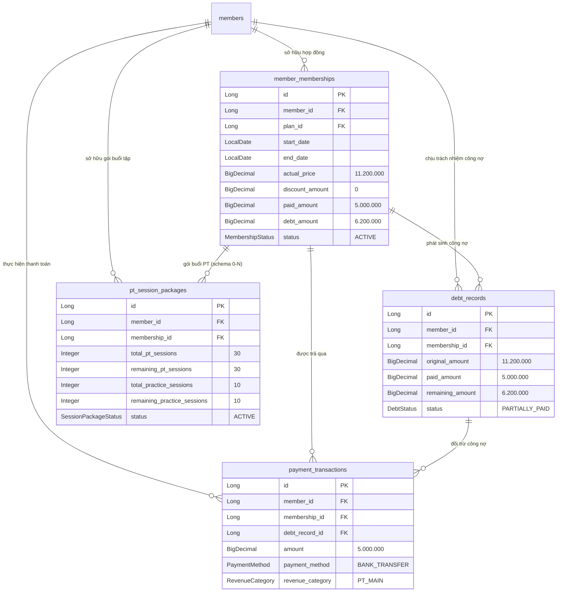
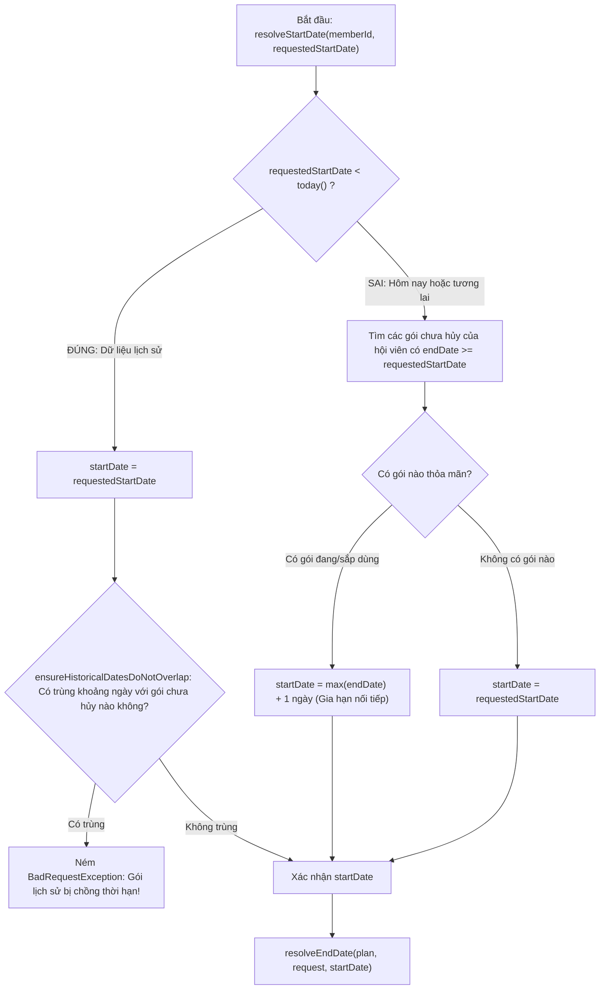
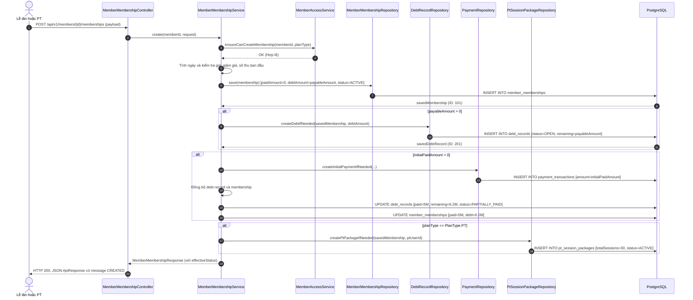
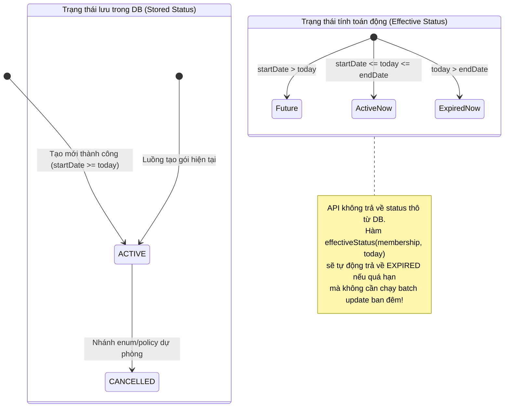

# Đăng ký, gia hạn và vòng đời gói tập (MemberMembership & Lifecycle)

## 1. Tình Huống Nghiệp Vụ Thực Tế & Bản Đồ Thực Thể

Để hiểu rõ nghiệp vụ đăng ký gói, hãy theo dõi một tình huống thực tế tại quầy lễ tân phòng gym:

> **Tình huống:**
> Hội viên **Nguyễn Văn Khánh** (đã có hồ sơ trên hệ thống) đến quầy đăng ký gói tập **"PT 30 Buổi Huấn Luyện Viên Chính"**:
> - **Giá niêm yết (Default Price):** `11.200.000 VNĐ`.
> - **Giảm giá ưu đãi (Discount):** `0 VNĐ`.
> - **Số tiền phải thu (Payable Amount):** `11.200.000 VNĐ`.
> - **Thanh toán ban đầu (Initial Payment):** Khánh thanh toán trước `5.000.000 VNĐ` qua hình thức Chuyển khoản VietQR, số còn lại `6.200.000 VNĐ` hẹn trả sau.

Trong một giao dịch duy nhất, hệ thống backend phải điều phối và khởi tạo **4 thực thể khác nhau** trong cơ sở dữ liệu:



### Ý nghĩa của 4 thực thể tách biệt:
1. **`MemberMembership` (Hợp đồng gói tập)**: Đại diện cho quyền lợi tập luyện theo thời gian của hội viên (`startDate` $\rightarrow$ `endDate`).
2. **`DebtRecord` (Bản ghi công nợ)**: Đại diện cho nghĩa vụ tài chính chưa hoàn tất. Có trường `@Version` để chống xung đột nợ khi có nhiều giao dịch thu tiền đồng thời.
3. **`Payment` (`payment_transactions`)**: Đại diện cho dòng tiền thực tế chạy vào tài khoản/két sắt phòng gym, phục vụ báo cáo doanh thu kế toán.
4. **`PtSessionPackage` (Gói buổi huấn luyện)**: Đại diện cho quyền lợi sử dụng dịch vụ chuyên môn PT 1-1, theo dõi số buổi đã tập và số buổi còn lại.

> **Cardinality cần nói chính xác:** nghiệp vụ tạo gói bình thường sinh tối đa một `DebtRecord` và một `PtSessionPackage` (nếu là plan PT) cho mỗi `MemberMembership`. Nhưng hai mapping về `membership` đều là `@ManyToOne` và không có `UNIQUE(membership_id)`. Vì vậy sơ đồ dùng `0..n` theo schema; “một bản ghi cho một lượt đăng ký” là quy ước của luồng tạo hiện tại, không phải constraint vật lý.

---

## 2. Bản Đồ Mã Nguồn Cần Đọc

| Tầng | File Mã Nguồn | Trách Nhiệm Nghiệp Vụ |
| :--- | :--- | :--- |
| **Frontend Modal** | [`MembershipAssignmentModal.tsx`](../../../frontend/src/features/members/components/MembershipAssignmentModal.tsx) | Modal giao diện bán gói: chọn gói, chỉnh sửa giá, giảm giá, nhập tiền trả trước, chọn hình thức thanh toán. |
| **Controller** | [`MemberMembershipController.java`](../../../backend/src/main/java/com/gymduongdouble/backend/membership/web/MemberMembershipController.java) | Định tuyến API `POST /api/v1/members/{memberId}/memberships`, kiểm tra quyền tầng method `@PreAuthorize("hasAnyRole('OWNER', 'PT')")`. |
| **Request DTO** | [`CreateMemberMembershipRequest.java`](../../../backend/src/main/java/com/gymduongdouble/backend/membership/web/dto/CreateMemberMembershipRequest.java) | Bean Validation: kiểm tra giá không âm, ngày bắt đầu không rỗng. |
| **Service Điều Phối** | [`MemberMembershipService.java`](../../../backend/src/main/java/com/gymduongdouble/backend/membership/service/MemberMembershipService.java) | Trái tim xử lý: kiểm tra quyền hội viên, tính toán ngày gia hạn, lưu hợp đồng, sinh công nợ, phiếu thu và gói PT trong 1 Transaction. |
| **Chính Sách Vòng Đời** | [`MembershipLifecyclePolicy.java`](../../../backend/src/main/java/com/gymduongdouble/backend/membership/service/MembershipLifecyclePolicy.java) | Tính toán trạng thái hiệu lực động (`effectiveStatus`, `isEffective`, `preferredMembership`) dựa theo thời gian thực. |
| **Thống Kê Kỳ Hạn** | [`MembershipPeriodStatistics.java`](../../../backend/src/main/java/com/gymduongdouble/backend/membership/service/MembershipPeriodStatistics.java) | Phân loại hội viên mới (`newMembers`) và hội viên gia hạn (`renewedMembers`) trong kỳ báo cáo. |

---

## 3. Kiểm Soát Quyền Hạn & Chống Vi Phạm Biên Giới Khách Hàng

Trước khi xử lý bất kỳ phép tính nào, [`MemberAccessService.java`](../../../backend/src/main/java/com/gymduongdouble/backend/member/service/MemberAccessService.java) và `MemberMembershipService.java` áp dụng bộ quy tắc phân quyền chặt chẽ:

```java
// backend/src/main/java/com/gymduongdouble/backend/member/service/MemberAccessService.java
public void ensureCanCreateMembership(Long memberId, PlanType planType) {
    if (canAccessMember(memberId)) {
        return;
    }
    boolean canStartPtEnrollment = planType == PlanType.PT
        && hasRole("PT")
        && memberRepository.findById(memberId)
            .filter(member -> member.getStatus() == MemberStatus.ACTIVE)
            .map(member -> !ptAssignmentPolicy.hasEffectiveAssignment(memberId, AppClock.today()))
            .orElse(false);
    if (!canStartPtEnrollment) {
        throw new AccessDeniedException("PT chỉ có thể đăng ký gói PT cho khách chưa được phân công hoặc khách do mình phụ trách.");
    }
}
```

### 3 Quy tắc cốt lõi:
1. **Chủ phòng (`OWNER`)**: Có toàn quyền đăng ký bất kỳ loại gói nào (`SELF_TRAINING`, `PT`, `GUIDANCE`, `OTHER`) cho bất kỳ hội viên nào trong hệ thống.
2. **Huấn luyện viên (`PT`)**:
   - Nếu hội viên đang được phân công cho chính PT đó: PT có toàn quyền thao tác.
   - Nếu hội viên là khách tự do / chưa được phân công cho PT nào (`!hasEffectiveAssignment`): PT **chỉ được phép bán gói loại `PlanType.PT`** (`canStartPtEnrollment`). PT **không được phép bán gói tự tập `SELF_TRAINING`** cho khách này.
   - Nếu hội viên đang thuộc quyền phụ trách của một PT khác: Hệ thống từ chối ngay với `AccessDeniedException`.

> [!NOTE]
> Ngoại lệ `canStartPtEnrollment` chỉ mở quyền **tạo lượt đăng ký gói PT ban đầu** cho khách đang active nhưng chưa có phân công hiệu lực. Nó không biến khách đó thành “học viên của PT” để PT được xem/sửa mọi dữ liệu. Các thao tác tiếp theo vẫn phải đi qua `MemberAccessService` và `PtAssignmentPolicy`; sau khi gói/việc phân công đã gắn PT khác, PT ban đầu không thể dùng ngoại lệ này để vượt quyền.
3. **Chống mạo danh người bán & người phụ trách (`rejectForeignPtUser`)**:
   ```java
   private void rejectForeignPtUser(Long requestedUserId, Long currentUserId) {
       if (requestedUserId != null && !requestedUserId.equals(currentUserId)) {
           throw new AccessDeniedException("PT chỉ có thể ghi nhận chính mình là người bán hoặc phụ trách gói.");
       }
   }
   ```
   - Chủ phòng có thể chỉ định bất kỳ nhân sự nào trong team (OWNER hoặc PT đang active) đứng tên bán gói hoặc phụ trách gói.
   - Huấn luyện viên (`PT`) bị khóa cứng: chỉ được phép ghi nhận **chính tài khoản của mình** là người bán và là PT phụ trách gói. Không cho phép nhận vơ doanh số của đồng nghiệp hoặc gán trộm khách cho người khác.

---

## 4. Thuật Toán Tính Ngày Bắt Đầu & Ngày Kết Thúc

Nghiệp vụ phòng gym có 2 kịch bản thời gian: **Nhập bù dữ liệu lịch sử** và **Đăng ký mới / Gia hạn nối tiếp**. Code trong `MemberMembershipService` xử lý hai nhánh này bằng thuật toán:



### A. Nhập dữ liệu trong quá khứ (`requestedStartDate < today`):
- Hệ thống giữ nguyên ngày được yêu cầu để hỗ trợ nhập liệu hồ sơ cũ từ sổ sách vào phần mềm.
- Tuy nhiên, hệ thống chạy hàm kiểm tra nghiêm ngặt `ensureHistoricalDatesDoNotOverlap`:
  ```java
  boolean overlapsExistingMembership = memberMembershipRepository.findByMemberIdOrderByStartDateDesc(memberId).stream()
      .filter(membership -> membership.getStatus() != MembershipStatus.CANCELLED)
      .anyMatch(membership -> !membership.getEndDate().isBefore(startDate)
          && !membership.getStartDate().isAfter(endDate));
  ```
  Nếu khoảng thời gian `[startDate, endDate]` bị giao nhau với bất kỳ gói tập nào chưa hủy (`!= CANCELLED`), hệ thống chặn ngay lập tức. **Hệ thống không tự ý xê dịch ngày lịch sử**.

### B. Đăng ký cho hôm nay hoặc tương lai (`requestedStartDate >= today`):
- **Cơ chế gia hạn nối tiếp thông minh (Sequential Renewal)**:
  ```java
  return memberMembershipRepository.findByMemberIdOrderByStartDateDesc(memberId).stream()
      .filter(membership -> membership.getStatus() != MembershipStatus.CANCELLED)
      .filter(membership -> !membership.getEndDate().isBefore(requestedStartDate))
      .map(MemberMembership::getEndDate)
      .max(LocalDate::compareTo)
      .map(endDate -> endDate.plusDays(1))
      .orElse(requestedStartDate);
  ```
- **Ví dụ minh họa:**
  * Hội viên đang có gói tập kết thúc vào ngày **30/10/2026**.
  * Ngày **20/10/2026**, hội viên đến quầy đóng tiền gia hạn thêm 1 tháng và yêu cầu bắt đầu từ ngày 20/10.
  * Backend phát hiện gói cũ chưa hết hạn (`30/10 >= 20/10`), lấy `max(endDate) = 30/10` và tự động cộng thêm 1 ngày: `startDate` thực tế của gói mới sẽ là **31/10/2026**.
  * Khách hàng không bị thiệt thòi 10 ngày tập còn lại của gói cũ!

### C. Công thức tính ngày kết thúc (`resolveEndDate`):
- Nếu request truyền `endDate` thủ công: Hệ thống kiểm tra `endDate` không được trước `startDate`.
- Nếu request không truyền `endDate`: Hệ thống tự động tính theo công thức:
  $$\text{endDate} = \text{startDate} + (\text{durationDays} - 1)$$
- **Tại sao phải trừ đi 1 ngày (`- 1L`)?**
  * Ví dụ: Gói 30 ngày bắt đầu từ ngày **01/10**.
  * Nếu tính `01/10 + 30 ngày` thì ra ngày `31/10` (tổng cộng thành 31 ngày tập).
  * Công thức chuẩn: `01/10 + (30 - 1) ngày = 30/10` (bao gồm trọn vẹn cả ngày 01/10 và ngày 30/10, đúng đủ 30 ngày).

---

## 5. Trình Tự Điều Phối Transaction Trong `create()`

Method `MemberMembershipService.create()` được đánh dấu `@Transactional`. Toàn bộ quá trình tạo hợp đồng, ghi nhận nợ, tạo phiếu thu và sinh số buổi PT phải thành công trọn vẹn; nếu có bất kỳ lỗi nào xảy ra, toàn bộ sẽ bị Rollback để tránh rác dữ liệu:



### Chi tiết các phép kiểm tra tài chính trước khi lưu:
1. `actualPrice`: Nếu client không gửi thì lấy mặc định `plan.getDefaultPrice()`.
2. `discountAmount`: Nếu client không gửi thì bằng `0`. Giảm giá **không được lớn hơn** giá bán thực tế (`discountAmount <= actualPrice`).
3. `payableAmount = (actualPrice - discountAmount).max(0)`: Số tiền khách thực tế phải trả.
4. `initialPaidAmount`: Tiền trả trước đợt 1 **không được lớn hơn** số tiền phải thu (`initialPaidAmount <= payableAmount`).
5. Nếu `initialPaidAmount > 0`: **Bắt buộc** phải cung cấp phương thức thanh toán `initialPaymentMethod` (`CASH` hoặc `BANK_TRANSFER`).
6. Ngày thu tiền ban đầu `resolveInitialPaymentDate`: Mặc định là `AppClock.today()`. **Tuyệt đối không cho phép ghi nhận ngày thu tiền ở tương lai** (`paymentDate.isAfter(today)` ném `BadRequestException`).

---

## 6. Khởi Tạo Gói Buổi Tập PT (`PtSessionPackage`)

Khi loại gói đăng ký là `PlanType.PT`, phương thức `createPtPackageIfNeeded` được kích hoạt:

```java
private void createPtPackageIfNeeded(MemberMembership membership, Long ptUserId) {
    MembershipPlan plan = membership.getPlan();
    if (plan.getPlanType() != PlanType.PT) {
        return;
    }

    PtSessionPackage sessionPackage = new PtSessionPackage();
    sessionPackage.setMember(membership.getMember());
    sessionPackage.setPtUser(findPtUserOrNull(ptUserId));
    sessionPackage.setMembership(membership);
    sessionPackage.setTotalPtSessions(valueOrZero(plan.getPtSessionCount()));
    sessionPackage.setUsedPtSessions(0);
    sessionPackage.setRemainingPtSessions(valueOrZero(plan.getPtSessionCount()));
    sessionPackage.setTotalPracticeSessions(valueOrZero(plan.getPracticeSessionCount()));
    sessionPackage.setUsedPracticeSessions(0);
    sessionPackage.setRemainingPracticeSessions(valueOrZero(plan.getPracticeSessionCount()));
    sessionPackage.setStartDate(membership.getStartDate());
    sessionPackage.setEndDate(membership.getEndDate());
    sessionPackage.setStatus(SessionPackageStatus.ACTIVE);
    ptSessionPackageRepository.save(sessionPackage);
}
```

### Các quy tắc nghiệp vụ quan trọng:
1. **Liên kết chặt chẽ**: `PtSessionPackage` bắt buộc trỏ tới `membership_id` và `member_id`.
2. **Khởi tạo số buổi**:
   - `totalPtSessions = plan.ptSessionCount`, `usedPtSessions = 0`, `remainingPtSessions = totalPtSessions`.
   - `totalPracticeSessions = plan.practiceSessionCount`, `usedPracticeSessions = 0`, `remainingPracticeSessions = totalPracticeSessions`.
3. **Thời hạn sử dụng**: Đồng bộ hoàn toàn theo thời hạn của hợp đồng gói (`startDate` và `endDate`).
4. **Kiểm tra tài khoản PT phụ trách (`findPtUserOrNull`)**:
   - Tài khoản người dùng phải có Role `PT`.
   - Trạng thái tài khoản người dùng phải là `ACTIVE`.
   - Phải có hồ sơ PT (`pt_profiles`) với trạng thái `active = true`.

---

## 7. Vòng Đời & Trạng Thái Động (`MembershipLifecyclePolicy`)

Một trong những thiết kế kiến trúc thông minh nhất của codebase này là: **Tách biệt giữa Trạng thái lưu tĩnh trong Database và Trạng thái hiệu lực tính toán theo thời gian thực**.



> **Phạm vi giao diện/API hiện tại:** `MembershipStatus.CANCELLED` có trong entity và
> `MembershipLifecyclePolicy` xử lý đúng nếu dữ liệu mang trạng thái này. Tuy nhiên,
> repository hiện **chưa có endpoint hay nút giao diện hủy một lượt đăng ký gói**.
> Vì vậy mũi tên sang `CANCELLED` trong sơ đồ là khả năng mà contract dữ liệu đã dự
> phòng, không phải thao tác "Chủ phòng bấm Hủy gói" đang có thể demo. Một workflow
> hủy thực tế sau này cần quy định riêng cách xử lý gói buổi PT, công nợ và các phiếu
> thu đã phát sinh; không nên tự thêm bằng cách sửa trực tiếp cột `status`.

### Đọc mã nguồn `MembershipLifecyclePolicy.java`:

```java
// backend/src/main/java/com/gymduongdouble/backend/membership/service/MembershipLifecyclePolicy.java
@Service
public class MembershipLifecyclePolicy {

    public boolean isEffective(MemberMembership membership, LocalDate date) {
        MembershipStatus status = effectiveStatus(membership, date);
        return status == MembershipStatus.ACTIVE
            && !membership.getStartDate().isAfter(date)
            && !membership.getEndDate().isBefore(date);
    }

    public MembershipStatus effectiveStatus(MemberMembership membership, LocalDate date) {
        if (membership.getStatus() == MembershipStatus.CANCELLED) {
            return MembershipStatus.CANCELLED;
        }
        return membership.getEndDate().isBefore(date) ? MembershipStatus.EXPIRED : membership.getStatus();
    }
}
```

### Phân tích nghiệp vụ sâu:
1. **Tại sao không dùng Cron Job chạy lúc 00:00 mỗi đêm để update status = `EXPIRED` vào DB?**
   - **Nhược điểm của Cron Job**: Nếu server bị tắt lúc nửa đêm, hoặc job bị treo, dữ liệu trạng thái sẽ bị sai lệch. Hơn nữa, quét hàng ngàn bản ghi để update hàng đêm gây nghẽn I/O database không cần thiết.
   - **Giải pháp On-the-fly của dự án**: Cột `status` vẫn lưu enum nghiệp vụ (`ACTIVE`, `PENDING_PAYMENT` hoặc `CANCELLED`; luồng tạo chính hiện dùng `ACTIVE`). Khi truy vấn API, method `effectiveStatus(saved, AppClock.today())` ưu tiên giữ `CANCELLED`, còn nếu `endDate` đã qua ngày hiện tại thì trả `EXPIRED` để hiển thị. Đây là phép tính theo `LocalDate` tại thời điểm đọc, nên không cần background job để đồng bộ trạng thái hết hạn.
2. **`isEffective(membership, date)`**:
   - Một gói tập lưu `ACTIVE` nhưng bắt đầu vào tháng sau thì **chưa có hiệu lực hôm nay**.
   - Điều kiện có hiệu lực: `effectiveStatus == ACTIVE` VÀ `startDate <= date <= endDate`.

---

## 8. Thuật Toán Lựa Chọn Gói Đại Diện (`preferredMembership`)

Một hội viên có thể có nhiều lượt mua gói: gói cũ đã hết hạn, gói hiện tại đang dùng, và gói gia hạn cho tháng tới. Khi màn hình Dashboard hoặc Lễ tân cần hiển thị **1 gói duy nhất đại diện cho hội viên**, hệ thống lựa chọn như thế nào?

Code trong `MembershipLifecyclePolicy.preferredMembership`:

```java
public Optional<MemberMembership> preferredMembership(List<MemberMembership> memberships, LocalDate date) {
    List<MemberMembership> available = memberships.stream()
        .filter(membership -> membership.getStatus() != MembershipStatus.CANCELLED)
        .toList();

    return available.stream()
        // Ưu tiên 1: Gói đang có hiệu lực tại ngày xét
        .filter(membership -> isEffective(membership, date))
        .max(Comparator.comparing(MemberMembership::getStartDate).thenComparing(MemberMembership::getEndDate))
        // Ưu tiên 2: Gói tương lai gần nhất (sắp có hiệu lực)
        .or(() -> available.stream()
            .filter(membership -> membership.getStartDate().isAfter(date))
            .min(Comparator.comparing(MemberMembership::getStartDate).thenComparing(MemberMembership::getEndDate)))
        // Ưu tiên 3: Gói trong quá khứ đã hết hạn gần đây nhất
        .or(() -> available.stream()
            .filter(membership -> membership.getEndDate().isBefore(date))
            .max(Comparator.comparing(MemberMembership::getEndDate).thenComparing(MemberMembership::getStartDate)));
}
```

### Thứ tự ưu tiên giải thuật:
1. **Ưu tiên 1 (Đang tập)**: Tìm gói thỏa mãn `isEffective(date)`. Nếu có nhiều gói cùng hiệu lực, comparator ưu tiên `startDate` mới nhất, rồi mới đến `endDate` mới nhất; không phải luôn chọn gói có `endDate` xa nhất.
2. **Ưu tiên 2 (Chờ kích hoạt)**: Nếu hiện tại không có gói nào hiệu lực, tìm gói ở tương lai (`startDate > date`) có ngày bắt đầu **gần nhất**.
3. **Ưu tiên 3 (Hết hạn)**: Nếu không có cả gói hiện tại lẫn gói tương lai, tìm gói đã hết hạn trong quá khứ (`endDate < date`) có ngày kết thúc **gần đây nhất** để nhắc nhở nhân viên sale gọi điện mời gia hạn.

---

## 9. Thống Kê Kỳ Hạn: Hội Viên Mới vs Gia Hạn

Trong báo cáo kinh doanh của chủ phòng, chỉ số tăng trưởng được đo lường thông qua [`MembershipPeriodStatistics.java`](../../../backend/src/main/java/com/gymduongdouble/backend/membership/service/MembershipPeriodStatistics.java):

```java
public Counts count(List<MemberMembership> memberships, LocalDate start, LocalDate end) {
    Map<Long, List<MemberMembership>> byMember = memberships.stream()
        .filter(membership -> membership.getStatus() != MembershipStatus.CANCELLED)
        .collect(Collectors.groupingBy(membership -> membership.getMember().getId()));
    Set<Long> newMembers = new HashSet<>();
    Set<Long> renewedMembers = new HashSet<>();
    Comparator<MemberMembership> order = Comparator.comparing(MemberMembership::getStartDate)
        .thenComparing(MemberMembership::getId);

    byMember.forEach((memberId, memberMemberships) -> {
        List<MemberMembership> sorted = memberMemberships.stream().sorted(order).toList();
        for (int i = 0; i < sorted.size(); i++) {
            LocalDate date = sorted.get(i).getStartDate();
            if (!date.isBefore(start) && !date.isAfter(end)) {
                (i == 0 ? newMembers : renewedMembers).add(memberId);
            }
        }
    });
    return new Counts(newMembers.size(), renewedMembers.size());
}
```

### Nguyên lý phân loại:
- Toàn bộ các gói chưa hủy của từng hội viên được sắp xếp theo `startDate` tăng dần.
- Lượt đăng ký đầu tiên trong đời của hội viên (`i == 0`): Nếu rơi vào khoảng `[start, end]` thì tính là **Hội viên mới (`newMembers`)**.
- Từ lượt đăng ký thứ hai trở đi (`i > 0`): Nếu có ngày bắt đầu rơi vào khoảng `[start, end]` thì tính là **Hội viên gia hạn (`renewedMembers`)**.
- Dùng `Set<Long>` đảm bảo nếu một hội viên có nhiều lượt gia hạn trong cùng kỳ thì chỉ được đếm là 1 khách gia hạn. Đây là chỉ số vận hành theo lượt đăng ký trong kỳ, không phải bằng chứng tuyệt đối rằng khách đã “duy trì thành công” về mặt kinh doanh.

---

## 10. Bộ Câu Hỏi Phản Biện & Phỏng Vấn Backend Intern

Khi bảo vệ đồ án thực tập hoặc phỏng vấn tuyển dụng vị trí Java Backend, đây là những câu hỏi cốt lõi nhà tuyển dụng sẽ hỏi xoay quanh module này:

### Câu hỏi 1: Tại sao hệ thống tính toán trạng thái `EXPIRED` động thông qua `MembershipLifecyclePolicy` thay vì dùng Cron Job quét database lúc 00:00 mỗi đêm?
> **Đáp án chuẩn:**
> - **Hiệu năng & Tải database**: Nếu hệ thống có hàng chục ngàn gói tập, việc quét toàn bộ bảng và cập nhật cột `status` hàng đêm sẽ sinh ra lượng lớn câu lệnh `UPDATE`, ghi log WAL và lock dòng/bảng không cần thiết.
> - **Độ tin cậy (Fault Tolerance)**: Cron Job có thể bị lỗi do cúp điện, sập container Docker hoặc server bảo trì lúc 00:00. Nếu job không chạy, sáng hôm sau hội viên hết hạn vẫn hiển thị `ACTIVE`.
> - **Kiến trúc On-the-fly**: Khi đọc dữ liệu, hệ thống so sánh `endDate.isBefore(today)` theo `LocalDate`; đây là phép kiểm tra nhẹ và không cần job nền. `status` trong database vẫn lưu trạng thái nghiệp vụ gốc (`ACTIVE`, `PENDING_PAYMENT`, `CANCELLED`), còn `EXPIRED` được suy ra khi ngày kết thúc đã qua. Nhờ vậy màn hình không phụ thuộc vào việc scheduler có chạy đúng lúc hay không.

### Câu hỏi 2: Trong phương thức `create()`, có tới 4 thao tác ghi database (`MemberMembership`, `DebtRecord`, `Payment`, `PtSessionPackage`). Nếu bước cuối cùng tạo gói PT bị lỗi thì dữ liệu sẽ như thế nào?
> **Đáp án chuẩn:**
> Phương thức `create()` được đánh dấu annotation `@Transactional` của Spring.
> - Mặc định, nếu có bất kỳ `RuntimeException` nào xảy ra (ví dụ: lỗi validate tài khoản PT `BadRequestException`), Spring Transaction Interceptor sẽ bắt ngoại lệ và ra lệnh cho Transaction Manager phát tín hiệu `ROLLBACK` xuống PostgreSQL.
> - Toàn bộ các bản ghi `MemberMembership`, `DebtRecord`, `Payment` đã `save()` ở các bước trước đó sẽ được phục hồi nguyên trạng, không một dòng dữ liệu rác nào tồn tại trong DB, đảm bảo nguyên lý **Atomicity (Nguyên tử)** của ACID.

### Câu hỏi 3: Entity `DebtRecord` có trường `@Version private Long version = 0L;`. Trường này phục vụ mục đích gì và giải quyết bài toán đồng thời nào?
> **Đáp án chuẩn:**
> Đây là cơ chế **Khóa lạc quan (Optimistic Locking)** của JPA/Hibernate:
> - Giả sử có 2 nhân viên lễ tân cùng mở màn hình thu tiền công nợ của một hội viên đang nợ 5 triệu đồng.
> - Lễ tân A thu 2 triệu, Lễ tân B thu 3 triệu gần như cùng một giây.
> - Nếu không có khóa, cả hai cùng đọc `remainingAmount = 5M`. Lễ tân A trừ 2M ghi đè `3M`, Lễ tân B trừ 3M ghi đè `2M`. Kết quả công nợ bị sai lệch nghiêm trọng (Lost Update).
> - Với `@Version`: Khi commit xuống DB, Hibernate tự động thêm điều kiện `WHERE id = ? AND version = ?`. Người commit sau sẽ thấy version trong DB đã bị tăng lên, Hibernate lập tức ném ra ngoại lệ `OptimisticLockException`, giao dịch bị hủy và lễ tân được yêu cầu tải lại dữ liệu mới nhất.

### Câu hỏi 4: Tại sao trong công thức tính ngày kết thúc mặc định lại là `startDate.plusDays(durationDays - 1L)` mà không phải `plusDays(durationDays)`?
> **Đáp án chuẩn:**
> Vì ngày bắt đầu (`startDate`) đã là ngày đầu tiên hội viên được quyền vào phòng tập.
> - Nếu gói có thời hạn 1 ngày và bắt đầu từ hôm nay (01/10): Khách chỉ được tập hết ngày 01/10. Nếu lấy `01/10.plusDays(1)` thì ngày kết thúc sẽ là 02/10 (tổng cộng thành 2 ngày tập).
> - Do đó, công thức `startDate.plusDays(durationDays - 1L)` đảm bảo tính cả ngày đầu và ngày cuối, tạo thành một khoảng khép kín `[startDate, endDate]` có đúng chính xác `durationDays` ngày tập.
