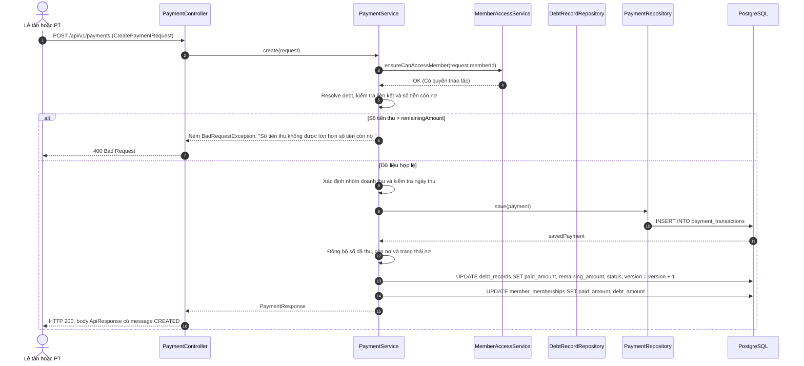
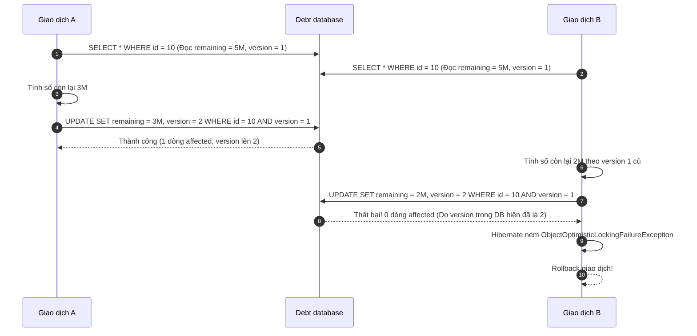

# Mô hình công nợ, phiếu thu và điều phối dòng tiền (DebtRecord & Payment)

## 1. Bản Chất Nghiệp Vụ: Không Được Gộp Công Nợ và Phiếu Thu

Trong hệ thống quản lý phòng gym Dương Double, việc tách bạch ranh giới giữa **Khoản phải thu (Công nợ)** và **Dòng tiền thực thu (Phiếu thu)** là nguyên tắc kế toán sống còn:

```mermaid
erDiagram
    members ||--o{ member_memberships : "sở hữu hợp đồng"
    members ||--o{ debt_records : "chịu trách nhiệm nợ"
    members ||--o{ payment_transactions : "thực hiện thanh toán"

    member_memberships ||--o{ debt_records : "phát sinh công nợ (schema 0-N)"
    member_memberships ||--o{ payment_transactions : "được trả qua (1-N)"
    debt_records ||--o{ payment_transactions : "đối trừ công nợ (1-N)"

    member_memberships {
        Long id PK
        BigDecimal actual_price "Giá bán thỏa thuận"
        BigDecimal discount_amount "Giảm giá"
        BigDecimal paid_amount "Tổng tiền đã trả"
        BigDecimal debt_amount "Số tiền còn nợ"
        MembershipStatus status
    }

    debt_records {
        Long id PK
        Long version "Optimistic Locking"
        BigDecimal original_amount "Số nợ gốc ban đầu"
        BigDecimal paid_amount "Số đã trả cho khoản nợ này"
        BigDecimal remaining_amount "Số nợ còn lại"
        LocalDate due_date "Hạn chót thanh toán"
        DebtStatus status "OPEN, PARTIALLY_PAID, PAID, CANCELLED"
    }

    payment_transactions {
        Long id PK
        LocalDate payment_date "Ngày thu tiền thực tế"
        BigDecimal amount "Số tiền thực thu lần này"
        PaymentMethod payment_method "CASH, BANK_TRANSFER"
        RevenueCategory revenue_category "PT_MAIN, PT_NEW, SELF_TRAINING..."
        String description "Ghi chú phiếu thu"
    }
```



### Hai khái niệm mang ý nghĩa kế toán độc lập:
1. **`DebtRecord` (Bản ghi công nợ - Phải thu)**:
   * Đại diện cho **nghĩa vụ tài chính** mà hội viên phải thanh toán cho một lượt đăng ký gói tập.
   * Sinh ra khi: `payableAmount = (actualPrice - discountAmount) > 0`.
   * Quản lý trạng thái: `OPEN` (chưa trả đồng nào), `PARTIALLY_PAID` (đã trả một phần), `PAID` (đã trả sạch), `CANCELLED` (nhánh phòng vệ cho khoản nợ đã bị hủy).
   * **Tuyệt đối không lưu phương thức thanh toán** trong `DebtRecord` vì hội viên có thể trả nợ thành nhiều đợt bằng các hình thức khác nhau.

   > Luồng đăng ký gói hiện tại tạo tối đa một khoản nợ cho một lượt đăng ký. Tuy nhiên mapping database là `DebtRecord -> MemberMembership` kiểu `@ManyToOne`, không có ràng buộc unique ở `membership_id`; do đó schema cho phép một lượt đăng ký có nhiều debt record. Tài liệu không được gọi đó là quan hệ 1-1 vật lý.

   > `DebtStatus.CANCELLED` đã được `PaymentService` chặn khi có request thu tiền,
   > nhưng hiện không có endpoint/UI hủy công nợ. Nó là trạng thái dự phòng của
   > contract dữ liệu, không phải một thao tác tài chính mà người dùng hiện có thể
   > thực hiện. Không cập nhật trực tiếp status bằng SQL để mô phỏng nghiệp vụ này.

   > Form đăng ký hiện chưa cho nhập một hạn thanh toán riêng. Khi phát sinh nợ,
   > `createDebtIfNeeded` gán `dueDate` bằng `startDate` của lượt đăng ký gói.
   > Vì vậy mốc này đang phục vụ sắp xếp/đối soát nhắc nợ đơn giản, không phải một
   > workflow thương lượng hạn trả nợ theo từng khách.
2. **`Payment` (`payment_transactions` - Phiếu thu thực tế)**:
   * Đại diện cho một **giao dịch dòng tiền thực nhập** vào két sắt hoặc tài khoản ngân hàng của phòng gym tại một thời điểm xác định.
   * Mỗi phiếu thu gắn liền với một ngày thu (`paymentDate`), một số tiền cụ thể (`amount`), một hình thức thanh toán duy nhất (`paymentMethod`), và một nhân viên chịu trách nhiệm thu tiền (`createdBy`).
   * Một khoản nợ `DebtRecord` có thể được thanh lý thông qua **nhiều lần thu tiền `Payment`** khác nhau (quan hệ 1 - N).

---

## 2. Bản Đồ Mã Nguồn Cần Đọc

| Tầng | File Mã Nguồn | Trách Nhiệm Nghiệp Vụ |
| :--- | :--- | :--- |
| **Frontend Form** | [`PaymentFormModal.tsx`](../../../frontend/src/features/payments/components/PaymentFormModal.tsx) | Modal lập phiếu thu: chọn khoản nợ, hiển thị mã VietQR động, nhập số tiền thu, chọn tiền mặt/chuyển khoản, chọn ngày thu. |
| **Frontend Trang** | [`PaymentsPage.tsx`](../../../frontend/src/features/payments/pages/PaymentsPage.tsx) | Hai bảng công nợ/phiếu thu có tìm kiếm và phân trang phía server; thẻ đầu trang lấy summary độc lập để không bị sai khi người dùng chuyển trang hoặc đổi bộ lọc. |
| **Controllers** | [`PaymentController.java`](../../../backend/src/main/java/com/gymduongdouble/backend/finance/web/PaymentController.java)<br/>[`DebtController.java`](../../../backend/src/main/java/com/gymduongdouble/backend/finance/web/DebtController.java) | Ngoài endpoint list gốc và `POST /api/v1/payments`, có `/api/v1/payments/page`, `/api/v1/debts/page` cho bảng phân trang và `/api/v1/payments/summary` cho KPI. Kiểm tra role `@PreAuthorize("hasAnyRole('OWNER', 'PT')")`. |
| **Request DTO** | [`CreatePaymentRequest.java`](../../../backend/src/main/java/com/gymduongdouble/backend/finance/web/dto/CreatePaymentRequest.java) | Bean Validation: kiểm tra `memberId != null`, `amount >= 1.0`, `paymentMethod != null`. |
| **Service Điều Phối** | [`PaymentService.java`](../../../backend/src/main/java/com/gymduongdouble/backend/finance/service/PaymentService.java) | Kiểm tra quyền truy cập hội viên, đối soát khoản nợ, kiểm tra số tiền không vượt nợ còn lại, phân loại doanh thu, ghi phiếu thu và đồng bộ nợ trong 1 `@Transactional`. |
| **Repositories** | [`DebtRecordRepository.java`](../../../backend/src/main/java/com/gymduongdouble/backend/finance/repository/DebtRecordRepository.java)<br/>[`PaymentRepository.java`](../../../backend/src/main/java/com/gymduongdouble/backend/finance/repository/PaymentRepository.java) | Truy vấn nợ chưa trả, tính tổng doanh thu theo khoảng ngày bằng JPQL `sumAmountByPaymentDateBetween`. |

---

## 3. Bảng Biến Thiên Dòng Tiền & Công Nợ Thực Tế

Hãy xem xét vòng đời thanh toán của gói tập **11.200.000 VNĐ** (không giảm giá):

| Giai đoạn | Thao tác nghiệp vụ | `DebtRecord.originalAmount` | `DebtRecord.paidAmount` | `DebtRecord.remainingAmount` | `DebtStatus` | Số bản ghi `Payment` phát sinh |
| :--- | :--- | :---: | :---: | :---: | :---: | :---: |
| **T0: Đăng ký gói** | Lập hợp đồng mua gói, chưa thu tiền trước | `11.200.000` | `0` | `11.200.000` | `OPEN` | **0** (Chưa có dòng tiền) |
| **T1: Thu đợt 1** | Hội viên chuyển khoản trước `5.000.000` qua VietQR | `11.200.000` | `5.000.000` | `6.200.000` | `PARTIALLY_PAID` | **1** (`5.000.000`, `BANK_TRANSFER`) |
| **T2: Thu đợt 2** | Sau 1 tuần, hội viên đóng nốt `6.200.000` tiền mặt | `11.200.000` | `11.200.000` | `0` | `PAID` | **1** (`6.200.000`, `CASH`) |
| **TỔNG KẾT** | **Đã hoàn tất thanh toán** | **11.200.000** | **11.200.000** | **0** | **PAID** | **Tổng 2 phiếu thu: 11.200.000** |

### Bài học kiến trúc cốt lõi:
1. **Bảo tồn phương thức thanh toán từng đợt**: Đợt 1 thu chuyển khoản ngân hàng, đợt 2 thu tiền mặt tại quầy. Nhờ tách bảng `Payment`, sổ quỹ tiền mặt và tài khoản ngân hàng khớp 100% khi đối soát cuối ngày.
2. **Không ghi nhận doanh thu ảo**: Nếu chỉ bán gói mà chưa thu tiền (T0), doanh thu thực thu trong kỳ bằng `0`. Không bao giờ được lấy `actualPrice` của gói để tính doanh thu kế toán khi tiền chưa vào tài khoản!
3. **Đồng bộ hai chiều**: Mọi biến động trên `DebtRecord` đều được đồng bộ tức thời sang `MemberMembership` (`membership.setPaidAmount(...)`, `membership.setDebtAmount(...)`) để màn hình quản lý hội viên luôn hiển thị số dư nợ chính xác.

---

## 4. Trình Tự Thực Thi Trong `PaymentService.create()`

Khi nhân viên bấm "Xác nhận thu tiền" trên giao diện, phương thức `PaymentService.create()` thực thi một chuỗi kiểm tra logic khép kín:



### Phân tích chi tiết 6 chốt chặn nghiệp vụ trong code:

#### Chốt 1: Phân quyền truy cập hội viên (`ensureCanAccessMember`)
```java
memberAccessService.ensureCanAccessMember(request.memberId());
```
Chủ phòng có quyền lập phiếu thu cho toàn bộ hội viên. PT chỉ được lập phiếu thu khi `MemberAccessService` cho phép: khách đang `ACTIVE`, có gói PT hiệu lực phù hợp và thuộc phân công hiệu lực của PT; ngoại lệ chỉ dành cho khách PT **chưa từng có bản ghi phân công** và gói chưa gắn PT khác. Khách tự tập, khách của PT khác, hoặc khách chỉ còn lịch sử phân công hết hạn không qua được policy này.

#### Chốt 2: Cơ chế tìm và đối soát khoản nợ (`resolveDebtRecord` & `validateDebtRecord`)
```java
private DebtRecord resolveDebtRecord(CreatePaymentRequest request, Member member, MemberMembership membership) {
    if (request.debtRecordId() != null) {
        return debtRecordRepository.findById(request.debtRecordId())
            .orElseThrow(() -> new ResourceNotFoundException("Không tìm thấy khoản công nợ."));
    }
    if (membership == null) {
        return null;
    }
    return debtRecordRepository.findByMembershipIdOrderByCreatedAtDesc(membership.getId()).stream()
        .filter(debtRecord -> debtRecord.getStatus() != DebtStatus.PAID)
        .filter(debtRecord -> debtRecord.getStatus() != DebtStatus.CANCELLED)
        .findFirst()
        .orElse(null);
}
```
- Nếu client truyền trực tiếp `debtRecordId`, hệ thống lấy đúng khoản nợ đó.
- Nếu client chỉ truyền `membershipId`, hệ thống tự động tìm khoản nợ chưa thanh toán xong gần nhất của hợp đồng đó (`status != PAID && status != CANCELLED`).
- Kiểm tra bảo mật: Luôn bắt buộc `debtRecord.member.id == member.id`. Nếu request có truyền `membershipId`, service kiểm tra thêm `debtRecord.membership.id == membership.id`; sau đó lấy `membership` chính thức từ `debtRecord` và từ chối nếu khoản nợ không gắn lượt đăng ký gói. Nhờ vậy client không thể gán nợ của người này hoặc của lượt đăng ký khác sang phiếu thu hiện tại.

#### Chốt 3: Chặn thu vượt mức nợ còn lại (`validatePaymentAmount`)
```java
private void validatePaymentAmount(BigDecimal amount, DebtRecord debtRecord) {
    if (amount.compareTo(debtRecord.getRemainingAmount()) > 0) {
        throw new BadRequestException("Số tiền thu không được lớn hơn số tiền còn nợ.");
    }
}
```
Khách còn nợ `6.200.000 VNĐ`, nhân viên gõ nhầm `6.500.000 VNĐ` $\rightarrow$ Hệ thống từ chối ngay lập tức, không để phát sinh nợ âm.

#### Chốt 4: Tự động phân loại danh mục doanh thu (`inferRevenueCategory`)
```java
private RevenueCategory inferRevenueCategory(MemberMembership membership) {
    MembershipPlan plan = membership.getPlan();
    if (plan.getPlanType() == PlanType.SELF_TRAINING) return RevenueCategory.SELF_TRAINING;
    if (plan.getPlanType() == PlanType.GUIDANCE) return RevenueCategory.GUIDANCE;
    if (plan.getPlanType() == PlanType.PT && plan.getPtLevel() == PtLevel.NEW) return RevenueCategory.PT_NEW;
    if (plan.getPlanType() == PlanType.PT) return RevenueCategory.PT_MAIN;
    return RevenueCategory.OTHER_INCOME;
}
```
Không để nhân viên tự chọn thủ công loại doanh thu khi lập phiếu thu. Code tự động truy ngược về gói tập gốc để gắn nhãn danh mục kế toán chính xác (`PT_MAIN`, `PT_NEW`, `SELF_TRAINING`).

#### Chốt 5: Ràng buộc ngày thu tiền (`resolvePaymentDate`)
```java
private LocalDate resolvePaymentDate(LocalDate requestedDate) {
    LocalDate paymentDate = requestedDate == null ? AppClock.today() : requestedDate;
    if (paymentDate.isAfter(AppClock.today())) {
        throw new BadRequestException("Ngày lập phiếu thu không được ở tương lai.");
    }
    return paymentDate;
}
```
Nếu client để trống ngày thu, mặc định lấy ngày hôm nay theo `AppClock.today()`. Nếu client chọn ngày ở tương lai, hệ thống chặn ngay bằng `BadRequestException`. Phiếu thu là biên nhận dòng tiền đã thực nhận, không thể ghi nhận trước cho tương lai!

#### Chốt 6: Đồng bộ toán học và cập nhật trạng thái (`syncDebtAndMembership`)
```java
private void syncDebtAndMembership(DebtRecord debtRecord, MemberMembership membership, BigDecimal amount) {
    if (debtRecord != null) {
        BigDecimal paidAmount = debtRecord.getPaidAmount().add(amount);
        BigDecimal remainingAmount = debtRecord.getRemainingAmount().subtract(amount).max(BigDecimal.ZERO);
        debtRecord.setPaidAmount(paidAmount.min(debtRecord.getOriginalAmount()));
        debtRecord.setRemainingAmount(remainingAmount);
        debtRecord.setStatus(resolveDebtStatus(debtRecord));
    }
    // Đồng bộ tiếp sang MemberMembership...
}

private DebtStatus resolveDebtStatus(DebtRecord debtRecord) {
    if (debtRecord.getRemainingAmount().compareTo(BigDecimal.ZERO) <= 0) {
        return DebtStatus.PAID;
    }
    if (debtRecord.getPaidAmount().compareTo(BigDecimal.ZERO) > 0) {
        return DebtStatus.PARTIALLY_PAID;
    }
    return DebtStatus.OPEN;
}
```
Toán tử `.max(BigDecimal.ZERO)` và `.min(...)` bảo vệ dữ liệu khỏi các lỗi làm tròn dấu phẩy động hoặc số âm ngoài ý muốn.

---

## 5. Xử Lý Tranh Chấp Đồng Thời: Khóa Lạc Quan (`@Version`)

Trong môi trường thực tế tại phòng gym giờ cao điểm, tình huống sau rất dễ xảy ra:
> Hội viên đang nợ `5.000.000 VNĐ`.
> - **Lễ tân A** tại quầy mở modal thu `2.000.000 VNĐ` tiền mặt.
> - Cùng lúc đó, **Chủ phòng B** trên điện thoại thấy thông báo ngân hàng nổi lên `3.000.000 VNĐ` nên bấm thu `3.000.000 VNĐ`.

Nếu không có cơ chế bảo vệ đồng thời, hiện tượng **Lost Update (Mất dữ liệu cập nhật)** sẽ xảy ra:



### Cách thức `@Version` hoạt động trong codebase:
1. Trong Entity [`DebtRecord.java`](../../../backend/src/main/java/com/gymduongdouble/backend/finance/domain/DebtRecord.java):
   ```java
   @Version
   @Column(nullable = false, columnDefinition = "bigint default 0")
   private Long version = 0L;
   ```
2. Khi Giao dịch B cố gắng ghi đè dữ liệu cũ, câu lệnh SQL ngầm định của Hibernate có dạng:
   ```sql
   UPDATE debt_records
   SET remaining_amount = 2000000.00, version = 2
   WHERE id = 10 AND version = 1;
   ```
   Do Giao dịch A đã commit trước và tăng `version` lên `2`, mệnh đề `WHERE version = 1` không khớp dòng nào (0 rows updated).
3. Hibernate lập tức phát hiện xung đột và ném ngoại lệ `ObjectOptimisticLockingFailureException`.
4. [`GlobalExceptionHandler.java`](../../../backend/src/main/java/com/gymduongdouble/backend/common/exception/GlobalExceptionHandler.java) bắt ngoại lệ này và trả HTTP `409 CONFLICT` với mã chi tiết `error.code = "CONCURRENT_UPDATE"`:
   ```json
   {
     "success": false,
      "message": "Dữ liệu vừa được cập nhật bởi thao tác khác. Vui lòng tải lại và thử lại.",
      "data": null,
      "error": {
        "code": "CONCURRENT_UPDATE",
        "message": "Dữ liệu vừa được cập nhật bởi thao tác khác. Vui lòng tải lại và thử lại.",
        "fields": {}
      }
   }
   ```
   Nhờ đó, số nợ của khách hàng không bị tính sai và Chủ phòng nhận được thông báo để tải lại dữ liệu mới nhất.

---

## 6. Bộ Câu Hỏi Phản Biện & Phỏng Vấn Backend Intern

### Câu hỏi 1: Tại sao trường `paymentMethod` (Phương thức thanh toán) lại nằm ở bảng `payment_transactions` mà không đặt ở bảng `debt_records` hay `member_memberships`?
> **Đáp án chuẩn:**
> Vì một lượt đăng ký gói hoặc một khoản công nợ có thể được thanh toán qua nhiều lần với các phương thức khác nhau. Ví dụ: khách đặt cọc trước 2 triệu bằng chuyển khoản VietQR, 1 tuần sau đến tập trả nốt 4 triệu bằng tiền mặt. Nếu lưu `paymentMethod` ở hợp đồng hoặc công nợ thì không thể biểu diễn được tính đa dạng này, dẫn đến sai lệch sổ quỹ kế toán khi đối soát dòng tiền mặt và tiền ngân hàng.

### Câu hỏi 2: Trong phương thức `PaymentService.create()`, cơ chế nào đảm bảo nếu việc cập nhật `debt_records` thất bại thì bản ghi `payment_transactions` không bị lưu mồ côi?
> **Đáp án chuẩn:**
> Toàn bộ phương thức `create()` được quản lý bởi annotation `@Transactional` của Spring Framework:
> - `paymentRepository.save(payment)` tạo phiếu thu. `DebtRecord` và `MemberMembership` đã được repository nạp vào Persistence Context, nên `syncDebtAndMembership(...)` chỉ gọi setter; Hibernate **dirty checking** sẽ sinh các `UPDATE` khi transaction commit. Code không gọi `debtRecordRepository.save(...)` hay `memberMembershipRepository.save(...)` trong method này.
> - Nếu bước cập nhật nợ ném ngoại lệ (như lỗi Optimistic Lock hoặc vi phạm ràng buộc dữ liệu), Spring Transaction Manager sẽ phát lệnh `ROLLBACK` xuống PostgreSQL.
> - Nếu cập nhật nợ ném ngoại lệ (ví dụ optimistic lock hoặc ràng buộc DB), Spring Transaction Manager rollback toàn bộ transaction. `INSERT` phiếu thu và các `UPDATE` do dirty checking tạo ra cùng bị hủy, đảm bảo Atomicity của ACID.

### Câu hỏi 3: Bộ lọc trạng thái công nợ `listDebts(memberId, DebtStatus status)` trong `PaymentService` có điểm gì đặc biệt cần lưu ý về mặt nghiệp vụ?
> **Đáp án chuẩn:**
> Đọc trong mã nguồn hàm `matchesDebtStatus`:
> ```java
> if (status == DebtStatus.OPEN) {
>     return debtRecord.getStatus() == DebtStatus.OPEN || debtRecord.getStatus() == DebtStatus.PARTIALLY_PAID;
> }
> ```
> Về mặt giao diện quản lý lễ tân, khi người dùng lọc các khoản nợ "Cần thu" (`status = OPEN`), nghiệp vụ thực tế yêu cầu phải hiển thị cả các khoản nợ chưa trả đồng nào (`OPEN`) lẫn các khoản nợ mới chỉ trả được một phần (`PARTIALLY_PAID`). Đây là thiết kế bám sát bài toán thực tế của phòng gym, không so sánh enum thô sơ một cách máy móc.

### Câu hỏi 4: Sự khác biệt giữa Bean Validation `@DecimalMin("1.0")` trong `CreatePaymentRequest` và hàm `validatePaymentAmount` trong `PaymentService` là gì?
> **Đáp án chuẩn:**
> - `@DecimalMin("1.0")` là **Validation cú pháp (Format Validation)** ở tầng Web/Controller: đảm bảo số tiền gửi lên là một số dương có nghĩa (không thể thu 0 đồng hoặc số âm), từ chối ngay trước khi vào Service.
> - `validatePaymentAmount` là **Validation nghiệp vụ (Business Rule Validation)** ở tầng Service: kiểm tra số tiền thu không được vượt quá số nợ còn lại (`amount <= debtRecord.remainingAmount`). Phép kiểm tra này bắt buộc phải truy vấn database để lấy số dư nợ hiện tại nên không thể thực hiện bằng Bean Validation tĩnh.
