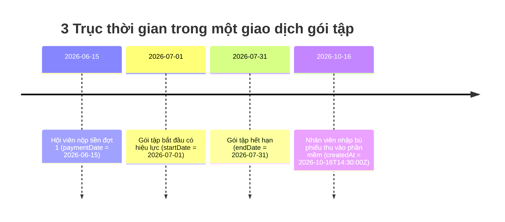
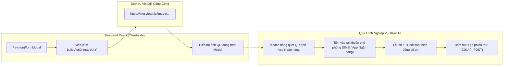

# Trục thời gian tài chính, đối soát doanh thu và ma trận kiểm thử

## 1. Ba Trục Thời Gian Độc Lập Trong Quản Lý Tài Chính

Một trong những sai lầm phổ biến nhất của lập trình viên mới là đồng nhất ngày ghi nhận dòng tiền với thời hạn thẻ tập hoặc ngày tạo bản ghi. Trong phòng gym Dương Double, hệ thống phân định rõ ràng **3 trục thời gian hoàn toàn độc lập**:



| Trục Thời Gian | Thuộc Tính / Thực Thể | Ý Nghĩa Nghiệp Vụ & Kế Toán |
| :--- | :--- | :--- |
| **1. Thời hạn gói tập** | `MemberMembership.startDate`<br/>`MemberMembership.endDate` | Xác định **Quyền lợi tập luyện** của hội viên. Được lễ tân và cổng soát vé kiểm tra để cho phép hội viên vào phòng gym hoặc đặt lịch tập với PT. |
| **2. Ngày thu tiền thực tế** | `Payment.paymentDate` | Xác định **Dòng tiền thực thu (Cash Flow)**. Dùng để tính toán doanh thu kế toán theo tháng/năm. Tiền thu vào tháng nào thì ghi nhận doanh thu cho tháng đó. |
| **3. Dấu vết hệ thống (Audit)** | `Payment.createdAt`<br/>(Audited Timestamp) | Thời điểm kỹ thuật câu lệnh SQL `INSERT` được thực thi vào database. Dùng để kiểm toán vết vận hành, không dùng để tính doanh thu. |

### Tình huống thực tế khi nhập bù dữ liệu lịch sử:
> Ngày **16/10/2026**, nhân viên số hóa sổ sách cũ của phòng gym, nhập lại khoản tiền **5.000.000 VNĐ** mà hội viên đã thanh toán vào ngày **15/07/2026**:
> - Trường `paymentDate` bắt buộc phải là **15/07/2026**.
> - Trường `createdAt` sẽ lưu thời điểm máy chủ hiện tại: `2026-10-16T...`.
> - **Nguyên tắc kế toán**: Báo cáo doanh thu tháng 7/2026 sẽ được cộng thêm 5 triệu. Doanh thu tháng 10/2026 hoàn toàn không bị ảnh hưởng. Nếu lập trình viên tính doanh thu theo `createdAt`, báo cáo tài chính tháng 10 sẽ bị thổi phồng sai lệch nghiêm trọng.

---

## 2. Tiện Ích VietQR và Bản Chất Kỹ Thuật

Màn hình lập phiếu thu hỗ trợ tạo mã QR chuyển khoản ngân hàng thông qua VietQR:



### Cơ chế kỹ thuật trong `frontend/src/features/settings/lib/vietQr.ts`:
1. **Chuẩn hóa nội dung chuyển khoản (`normalizeTransferContent`)**:
   - Loại bỏ toàn bộ dấu tiếng Việt (NFD Unicode), chuyển `đ/Đ` thành `d/D`.
   - Loại bỏ các ký tự đặc biệt, chuyển thành chữ in hoa, giới hạn tối đa 90 ký tự.
   - Định dạng cú pháp: `GYMDD [TÊN_HỘI_VIÊN] NO [MÃ_CÔNG_NỢ]` (Ví dụ: `GYMDD NGUYEN VAN KHANH NO 101`).
2. **Tạo URL ảnh VietQR động (`buildVietQrImageUrl`)**:
   ```typescript
   export function buildVietQrImageUrl({ setting, amount, addInfo }: BuildVietQrUrlParams) {
     if (!setting.enabled || !setting.bankCode || !setting.accountNumber || !setting.accountName) return ''
     const params = new URLSearchParams()
     if (amount > 0) params.set('amount', Math.round(amount).toString())
     if (addInfo) params.set('addInfo', addInfo)
     params.set('accountName', setting.accountName)
     return `https://img.vietqr.io/image/${setting.bankCode}-${setting.accountNumber}-${setting.template || 'compact2'}.png?${params.toString()}`
   }
   ```

### ⚠️ Bản chất kiến trúc cần làm rõ khi phỏng vấn:
- **Đây KHÔNG PHẢI là cổng thanh toán tự động qua Webhook/IPN** (như MoMo, VNPay hay Stripe).
- Việc mã QR hiển thị trên màn hình **không chứng minh** tiền đã vào tài khoản.
- Hệ thống hoạt động theo mô hình **Xác nhận thủ công (Manual Confirmation)**: Người vận hành (Chủ phòng/Lễ tân) kiểm tra biến động số dư trên app ngân hàng của mình; khi thấy tiền nổi lên, người vận hành mới bấm nút lưu phiếu thu để backend ghi nhận giao dịch vào DB.

---

## 3. Từ Phiếu Thu Đến Dashboard & Báo Cáo Tài Chính

Mã nguồn tại [`DashboardService.java`](../../../backend/src/main/java/com/gymduongdouble/backend/dashboard/service/DashboardService.java) điều phối việc tính toán các chỉ số tài chính phục vụ quản trị phòng gym:

### A. Tính toán doanh thu thực thu (`revenueBetween`):
```java
// backend/src/main/java/com/gymduongdouble/backend/finance/repository/PaymentRepository.java
@Query("select coalesce(sum(payment.amount), 0) from Payment payment where payment.paymentDate between :startDate and :endDate")
BigDecimal sumAmountByPaymentDateBetween(
    @Param("startDate") LocalDate startDate,
    @Param("endDate") LocalDate endDate
);
```
- **Hàm `coalesce(..., 0)`**: Đảm bảo nếu trong kỳ không phát sinh phiếu thu nào, câu truy vấn SQL trả về `0` thay vì `NULL`, bảo vệ backend khỏi lỗi `NullPointerException` khi tính toán số học.
- **Tính theo `paymentDate`**: Doanh thu chỉ được cộng khi tiền đã thực thu theo ngày ghi nhận của phiếu thu.

### B. "Doanh thu thực thu" vs "Lợi nhuận":
- Hệ thống phòng gym Dương Double hiện tại chỉ quản lý **Dòng tiền vào (Cash Inflow)** từ các gói tập và dịch vụ.
- Hệ thống **chưa quản lý Dòng tiền ra (Chi phí vận hành / Cash Outflow)** như tiền thuê mặt bằng, điện nước, lương cứng và hoa hồng PT, bảo trì máy tập.
- Do đó, số liệu trên Dashboard được định nghĩa chuẩn xác là **Doanh Thu Thuần Thực Thu (Gross Cash Revenue)**, tuyệt đối không được gọi là "Lợi Nhuận (Net Profit)".

### C. Cơ chế cảnh báo công nợ (`openDebts`):
```java
private List<DebtRecord> openDebts() {
    return debtRecordRepository.findByStatusInOrderByDueDateAsc(
        List.of(DebtStatus.OPEN, DebtStatus.PARTIALLY_PAID)
    ).stream()
    .filter(debt -> debt.getRemainingAmount().compareTo(BigDecimal.ZERO) > 0)
    .toList();
}
```
Dashboard tự động quét các khoản nợ chưa tất toán và đẩy vào danh sách thông báo (`NotificationResponse` loại `OPEN_DEBT`), sắp xếp theo hạn chót thanh toán (`dueDate`) tăng dần để lễ tân kịp thời đôn đốc khách trả nợ.

---

## 4. Ma Trận Kịch Bản Kiểm Thử Tài Chính Toàn Diện

Dưới đây là bảng kịch bản kiểm thử (Test Matrix) chi tiết dùng để kiểm tra tính toàn vẹn của module tài chính trước khi bàn giao:

| STT | Tên Kịch Bản Kiểm Thử | Dữ Liệu Đầu Vào (Payload) | Điều Kiện Tiên Quyết | Kết Quả Mong Đợi (Backend & DB) | Mã HTTP |
| :---: | :--- | :--- | :--- | :--- | :---: |
| **TC-01** | Bán gói không thu trước | `payableAmount = 10.000.000`<br/>`initialPaidAmount = 0` | Gói active, hội viên active | Tạo `MemberMembership` nợ 10M.<br/>Tạo `DebtRecord` status `OPEN`.<br/>**Không tạo bản ghi nào trong `payment_transactions`**. Body có `message = CREATED`. | `200` |
| **TC-02** | Bán gói thu trước 1 phần | `payableAmount = 10.000.000`<br/>`initialPaidAmount = 4.000.000`<br/>`initialPaymentMethod = BANK_TRANSFER` | Gói active, hội viên active | Tạo `MemberMembership` đã trả 4M, nợ 6M.<br/>Tạo `DebtRecord` status `PARTIALLY_PAID`, còn nợ 6M.<br/>Tạo 1 `Payment` giá trị 4M. Body có `message = CREATED`. | `200` |
| **TC-03** | Lập phiếu thu nợ lần 2 hoàn tất | `debtRecordId = 101`<br/>`amount = 6.000.000`<br/>`paymentMethod = CASH` | Khoản nợ đang còn nợ 6M | Tạo thêm 1 `Payment` giá trị 6M.<br/>`DebtRecord.remainingAmount = 0`, status chuyển `PAID`.<br/>`MemberMembership.debtAmount = 0`. Body có `message = CREATED`. | `200` |
| **TC-04** | Thu tiền vượt quá số nợ còn lại | `debtRecordId = 101` (còn nợ 6M)<br/>`amount = 7.000.000` | Nợ còn 6M | Backend ném `BadRequestException`: *"Số tiền thu không được lớn hơn số tiền còn nợ."*<br/>Không sinh phiếu thu, dữ liệu nợ giữ nguyên. | `400` |
| **TC-05** | Thu tiền cho khoản nợ đã thanh toán đủ | `debtRecordId = 101`<br/>`amount = 1.000.000` | Khoản nợ đã có status `PAID` | Backend ném `BadRequestException`: *"Khoản công nợ đã được thanh toán đủ."* | `400` |
| **TC-06** | Nhánh phòng vệ: request thu khoản nợ đã hủy | `debtRecordId = 102`<br/>`amount = 500.000` | Một bản ghi test đã có status `CANCELLED` | Backend ném `BadRequestException`: *"Khoản công nợ đã bị hủy."* | `400` |
| **TC-07** | Lập phiếu thu ghi ngày ở tương lai | `paymentDate = [Ngày mai]`<br/>`amount = 1.000.000` | Nợ hợp lệ | Backend ném `BadRequestException`: *"Ngày lập phiếu thu không được ở tương lai."* | `400` |
| **TC-08** | Lập phiếu thu nợ của khách hàng khác (IDOR) | `memberId = 2` (Hội viên B)<br/>`debtRecordId = 101` (Nợ của Hội viên A) | Cả 2 hội viên đều active | Backend ném `BadRequestException`: *"Khoản công nợ không thuộc khách hàng này."* | `400` |
| **TC-09** | Xung đột đồng thời (Optimistic Lock) | 2 Request cùng gửi thu nợ cho `debtRecordId = 101` tại cùng một thời điểm | `version = 0` | Request 1 thành công (version lên 1).<br/>Request 2 ném `ObjectOptimisticLockingFailureException`.<br/>`error.code = CONCURRENT_UPDATE`; message: *"Dữ liệu vừa được cập nhật bởi thao tác khác. Vui lòng tải lại và thử lại."* | `409` |

> **Lưu ý khi chạy ma trận:** TC-06 kiểm tra nhánh phòng vệ trong
> `PaymentService.validateDebtRecord`, không phải luồng thao tác giao diện. Scope
> hiện tại chưa có API/UI hủy công nợ, vì vậy không được tự sửa database production
> chỉ để tạo dữ liệu test. Có thể kiểm tra nhánh này bằng unit/integration test cô lập
> hoặc dữ liệu seed test có chủ đích.

---

## 5. Bộ Câu Hỏi Phản Biện & Phỏng Vấn Backend Intern

### Câu hỏi 1: Tại sao ngày lập phiếu thu (`paymentDate`) không cho phép chọn ngày ở tương lai, trong khi ngày bắt đầu gói tập (`startDate`) lại được phép ở tương lai?
> **Đáp án chuẩn:**
> - `startDate` của gói tập là **quy ước về quyền lợi dịch vụ**: Khách hàng hoàn toàn có thể mua thẻ tập hôm nay để kích hoạt sử dụng vào đầu tháng sau (đăng ký trước hoặc gia hạn sớm).
> - `paymentDate` là **chứng từ kế toán phản ánh dòng tiền thực nhập**: Phiếu thu là bằng chứng chứng minh tiền đã vào tài khoản hoặc két sắt phòng gym. Bạn không thể lập chứng từ xác nhận rằng "tôi đã nhận được tiền" cho một thời điểm trong tương lai chưa xảy ra. Quy tắc này đảm bảo tính trung thực và ngăn chặn gian lận sổ quỹ kế toán.

### Câu hỏi 2: Trong phương thức `sumAmountByPaymentDateBetween`, tại sao lại dùng hàm `coalesce` trong câu lệnh JPQL?
> **Đáp án chuẩn:**
> Trong chuẩn SQL và JPQL, nếu bảng không có bản ghi nào thỏa mãn điều kiện `WHERE`, hàm tổng hợp `SUM(column)` sẽ trả về giá trị `NULL`.
> - Nếu không dùng `coalesce`, Spring Data JPA sẽ ánh xạ kết quả thành `null`, dẫn đến lỗi `NullPointerException` khi gán vào `BigDecimal` hoặc khi thực hiện các phép cộng trừ trên Dashboard.
> - Cú pháp `coalesce(sum(payment.amount), 0)` quy định: nếu tổng là `NULL`, câu truy vấn sẽ tự động thế giá trị `0` vào, giúp code backend luôn nhận về một giá trị `BigDecimal` hợp lệ, an toàn 100%.

### Câu hỏi 3: Hệ thống làm thế nào để đảm bảo một nhân viên PT không thể tạo phiếu thu tiền cho hội viên của một PT khác?
> **Đáp án chuẩn:**
> Thông qua kiểm soát phân quyền ở tầng dữ liệu (Data-level Authorization) tại đầu phương thức `PaymentService.create()`:
> ```java
> memberAccessService.ensureCanAccessMember(request.memberId());
> ```
> Khi request gửi lên:
> 1. Nếu người đăng nhập là `OWNER`: Phương thức trả về `true` (toàn quyền).
> 2. Nếu người đăng nhập là `PT`: `MemberAccessService` phối hợp `PtAssignmentPolicy` kiểm tra hội viên `ACTIVE`, có gói PT hiệu lực phù hợp với PT, và có phân công hiệu lực cho PT đó; nhánh đặc biệt chỉ áp dụng khi khách PT **chưa từng có bản ghi phân công** và gói chưa gắn PT khác. Khách tự tập hoặc khách chỉ có lịch sử phân công hết hạn không được phép.
> 3. Nếu hội viên đã được phân công cho một PT khác, phương thức ném ngay ngoại lệ `AccessDeniedException` (HTTP 403), ngăn chặn hành vi can thiệp trái phép.

### Câu hỏi 4: Khách hàng quét mã VietQR và tiền đã trừ trong tài khoản ngân hàng của khách, nhưng nhân viên chưa bấm "Lập phiếu thu" trên phần mềm thì hệ thống ghi nhận trạng thái như thế nào?
> **Đáp án chuẩn:**
> Vì hệ thống phòng gym Dương Double chưa tích hợp webhook tự động với ngân hàng:
> - Cho đến khi nhân viên bấm "Lập phiếu thu" trên phần mềm, hệ thống vẫn coi như khoản nợ đó **chưa được thanh toán** (trạng thái `DebtRecord` vẫn là `OPEN` hoặc `PARTIALLY_PAID`).
> - Số tiền đó **chưa được ghi nhận vào báo cáo doanh thu** của phòng gym.
> - Đây là đặc điểm của mô hình vận hành xác nhận thủ công: sự đồng bộ giữa số dư ngân hàng và dữ liệu phần mềm phụ thuộc vào thao tác đối soát của người vận hành.
