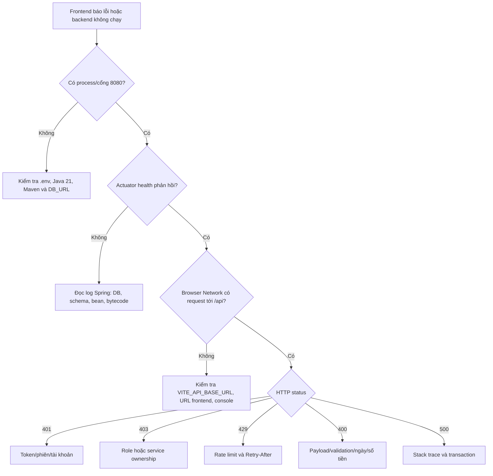

# Khởi động local và đọc lỗi thường gặp

## 1. Cấu hình và khởi động backend

[`backend/pom.xml`](../../../backend/pom.xml) khai báo Java 21, Spring Boot, Maven dependencies cho web, JPA, security, validation, PostgreSQL và test. [`application.yml`](../../../backend/src/main/resources/application.yml) chọn profile dev mặc định, port 8080, context `/api`, datasource từ biến môi trường và Flyway tắt.

Từ thư mục gốc, chạy `.\run-backend.bat`. File này chuyển vào thư mục `backend`, gọi [`run-backend.ps1`](../../../backend/run-backend.ps1); script đọc `.env` ở thư mục gốc và chỉ đặt biến process nếu biến tương ứng chưa có. Script yêu cầu `DB_PASSWORD`, `JWT_SECRET`, `OWNER_PASSWORD`; không chép giá trị thật vào Git hay báo cáo. Điều này giải thích vì sao chạy Maven trực tiếp trong một terminal mới có thể không có cấu hình tương đương script.

Database PostgreSQL phải có sẵn và kết nối hợp lệ. Script không phải backup, cũng không phải migration Flyway. Không xóa database để xử lý lỗi khởi động thông thường.

## 2. Health và cổng

Khi service báo đã start, kiểm tra endpoint health đã cấu hình, chẳng hạn `http://localhost:8080/api/actuator/health`. Nếu báo `Port 8080 was already in use`, tìm process đang nghe cổng bằng PowerShell:

```powershell
Get-NetTCPConnection -LocalPort 8080 -State Listen |
  Select-Object LocalAddress, LocalPort, OwningProcess
```

Sau đó kiểm tra đúng process và chỉ dừng process nếu biết đó là instance mình muốn dừng; không tự động kết thúc process không rõ. Nếu backend của dự án đã chạy, không khởi động một instance khác cùng cổng. Nếu đổi cổng, frontend API base URL cũng phải được cấu hình khớp.

## 3. Lỗi class được biên dịch và database

`ClassFormatError` ở file `.class` trong `target` có thể là file build lỗi/hỏng; đọc stack trace và xác nhận class/path. Nếu cần build lại sạch, dừng những tiến trình backend đang dùng cùng output, sau đó dùng Maven clean/test phù hợp. `clean` xóa output build của Maven, không xóa database; vẫn phải kiểm tra lệnh và thư mục làm việc trước khi chạy.

Lỗi kết nối database cần kiểm tra service PostgreSQL, URL, database, username/password và biến môi trường đang thực sự được process nhận. Lỗi authentication database không giống lỗi cổng backend bận. Tránh đăng nguyên log có secret lên chat hoặc issue.

## 4. Frontend

Trong `frontend`, dùng `npm install` khi cần cài dependency và `npm run dev` để chạy Vite; xem URL/cổng thực tế trong terminal. `VITE_API_BASE_URL` được [`apiClient.ts`](../../../frontend/src/shared/api/apiClient.ts) dùng nếu cấu hình; mặc định là `http://localhost:8080/api`. CORS backend phải cho phép origin frontend tương ứng. Chỉ chạy local không có nghĩa đã triển khai production.

## 5. Đọc log theo nguyên nhân, không chỉ dòng cuối

Ví dụ log `Port 8080 was already in use`: JVM có thể đã kết nối database và khởi tạo JPA nhưng không bind được cổng web. Kiểm tra process đang nghe cổng, xác định có phải backend đã chạy hay chương trình khác trước khi dừng. Không tùy tiện tắt process không biết chủ sở hữu. Cấu hình cổng khác chỉ có tác dụng khi frontend/CORS cũng trỏ đúng cổng.

Ví dụ `ClassFormatError` với file trong `target/classes`: đây là lỗi bytecode runtime không đọc được, không tự chứng minh entity Java hay PostgreSQL bị sai. Kiểm tra môi trường Java, quá trình build; có thể biên dịch lại sạch output Maven sau khi bảo đảm không có build khác đang dùng, rồi chạy lại. Maven clean xóa output build, không phải thao tác xóa database, nhưng vẫn cần đọc lệnh và chạy đúng thư mục.

## 6. Chuỗi chẩn đoán lỗi đăng nhập local

1. Backend có log khởi động hoàn tất và cổng lắng nghe chưa? Xác nhận process trước khi khởi động bản thứ hai.
2. Frontend gọi đúng base URL `/api` và origin được backend cho phép không? Kiểm tra Network, không công bố token.
3. PostgreSQL chạy và biến kết nối trỏ đúng database dev không? Không chép `.env` hoặc mật khẩu vào ảnh/log báo cáo.
4. Response là 401, 403, 429 hay lỗi mạng? 429 có thể là bộ đếm trong RAM, không đồng nghĩa sai schema database.
5. Xem stack trace ở server, ghép request với exception, chỉ thay đổi cấu hình sau khi xác định nguyên nhân.

Không cần xóa database để chữa lỗi chiếm cổng hay bytecode. Sao lưu và kiểm tra mục tiêu trước mọi thao tác tác động dữ liệu.

## 7. Hai script khởi động và các biến bắt buộc

Ở root có `run-backend.bat` và `run-frontend.bat`. Batch backend đổi thư mục sang `backend` rồi gọi `run-backend.ps1`; PowerShell script đọc `.env` ở root nếu có, chỉ đưa một biến vào process khi biến môi trường chưa được đặt trước đó. Sau đó script yêu cầu tối thiểu `DB_PASSWORD`, `JWT_SECRET`, `OWNER_PASSWORD`; thiếu một trong ba thì dừng với thông báo rõ thay vì cố chạy bằng secret rỗng. Các giá trị khác có default cục bộ như JDBC URL, user `postgres`, JWT 120 phút và email owner demo.

`run-frontend.bat` đổi sang `frontend` rồi chạy `npm run dev`; Vite được cấu hình cổng 5173. Frontend gọi `VITE_API_BASE_URL` nếu có, nếu không thì dùng `http://localhost:8080/api`. Backend dùng context path `/api` và mặc định cổng 8080. Vì vậy URL cần kiểm tra khi local là:

```text
Frontend: http://localhost:5173
Backend health: http://localhost:8080/api/actuator/health
Backend API prefix: http://localhost:8080/api/v1
```

Không commit `.env` có password, JWT secret hoặc Groq keys. Cũng không đưa giá trị thật vào ảnh chụp/log gửi mentor.

## 8. Cấu hình database, Hibernate và Flyway hiện tại

`application.yml` dùng PostgreSQL, `spring.jpa.hibernate.ddl-auto: update`, `open-in-view: false`, timezone Hibernate `Asia/Ho_Chi_Minh` và profile mặc định `dev`. Flyway dependency và location `classpath:db/migration` đã được chuẩn bị, nhưng `spring.flyway.enabled: false` hiện tắt. Nghĩa là ở local hiện tại Hibernate update mapping; Flyway chưa thực thi migration. Không mô tả sai rằng mỗi lần chạy app đang migration database qua Flyway.

Giữ Flyway là định hướng mở rộng hợp lý: khi schema ổn định và cần cập nhật môi trường có dữ liệu, đội dự án có thể đưa các migration versioned vào `db/migration`, bật cấu hình theo kế hoạch và kiểm thử migrate/rollback. Trước khi bật, phải có migration khớp schema hiện hữu và backup; không chỉ chuyển `enabled=true` trên một database bất kỳ.

## 9. Cây quyết định chẩn đoán local



Với `port 8080 already in use`, tìm process đang lắng nghe trước. Có thể đó là backend đã chạy thành công từ terminal khác; chạy bản thứ hai sẽ thất bại nhưng không làm server thứ nhất hỏng. Với `ClassFormatError` trong `target/classes`, ưu tiên kiểm tra compiler/Java/output build và biên dịch lại output; đó không phải lý do mặc định để drop PostgreSQL.

## 10. Cách dùng Maven/NPM mà không tự làm mất dữ liệu

Các lệnh build/test đọc source và tạo output trong `target` hoặc `dist`; chúng không phải lệnh xóa database. `mvnw.cmd clean` xóa `backend/target` (bytecode/build artifacts), không xóa schema/data PostgreSQL. Tuy vậy `ddl-auto:update`, seed và cấu hình môi trường vẫn có thể ảnh hưởng database nếu bạn chạy app trỏ nhầm DB; luôn kiểm tra `DB_URL` trước khi chạy.

Với frontend, `npm run lint`, `npm test`, `npm run build` kiểm tra source/build artifacts. `npm run dev` là server phát triển, không phải production deployment. Nếu cần thay cổng, chỉnh Vite/biến môi trường và cả `app.cors.allowed-origins` backend cho phù hợp; chỉ đổi một phía sẽ tạo lỗi CORS khó hiểu.
